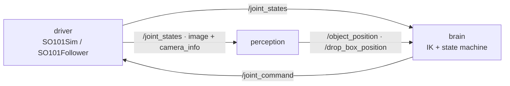

# SO-ARM101 — autonomous pick & place (ROS 2 · MuJoCo · real arm)

[](https://github.com/FoxaxeWasTaken/Robotics/actions/workflows/ci.yml)

A camera spots a red cube, the SO-ARM101 arm grasps it and drops it into a box — in MuJoCo simulation, then on the real robot — with a ROS 2 stack written by the team.

<!-- Replace with a 5–10 s GIF (≤ 5 MB) or a clickable thumbnail linking to the video -->
**Demo (30 s)**: [sim + real arm video](https://example.com/demo)

## What it does (target)

- **Perception**: HSV detection of the cube and the box, pixel → 3D, **in-house ArUco extrinsic calibration**.
- **Kinematics**: FK/IK (ikpy), minimal-tilt grasping, minimum-jerk trajectories.
- **Decision**: explicit, non-blocking state machine with grasp and drop verification.
- **Sim ↔ real**: a single parameter, `use_sim`.
- **Phase 2**: play Connect Four against the arm: it reads the grid with its camera and drops its own tokens ([design](docs/project/phase2/README.md)).

## Status (2026-10-16)

| Done | Next (see [roadmap](docs/project/09_roadmap_step_by_step.md)) |
| --- | --- |
| Environment (Docker images, X11, DDS, usbipd); `so101_common` (joint names, limits, gripper conversion, checked against the URDF); `so101_bringup` (`sim.launch.py`, parameter files, RViz file); base driver in sim: `/joint_states` at 30 Hz, `/joint_command`, speed limiter, camera at 10 Hz in its own thread, `camera_info`, joint-limit clamp and NaN rejection, parameters, normalized effort | Driver: sim services `/sim/randomize` and ground truth for the bench (stage 1) |
| CI, hooks, governance files, full design docs with measured spikes | Brain: FK/IK, trajectories, grasp planner, state machine (stages 2 and 4) |
| A bootstrap prototype proved the driver (30 Hz) and the IK (0.13 mm); it stays outside this repository ([ADR-039](docs/project/adr/ADR-039-start-from-course-stubs.md)) | Perception and our ArUco calibration (stage 3), then the real arm (stage 6) |
| Phase 2 chosen and validated by the teaching staff: Connect Four ([docs/project/phase2](docs/project/phase2/README.md), [roadmap](docs/project/phase2/P2-04_roadmap.md)) | Phase 2: measure a store-bought grid, then the drop spike |

New here? Start with [docs/project/README.md](docs/project/README.md).

## Quickstart (simulation)

The driver moves the sim arm; the brain is still the course stub (stage 2).

```bash
cp docker/.env.example docker/.env
cd docker && docker compose build            # ~10 min the first time
xhost +local:docker                          # X11 for RViz (Linux / WSLg)
docker compose up -d control perception viz  # perception stays idle until roadmap step 3.1
docker compose logs -f control               # wait for "Driver node ready." and "Brain node ready." then Ctrl-C
docker compose exec control bash -lc "source /ros2_ws/install/setup.bash && ros2 node list --no-daemon --spin-time 3"  # /so101_brain /so101_driver
docker compose down
```

A command moves the sim arm: `ros2 topic pub --once -w 1 --keep-alive 1 /joint_command sensor_msgs/msg/JointState '{name: [shoulder_pan], position: [0.5]}'`. Why `-w 1 --keep-alive 1`? A plain `--once` (as in the course slides) exits before DDS delivers the message: measured 0/8 applied, vs 8/8 with these options ([runbook](docs/project/13_runbook_troubleshooting.md)). After step 2.1, `/go_to_target` reaches a position; after step 4.2, `ros2 service call /brain/start std_srvs/srv/Trigger` runs a full pick & place.

Real arm: see [docs/project/07](docs/project/07_real_arm_safety_sim2real.md) — **read the safety checklist first**.

## Architecture



Details: [docs/project/01](docs/project/01_architecture.md).

## Measured results

| Metric | Sim | Real |
| --- | --- | --- |
| Pick & place success (randomized cube + box) | xx / 50 | x / 10 |
| TCP accuracy (measured) | x mm | x mm |
| Object localization error | x mm | x mm |

Reports: [`results/`](results/).

## Repository layout

| Folder | Content |
| --- | --- |
| `ros2_ws/src/` | ROS 2 packages: `so101_driver`, `so101_perception`, `so101_brain`, `so101_common`, `so101_bringup` (launch, parameters, RViz file) |
| `docker/` | Images and compose (`control`, `perception`, `viz`) |
| `docs/project/` | Design, decisions (ADRs), roadmap, measurements |
| `core/`, `sim/`, `so101_description/` | Course kit (unmodified) |

## Contributing

See [CONTRIBUTING.md](CONTRIBUTING.md). Planned work and progress: the team's GitHub Project (PR-sized tickets, [conventions](docs/project/15_repository_hygiene.md#12-planning-the-github-project)).

## Team

| Member | Main role |
| --- | --- |
| … | Driver, infrastructure, hardware |
| … | Kinematics, brain |
| … | Perception, calibration |

## Acknowledgements and license

TEK5 Robotics module kit (Epitech). Driver extracted from [LeRobot](https://github.com/huggingface/lerobot) (Apache-2.0). License of the team's code: see `LICENSE` (to be decided, ADR-031).
