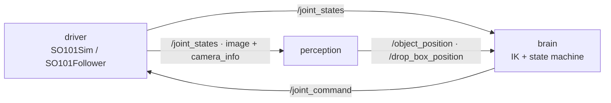

# SO-ARM101 — autonomous pick & place (ROS 2 · MuJoCo · real arm)

[](https://github.com/FoxaxeWasTaken/Robotics/actions/workflows/nightly.yml) · [Latest bench results](https://github.com/FoxaxeWasTaken/Robotics/issues?q=is%3Aissue+in%3Atitle+%22Nightly+bench+results%22)

A camera spots a red cube, the SO-ARM101 arm grasps it and drops it into a box — in MuJoCo simulation, then on the real robot — with a ROS 2 stack written by the team.


*One randomized cycle in simulation, 2× speed: the scene camera with perception's detections (`/perception/debug_image`) and the brain's state, from `WAIT_TARGET` to the cube in the box. RViz shows the same cycle in 3D ([What RViz shows](#what-rviz-shows)).*

## What it does today

- **In simulation, the whole cycle runs on its own.** `/brain/start` parks the arm out of the camera's view. Perception then locates the cube and the box: HSV detection, pixel → 3D, median filter, cube yaw. The brain plans a grasp, approaches, grasps, checks the grip, carries the cube, drops it, checks it is in the box, and comes back to rest.
- **The real arm**: the driver is ready (speed limits, slow park before the torque is cut, stop on a lost serial bus, the USB webcam, the real-arm parameters, the joint zeros corrected). Commissioning started on 2026-10-30: tests 1 to 3 of `07` §3.2 passed, the shutdown move checked from the far side; the camera calibration and the grasp come next (stage 6).
- **Sim ↔ real**: `USE_SIM` in `docker/.env`, plus a few documented values ([`01` §3.3](docs/project/01_architecture.md)).
- **Phase 2** (planned): play Connect Four against the arm, which reads the grid with its camera and drops its own tokens ([design](docs/project/phase2/README.md)).

## Status (2026-10-30)

| Done | Next (see [roadmap](docs/project/09_roadmap_step_by_step.md)) |
| --- | --- |
| Environment (Docker images, X11, DDS, usbipd), CI, hooks, design docs with measured spikes; the phase-1 sim criterion met on our calibration, 50/50 (4.5b, C-42) | Release v1.0.0, the simulation milestone (5.3a, #63) |
| Driver: `/joint_states` at 30 Hz, `/joint_command`, speed limiter, joint-limit clamp, camera at 10 Hz with `camera_info`, `/sim/randomize`, ground truth for the bench only; real-arm safety and webcam; a warning for each late tick, a clean stop on SIGINT (#158, #176) | The real arm: commissioning (6.1b), camera and grasp calibration (6.2b–6.4), 10 real trials (6.5a) |
| Perception: HSV detection that holds under a dim, warm light, pixel → 3D, median filter, cube yaw, `/object_position` and `/drop_box_position`, debug image, our ArUco extrinsic calibration and the camera TF; a cube cut by the image edge or partly hidden is not published (3.4b–c, 3.5c, MES-47, MES-52, MES-53) | The nightly's trends and SonarQube Cloud: recorded each night since #174; they close with two nightlies of values and the SonarQube decision of `14` §4, by 2026-11-10 (5.1d–e, #60, #61) |
| Brain: FK/IK (no self-collision), `/go_to_target`, grasp planner in a worker process, the full state machine, markers in RViz; grasp verification and retries checked on fault scenarios, effort threshold measured (4.4a, MES-48) | The shared-understanding session (5.2a, #62) |
| Evaluation bench, E2E on every PR, nightly 50-episode bench with its report, and the nightly's quality job: coverage, trends, the SonarQube Cloud gate (#174, #179); the robustness demo, the five cases of the slides handled (5.4a, #103, #175); `tools/so101` for the everyday commands; this README replayed by a member from a fresh clone, quickstart and demo in about 12 min (5.1b) | Phase 2: the store-bought grid measured, then the drop spike (P2.1, #75, #76) |

## Measured results (sim)

| Metric | Result | Source |
| --- | --- | --- |
| Pick & place, real perception, randomized cube and box | Each night `main` changes, 50 episodes: [latest results](https://github.com/FoxaxeWasTaken/Robotics/issues?q=is%3Aissue+in%3Atitle+%22Nightly+bench+results%22). Since the sim camera moved (#47), no cube is cut by the image edge any more (21 % were): 50/50 on the nightly's scenes in a local bench | MES-45, MES-46, [`08` §2](docs/project/08_quality_tests.md) |
| Full cycle with the ground truth in place of perception | 20/20 in the box, cycle median 14.6 s | MES-40 |
| Grasp chain in closed loop (IK, planner, min-jerk) | 40/40 in the box | MES-38 |
| IK accuracy in closed loop (`/go_to_target` on 20 targets, MuJoCo's TCP against the target) | mean 0.161 mm, max 0.218 mm | MES-43 |
| Cube localization on the table plane (exact camera pose) | mean 0.50 mm, max 1.00 mm | MES-41 |
| Robustness, the five questions of the slides | All five handled: the cube moved mid-action, failed grasps, perception lost, a target out of reach, a dim, warm light (5/5 cycles in each of 2 runs; 0/5 before #175) | [`results/robustness_demo.md`](results/robustness_demo.md), MES-49, MES-52 |

On the real arm: nothing measured yet (stage 6). Measurements and how to reproduce them: [`11` §4](docs/project/11_cross_review_and_measurements.md); milestone reports in [`results/`](results/).

## Prerequisites

- **A Linux host** (x86_64) with **Docker**: Docker Engine with the Compose v2 plugin, or Docker Desktop. About 8 GB of disk for the two images (control 4.2 GB, perception 2.9 GB), plus Docker's build cache, which grew to 16 GB on a member's machine: `docker builder prune` empties it (every project's cache; the next builds are slower). With Docker Desktop on Windows, that disk is on `C:`.
- **An X server on the host for RViz**: X11, or Wayland with XWayland.
- **git**, and **pre-commit** to contribute ([CONTRIBUTING §1](CONTRIBUTING.md#1-setup-once)).
- **Real arm only**: the arm's serial port (`/dev/ttyACM*`) and the USB webcam (`/dev/video*`) visible on the host; compose passes them to the control container.
- **On Windows**: all of the above inside WSL2, a Linux distribution, with Docker Desktop's WSL integration. WSLg is the X server, and the USB devices reach WSL2 through usbipd ([`02` §5](docs/project/02_environment_infrastructure.md#5-usb-hardware-under-wsl2-arm-and-camera)).

**Tested on** Windows with WSL2 (Ubuntu 24.04), Docker Desktop and WSLg ([`02` §1](docs/project/02_environment_infrastructure.md#1-reference-workstation-validated-on-2026-10-08)); the CI on GitHub's Ubuntu 24.04 runners (native Linux, headless, no USB). A native Linux host needs no usbipd; the team has not run the stack on one yet.

## Quickstart (simulation)

From the repository root, on a host with the prerequisites (full setup: [`02`](docs/project/02_environment_infrastructure.md)):

```bash
cp docker/.env.example docker/.env           # ROS_DOMAIN_ID=69, the team's value
tools/so101 build                            # the images, ~10 min the first time
xhost +local:docker                          # let the containers open windows on your X server (RViz)
tools/so101 up                               # control, perception, viz
tools/so101 logs                             # wait for "Driver node ready." and "Brain node ready.", then Ctrl-C
tools/so101 rviz                             # the arm, the camera, the detections; it keeps this terminal: the rest in another
tools/so101 cycle                            # one full pick & place: the states until DONE
tools/so101 down
```

`tools/so101` prints each `docker compose` command it runs; `--dry-run` only prints it, `--help` lists them all. Real arm: read [`07`](docs/project/07_real_arm_safety_sim2real.md) first, its safety checklist above all.

## Demo

```bash
tools/so101 up
tools/so101 rviz                             # RViz keeps this terminal: the next commands in a second one
tools/so101 cycle                            # randomize the cube and the box, then a full cycle
tools/so101 bench --perception -n 10         # the evaluation bench: 10 episodes, success rate and durations
```

The bench starts its own driver, brain and perception on ROS domain 77 (below), runs the episodes, prints one line per episode as it ends (about 15 s each; the first one also waits for the stack to start) and the summary, then stops them. Ctrl-C stops the bench and its stack. The CSV is in `ros2_ws/eval_bench.csv`; `--bags /ros2_ws/bags` keeps a rosbag of each failed episode in `ros2_ws/bags/`.

## Test the project

```bash
tools/so101 test                             # all our packages: build, colcon test (each on its own free ROS domain)
tools/so101 test so101_brain -k fsm          # one package; the options go to pytest: the fast loop on one test
sudo apt install pre-commit                  # once (Ubuntu; or pipx install pre-commit: plain pip is refused)
pre-commit run --all-files                   # host: lint, format, shellcheck, workflow checks, the scripts' tests
bash tools/ci/guards.sh                      # host: the project rules (no ground truth in the pipeline, …)
tools/so101 bench --stub -n 10               # driver and brain alone: the ground truth in place of perception
tools/so101 bench --perception -n 10         # the real pipeline
```

- The packages: `so101_common`, `so101_driver`, `so101_brain`, `so101_perception`, `so101_bringup` (the sim-backed tests: closed loop, IK accuracy, launch files).
- `tools/so101 test` runs in a new control container: the stack need not run. For a full run, stop it first (`tools/so101 down`): the grasp planner's timing tests (p95 under 1 s) fail when the simulation shares the CPU.
- **Every PR** runs lint, the guards, the build and tests of both images, and a 3-episode E2E bench (a draft or a docs-only change: lint and guards only). The nightly runs 50 episodes each night `main` changes.
- Code quality: [SonarQube Cloud](https://sonarcloud.io/project/overview?id=FoxaxeWasTaken_Robotics), `main` analyzed each night it changes, on trial until 2026-11-10 (`14` §4; members of the SonarCloud organization only).
- Test strategy, thresholds and the bench: [`08`](docs/project/08_quality_tests.md); CI: [`14`](docs/project/14_quality_pipeline_ci.md); how to write tests: [CONTRIBUTING §5](CONTRIBUTING.md#5-tests).

## ROS domains

| Domain | Who | Why |
| --- | --- | --- |
| 69 (`docker/.env`) | The everyday stack: driver, brain, perception, RViz | The team's value |
| 77 | `tools/so101 bench` | Its own driver publishes the ground truth that scores the bench |
| Free, picked per package | `colcon test` (colcon-ros-domain-id-coordinator) | Tests never talk to a running stack |

The ground truth (`/sim/ground_truth/*`) is published only by a driver started with `expose_ground_truth:=true`, which only the bench and the CI's E2E jobs do (C-06). On domain 77, it never reaches the everyday stack: perception and the brain on 69 cannot use it, even by mistake. The bench refuses to start when a stack already runs on 77.

## What RViz shows

- **The camera image** (`/external_cam/image_raw`) and **the perception debug image** (`/perception/debug_image`):
  - the cube's pixels in green, the box's in blue;
  - a red cross on each centroid;
  - the cube's status in the top-left corner: `OK`, `TRUNCATED` (cut by the image edge, not published), `OCCLUDED` (partly hidden by the arm or the box, not published) or `LOST`.
- **The 3D view**:
  - the arm and its TF;
  - the TCP pose (`/end_effector_pose`), the cube and box poses;
  - the brain's markers (`/brain/markers`): pre-grasp in yellow, grasp in green, drop in blue, the approach arrow (display "Brain targets");
  - the locked cube, a red 5 cm cube from `APPROACH` until it is lifted, in its own display "Cube (locked)": untick it to hide the cube.
- **The large red translucent block is the drop box** (the course's marker), not the cube.

## Common problems

| Symptom | Fix |
| --- | --- |
| `ros2 topic pub --once …` has no effect | The CLI exits before delivery: `--once -w 1 --keep-alive 1` ([`13` §2](docs/project/13_runbook_troubleshooting.md#2-troubleshooting)) |
| RViz: "could not connect to display" | `xhost +local:docker` on the host ([`13` §2](docs/project/13_runbook_troubleshooting.md#2-troubleshooting)) |
| `colcon`: "Permission denied" on `build/` or `install/` | Files made by root in the container: delete them from inside it ([`13` §2](docs/project/13_runbook_troubleshooting.md#2-troubleshooting)) |

## Architecture



Details: [`01`](docs/project/01_architecture.md). All the design docs: [docs/project/README.md](docs/project/README.md).

## Repository layout

| Folder | Content |
| --- | --- |
| `ros2_ws/src/` | ROS 2 packages: `so101_driver`, `so101_perception`, `so101_brain`, `so101_common`, `so101_bringup` (launch files, parameters, RViz file, the bench) |
| `docker/` | Images and compose (`control`, `perception`, `viz`) |
| `tools/` | `so101` (everyday commands), `ci/` (the CI scripts and their tests) |
| `docs/project/` | Design, decisions (ADRs), roadmap, measurements |
| `results/` | Milestone reports: the 50-episode bench, the calibration, the IK accuracy, the robustness demo |
| `core/`, `sim/`, `so101_description/` | Course kit (unmodified) |

## Contributing

See [CONTRIBUTING.md](CONTRIBUTING.md). Planned work and progress: the team's GitHub Project (PR-sized tickets, [conventions](docs/project/15_repository_hygiene.md#12-planning-the-github-project)).

## Team

| | Member | Lane |
| --- | --- | --- |
|  | [@FoxaxeWasTaken](https://github.com/FoxaxeWasTaken) | A: driver, infrastructure, hardware |
|  | [@SamuelValentin974](https://github.com/SamuelValentin974) | B: kinematics, brain |
|  | [@Hasnain-Pyarali](https://github.com/Hasnain-Pyarali) | C: perception, calibration |

The lanes say who knows a part best ([`09` §1.2](docs/project/09_roadmap_step_by_step.md)). `.github/CODEOWNERS` follows them but is indicative: any member may review and approve any PR.

## Links

- The course repository this one comes from (kit, slides, brief): [JasonChmn/content-lerobot-bras-students](https://github.com/JasonChmn/content-lerobot-bras-students), the `upstream` remote ([CONTRIBUTING §7](CONTRIBUTING.md#7-syncing-with-the-course-kit)).
- The design docs: [docs/project/README.md](docs/project/README.md).
- The bootstrap prototype of days 1–2 stays outside this repository ([ADR-039](docs/project/adr/ADR-039-start-from-course-stubs.md)).

## Acknowledgements and license

TEK5 Robotics module kit (Epitech). Driver extracted from [LeRobot](https://github.com/huggingface/lerobot) (Apache-2.0). License of the team's code: see `LICENSE` (to be decided, ADR-031).
