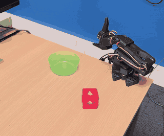
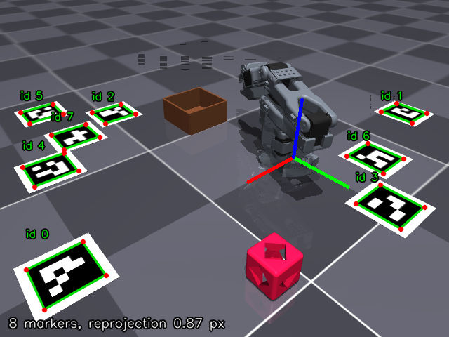
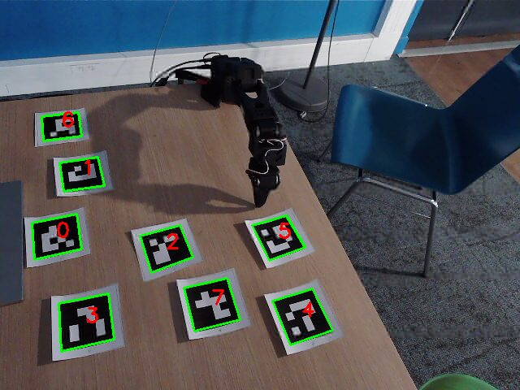
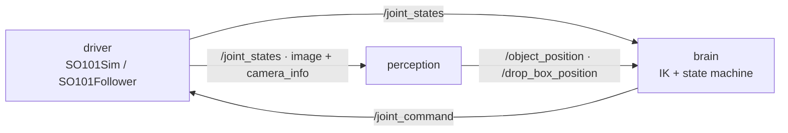
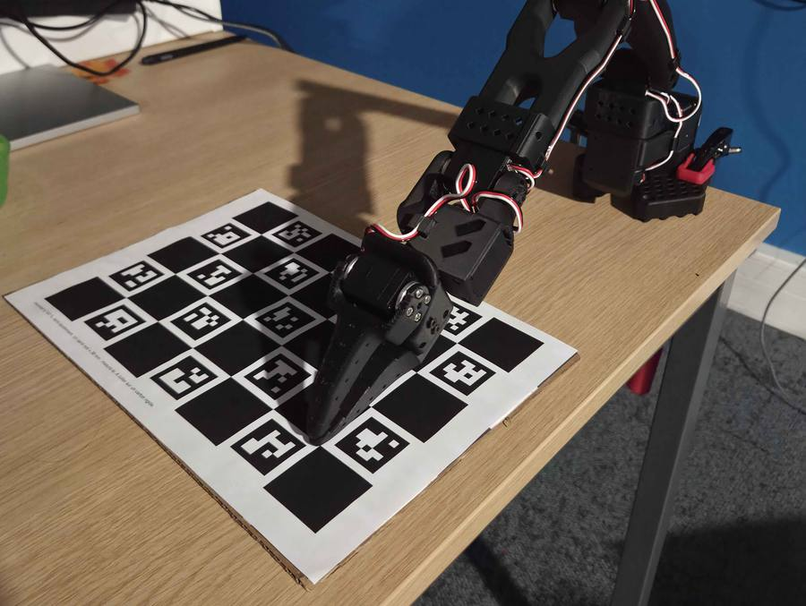

<div align="center">

# SO-ARM101 · Autonomous pick & place with ROS 2

**A camera spots a cube, the arm picks it up and drops it on target.**<br>
**The same ROS 2 stack runs in simulation and on the real robot.**

[](https://github.com/FoxaxeWasTaken/Robotics/actions/workflows/nightly.yml)


| Simulation | Real arm |
| --- | --- |
|  |  |
|  |  |

*One cycle at 4× speed, then the 8 ArUco markers seen by each camera.*<br>
*The inset of the simulation is the scene camera with perception's detections.*

**Real videos:** [one cycle](https://github.com/FoxaxeWasTaken/Robotics/releases/download/v1.3.0/real_pick_and_place.mp4) · [the cube moved by hand, then the retry](https://github.com/FoxaxeWasTaken/Robotics/releases/download/v1.3.0/real_cube_moved_retry.mp4)

| **50/50** | **14/17** | **0.16 mm** | **5/5** |
| --- | --- | --- | --- |
| pick & place in simulation, random scenes | on the real arm, retries included | mean inverse-kinematics error | failure cases handled in simulation |

</div>

## What it does

Each cycle runs on its own, from one command:

```text
WAIT_TARGET → PLAN → APPROACH → DESCEND → GRASP → LIFT → TRANSPORT → RELEASE → HOME → VERIFY → DONE
```

- **One stack, two worlds.** `USE_SIM` in `docker/.env` moves the driver between MuJoCo and the real SO-101. The same nodes run on both; only a few measured values change ([`01` §3.3](docs/project/01_architecture.md)).
- **It sees for itself.** Perception locates the cube and the target with HSV detection, pixel → 3D and a median filter, on our own camera calibration. No ground truth reaches the pipeline, and a CI guard checks it.
- **It checks its work.** The brain verifies each grasp and each drop, and takes up to 3 attempts: an empty gripper, a cube moved mid-action, a drop outside the target.
- **It is built like a product.** A 3-episode end-to-end bench on every PR, 50 episodes each night `main` changes, mutation testing on the modules that protect the arm, 39 architecture decisions and 62 recorded measurements.

## Quickstart (simulation)

```bash
cp docker/.env.example docker/.env           # ROS_DOMAIN_ID=69, the team's value
tools/so101 build                            # the images, ~10 min the first time
xhost +local:docker                          # let the containers open windows on your X server (RViz)
tools/so101 up                               # control, perception, viz
tools/so101 logs                             # wait for "Driver node ready." and "Brain node ready.", then Ctrl-C
tools/so101 rviz                             # the arm, the camera, the detections; it keeps this terminal: the rest in another
tools/so101 cycle                            # one full pick & place: the states until DONE
tools/so101 down
```

`tools/so101` prints each `docker compose` command it runs; `--dry-run` only prints it, `--help` lists them all.

### Prerequisites

Linux (x86_64) with Docker and Compose v2, an X server for RViz, and about 8 GB of disk for the images, plus Docker's build cache. On Windows: WSL2 with Docker Desktop and WSLg. **Tested on** Windows with WSL2 (Ubuntu 24.04), and in CI on GitHub's Ubuntu 24.04 runners; the team has not run the stack on a native Linux desktop yet. Full setup: [`02`](docs/project/02_environment_infrastructure.md); to contribute, `pre-commit` too ([CONTRIBUTING §1](CONTRIBUTING.md#1-setup-once)).

## Architecture



Details: [`01`](docs/project/01_architecture.md). All the design docs: [docs/project/README.md](docs/project/README.md).

## Measured results

| Metric | Result | Source |
| --- | --- | --- |
| Pick & place, simulation, real perception, randomized cube and box | 50/50, and 50 more each night `main` changes: [latest results](https://github.com/FoxaxeWasTaken/Robotics/issues?q=is%3Aissue+in%3Atitle+%22Nightly+bench+results%22) | [`results/bench_sim_2026-10-27.md`](results/bench_sim_2026-10-27.md), MES-45, MES-46 |
| Pick & place, **real arm**, USB webcam, the sim's speeds, retries included | **14/17**, target ≥ 7/10 | [`results/bench_real_2026-11-06.md`](results/bench_real_2026-11-06.md) |
| Real camera, intrinsics | RMS 0.36 px, 25 views | MES-58 |
| Real camera, pose from a board touched by the arm | touches within 2.7 mm | MES-59 |
| Robustness, simulation: the cube moved mid-action, failed grasps, perception lost, a target out of reach, a dim, warm light | All five handled, 5/5 cycles in each of 2 runs | [`results/robustness_demo.md`](results/robustness_demo.md), MES-49, MES-52 |
| Full cycle, simulation, the ground truth in place of perception | 20/20 in the box, cycle median 14.6 s | MES-40 |
| Grasp chain in closed loop, simulation (IK, planner, min-jerk) | 40/40 in the box | MES-38 |
| IK accuracy in closed loop, simulation (`/go_to_target` on 20 targets) | mean 0.161 mm, max 0.218 mm | MES-43 |
| Cube localization on the table plane, simulation, exact camera pose | mean 0.50 mm, max 1.00 mm | MES-41 |

Measurements and how to reproduce them: [`11` §4](docs/project/11_cross_review_and_measurements.md); milestone reports in [`results/`](results/).

## Real arm

The real SO-101 runs the same cycle with a USB webcam, at the simulation's speeds. [`07` §9](docs/project/07_real_arm_safety_sim2real.md#9-real-setup-from-the-bare-arm-to-the-first-cycle) goes from the bare arm to the first cycle: the material, 14 steps, the pass criterion of each. Read [`07`](docs/project/07_real_arm_safety_sim2real.md) first, its safety checklist above all.



*The arm calibrates the camera itself: its jaws touch four crossings of a ChArUco board, which gives the camera's pose in the arm's own frame, with no ruler.*

`tools/so101-arm` handles the arm's calibration and joint zeros, the stack stopped (one program on the serial bus), with the port and the calibration file from `docker/.env`:

```bash
tools/so101-arm calibrate                    # back up CALIBRATION_FILE, then LeRobot's calibration and its prompts
tools/so101-arm zero-offsets -n 3            # the arm held at the URDF zero: the joint_zero_offsets line (driver_real.yaml)
```

## Next: Connect Four

Phase 2 plays Connect Four against the arm: it reads the grid with its camera and drops its own tokens ([design](docs/project/phase2/README.md)).

## Going further

<details>
<summary><b>More demos: the evaluation bench, the robustness cases</b></summary>

```bash
tools/so101 up
tools/so101 rviz                             # RViz keeps this terminal: the next commands in a second one
tools/so101 cycle                            # randomize the cube and the box, then a full cycle
tools/so101 bench --perception -n 10         # the evaluation bench: 10 episodes, success rate and durations
tools/so101 down && tools/so101 robustness 3a  # a case of the robustness demo, alone (results/robustness_demo.md)
```

The bench starts its own driver, brain and perception on ROS domain 77 (below), runs the episodes, prints one line per episode as it ends (about 15 s each; the first one also waits for the stack to start) and the summary, then stops them. Ctrl-C stops the bench and its stack. The CSV is in `ros2_ws/eval_bench.csv`; `--bags /ros2_ws/bags` keeps a rosbag of each failed episode in `ros2_ws/bags/`.

</details>

<details>
<summary><b>Status: what is done, what is next</b></summary>

As of 2026-11-06.

| Done | Next (see [roadmap](docs/project/09_roadmap_step_by_step.md)) |
| --- | --- |
| Environment (Docker images, X11, DDS, usbipd), CI, hooks, design docs with measured spikes; the phase-1 sim criterion met on our calibration, 50/50 (4.5b, C-42) | Phase 2: the store-bought grid measured, then the drop spike (P2.1, #75, #76) |
| Driver: `/joint_states` at 30 Hz, `/joint_command`, speed limiter, joint-limit clamp, camera at 10 Hz with `camera_info`, `/sim/randomize`, ground truth for the bench only; real-arm safety and webcam; a warning for each late tick, a clean stop on SIGINT (#158, #176) | Later, on the real arm: a startup check that the camera has not moved (#222), the colors measured by a tool (#223), replay tests on real images (#48), a guided setup script (#224) |
| Perception: HSV detection that holds under a dim, warm light, pixel → 3D, median filter, cube yaw, `/object_position` and `/drop_box_position`, debug image, our ArUco extrinsic calibration and the camera TF; a cube cut by the image edge or partly hidden is not published (3.4b–c, 3.5c, MES-47, MES-52, MES-53); on the real bench, the intrinsics from a ChArUco board and the camera's pose from that board touched by the arm (6.2b, 6.3a) | |
| Brain: FK/IK (no self-collision), `/go_to_target`, grasp planner in a worker process, the full state machine, markers in RViz; grasp verification and retries checked on fault scenarios, effort threshold measured (4.4a, MES-48) | |
| The real arm: commissioning, calibration and a filmed pick & place at 14/17, at the sim's speeds, released as `v1.3.0` (6.1 to 6.5, [`results/bench_real_2026-11-06.md`](results/bench_real_2026-11-06.md)); the setup from A to Z ([`07` §9](docs/project/07_real_arm_safety_sim2real.md)) | |
| Evaluation bench, E2E on every PR, nightly 50-episode bench with its report, and the nightly's quality job: coverage, trends, the SonarQube Cloud gate (#174, #179); the robustness demo, the five cases of the slides handled (5.4a, #103, #175); `tools/so101` for the everyday commands; this README replayed by a member from a fresh clone, quickstart and demo in about 12 min (5.1b) | |

</details>

<details>
<summary><b>Test the project</b></summary>

```bash
tools/so101 test                             # all our packages: build, colcon test (each on its own free ROS domain)
tools/so101 test so101_brain -k fsm          # one package; the options go to pytest: the fast loop on one test
tools/so101 run 'colcon test --packages-select so101_brain'  # next to someone's stack: a throwaway container
sudo apt install pre-commit                  # once (Ubuntu; or pipx install pre-commit: plain pip is refused)
pre-commit run --all-files                   # host: lint, format, shellcheck, workflow checks, the scripts' tests
bash tools/ci/guards.sh                      # host: the project rules (no ground truth in the pipeline, …)
tools/so101 bench --stub -n 10               # driver and brain alone: the ground truth in place of perception
tools/so101 bench --perception -n 10         # the real pipeline
```

- The packages: `so101_common`, `so101_driver`, `so101_brain`, `so101_perception`, `so101_bringup` (the sim-backed tests: closed loop, IK accuracy, launch files).
- `tools/so101 run '<command>'` runs a command in a throwaway control container: no network, ROS domain 79, the repository read-only, our packages built inside it. It leaves a teammate's running stack and the shared `ros2_ws/build/` alone. `--stack` starts the simulation first, `--out DIR` gets back what the command writes.
- `tools/so101 test` runs in a new control container: the stack need not run. For a full run, stop it first (`tools/so101 down`): the grasp planner's timing tests (p95 under 1 s) fail when the simulation shares the CPU.
- **Every PR** runs lint, the guards, the build and tests of both images, and a 3-episode E2E bench (a draft or a docs-only change: lint and guards only). The nightly runs 50 episodes each night `main` changes.
- Code quality: [SonarQube Cloud](https://sonarcloud.io/project/overview?id=FoxaxeWasTaken_Robotics), `main` analyzed each night it changes (`14` §4; members of the SonarCloud organization only).
- Test strategy, thresholds and the bench: [`08`](docs/project/08_quality_tests.md); CI: [`14`](docs/project/14_quality_pipeline_ci.md); how to write tests: [CONTRIBUTING §5](CONTRIBUTING.md#5-tests).

</details>

<details>
<summary><b>What RViz shows</b></summary>

- **The camera image** (`/external_cam/image_raw`) and **the perception debug image** (`/perception/debug_image`):
  - the cube's pixels in green, the box's in blue;
  - a red cross on each centroid;
  - the cube's status in the top-left corner: `OK`, `TRUNCATED` (cut by the image edge, not published), `OCCLUDED` (partly hidden by the arm or the box, not published) or `LOST`.
- **The 3D view**:
  - the arm and its TF;
  - the TCP pose (`/end_effector_pose`), the cube and box poses;
  - the brain's markers (`/brain/markers`): pre-grasp in yellow, grasp in green, drop in blue, the approach arrow (display "Brain targets");
  - the locked cube, a red 5 cm cube from `APPROACH` until it is lifted, in its own display "Cube (locked)": untick it to hide the cube;
  - the ghost arm, display "Commanded arm (ghost)", unchecked by default: the setpoint the driver sends to the motors (`/joint_setpoint`), translucent over the measured arm; the gap is the tracking error, useful on the real arm.
- **The large red translucent block is the drop box** (the course's marker), not the cube.

</details>

<details>
<summary><b>ROS domains</b></summary>

| Domain | Who | Why |
| --- | --- | --- |
| 69 (`docker/.env`) | The everyday stack: driver, brain, perception, RViz | The team's value |
| 77 | `tools/so101 bench` | Its own driver publishes the ground truth that scores the bench |
| 78 | `tools/so101 robustness` | The demo runs alone: next to another driver it sees "2 drivers on this ROS domain" |
| 79 | `tools/so101 run` | A throwaway container with no network: tests, a scenario or a capture next to a running stack |
| Free, picked per package | `colcon test` (colcon-ros-domain-id-coordinator) | Tests never talk to a running stack |

The ground truth (`/sim/ground_truth/*`) is published only by a driver started with `expose_ground_truth:=true`, which only the bench and the CI's E2E jobs do (C-06). On domain 77, it never reaches the everyday stack: perception and the brain on 69 cannot use it, even by mistake. The bench refuses to start when a stack already runs on 77.

</details>

<details>
<summary><b>Common problems</b></summary>

| Symptom | Fix |
| --- | --- |
| `ros2 topic pub --once …` has no effect | The CLI exits before delivery: `--once -w 1 --keep-alive 1` ([`13` §2](docs/project/13_runbook_troubleshooting.md#2-troubleshooting)) |
| RViz: "could not connect to display" | `xhost +local:docker` on the host ([`13` §2](docs/project/13_runbook_troubleshooting.md#2-troubleshooting)) |
| `colcon`: "Permission denied" on `build/` or `install/` | Files made by root in the container: delete them from inside it ([`13` §2](docs/project/13_runbook_troubleshooting.md#2-troubleshooting)) |

</details>

## Repository layout

| Folder | Content |
| --- | --- |
| `ros2_ws/src/` | ROS 2 packages: `so101_driver`, `so101_perception`, `so101_brain`, `so101_common`, `so101_bringup` (launch files, parameters, RViz file, the bench) |
| `docker/` | Images and compose (`control`, `perception`, `viz`) |
| `tools/` | `so101` (everyday commands), `so101-arm` (the real arm's calibration and joint zeros), `calibration_sheets.py` (the printed board and markers), `ci/` (the CI scripts and their tests) |
| `docs/project/` | Design, decisions (ADRs), roadmap, measurements |
| `results/` | Milestone reports: the real pick & place, the 50-episode bench, the calibration, the IK accuracy, the robustness demo |
| `core/`, `sim/`, `so101_description/` | Course kit (unmodified) |

## Team

| | Member | Lane |
| --- | --- | --- |
|  | [@FoxaxeWasTaken](https://github.com/FoxaxeWasTaken) | A: driver, infrastructure, hardware |
|  | [@SamuelValentin974](https://github.com/SamuelValentin974) | B: kinematics, brain |
|  | [@Hasnain-Pyarali](https://github.com/Hasnain-Pyarali) | C: perception, calibration |

The lanes say who knows a part best ([`09` §1.2](docs/project/09_roadmap_step_by_step.md)). `.github/CODEOWNERS` follows them but is indicative: any member may review and approve any PR.

## Contributing

See [CONTRIBUTING.md](CONTRIBUTING.md). Planned work and progress: the team's GitHub Project (PR-sized tickets, [conventions](docs/project/15_repository_hygiene.md#12-planning-the-github-project)).

## Links

- This repository has a copy on the school's GitHub, overwritten from the team's at each merge and every day: branches and pull requests opened on that copy are deleted and closed automatically. Contact the team instead (`docs/project/16`).
- The course repository this one comes from (kit, slides, brief): [JasonChmn/content-lerobot-bras-students](https://github.com/JasonChmn/content-lerobot-bras-students), the `upstream` remote ([CONTRIBUTING §7](CONTRIBUTING.md#7-syncing-with-the-course-kit)).
- The design docs: [docs/project/README.md](docs/project/README.md).
- The bootstrap prototype of days 1–2 stays outside this repository ([ADR-039](docs/project/adr/ADR-039-start-from-course-stubs.md)).

## Acknowledgements and license

TEK5 Robotics module kit (Epitech). Driver extracted from [LeRobot](https://github.com/huggingface/lerobot) (Apache-2.0). License of the team's code: see `LICENSE` (to be decided, ADR-031).
