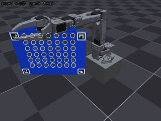
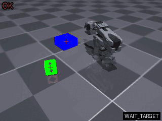
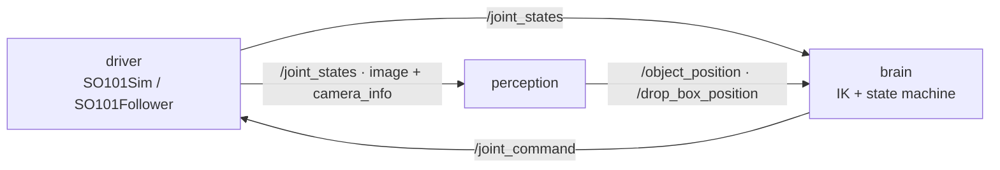

<div align="center">

# SO-ARM101 · Connect Four and pick & place with ROS 2

**The arm plays Connect Four against you, in simulation: its camera reads the grid, an engine picks the move, the arm takes a token and drops it.**<br>
**It also picks a cube and drops it on target, in simulation and on the real robot. One ROS 2 stack.**

[](https://github.com/FoxaxeWasTaken/Robotics/actions/workflows/nightly.yml)




*A game against the simulated arm at 16× speed, as the board reader draws it: the cells it reads, the stations of the dispenser, the robot's reason, the winning four.*<br>
**Video:** [a full game at 4× speed, 27 s](https://github.com/FoxaxeWasTaken/Robotics/releases/download/v2.0.0/demo_connect4_sim.mp4), an asset of the Release `v2.0.0` on the team's repository; the GIF above is the same view of another game.

| **50/50** | **2100/2100** | **10/10** | **8/8** |
| --- | --- | --- | --- |
| tokens dropped in their column | cells of the grid read by the camera | full games finished, the robot wins each | fault cases of a game handled |

| Simulation | Real arm |
| --- | --- |
|  |  |
|  |  |

*One pick & place at 4× speed, then the 8 ArUco markers seen by each camera.*<br>
*The inset of the simulation is the scene camera with perception's detections.*

**Real videos:** [one cycle](https://github.com/FoxaxeWasTaken/Robotics/releases/download/v1.3.0/real_pick_and_place.mp4) · [the cube moved by hand, then the retry](https://github.com/FoxaxeWasTaken/Robotics/releases/download/v1.3.0/real_cube_moved_retry.mp4)

| **50/50** | **14/17** | **0.16 mm** | **5/5** |
| --- | --- | --- | --- |
| pick & place in simulation, random scenes | on the real arm, retries included | mean inverse-kinematics error | failure cases handled in simulation |

</div>

## What it does

**Connect Four against the arm** (phase 2, in simulation). You drop a red token, the robot answers with a yellow one (or the other way round: `token.robot_color` in [`connect4_grid.yaml`](ros2_ws/src/so101_connect4/config/connect4_grid.yaml)):

- **It reads the grid** with the scene camera: four ArUco markers give the grid's pose, each of the 42 cells is classified by its color, and a move counts once 5 images in a row agree.
- **It thinks**: a negamax engine with three levels, which answers in 0.2 s and says why it played (its search depth, and "it wins in 2 moves" once the game is decided).
- **It plays**: the arm takes a token at its dispenser, which the camera places and reads as it does the grid, checks it holds it, and releases it above the column.
- **It notices what goes wrong**: a token in the wrong place, a move not seen, an empty gripper, an empty dispenser, a column out of reach. The game stops with its reason and waits for you; the arm never moves during your turn.

**Pick & place** (phase 1, in simulation and on the real arm). Each cycle runs on its own, from one command:

```text
WAIT_TARGET → PLAN → APPROACH → DESCEND → GRASP → LIFT → TRANSPORT → RELEASE → HOME → VERIFY → DONE
```

- **One stack, two worlds.** `USE_SIM` in `docker/.env` moves the driver between MuJoCo and the real SO-101. The same nodes run on both; only a few measured values change ([`01` §3.3](docs/project/01_architecture.md)).
- **It sees for itself.** Perception locates the cube and the target with HSV detection, pixel → 3D and a median filter, on our own camera calibration. No ground truth reaches the pipeline, and a CI guard checks it.
- **It checks its work.** The brain verifies each grasp and each drop, and takes up to 3 attempts: an empty gripper, a cube moved mid-action, a drop outside the target.
- **It is built like a product.** On every PR, a 3-episode end-to-end bench and one full Connect Four game; each night `main` changes, 50 episodes and 10 games; mutation testing on the modules that protect the arm, 42 architecture decisions and 80 recorded measurements.

## Quickstart (simulation)

```bash
cp docker/.env.example docker/.env           # ROS_DOMAIN_ID=69, the team's value
tools/so101 build                            # the images, ~10 min the first time
xhost +local:docker                          # let the containers open windows on your X server (RViz)
tools/so101 up                               # control, perception, viz
tools/so101 logs                             # wait for "Driver node ready." and "Brain node ready.", then Ctrl-C
tools/so101 rviz                             # the arm, the camera, the detections; it keeps this terminal: the rest in another
tools/so101 cycle                            # one full pick & place: the states until DONE
tools/so101 down
```

`tools/so101` prints each `docker compose` command it runs; `--dry-run` only prints it, `--help` lists them all.

### Prerequisites

Linux (x86_64) with Docker and Compose v2, an X server for RViz, and about 8 GB of disk for the images, plus Docker's build cache. On Windows: WSL2 with Docker Desktop and WSLg. **Tested on** Windows with WSL2 (Ubuntu 24.04), and in CI on GitHub's Ubuntu 24.04 runners; the team has not run the stack on a native Linux desktop yet. Full setup: [`02`](docs/project/02_environment_infrastructure.md); to contribute, `pre-commit` too ([CONTRIBUTING §1](CONTRIBUTING.md#1-setup-once)).

## Play against the sim robot

After the quickstart's `build` (stop the pick & place stack first: `tools/so101 down`):

```bash
tools/so101 demo                             # the game in one command: starts it, waits until it is ready, opens the console
tools/so101 rviz                             # optional, in a second terminal: the arm, the grid and its tokens as the camera reads them
tools/so101 down                             # before coming back to the pick & place
```

`demo` is `tools/so101 up --game` (the game's simulation: the grid, its 42 tokens, the dispenser, the board reader, the game node), `tools/so101 wait` (the first start builds the workspace, minutes) and `tools/so101 play` (the console). An `up` never changes the mode of a running stack: `down` first.


| Key | What it does |
| --- | --- |
| `n`, `r` | A new game: you start (`n`), or the robot starts (`r`) |
| `1` to `7` | Your red token in that column, numbered as on the screen. The simulated hand drops it; the robot takes its own yellow token at the dispenser |
| `?` | A hint: the column the engine would play in your place |
| `a` | The computer plays your turns too: a whole game to watch. Any key stops it |
| `e`, `m`, `h` | The robot's level: easy, medium, hard (the default). It applies from its next move |
| `s` | Stops the arm and the game |
| `q` | Quits the console; the stack keeps running |

- **The screen** shows the grid, the level, the robot's last move with its reason, and what to do, redrawn in place on a terminal. The winning four is drawn as `*`. Keys work in capitals too.
- **The colors**: the robot plays yellow (`Y`) and you red (`R`). To swap them, set `token.robot_color: red` in [`connect4_grid.yaml`](ros2_ws/src/so101_connect4/config/connect4_grid.yaml) and start the stack again (`tools/so101 down`, then `CONNECT4=true tools/so101 up`: both containers read the file): the simulated hand, the camera's reading and the screen follow.
- **A robot's move takes about 20 s**: 8 to 12 s to take its token at the dispenser, then 12 s to drop it (17 on the far column). A game against a careless player lasts about a minute and a half.
- **The dispenser** holds the robot's 21 tokens, enough for a whole game; a new game fills it again. Found empty, the game waits (`dispenser_empty`) and the console fills it. To play as before the dispenser, a token given between the jaws at each turn, set `token_source: hand` in [`game.yaml`](ros2_ws/src/so101_connect4/config/game.yaml) and start the stack again.
- **`FIX_BOARD`** means the grid the camera sees is not the one the game expects: `not_seen:human` when your move did not show, `board_not_empty` when tokens are left at a new game, a token played out of turn. Nothing moves. In simulation, press `n` for a new game.
- **`ERROR`** follows a stop (`s`) or a move the arm could not finish; `n` starts again.
- **Other messages**: `waiting: …` says what the game still waits for before it is ready (a topic, or `checking where the grid stands`), or why the arm would not play where the grid stands (`column 7: unsafe_path:column`); `not your turn: <STATE>` and `column N is full` change nothing; on `the robot's turn (no_token, token_lost, dispenser_not_seen)` the console answers by itself. Every reason: the [runbook](docs/project/13_runbook_troubleshooting.md#2-troubleshooting).
- `tools/so101 bench --game -n 3` plays measured games against a scripted player: it runs in the control container (after `tools/so101 up`) and starts its own stack on ROS domain 77. `tools/so101 robustness g1` (to `g8`) shows one fault case, in its own container: after `tools/so101 down`.

How the game is built: [`phase2/P2-02`](docs/project/phase2/P2-02_design.md).

## Architecture



In game mode, a board reader takes perception's place and a game node sits above the brain: it asks for one move at a time (`/brain/drop`). Details: [`01`](docs/project/01_architecture.md), the game in [`phase2/P2-02`](docs/project/phase2/P2-02_design.md). All the design docs: [docs/project/README.md](docs/project/README.md).

## Measured results

| Metric | Result | Source |
| --- | --- | --- |
| **Connect Four**, simulation: full games without intervention, the robot at its hard level | **10/10** against a random player, 2/2 against the engine; **20/20** with the robot taking its tokens at the dispenser (MES-77); target ≥ 8/10. One game on each PR, 10 each night `main` changes: 10/10 on the runner (2026-11-13, the tokens given by hand: a game 51 to 112 s; with the dispenser a game lasts 86 to 190 s) | [`results/phase2_2026-11-14.md`](results/phase2_2026-11-14.md), [`results/phase2_2026-11-13.md`](results/phase2_2026-11-13.md), MES-71, MES-77, MES-78 |
| Connect Four: a token taken at the dispenser, then dropped in the requested column, both where the camera sees them | **50/50**, held 50/50, empty jaws refused 10/10; a pick 8.1 to 12.4 s, a drop 11.4 to 16.7 s | MES-69, MES-73, MES-77, MES-78 |
| Connect Four: the grid read by the camera, 50 random game states | **2100/2100** cells; the grid's pose within 0.7 mm | MES-68 |
| Connect Four: the engine | 100/100 against a random player; hard beats medium 26 – 7, medium beats easy 28 – 2 (40 games each); a move in 0.2 s | MES-66, MES-70, MES-72 |
| Connect Four: fault cases of a game (a token out of turn, the dispenser empty, the reader stopped, a column out of reach, a dim light, a stop, the grid set down elsewhere between two games, then where the arm would hit it) | All eight handled | [`results/robustness_demo.md`](results/robustness_demo.md) |
| Pick & place, simulation, real perception, randomized cube and box | 50/50, and 50 more each night `main` changes: [latest results](https://github.com/FoxaxeWasTaken/Robotics/issues?q=is%3Aissue+in%3Atitle+%22Nightly+bench+results%22) | [`results/bench_sim_2026-10-27.md`](results/bench_sim_2026-10-27.md), MES-45, MES-46 |
| Pick & place, **real arm**, USB webcam, the sim's speeds, retries included | **14/17**, target ≥ 7/10 | [`results/bench_real_2026-11-06.md`](results/bench_real_2026-11-06.md) |
| Real camera, intrinsics | RMS 0.36 px, 25 views | MES-58 |
| Real camera, pose from a board touched by the arm | touches within 2.7 mm | MES-59 |
| Robustness, simulation: the cube moved mid-action, failed grasps, perception lost, a target out of reach, a dim, warm light | All five handled, 5/5 cycles in each of 2 runs | [`results/robustness_demo.md`](results/robustness_demo.md), MES-49, MES-52 |
| Full cycle, simulation, the ground truth in place of perception | 20/20 in the box, cycle median 14.6 s | MES-40 |
| Grasp chain in closed loop, simulation (IK, planner, min-jerk) | 40/40 in the box | MES-38 |
| IK accuracy in closed loop, simulation (`/go_to_target` on 20 targets) | mean 0.161 mm, max 0.218 mm | MES-43 |
| Cube localization on the table plane, simulation, exact camera pose | mean 0.50 mm, max 1.00 mm | MES-41 |

Measurements and how to reproduce them: [`11` §4](docs/project/11_cross_review_and_measurements.md); milestone reports in [`results/`](results/).

## Real arm

The real SO-101 runs the same cycle with a USB webcam, at the simulation's speeds. [`07` §9](docs/project/07_real_arm_safety_sim2real.md#9-real-setup-from-the-bare-arm-to-the-first-cycle) goes from the bare arm to the first cycle: the material, 14 steps, the pass criterion of each. Read [`07`](docs/project/07_real_arm_safety_sim2real.md) first, its safety checklist above all.


*The arm calibrates the camera itself: its jaws touch four crossings of a ChArUco board, which gives the camera's pose in the arm's own frame, with no ruler.*

`tools/so101-arm` handles the arm's calibration and joint zeros, the stack stopped (one program on the serial bus), with the port and the calibration file from `docker/.env`:

```bash
tools/so101-arm calibrate                    # back up CALIBRATION_FILE, then LeRobot's calibration and its prompts
tools/so101-arm zero-offsets -n 3            # the arm held at the URDF zero: the joint_zero_offsets line (driver_real.yaml)
tools/so101-arm touch 0                      # read-only, the jaws closed on corner 0 of the board: the --touch argument of calibrate_touch (07 §9)
```

## Going further

<details>
<summary><b>More demos: the evaluation bench, the robustness cases</b></summary>

```bash
tools/so101 up
tools/so101 rviz                             # RViz keeps this terminal: the next commands in a second one
tools/so101 cycle                            # randomize the cube and the box, then a full cycle
tools/so101 bench --perception -n 10         # the evaluation bench: 10 episodes, success rate and durations
tools/so101 down && tools/so101 robustness 3a  # a case of the robustness demo, alone (results/robustness_demo.md)
```

The bench starts its own driver, brain and perception on ROS domain 77 (below), runs the episodes, prints one line per episode as it ends (about 15 s each; the first one also waits for the stack to start) and the summary, then stops them. Ctrl-C stops the bench and its stack. The CSV is in `ros2_ws/eval_bench.csv`; `--bags /ros2_ws/bags` keeps a rosbag of each failed episode in `ros2_ws/bags/`.

</details>

<details>
<summary><b>Status: what is done, what is next</b></summary>

As of 2026-11-14.

| Done | Next (see [roadmap](docs/project/09_roadmap_step_by_step.md)) |
| --- | --- |
| Environment (Docker images, X11, DDS, usbipd), CI, hooks, design docs with measured spikes; the phase-1 sim criterion met on our calibration, 50/50 (4.5b, C-42) | Phase 2 in sim, for the hand-in of 2026-11-20. Done: the drop spike, a go (#76), the engine and the turns (`so101_connect4`), the drop pose, the game's sim scene with the simulated player's services, the board reader that reads the grid from the camera (`CONNECT4=true tools/so101 up`), one move of the game through the brain (`/brain/drop`, `/brain/pick` and `/brain/handover`: 50 tokens of 50 in their column), the game node with three levels, the console `tools/so101 play`, the game bench (`evaluate --games`), one game on each PR and ten each night, the robustness demo of the game (`tools/so101 robustness g1` to `g8`), the robot's reason, the level keys and the hint in the console, faster moves; the results of the first nightly on the game's code ([`results/phase2_2026-11-13.md`](results/phase2_2026-11-13.md)), then of the game with the dispenser and the measured positions ([`results/phase2_2026-11-14.md`](results/phase2_2026-11-14.md)). A token dispenser stands in the scene, three stacked rails with the robot's 21 tokens, the camera places it and reads its stations (#257, #258), and the arm takes its tokens there by itself (`/brain/pick`, #259: 50 tokens of 50 taken and dropped). Where the grid and the dispenser stand comes from the camera only: the brain judges each move there before the arm moves, and a grid set down 2 cm elsewhere between two games is found and played (#260). The phase-2 video is a game rendered from the sim (#97). Next: a game replayed from this README by a member who did not write it (#234), then the tag `v2.0.0`; after the hand-in, the slides (#98) and the public repository (#99) |
| Driver: `/joint_states` at 30 Hz, `/joint_command`, speed limiter, joint-limit clamp, camera at 10 Hz with `camera_info`, `/sim/randomize`, ground truth for the bench only; real-arm safety and webcam; a warning for each late tick, a clean stop on SIGINT (#158, #176) | Later, on the real arm: a startup check that the camera has not moved (#222), the colors measured by a tool (#223), replay tests on real images (#48), a guided setup script (#224) |
| Perception: HSV detection that holds under a dim, warm light, pixel → 3D, median filter, cube yaw, `/object_position` and `/drop_box_position`, debug image, our ArUco extrinsic calibration and the camera TF; a cube cut by the image edge or partly hidden is not published (3.4b–c, 3.5c, MES-47, MES-52, MES-53); on the real bench, the intrinsics from a ChArUco board and the camera's pose from that board touched by the arm (6.2b, 6.3a) | |
| Brain: FK/IK (no self-collision), `/go_to_target`, grasp planner in a worker process, the full state machine, markers in RViz; grasp verification and retries checked on fault scenarios, effort threshold measured (4.4a, MES-48) | |
| The real arm: commissioning, calibration and a filmed pick & place at 14/17, at the sim's speeds, released as `v1.3.0` (6.1 to 6.5, [`results/bench_real_2026-11-06.md`](results/bench_real_2026-11-06.md)); the setup from A to Z ([`07` §9](docs/project/07_real_arm_safety_sim2real.md)) | |
| Evaluation bench, E2E on every PR, nightly 50-episode bench with its report, and the nightly's quality job: coverage, trends, the SonarQube Cloud gate (#174, #179); the robustness demo, the five cases of the slides handled (5.4a, #103, #175); `tools/so101` for the everyday commands; this README replayed by a member from a fresh clone, quickstart and demo in about 12 min (5.1b) | |

</details>

<details>
<summary><b>Test the project</b></summary>

```bash
tools/so101 test                             # all our packages: build, colcon test (each on its own free ROS domain)
tools/so101 test so101_brain -k fsm          # one package; the options go to pytest: the fast loop on one test
tools/so101 run 'colcon test --packages-select so101_brain'  # next to someone's stack: a throwaway container
sudo apt install pre-commit                  # once (Ubuntu; or pipx install pre-commit: plain pip is refused)
pre-commit run --all-files                   # host: lint, format, shellcheck, workflow checks, the scripts' tests
bash tools/ci/guards.sh                      # host: the project rules (no ground truth in the pipeline, …)
tools/so101 bench --stub -n 10               # driver and brain alone: the ground truth in place of perception
tools/so101 bench --perception -n 10         # the real pipeline
```

- The packages: `so101_common`, `so101_interfaces`, `so101_driver`, `so101_brain`, `so101_perception`, `so101_connect4` (the game), `so101_bringup` (the sim-backed tests: closed loop, IK accuracy, launch files, the game's scene, drops and reading).
- `tools/so101 run '<command>'` runs a command in a throwaway control container: no network, ROS domain 79, the repository read-only, our packages built inside it. It leaves a teammate's running stack and the shared `ros2_ws/build/` alone. `--stack` starts the simulation first, `--game` starts it in game mode (the game node, the board reader), `--out DIR` gets back what the command writes.
- `tools/so101 test` runs in a new control container: the stack need not run. For a full run, stop it first (`tools/so101 down`): the grasp planner's timing tests (p95 under 1 s) fail when the simulation shares the CPU.
- **Every PR** runs lint, the guards, the build and tests of both images, a 3-episode E2E bench and one full Connect Four game (a draft or a docs-only change: lint and guards only). The nightly runs 50 episodes and 10 games each night `main` changes.
- Code quality: [SonarQube Cloud](https://sonarcloud.io/project/overview?id=FoxaxeWasTaken_Robotics), `main` analyzed each night it changes (`14` §4; members of the SonarCloud organization only).
- Test strategy, thresholds and the bench: [`08`](docs/project/08_quality_tests.md); CI: [`14`](docs/project/14_quality_pipeline_ci.md); how to write tests: [CONTRIBUTING §5](CONTRIBUTING.md#5-tests).

</details>

<details>
<summary><b>What RViz shows</b></summary>

- **The camera image** (`/external_cam/image_raw`) and **the perception debug image** (`/perception/debug_image`):
  - the cube's pixels in green, the box's in blue;
  - a red cross on each centroid;
  - the cube's status in the top-left corner: `OK`, `TRUNCATED` (cut by the image edge, not published), `OCCLUDED` (partly hidden by the arm or the box, not published) or `LOST`.
- **The 3D view**:
  - the arm and its TF;
  - the TCP pose (`/end_effector_pose`), the cube and box poses;
  - the brain's markers (`/brain/markers`): pre-grasp in yellow, grasp in green, drop in blue, the approach arrow (display "Brain targets");
  - the locked cube, a red 5 cm cube from `APPROACH` until it is lifted, in its own display "Cube (locked)": untick it to hide the cube;
  - the ghost arm, display "Commanded arm (ghost)", unchecked by default: the setpoint the driver sends to the motors (`/joint_setpoint`), translucent over the measured arm; the gap is the tracking error, useful on the real arm.
- **The large red translucent block is the drop box** (the course's marker), not the cube.
- **In game mode**, the 3D view shows beside the arm what the camera reads (display "Connect Four grid (game mode)", `/connect4/markers`): the grid where it is measured, the tokens read in its cells, the dispenser's rails and the token waiting at each station. It is what the robot believes, not the simulation's state: a token appears once it is read.
- **In game mode**, the display "Connect Four board (game mode)" shows `/connect4/debug_image`: a disc on each cell, filled in red or yellow when a token is read there; at the top, the read's validity (`board VALID`, or why not) and the game's state, then the last move with the robot's reason; the winning four circled in green.

</details>

<details>
<summary><b>ROS domains</b></summary>

| Domain | Who | Why |
| --- | --- | --- |
| 69 (`docker/.env`) | The everyday stack: driver, brain, perception, RViz | The team's value |
| 77 | `tools/so101 bench` | Its own driver publishes the ground truth that scores the bench |
| 78 | `tools/so101 robustness` | The demo runs alone: next to another driver it sees "2 drivers on this ROS domain" |
| 79 | `tools/so101 run` | A throwaway container with no network: tests, a scenario or a capture next to a running stack |
| Free, picked per package | `colcon test` (colcon-ros-domain-id-coordinator) | Tests never talk to a running stack |

The ground truth (`/sim/ground_truth/*`) is published only by a driver started with `expose_ground_truth:=true`, which only the bench and the CI's E2E jobs do (C-06). On domain 77, it never reaches the everyday stack: perception and the brain on 69 cannot use it, even by mistake. The bench refuses to start when a stack already runs on 77.

</details>

<details>
<summary><b>Common problems</b></summary>

| Symptom | Fix |
| --- | --- |
| `ros2 topic pub --once …` has no effect | The CLI exits before delivery: `--once -w 1 --keep-alive 1` ([`13` §2](docs/project/13_runbook_troubleshooting.md#2-troubleshooting)) |
| RViz: "could not connect to display" | `xhost +local:docker` on the host ([`13` §2](docs/project/13_runbook_troubleshooting.md#2-troubleshooting)) |
| `colcon`: "Permission denied" on `build/` or `install/` | Files made by root in the container: delete them from inside it ([`13` §2](docs/project/13_runbook_troubleshooting.md#2-troubleshooting)) |

</details>

## Repository layout

| Folder | Content |
| --- | --- |
| `ros2_ws/src/` | ROS 2 packages: `so101_driver`, `so101_perception`, `so101_brain`, `so101_connect4` (the game: board reader, engine, turns, console), `so101_common`, `so101_interfaces`, `so101_bringup` (launch files, parameters, RViz file, the benches) |
| `docker/` | Images and compose (`control`, `perception`, `viz`) |
| `tools/` | `so101` (everyday commands), `so101-arm` (the real arm's calibration and joint zeros), `calibration_sheets.py` (the printed board and markers), `ci/` (the CI scripts and their tests) |
| `docs/project/` | Design, decisions (ADRs), roadmap, measurements |
| `results/` | Milestone reports: the real pick & place, the 50-episode bench, the calibration, the IK accuracy, the perception's robustness, the robustness demo, the Connect Four games |
| `core/`, `sim/`, `so101_description/` | Course kit (unmodified) |

## Team

| | Member | Lane |
| --- | --- | --- |
|  | [@FoxaxeWasTaken](https://github.com/FoxaxeWasTaken) | A: driver, infrastructure, hardware |
|  | [@SamuelValentin974](https://github.com/SamuelValentin974) | B: kinematics, brain |
|  | [@Hasnain-Pyarali](https://github.com/Hasnain-Pyarali) | C: perception, calibration |

The lanes say who knows a part best ([`09` §1.2](docs/project/09_roadmap_step_by_step.md)). `.github/CODEOWNERS` follows them but is indicative: any member may review and approve any PR.

## Contributing

See [CONTRIBUTING.md](CONTRIBUTING.md). Planned work and progress: the team's GitHub Project (PR-sized tickets, [conventions](docs/project/15_repository_hygiene.md#12-planning-the-github-project)).

## Links

- This repository has a copy on the school's GitHub, overwritten from the team's at each merge and every day: branches and pull requests opened on that copy are deleted and closed automatically. Contact the team instead (`docs/project/16`).
- The course repository this one comes from (kit, slides, brief): [JasonChmn/content-lerobot-bras-students](https://github.com/JasonChmn/content-lerobot-bras-students), the `upstream` remote ([CONTRIBUTING §7](CONTRIBUTING.md#7-syncing-with-the-course-kit)).
- The design docs: [docs/project/README.md](docs/project/README.md).
- The bootstrap prototype of days 1–2 stays outside this repository ([ADR-039](docs/project/adr/ADR-039-start-from-course-stubs.md)).

## Acknowledgements and license

TEK5 Robotics module kit (Epitech). Driver extracted from [LeRobot](https://github.com/huggingface/lerobot) (Apache-2.0). The arm's model (URDF, MJCF, meshes) is the [SO-ARM100](https://github.com/TheRobotStudio/SO-ARM100) design by TheRobotStudio (Apache-2.0). The team's work is under the [Apache License 2.0](LICENSE) (ADR-031); [`NOTICE`](NOTICE) names what is not ours and keeps its own terms: LeRobot's extract in `core/` and the course kit.
