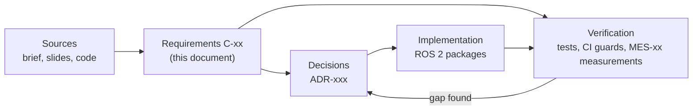

# 00 — Constraints, scope and traceability

> Authors: [CP] Project lead · Reviewers: [ARC] Architect, [QA] Quality
> This document is the **foundation** of the folder: every decision elsewhere must be compatible with the requirements listed here. An **IMPOSED** requirement is not up for debate; it is met and verified.

## 1. Project goal (imposed)

> "A camera spots a red cube with holes, the arm picks it up and drops it in a box. In simulation first, then, even better, on the real robot. In a second phase, find your own application with this robot arm." — [BRIEF]

The project has two phases [BRIEF], [KO2 p13] (the roadmap calls its own work packages *stages*, `09`):

| Phase | Content | Status |
| --- | --- | --- |
| **Phase 1 — Pick & place project** | *Model-based* pick & place: ROS 2 + perception + IK + control. Sim, then real arm ("preferred" at the final defense). | **Mandatory** |
| **Phase 2 — Go further** | Your own application, "anything", with one constraint: **reuse the phase-1 work** (AI for control or perception, LLM, VLM, voice, imitation learning, RL…). | **Mandatory at the final defense (S7)** since the brief update of 2026-10-08 |

## 2. Sources

| Code | Source | Nature |
| --- | --- | --- |
| [BRIEF] | `docs/SUJET.md` | Official specification. **Wins in case of conflict.** |
| [BOOT] | `docs/Bootstrap_rob_tek5.pdf` (versioned by the course since 2026-10-08) | Day-2 slides (setup, driver, daily milestones) |
| [BOOT2] | `docs/Bootstrap_rob_tek5_part2.pdf` (added upstream on 2026-10-08, pulled 2026-10-09) | Day-2 recap: `ROS_DOMAIN_ID`, RViz, driver milestones, brain robustness questions, phase-2 workshop |
| [KO1] | `docs/part_1_Kickoff_rob_tek5.pdf` | General culture slides + schedule |
| [KO2] | `docs/part_2_Kickoff_rob_tek5_aprem.pdf` | Architecture, topics, nodes slides |
| [J3] | `docs/J3_visio_perception.pdf` (added upstream on 2026-10-21, pulled 2026-10-23) | Day-3 visio (2026-10-22) on perception: the calendar (intermediate review ~31 Oct, phase 1 working in sim, ideally on the real arm; visio #2 on 5 Nov; final review 21 or 28 Nov), pixel → 3D (K, D, depth, TF), calibration and camera pose (checkerboard, ArUco, PnP, hand-eye; autofocus off), depth from a known plane, then sensors and AI |
| [CODE] | Provided code (`core/`, `sim/`, `ros2_ws/`, `docker/`) | De facto technical constraints |
| [MES-xx] | Team measurements (`11_cross_review_and_measurements.md`) | Experimental evidence |

## 3. Imposed requirements (traceability matrix)

Each requirement has a `C-xx` identifier reused in the ADRs and the roadmap. The "Verification" column states **how we prove** it is met.

### 3.1 Architecture and tooling

| ID | Requirement | Source | Verification |
| --- | --- | --- | --- |
| C-01 | Use **ROS 2** (Jazzy, provided by the Docker images) | [BRIEF], [KO2] | `colcon` build in `tek5/control` |
| C-02 | **Two containers, `control` and `perception`**, on a shared ROS 2 network | [BRIEF] | `docker compose ps` + `ros2 node list` from each container |
| C-03 | **At least three nodes**: `driver_node` and `brain_node` (control container), `perception_node` (perception container) | [BRIEF] | `ros2 node list` |
| C-04 | First check inter-container communication with `talker` | [BRIEF] | `ros2 topic echo /chatter` from the other container |
| C-05 | **Motor commands only through `/joint_command`**; no direct backend access from `brain` or `perception` | [BRIEF Rules] | Code review + CI grep (`SO101Sim`/`SO101Follower` imported only in `so101_driver`) |
| C-06 | **`get_object_position()` forbidden in the pipeline** (allowed in tests) | [BRIEF Rules] | CI grep: the function only appears under `test/` or behind a test parameter disabled by default |
| C-07 | Code on Git, **each member's history visible** | [BRIEF Rules] | `git shortlog -sn`: every member has meaningful commits |
| C-08 | The `so101_description` package is **provided, do not modify** | [CODE package.xml] | Empty `git diff` on that package |

### 3.2 `driver_node`

| ID | Requirement | Source | Verification |
| --- | --- | --- | --- |
| C-10 | Instantiates `SO101Sim` **or** `SO101Follower` from the `use_sim` parameter (**default `true`**). The rest of the stack **never** knows which one runs | [BRIEF] | Same launch, same brain/perception code in both modes |
| C-11 | Publishes **`/joint_states` at ≥ 20 Hz**, in **radians** (REP-103) | [BRIEF], [KO2 p18] | `ros2 topic hz /joint_states` |
| C-12 | Publishes **`/external_cam/image_raw` at ~10 Hz** | [BRIEF] | `ros2 topic hz /external_cam/image_raw` |
| C-13 | Publishes **`/external_cam/camera_info`** (intrinsics K) | [KO2 p18], [BOOT p7] | `ros2 topic echo --once …/camera_info` |
| C-14 | Subscribes to **`/joint_command`**: `sensor_msgs/JointState`, radians, **gripper 0–100 %** | [BRIEF], [KO2 p18] | `ros2 topic pub --once -w 1 --keep-alive 1 /joint_command …` moves the arm (plain `--once` is unreliable, [MES-26]) |
| C-15 | Driver *definition of done*: steady rate · rad in/out, gripper in % · `use_sim` only switches the backend · the RViz arm follows `/joint_command` · **partial command: only named joints move** · **joint limits clamped** | [BOOT p10] | Automated launch tests (see `08`) |

### 3.3 `perception_node`

| ID | Requirement | Source | Verification |
| --- | --- | --- | --- |
| C-20 | Detects **the object and the box**. Free method (HSV, YOLO, ArUco…) **but justified** | [BRIEF] | ADR-011 |
| C-21 | Publishes their **3D positions in the robot frame** (`/object_position`, `/drop_box_position`, **5–10 Hz**; names are suggestions) | [BRIEF] | `ros2 topic hz` + error vs ground truth in tests |
| C-22 | Uses K, the camera pose and **an assumption of its own** (known object size? object on the table?) to go from pixel to 3D | [BRIEF] | ADR-012 |
| C-23 | `get_camera_extrinsics()` is allowed to unblock, but **in the end: own extrinsic calibration** | [BRIEF] | ADR-013: the final pipeline no longer calls `get_camera_extrinsics()` |
| C-24 | Show the **masked image** (segmented object) in RViz | [KO2 p19] | Image display in `so101.rviz` |

### 3.4 `brain_node`

| ID | Requirement | Source | Verification |
| --- | --- | --- | --- |
| C-30 | Reads the positions, computes the **IK**, chains **approach → grasp → transport → drop** | [BRIEF] | E2E scenario in sim |
| C-31 | **Free IK method** (ikpy and Pinocchio suggested) | [BRIEF] | ADR-008 |
| C-32 | **Explicit state machine** | [BRIEF] | ADR-015, transition table in the code |
| C-33 | **Control never blocks waiting for perception**: use the last known value | [BRIEF] | ADR-017 + test: perception is killed mid-cycle, the brain does not freeze |
| C-34 | Publishes the current state on **`/brain_state`** | [KO2 p20] | `ros2 topic echo /brain_state` |
| C-35 | Services **`/brain/start`** and **`/brain/stop`** (`std_srvs/Trigger`) | [KO2 p18, p25] | `ros2 service call /brain/start std_srvs/srv/Trigger` |
| C-36 | Robust brain: answers for an object moved mid-action, a failed grasp, an object leaving the view, an unreachable target, a lighting change | [BOOT2 p12] | Mapping `06` §10; fault-injection tests (`06` §8) |

### 3.5 Performance and functional milestones

Dates are deliberately ignored here: only the **criteria** matter.

| ID | Criterion | Source | Verification |
| --- | --- | --- | --- |
| C-40 | The arm moves on a manual `ros2 topic pub /joint_command …` | [BOOT], [BOOT2 p4, p10] (former S2 milestone, removed from the brief on 2026-10-08) | Demo |
| C-41 | **IK: the arm reaches an arbitrary XYZ with < 1 cm error, measured**; gripper controllable | [BRIEF] | Measurement campaign (`04` §7) |
| C-42 | **Robust pick & place in sim** (final defense) | [BRIEF] | N-episode evaluation bench (`08`) with randomized cube **and** box: our robustness protocol (ADR-018), the brief no longer names the randomization |
| C-43 | (Bonus on paper, "the whole point of this project", "real robot preferred" at the final defense) **pick & place on the real arm**, filmed | [BRIEF] | Video |

### 3.6 Team, safety and deliverables

| ID | Requirement | Source |
| --- | --- | --- |
| C-50 | Teams of 3; **every member understands the whole pipeline** (camera, calibration, perception, IK, control, ROS 2) | [BRIEF], [BOOT] |
| C-51 | Real-arm safety: clear workspace, small moves first, hands off while it moves, know where the power plug is, **test every new command in sim first** | [BOOT p11] |
| C-52 | RViz configuration saved in the repo (Fixed Frame, RobotModel, TF, Image) | [BOOT p9] |
| C-53 | Deliverables: ~30 s demo video, clean and documented GitHub repo; for the final defense, a demo video **with the team on it** | [KO2 p31], [BRIEF] |
| C-54 | Phase 2 (**mandatory at the final defense**): own application reusing the phase-1 work; pitch "idea in one sentence / added tech / risk"; feasible in a few weeks, demonstrable on video, a real robotics skill. Chosen and validated by the staff: Connect Four (`phase2/`, ADR-034) | [BRIEF], [BOOT p17], [BOOT2 p15–16] |

## 4. What is left open

All the following choices belong to the team; each has an ADR (see `adr/README.md`).

| Area | Free choice | ADR |
| --- | --- | --- |
| Perception | Detection method, 3D assumption, calibration method, filtering | 011, 012, 013, 014 |
| Kinematics | IK library and algorithm, grasp strategy, trajectory generation | 008, 009, 010 |
| Decision | State-machine implementation, error handling, grasp detection | 015, 016, 017 |
| Interfaces | Exact topic names (suggested), position types, QoS, frames, extra nodes | 004, 005 |
| Infra | Docker image extensions, extra compose services, CI | 002, 019, 025 |
| Real arm | Real camera, placement, intrinsic calibration | 007, 014, 021 |
| Phase 2 | The application itself and its design (Connect Four) | 034, 035, 036, 037, 038 |

## 5. Inconsistencies between sources and how they are resolved

The kit contains leftovers of a previous project version ("golden ball"). Resolution rule: **[BRIEF] > current [CODE] > slides**.

| # | Inconsistency | Resolution | Status |
| --- | --- | --- | --- |
| I-1 | The `perception_node.py` stub describes a **golden ball** (yellow HSV); the brief and the scene describe a **5 cm red cube with holes** | **Red cube**; the stub gets rewritten | Resolved |
| I-2 | Slides: `/ball_position`; brief: `/object_position` | **`/object_position`** | Resolved |
| I-3 | Slides: `docker compose up -d control perception viz`; **no `perception` service** in `docker-compose.yml` | We **add** the `perception` service (ADR-002) | Resolved; confirmed by the teaching staff (2026-10-16) |
| I-4 | Slides: `docker compose --profile real up -d control-real`; no `real` profile in the compose file | We use **`USE_SIM=false` in `docker/.env`** | Resolved |
| I-5 | `SetJointPositions.srv` is in **degrees**; everything else is in **radians** | We **don't use** that service; if one is needed, keep radians (REP-103) | Resolved |
| I-6 | `SO101Sim.randomize_object()` only randomizes **the cube**; the former brief also required **the box** | Box randomization on the driver side (sim-only `/sim/randomize` service), without modifying `sim/` (ADR-018); kept as our robustness protocol after the brief update (I-11) | Resolved |
| I-7 | The API comment says `get_observation()` contains `external_cam` (sim); the code says otherwise | The code wins: **`render_camera()`** | Resolved |
| I-8 | `so101_perception` has a `COLCON_IGNORE` and its `setup.py` references a missing `launch/` folder | Remove `COLCON_IGNORE` and create `launch/` when implementing | Resolved |
| I-9 | Slides: "wait: Brain node prêt"; the real log says "Brain node ready." | Cosmetic | — |
| I-10 | **21 % of the randomized cube positions are partially outside the field of view** of the simulated camera [MES-12] | The staff allows moving the sim camera (2026-10-16): move it and re-measure; the software mitigation stays (`05` §6) | Resolved (#47): the camera moved, 0 % cut [MES-45] |
| I-11 | Brief update of 2026-10-08: the S2 milestone, "7 out of 10 on a real arm" and "randomized object and box poses" are gone; S4 adds "ideally the pick & place should be functional"; S7 adds phase 2 | 7/10 and the randomized bench kept as **team targets** (DECIDED, source tags changed); early vertical slice kept; phase 2 becomes roadmap stage 7 (`09`) | Resolved |

## 6. Out of scope (phase 1)

Deliberately excluded; may come back in phase 2.

- **MoveIt 2 / ros2_control**: `/joint_command` is imposed, the arm has 5 DoF and the scene has no obstacles; integration cost is disproportionate.
- **Learned policies** (ACT, SmolVLA…): phase 1 is explicitly *model-based* [KO2 p12-13].
- Multiple objects, dynamic obstacles, regrasping in motion.
- Force/impedance control (the STS3215 servos are position-controlled).

## 7. Global Definition of Done (phase 1)

Phase 1 is done when **every** box is ticked, with evidence. Ticked on 2026-10-30, for the sim release `v1.0.0`:

- [x] C-01 to C-08: compliant architecture, checked by `ros2 node list`, CI and code review (the guards of `tools/ci/guards.sh` on every PR).
- [x] Driver: `/joint_states` ≥ 20 Hz (target 30–50 Hz), image ~10 Hz, `camera_info`, partial commands, clamping. Launch tests green (`03` §0).
- [x] IK: **measured** error < 1 cm on ≥ 20 random targets (sim: < 1 mm expected [MES-09]): 20 targets, mean 0.161 mm, max 0.218 mm [MES-43].
- [x] Perception: mean error < 1 cm on object and box, **with our own calibration** (no `get_camera_extrinsics`): the cube within 0.9 mm on average, 1.8 mm at most, over 50 scenes [MES-47]; the box has no error measure of its own, but every drop of the 50-episode bench landed in it.
- [x] Brain: explicit state machine, `/brain_state`, `/brain/start`, `/brain/stop`, never blocking (`06`; the robustness demo, `results/robustness_demo.md`).
- [x] Evaluation bench: **≥ 90 % success over 50 episodes** with randomized cube **and** box, no ground truth in the pipeline: 50/50 (4.5b, `results/bench_sim_2026-10-27.md`), and each night `main` changes.
- [x] Real arm: filmed pick & place (team target ≥ 7/10; the brief: "real robot preferred"): 14/17 on 2026-11-06, `results/bench_real_2026-11-06.md`.
- [ ] Documented repo, each member's Git history visible, 30 s video.

The final defense also requires **phase 2** (C-54): pitched, built on top of phase 1, demonstrated on video (`09` stage 7). Chosen and validated by the staff: Connect Four (`phase2/`).
