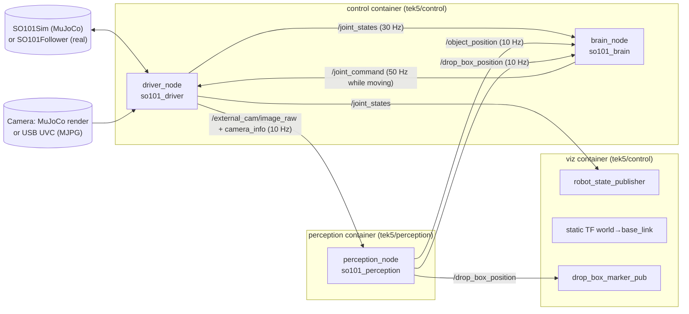
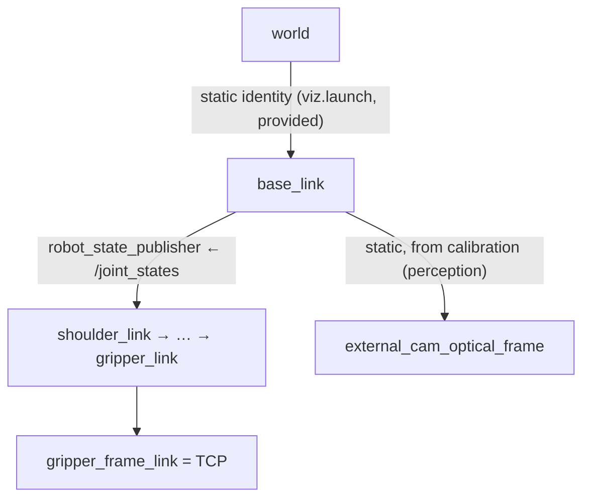
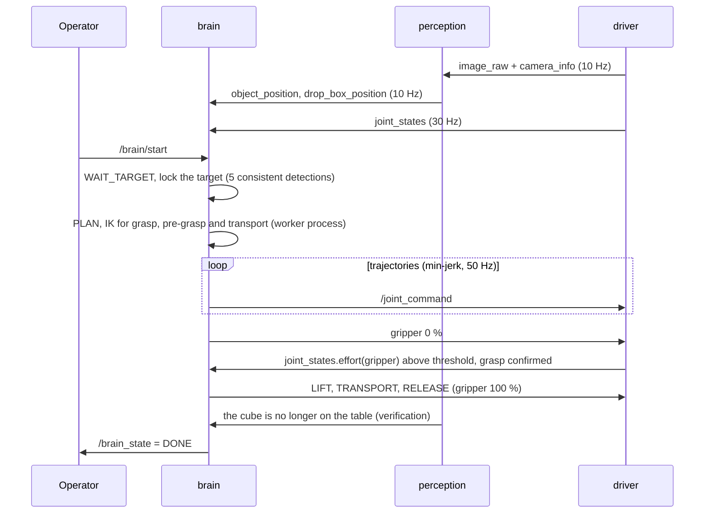

# 01 — System architecture and interface contract

> Authors: [ARC] ROS 2 architect · Reviewers: [CTRL], [VIS], [DEC], [QA]
> Related decisions: ADR-001 to ADR-007, ADR-017, ADR-022

## 1. Overview

**Guiding principle**: the driver is the **only** component that knows the hardware (C-05, C-10). Perception and brain only speak standard ROS messages, SI units and explicit frames. Switching sim → real changes a single parameter.

## 2. Packages

| Package | Type | Container | Content | Status |
| --- | --- | --- | --- | --- |
| `so101_driver` | ament_python | control | `driver_node`: sim/real backend, control loop, camera, sim services | Base driver (step 1.0): `/joint_states`, `/joint_command`, speed limiter; sim camera thread (step 1.2); clamp, parameters, `camera_info`, effort (1.1, 1.3); `/sim/randomize`, `seed`, ground truth (1.4); provided `_connect_arm` unchanged (ADR-032) |
| `so101_brain` | ament_python | control | `brain_node` + pure modules: `kinematics.py`, `grasp_planner.py`, `trajectory.py`, `fsm.py` | FK/IK in `kinematics.py` (step 2.1), min-jerk `trajectory.py` (2.2); `/end_effector_pose`, `/go_to_target` streaming a trajectory; orientation IK (2.1b), `grasp_planner.py` validated in closed loop (2.4); pure `fsm.py` (4.1) driven by a 50 Hz tick, `/brain/start`, `/brain/stop`, `/brain_state` (4.2a); planning worker, `/brain/markers` (4.2b): full cycle in sim with the ground-truth stub (4.2c) |
| `so101_perception` | ament_python | perception | `perception_node` + pure modules: `detection.py`, `geometry.py`, `calibration.py` (offline tool) | Skeleton (step 3.1): `/perception/debug_image` = each image with its status, `debug.py`; reference images with labels in `test/data/` (3.2a) |
| `so101_interfaces` | ament_cmake | both | `.srv` (existing); phase 2 adds `Connect4Board.msg`, `DropToken.srv` and the `PickPlace` action (ADR-037) | Existing |
| `so101_description` | ament_python | viz | URDF, meshes, `viz.launch.py`. **Do not modify** (C-08) | Provided |
| **`so101_common`** | ament_python (pure Python, no dependency) | both | **Single source of truth**: joint names, limits, gripper %↔rad conversion, frame names | **Exists** (ADR-003, step 0.3) |
| **`so101_bringup`** | ament_python | control | Top-level launch files (`sim.launch.py`, `real.launch.py`), `config/*.yaml`, RViz config, tools (`evaluate`, calibration) | **Exists** (step 0.3): `sim.launch.py`, `config/driver.yaml` and `brain.yaml`, `rviz/so101.rviz`; the rest later |
| **`so101_connect4`** | ament_python | perception + control | Phase 2: pure `game.py` and `board.py`, `board_reader_node`, `game_node` | **Planned** (ADR-037) |

> **Why `so101_common`?** Without it, the gripper 0–100 % ↔ rad mapping, the limits and the joint names would be duplicated in the driver, the brain and the tests — the number-one source of silent bugs in robotics (a joint clamped differently on each side).

## 3. Interface contract

This table is **the contract** between team members. Any change goes through a PR reviewed by the owners on both sides.

### 3.1 Topics

| Topic | Type | Producer → consumers | Rate | Units and content | Frame (`frame_id`) | Publisher QoS |
| --- | --- | --- | --- | --- | --- | --- |
| `/joint_states` | `sensor_msgs/JointState` | driver → brain, RSP | **30 Hz** target (≥ 20 imposed; the bootstrap prototype measured 30 Hz) | `name` = 6 joints; `position` in **rad**, gripper included (converted % → rad for RSP); `effort` = normalized load in [-1, 1] (ADR-016): positive towards larger angles, except the gripper, positive when squeezing (03 §5) | — | Reliable, depth 10 |
| `/joint_command` | `sensor_msgs/JointState` | brain (or human) → driver | Event-driven; 50 Hz during trajectories | `name` = subset of the 6 joints; `position` in **rad**, **gripper in % (0–100)** | — | Reliable, depth 10 |
| `/external_cam/image_raw` | `sensor_msgs/Image` (`rgb8`) | driver → perception, RViz | **10 Hz** | Raw image (320×240 in sim) | `external_cam_optical_frame` | **Reliable**, depth 2 |
| `/external_cam/camera_info` | `sensor_msgs/CameraInfo` | driver → perception | 10 Hz, **same `stamp`** as the image | K, D, P, size | `external_cam_optical_frame` | Reliable, depth 2 |
| `/object_position` | `geometry_msgs/PoseStamped` | perception → brain | 10 Hz, **only when the detection is valid** | Cube center (m); orientation = cube yaw (quaternion about z) | `base_link` | Reliable, depth 1 |
| `/drop_box_position` | `geometry_msgs/PoseStamped` | perception → brain, `drop_box_marker_pub` | 10 Hz when valid | Center of the box **floor** (m) | `base_link` | Reliable, depth 1 |
| `/perception/debug_image` | `sensor_msgs/Image` | perception → RViz | 5–10 Hz | Annotated image: masks, centroids, status | `external_cam_optical_frame` | Best effort, depth 1 |
| `/end_effector_pose` | `geometry_msgs/PoseStamped` | brain → RViz | 30 Hz | TCP pose (`gripper_frame_link`) from forward kinematics | `base_link` | Reliable, depth 10 |
| `/brain_state` | `std_msgs/String` | brain → human, tests | On each transition + 1 Hz | FSM state name (`IDLE`, `APPROACH`…) | — | Reliable, **transient_local**, depth 1 |
| `/brain/markers` | `visualization_msgs/MarkerArray` | brain → RViz | On each plan | Grasp/pre-grasp targets, waypoints | `base_link` | Reliable, depth 1 |

**QoS rule (ADR-004)**: a **Reliable publisher** is compatible with Reliable **and** Best-effort subscribers; the reverse is false, and fails silently [KO1 p29]. All our publishers are therefore Reliable (except debug streams). Subscribers that only want "the latest image" (perception) subscribe Best effort, depth 1.

### 3.2 Services

| Service | Type | Server | Role |
| --- | --- | --- | --- |
| `/brain/start` | `std_srvs/Trigger` | brain | Starts a pick & place cycle. Rejected if not in `IDLE` (C-35); in `ERROR` it re-arms (→ `IDLE`, `06` §3.1) |
| `/brain/stop` | `std_srvs/Trigger` | brain | Aborts the cycle, from any state: the arm freezes at its current position, state → `STOPPED` → `IDLE` |
| `/go_to_target` | `so101_interfaces/GoToTarget` (existing) | brain | Moves to a target position by IK (IK tests, C-41): position IK seeded with the measured joints, rejected if FK misses by more than 1 mm; answers at once (`moving for T s`), then streams a min-jerk trajectory on `/joint_command` at 50 Hz; a new goal preempts (steps 2.1, 2.2); served in `IDLE` only (4.2a) |
| `/sim/randomize` | `std_srvs/Trigger` | driver (**sim only**) | Randomizes the cube **and** the box (C-42, ADR-018) |

### 3.3 Main parameters

Declared with descriptors (description, range, read-only: read at startup) in each node, loaded from `so101_bringup/config/*.yaml`. The driver declares `use_sim`, `port` and, since step 1.1, the rates, speed limits and image size, since step 1.4 `seed` and `expose_ground_truth`; `calibration_file` and `scene_path` come with step 5.1.

| Node | Parameter | Default | Note |
| --- | --- | --- | --- |
| driver | `use_sim` | `true` | Imposed (C-10) |
| driver | `port` | `/dev/ttyACM0` | Real arm |
| driver | `calibration_file` | `/calibration/arm.json` | Real arm, mounted by compose |
| driver | `control_rate_hz` | 50 | 2 backend calls per tick → the sim runs in real time [MES-02] |
| driver | `joint_state_rate_hz` | 30 | ≥ 20 imposed (C-11): the range starts at 20 |
| driver | `camera_rate_hz` | 10 | C-12 |
| driver | `camera_width/height` | 320/240 | 640/480 during calibration (ADR-013); at most 1280/720, the scene's offscreen buffer; K follows |
| driver | `max_joint_velocity` | 1.5 rad/s (sim), 0.8 (real) | Safety limiter (ADR-023) |
| driver | `max_gripper_velocity` | 200 %/s | Safety limiter (ADR-023) |
| driver | `scene_path` | provided scene | Scene with ArUco markers for calibration (ADR-013) |
| driver | `seed` | 0 | `/sim/randomize`: same seed, same cube and box sequence (`03` §7) |
| driver | `expose_ground_truth` | **`false`** | Tests and evaluation bench only (C-06) |
| perception | `extrinsics_file` | `config/camera_extrinsics.yaml` | Produced by calibration |
| perception | `hsv_*` | see `05` | Tunable at runtime |
| brain | `grasp.*`, `motion.*`, `fsm.*` | see `06` | Heights, speeds, thresholds, timeouts |

## 4. Frames and conventions (ADR-005)

| Convention | Value | Why |
| --- | --- | --- |
| Units | SI, angles in rad (REP-103); **exception: gripper in %** on `/joint_command` (imposed) | C-11, C-14 |
| Working frame | `base_link` (= `world`, identity); x forward, z up | Brief: "in the robot frame" |
| Camera frame | `external_cam_optical_frame`, optical convention: **z forward, x right, y down** | OpenCV and REP-103. ⚠ MuJoCo uses y up and −z forward [MES-13] |
| TCP | `gripper_frame_link` (URDF). **Approach axis = +z**, jaw closing axis = x [MES-05] | Measured |
| `shoulder_pan` | **Positive = rotation towards −y** (pan ≈ −azimuth); vertical axis offset at **x = 3.88 cm** from the origin [MES-06] | Measured pitfall |
| Timestamps | `header.stamp` = wall clock at acquisition. **No `use_sim_time`**: the driver paces the sim in real time [MES-02] | Simplicity |

## 5. Nominal pick & place sequence

## 6. Startup and launch

| Command | Effect |
| --- | --- |
| `docker compose up -d control perception viz` | `control` builds the workspace then starts `so101_bringup sim.launch.py` (driver + brain); `perception` stays idle until step 3.1, then waits for its build and starts `perception_node`; `viz` starts RSP + static TF + marker |
| `USE_SIM=false` in `docker/.env` | The same launch passes `use_sim:=false` to the driver, nothing else changes (C-10) |
| `ros2 service call /brain/start std_srvs/srv/Trigger` | Starts a cycle: the arm parks and waits for its target (step 4.2a); the full cycle once perception (3.3) and the planning worker (4.2b) are in |

The entrypoint (`docker/control_entrypoint.sh`) starts `so101_bringup sim.launch.py` and forwards `USE_SIM` and `REAL_ROBOT_PORT` (`docker/.env`) as `use_sim:=` and `port:=`. The course's `driver.launch.py` and `brain.launch.py` stay, to start one node alone.

## 7. Rejected architecture options

| Alternative | Why rejected |
| --- | --- |
| ros2_control + JointTrajectoryController | `/joint_command` is imposed; a hardware interface would have to be written for both SO101Sim and Follower. High cost, low gain for 5 DoF |
| MoveIt 2 | No obstacles, 5 DoF, simple IK: the complexity (SRDF, planning scene) is not justified in phase 1. Possible in phase 2 |
| Single "monolith" node | Violates C-03; prevents parallel work |
| Perception in the control container | Violates C-02 |
| `use_sim_time` + `/clock` published by the driver | Useless: the sim is paced in real time by the driver [MES-02], and it adds a source of bugs |
