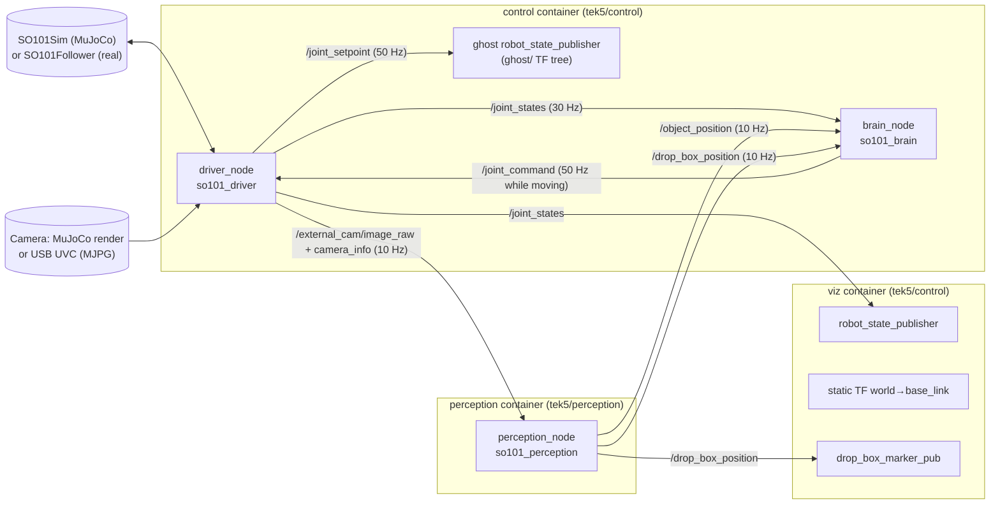
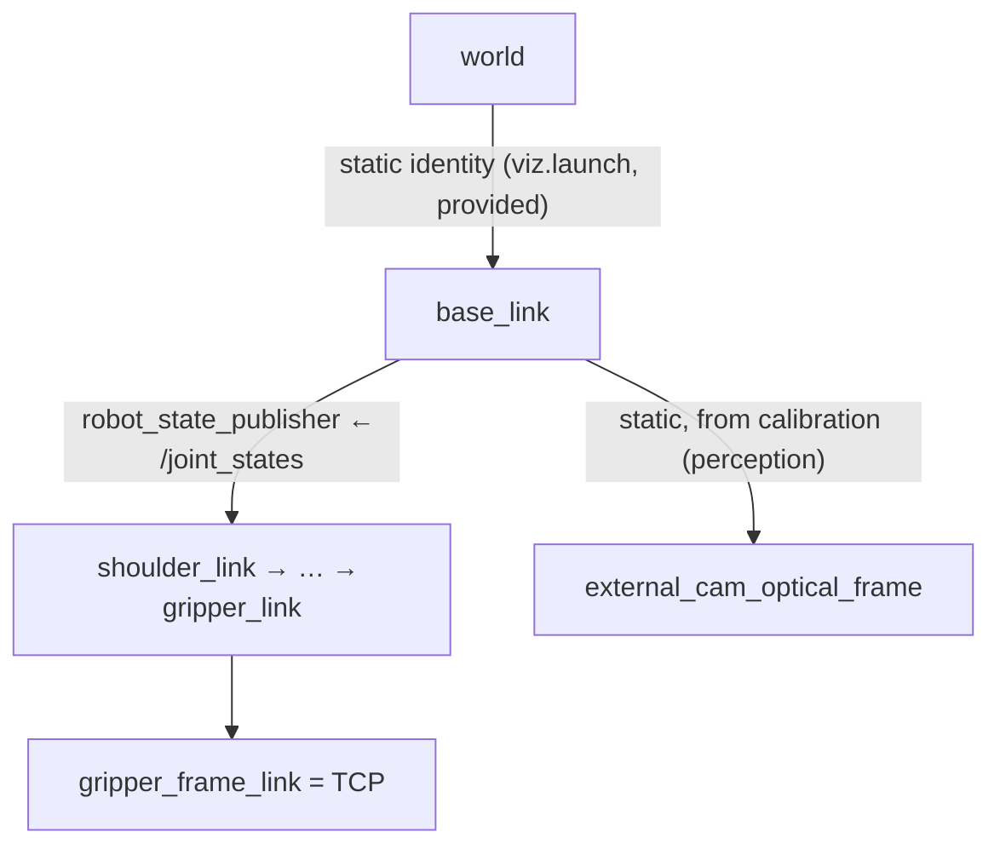
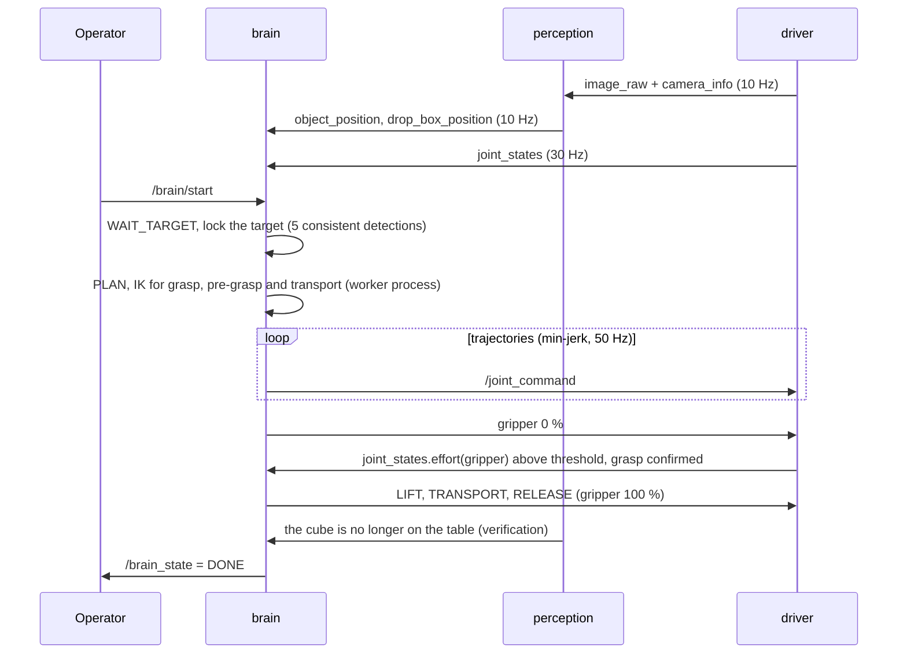

# 01 — System architecture and interface contract

> Authors: [ARC] ROS 2 architect · Reviewers: [CTRL], [VIS], [DEC], [QA]
> Related decisions: ADR-001 to ADR-007, ADR-017, ADR-022

## 1. Overview

**Guiding principle**: the driver is the **only** component that knows the hardware (C-05, C-10). Perception and brain only speak standard ROS messages, SI units and explicit frames. Switching sim → real changes a single parameter.

## 2. Packages

| Package | Type | Container | Content | Status |
| --- | --- | --- | --- | --- |
| `so101_driver` | ament_python | control | `driver_node`: sim/real backend, control loop, camera, sim services | **Exists**: `/joint_states`, `/joint_command` (partial, clamped, speed-limited), the sim camera thread, `camera_info`, effort, `/sim/randomize`, `seed`, ground truth for the bench; in game mode the simulated person, `/sim/connect4/*` (#80, `03` §7); real-arm safety (shutdown move, bus loss) and webcam; a warning for each late tick; `/joint_setpoint` for the ghost arm (#200); provided `_connect_arm` unchanged (ADR-032) |
| `so101_brain` | ament_python | control | `brain_node` + pure modules: `kinematics.py`, `grasp_planner.py`, `trajectory.py`, `fsm.py`, `drop.py` | **Exists**: FK/IK (no self-collision), the phase-2 drop pose `release_pose` (#83) and, in game mode, one move of the game behind `/brain/drop` and `/brain/handover` (`drop.Move`, #84, #85), min-jerk trajectories, `/end_effector_pose`, `/go_to_target`, the grasp planner in a worker process, the pure `fsm.py` driven by a 50 Hz tick, `/brain/start`, `/brain/stop`, `/brain_state`, `/brain/markers` |
| `so101_perception` | ament_python | perception | `perception_node` + pure modules: `detection.py`, `geometry.py`, `calibration.py` and `intrinsics.py` (offline tools) | **Exists**: `/object_position` and `/drop_box_position` from the HSV detection, our extrinsic calibration (`calibrate_extrinsics` in sim, `calibrate_intrinsics` and `calibrate_touch` on the real bench) and the median filter; the cube yaw from `minAreaRect`; a cube cut by the image edge or partly hidden is not published; `/perception/debug_image` with masks, centroids and status; reference images with labels in `test/data/` |
| `so101_interfaces` | ament_cmake | both | `.srv` (existing); phase 2 adds `Connect4Board.msg`, `DropToken.srv` and `Drop.srv` (ADR-037) | Existing; `Connect4Board.msg` and `DropToken.srv` (#80), `Drop.srv` (#84) |
| `so101_description` | ament_python | viz | URDF, meshes, `viz.launch.py`. **Do not modify** (C-08) | Provided |
| **`so101_common`** | ament_python (pure Python, no dependency) | both | **Single source of truth**: joint names, limits, gripper %↔rad conversion, frame names | **Exists** (ADR-003, step 0.3) |
| **`so101_bringup`** | ament_python | control | Top-level launch files (`sim.launch.py`, `real.launch.py`), `config/*.yaml`, RViz config, the sim scene, the evaluation bench | **Exists**: `sim.launch.py`, `real.launch.py`, the robustness demo's launch file, `config/*.yaml` (driver, brain, the sim scene and its markers), the Connect Four scene with `connect4:=true` (#79), `rviz/so101.rviz`, the sim scene generator, the evaluation bench (`evaluate`), the sim-backed tests |
| **`so101_connect4`** | ament_python | perception + control | Phase 2: pure `game.py`, `turns.py` and `board.py`, `board_reader_node`, `game_node`, the console | **Exists** (ADR-037): the package, built and tested, its grid layout `config/connect4_grid.yaml` (`phase2/P2-02` §7) and `layout.py`, the grid frame and the markers' corners the scene and the reader share, under the guards (no backend, ground truth, provided extrinsics, `/joint_command` or `/sim/` outside tests); the engine `game.py` and the turns `turns.py` (only `MOVE` commands the arm), ported from the prototypes [MES-66]; `board.py` and `board_reader_node`, the grid read from the camera (#81, #82) [MES-68]; `game_node` and the console planned |

> **Why `so101_common`?** Without it, the gripper 0–100 % ↔ rad mapping, the limits and the joint names would be duplicated in the driver, the brain and the tests — the number-one source of silent bugs in robotics (a joint clamped differently on each side).

## 3. Interface contract

This table is **the contract** between team members. Any change goes through a PR reviewed by the owners on both sides.

### 3.1 Topics

| Topic | Type | Producer → consumers | Rate | Units and content | Frame (`frame_id`) | Publisher QoS |
| --- | --- | --- | --- | --- | --- | --- |
| `/joint_states` | `sensor_msgs/JointState` | driver → brain, RSP | **30 Hz** (≥ 20 imposed) | `name` = 6 joints; `position` in **rad**, gripper included (converted % → rad for RSP); `effort` = normalized load in [-1, 1] (ADR-016): positive towards larger angles, except the gripper, positive when squeezing (03 §5) | — | Reliable, depth 10 |
| `/joint_command` | `sensor_msgs/JointState` | brain (or human) → driver | Event-driven; 50 Hz during trajectories | `name` = subset of the 6 joints; `position` in **rad**, **gripper in % (0–100)** | — | Reliable, depth 10 |
| `/joint_setpoint` | `sensor_msgs/JointState` | driver → the ghost `robot_state_publisher` (RViz, #200) | 50 Hz, each control step, also while the bus is retried; none once it is lost | The setpoint **sent** to the motors, after the clamp and the speed limiter: the 6 joints in **rad**, the gripper converted from % (what RSP expects). Read-only: nothing commands the arm from it | — | Reliable, depth 1 (RSP subscribes Reliable, ADR-004) |
| `/external_cam/image_raw` | `sensor_msgs/Image` (`rgb8`) | driver → perception, RViz | **10 Hz** | Raw image (320×240 in sim) | `external_cam_optical_frame` | **Reliable**, depth 2 |
| `/external_cam/camera_info` | `sensor_msgs/CameraInfo` | driver → perception | 10 Hz, **same `stamp`** as the image | K, D, P, size | `external_cam_optical_frame` | Reliable, depth 2 |
| `/object_position` | `geometry_msgs/PoseStamped` | perception → brain | 10 Hz, **only when the detection is valid** | Cube center (m); orientation = cube yaw (quaternion about z) | `base_link` | Reliable, depth 1 |
| `/drop_box_position` | `geometry_msgs/PoseStamped` | perception → brain, `drop_box_marker_pub` | 10 Hz when valid | Center of the box **floor** (m) | `base_link` | Reliable, depth 1 |
| `/perception/debug_image` | `sensor_msgs/Image` | perception → RViz | 5–10 Hz | Annotated image: masks, centroids, status | `external_cam_optical_frame` | Best effort, depth 1 |
| `/connect4/board` | `so101_interfaces/Connect4Board` | board_reader (game mode) → game_node | 10 Hz **once 5 reads in a row agree**, each on a new image | `cells`: 42, row-major from the bottom row, 0 empty, 1 human, 2 robot; `valid`, `reason`; the stamp is the first image's of the streak (`phase2/P2-02` §6) | `connect4_grid` | Reliable, depth 1 |
| `/connect4/grid_pose` | `geometry_msgs/PoseStamped` | board_reader → game_node, RViz | 10 Hz when the grid's markers are seen | The grid frame, also sent as the TF `base_link` → `connect4_grid` | `base_link` | Reliable, **transient_local**, depth 1 |
| `/connect4/debug_image` | `sensor_msgs/Image` | board_reader → RViz | 10 Hz | The cells as read, a status line | `external_cam_optical_frame` | Reliable, depth 1 |
| `/end_effector_pose` | `geometry_msgs/PoseStamped` | brain → RViz | 30 Hz | TCP pose (`gripper_frame_link`) from forward kinematics | `base_link` | Reliable, depth 10 |
| `/brain_state` | `std_msgs/String` | brain → human, tests | On each transition + 1 Hz | FSM state name (`IDLE`, `APPROACH`…) | — | Reliable, **transient_local**, depth 1 |
| `/brain/markers` | `visualization_msgs/MarkerArray` | brain → RViz | On each plan | Grasp/pre-grasp targets, waypoints, the locked cube until `LIFT` (`06` §7) | `base_link` | Reliable, depth 1 |

**QoS rule (ADR-004)**: a **Reliable publisher** is compatible with Reliable **and** Best-effort subscribers; the reverse is false, and fails silently [KO1 p29]. All our publishers are therefore Reliable (except debug streams). Subscribers that only want "the latest image" (perception) subscribe Best effort, depth 1.

### 3.2 Services

| Service | Type | Server | Role |
| --- | --- | --- | --- |
| `/brain/start` | `std_srvs/Trigger` | brain | Starts a pick & place cycle. Rejected if not in `IDLE` (C-35), and always in game mode (no cube on the game's scene, and the way to `PARK` crosses the grid [MES-69]); in `ERROR` it re-arms (→ `IDLE`, `06` §3.1) |
| `/brain/stop` | `std_srvs/Trigger` | brain | Aborts the cycle, from any state: the arm freezes at its current position, state → `STOPPED` → `IDLE`. It cuts a move of the game too, whose reply is `stopped` |
| `/brain/drop` | `so101_interfaces/Drop` | brain (**game mode only**) | One move of the game (`06` §5.1, `phase2/P2-02` §2.3): `target`, the token's centre at the release, in `base_link`. From `HANDOVER`, a token between the open jaws: closes, checks the grip, drops the token, comes back. **Replies at the end of the move**, `/brain_state` stays `IDLE`. `message`: `done in <s> s`, or `no_token` (the jaws open again, the arm has not moved), `unreachable`, `not_at_handover`, `not_idle:<state>`, `busy`, `no_joint_states`, `stopped`, `timeout:<step>` |
| `/brain/handover` | `std_srvs/Trigger` | brain (**game mode only**) | Opens the jaws and reaches `HANDOVER` (`connect4.handover_pose`), where a token is given and the camera sees the whole grid; replies there. Same refusals |
| `/go_to_target` | `so101_interfaces/GoToTarget` (existing) | brain | Moves to a target position by IK (IK tests, C-41): position IK seeded with the measured joints, rejected if FK misses by more than 1 mm; answers at once (`moving for T s`), then streams a min-jerk trajectory on `/joint_command` at 50 Hz; a new goal preempts (steps 2.1, 2.2); served in `IDLE` only (4.2a), and not during a move of the game |
| `/sim/randomize` | `std_srvs/Trigger` | driver (**sim only**) | Randomizes the cube **and** the box (C-42, ADR-018). Not served in game mode |
| `/sim/connect4/drop_token` | `so101_interfaces/DropToken` | driver (**sim only**, game mode) | The simulated person drops a token: `column` 0 to 6, `color` `HUMAN` or `ROBOT` (`03` §7, `phase2/P2-02` §7) |
| `/sim/connect4/give_token`, `/sim/connect4/reset_board` | `std_srvs/Trigger` | driver (**sim only**, game mode) | A yellow token between the open jaws; every token back to its parking place |

### 3.3 Main parameters

Declared with descriptors (description, range, read-only: read at startup) in each node, loaded from `so101_bringup/config/*.yaml`. The driver declares `use_sim`, `port`, the rates, speed limits and image size, `seed`, `expose_ground_truth`, `shutdown_pose`, `shutdown_velocity`, `shutdown_tolerance`, `bus_retries`, the per-motor `max_relative_target_*`, `camera_device` and `camera_info_file`.

- **Every tunable is in the base files** (`driver.yaml`, `brain.yaml`, `perception.yaml`), with its sim value.
- **A node stops at startup on a key it does not declare.** ROS would ignore it, so a typo in a real file would keep the sim's value.
- **Not parameters**:
  - the calibration file: the provided `_connect_arm` reads `/calibration/arm.json` (ADR-032); the host file is `CALIBRATION_FILE` in `docker/.env`;
  - the shutdown move's 11 s: PARK from the farthest pose at 0.5 rad/s, and its slow end; the entrypoint kills the stack 14 s after SIGINT (`03` §8);
  - the rates of §3.1, part of the interface contract;
  - the arm geometry of the fold rule (`04` §8).
- `scene_path` loads our sim scene (3.4a, #44): set by `sim.launch.py`, generated by `so101_bringup.sim_scene` (ADR-036); empty, the provided one.

| Node | Parameter | Default | Note |
| --- | --- | --- | --- |
| driver | `use_sim` | `true` | Imposed (C-10) |
| driver | `port` | `/dev/ttyACM0` | Real arm |
| driver | (calibration file) | `/calibration/arm.json` | Not a parameter: the path the provided `_connect_arm` reads, mounted by compose from `CALIBRATION_FILE` |
| driver | `control_rate_hz` | 50 | 2 backend calls per tick → the sim runs in real time [MES-02] |
| driver | `joint_state_rate_hz` | 30 | ≥ 20 imposed (C-11): the range starts at 20 |
| driver | `camera_rate_hz` | 10 | C-12 |
| driver | `camera_width/height` | 320/240 (640/480 real) | Sim: 640/480 during calibration (ADR-013), at most 1280/720, the scene's offscreen buffer, K follows; webcam: a size it supports |
| driver | `max_joint_velocity` | 1.5 rad/s, sim and real arm | Safety limiter (ADR-023) |
| driver | `max_gripper_velocity` | 200 %/s | Safety limiter (ADR-023) |
| driver | `scene_path` | `""`: the provided scene | Set by `sim.launch.py` (not in `driver.yaml`): `calibration:=true` gives the ArUco scene of `markers_sim.yaml`, with `driver_calibration.yaml` at 640×480 (3.4a, #44; `05` §5.3); `connect4:=true` gives the game's scene, with `driver_connect4.yaml` at 640×480 (#79) |
| driver | `connect4_layout` | `""`: no game | Set by `sim.launch.py connect4:=true`: the path of `connect4_grid.yaml`, which turns the driver's game mode on (`03` §7) |
| driver | `seed` | 0 | `/sim/randomize`: same seed, same cube and box sequence (`03` §7) |
| driver | `expose_ground_truth` | **`false`** | Tests and evaluation bench only (C-06) |
| driver | `shutdown_pose` | `PARK` [1.9, −1.7, 1.5, 0.7, 0.0] rad; in game mode `HANDOVER` (`driver_connect4.yaml`) | Reached at 0.5 rad/s before `disconnect()` cuts the torque (`03` §8). On the game's scene the joint line from `HANDOVER` to `PARK` goes 30 mm into the grid's near post [MES-69] |
| driver | `shutdown_velocity` / `shutdown_tolerance` | 0.5 rad/s / 0.05 rad | The shutdown move, at most `max_joint_velocity`, 11 s at most (`03` §8) |
| driver | `bus_retries` | 3 | Failed control ticks retried before "Bus lost" (`03` §8) |
| driver | `max_relative_target_arm` / `_gripper` | 0.2 rad / 25 % | Real arm only: LeRobot's max delta per command, per motor (ADR-023) |
| driver | `camera_device` | empty (`/dev/video0` real) | Webcam in MJPG (`03` §6), also with the sim arm; empty: the sim render, or no image on the real arm |
| driver | `camera_info_file` | empty | Webcam: ROS calibration YAML (6.2b); empty: no `camera_info` |
| perception | `extrinsics_file` | `config/camera_extrinsics.yaml` | Produced by calibration |
| perception | `hsv_*`, `min_area_px`, `min_solidity` | see `05` | Tunable at runtime |
| perception | `process_rate_hz`, `filter_size`, `filter_jump_m`, `min_cube_area_ratio` | 20 Hz, 5, 0.02 m, 0.85 | Read at startup; the median filter (`05` §7), the partly hidden cube (`05` §2.3) |
| brain | `grasp.*`, `motion.*`, `fsm.*` | see `06` §6 | Heights, speeds, thresholds, timeouts; `motion.v_max_rad_s` 1.0 rad/s, sim and real arm |
| brain | `connect4.enabled` | **`false`** | Set by `sim.launch.py connect4:=true` (not in `brain.yaml`): the brain serves `/brain/drop` and `/brain/handover` |
| brain | `connect4.handover_pose` | [−1.0, −0.6, 0.6, 1.1, 1.57] rad | `HANDOVER`: pan ≤ −0.7 hides no cell from the camera [MES-65] |

**Real arm** (`real.launch.py`, or `use_sim:=false`): `driver_real.yaml` and `brain_real.yaml` load on top of the base files, last: in sim the driver gets `driver_calibration.yaml` there with `calibration:=true` (#197). They change only these keys (`test_real_config.py`):

| File | Key | Real value |
| --- | --- | --- |
| `driver_real.yaml` | `camera_device` | `/dev/video0`, the webcam (6.2a) |
| `driver_real.yaml` | `camera_width` / `camera_height` | 640 / 480 |
| `driver_real.yaml` | `camera_info_file` | `camera_real_intrinsics.yaml` (6.2b) |
| `driver_real.yaml` | `joint_zero_offsets` | Each joint's reading at the URDF zero, rad (`07` §4, #196); 0 in `driver.yaml` |
| `brain_real.yaml` | `motion.reach_tol_rad` / `motion.reach_tol_roll_rad` | 0.10 / 0.25 rad (`07` §4) |
| `brain_real.yaml` | `fsm.grasp_wait_s` / `fsm.grasp_timeout_s` | 1.2 / 2.0 s: the real jaws close slower |
| `brain_real.yaml` | `grasp.close_pct` / `grasp.hold_gap_pct` | 1 % / 1.8 % [MES-60] |
| `perception_real.yaml` | `hsv_*` | The setup's colors: the red cube, the green bowl (6.4b) |

The speeds are the sim's (ADR-023 Update). `USE_SIM=false` also reaches the perception container: `perception_real.yaml` on top of `perception.yaml`, and the pose in `camera_extrinsics_real.yaml` instead of `camera_extrinsics.yaml`. The object is a parameter there: `cube_side_m` and `box_height_m` in `perception.yaml`.

## 4. Frames and conventions (ADR-005)

| Convention | Value | Why |
| --- | --- | --- |
| Units | SI, angles in rad (REP-103); **exception: gripper in %** on `/joint_command` (imposed) | C-11, C-14 |
| Working frame | `base_link` (= `world`, identity); x forward, z up | Brief: "in the robot frame" |
| Camera frame | `external_cam_optical_frame`, optical convention: **z forward, x right, y down** | OpenCV and REP-103. ⚠ MuJoCo uses y up and −z forward [MES-13] |
| TCP | `gripper_frame_link` (URDF). **Approach axis = +z**, jaw closing axis = x [MES-05] | Measured |
| `shoulder_pan` | **Positive = rotation towards −y** (pan ≈ −azimuth); vertical axis offset at **x = 3.88 cm** from the origin [MES-06] | Measured pitfall |
| Timestamps | `header.stamp` = wall clock at acquisition. **No `use_sim_time`**: the driver paces the sim in real time [MES-02] | Simplicity |

## 5. Nominal pick & place sequence

## 6. Startup and launch

| Command | Effect |
| --- | --- |
| `docker compose up -d control perception viz` | `control` builds the workspace then starts `so101_bringup sim.launch.py` (driver + brain); `perception` waits for its build and starts `perception_node`; `viz` starts RSP + static TF + marker |
| `USE_SIM=false` in `docker/.env` | The entrypoint starts `real.launch.py`: `sim.launch.py` with `use_sim:=false`, which adds `driver_real.yaml` and `brain_real.yaml` (§3.3); nothing else changes (C-10) |
| `CONNECT4=true` in `docker/.env`, or `CONNECT4=true tools/so101 up` | The game of phase 2 in place of the pick & place, sim only (#231, `phase2/P2-02` §6.1): the entrypoint passes `connect4:=true` to `sim.launch.py` (the game's scene at 640×480, the driver's `/sim/connect4/*`, the brain's `/brain/drop` and `/brain/handover`, `so101_connect4`'s `game.launch.py`); the perception container starts `so101_connect4`'s `board_reader.launch.py`, the board reader, instead of `perception_node`. `game.launch.py` is empty until the game node (#86). Refused with `USE_SIM=false`. `down` then `up` to change mode: `restart` keeps the environment |
| `ros2 service call /brain/start std_srvs/srv/Trigger` | Starts a full pick & place cycle (`06` §3); `tools/so101 cycle` does it after `/sim/randomize` |

The entrypoint (`docker/control_entrypoint.sh`) starts `so101_bringup sim.launch.py`, or `real.launch.py` with `REAL_ROBOT_PORT` as `port:=` when `USE_SIM=false` (`docker/.env`). The course's `driver.launch.py` and `brain.launch.py` stay, to start one node alone.

## 7. Rejected architecture options

| Alternative | Why rejected |
| --- | --- |
| ros2_control + JointTrajectoryController | `/joint_command` is imposed; a hardware interface would have to be written for both SO101Sim and Follower. High cost, low gain for 5 DoF |
| MoveIt 2 | No obstacles, 5 DoF, simple IK: the complexity (SRDF, planning scene) is not justified in phase 1. Possible in phase 2 |
| Single "monolith" node | Violates C-03; prevents parallel work |
| Perception in the control container | Violates C-02 |
| `use_sim_time` + `/clock` published by the driver | Useless: the sim is paced in real time by the driver [MES-02], and it adds a source of bugs |
