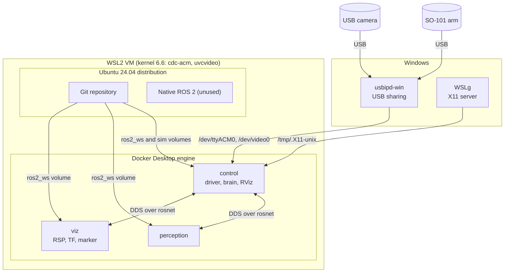

# 02 — Development environment and infrastructure

> Authors: [OPS] DevOps/infra · Reviewers: [ARC], [CTRL], [VIS]
> Related decisions: ADR-001, ADR-002, ADR-007, ADR-019

## 1. Reference workstation (validated on 2026-10-08)



| Item | Version / state | Evidence |
| --- | --- | --- |
| Host | Windows + **WSL2** Ubuntu 24.04, kernel `6.6.87.2-microsoft-standard-WSL2` | `uname -r` |
| Docker | Docker Desktop 29.8 (WSL integration), Compose v5.5 | `docker info` |
| `tek5/control` image | 4.2 GB — ROS 2 Jazzy, numpy 1.26.4, mujoco 3.15.0, opencv-headless 4.10, ikpy 4.1.0, pinocchio 4.1.0, feetech-servo-sdk 1.0.0, pyserial 3.5 | [MES-01] |
| `tek5/perception` image | 2.9 GB — ROS 2 Jazzy, opencv-headless 4.10, numpy 1.26.4, `cv2.aruco` available | [MES-01], [MES-16] |
| Display | WSLg (X11 `:0`) → RViz OpenGL 4.5 in the container | [MES-18] |
| USB | usbipd-win 5.3; the WSL kernel ships `cdc-acm` (arm) and `uvcvideo` (webcam) | [MES-17] |
| Native ROS 2 in WSL | Present, **not used** for this project (see §6) | — |

Other possible hosts: native Linux (simplest, no usbipd), or a VM (USB passthrough to configure in the hypervisor) [KO2 p34].

## 2. What the images contain, and how to extend them

- **Never `pip install` in a running container** without adding it to the Dockerfile: the change vanishes on the next `up` and does not exist for teammates.
- Add dependencies **in a dedicated layer with pinned versions**, at the end of the Dockerfile to benefit from the cache.
- `numpy<2` is pinned in `control` because Jazzy apt packages (Pinocchio, cv_bridge) are built against numpy 1.26. **Do not touch it.**
- ⚠ `so101-core` and `so101-sim` are installed with a **non-editable** `pip install` in the image. The `../sim:/opt/so101/sim` volume only serves the **assets** (hard-coded scene path). **Editing Python code in `sim/` or `core/` has no effect without a rebuild.** Decision: we modify neither `sim/` nor `core/`; specific needs (box randomization, calibration scene, phase-2 scene) are handled in the driver (ADR-018, ADR-013, ADR-036).

## 3. `docker-compose.yml` changes (ADR-002)

### 3.1 Add the missing `perception` service

**Today** (step 0.3): the service exists but stays idle (`sleep infinity`), because `so101_perception` still has `COLCON_IGNORE` and its stub raises `NotImplementedError`; check C-04 with the course's `ros2 run example_py_pkg talker` in `control` and `ros2 topic echo /chatter` in `perception`. **Step 3.1** switches to the command below.

The current compose file forbids two concurrent `colcon build` on the same volume, so `perception` builds **into its own folders** (`build_perception/`, `install_perception/`) and **only the packages it needs**:

```yaml
  perception:
    build:
      context: ..
      dockerfile: docker/Dockerfile.perception
    image: tek5/perception
    init: true
    environment:
      <<: *ros-env
    volumes:
      - ../ros2_ws:/ros2_ws
    networks: [rosnet]
    command: >
      bash -lc "source /opt/ros/jazzy/setup.bash && cd /ros2_ws &&
      colcon build --symlink-install --build-base build_perception --install-base install_perception
      --packages-up-to so101_perception &&
      source install_perception/setup.bash &&
      ros2 launch so101_perception perception.launch.py"
```

`build_perception/` and `install_perception/` are already covered by the root `.gitignore`.

### 3.2 Real USB camera in `control`

`/dev/video*` only exists when the camera is attached. Reuse the method already used for the serial port (cgroup rule + `mknod` in the entrypoint) rather than `devices:`, which makes `up` fail when the device is missing:

```yaml
    device_cgroup_rules:
      - 'c 166:* rmw'   # ttyACM (arm)
      - 'c 188:* rmw'   # ttyUSB
      - 'c 81:* rmw'    # video4linux (camera)
```

In `control_entrypoint.sh`, following the ttyACM pattern: `[ -e /dev/video$i ] || mknod /dev/video$i c 81 $i`.

### 3.3 `docker/.env`

```bash
cp docker/.env.example docker/.env
```

- `ROS_DOMAIN_ID`: **unique per team** if several teams share a network; the course asks for a number between 2 and 99 (e.g. your department) instead of the default 42 [BOOT2 p8].
- `USE_SIM=false` + `REAL_ROBOT_PORT` + `CALIBRATION_FILE` for the real arm (`07`).

## 4. Golden rules of the workspace

| Rule | Reason |
| --- | --- |
| **`colcon build` only inside containers**, never from WSL | `build/` and `install/` contain `/ros2_ws` paths and belong to root; mixing breaks both environments |
| Only one container builds into `build/`/`install/` (control); perception uses `build_perception/` | Concurrent builds = corruption |
| After changing `setup.py`, `package.xml` or a `.srv`/`.msg`: run `colcon build` again | `--symlink-install` covers Python code, not metadata |
| Cleanup: `sudo rm -rf ros2_ws/{build,install,log}*` | Root-owned files |
| `source /ros2_ws/install/setup.bash` in **every** new container shell | Otherwise the project packages are not found |

## 5. USB hardware under WSL2 (arm and camera)

### 5.1 Arm (serial port)

```powershell
usbipd list                          # find the arm (it appears when plugged in)
usbipd bind --busid <X-Y>            # ADMIN PowerShell, once (persistent)
usbipd attach --wsl --busid <X-Y>    # at each plug-in / WSL restart; add --auto-attach to automate
```

Then in WSL: `ls /dev/ttyACM*`. Another USB port means another BUSID, so `bind` again.

### 5.2 USB camera [MES-17]

- `attach` the same way. A webcam used by Windows (Teams, Discord, browser) returns `Device busy`: close the app, or `bind --force` as a last resort.
- A UVC camera exposes several `/dev/video*` (color capture, metadata, sometimes infrared): identify them with `cat /sys/class/video4linux/video*/name` and `index` (0 = capture).
- ⚠ **Through usbip only MJPG delivers frames**: YUYV (OpenCV's default) gives 0 fps and `select() timeout`; MJPG gives 27.5 fps at 640×480. Always force `fourcc="MJPG"` (ADR-007).

## 6. Native ROS 2 in WSL: coexistence

- It does not interfere with the containers and is handy for VS Code autocompletion (`rclpy`, messages).
- It **cannot see** the containers' topics (Docker bridge network): an empty `ros2 topic list` from WSL is normal.
- All project `ros2` commands run in `docker compose exec control bash`.

## 7. Display (RViz)

```bash
xhost +local:docker   # once per session (native Linux; WSLg accepts it too)
docker compose exec control bash -lc "source /ros2_ws/install/setup.bash && rviz2 -d /ros2_ws/so101.rviz"
```

The RViz configuration is versioned (C-52). **Today**: the course file (Grid and TF only). Step 1.5 adds RobotModel, Image (`/external_cam/image_raw`) and an Axes display on the end-effector frame (the bootstrap prototype's file had them). **Target** (ADR-022, each added with its topic): Image `/perception/debug_image`, Markers `/drop_box_marker` and `/brain/markers`, Pose `/object_position`. ⚠ Unchecking a Pose display while it receives messages crashes RViz (`13`).

## 8. Performance facts [MES-02], [MES-03], [MES-20]

| Operation | Measured cost | Consequence |
| --- | --- | --- |
| One `get_observation()`/`send_action()` call in sim | 0.1 ms CPU; advances physics by **10 ms** | 2 calls per 50 Hz tick → the sim runs in **real time** |
| `render_camera()` (OSMesa, CPU) | **~51 ms** at 320×240, ~57 ms at 640×480 (up to 137 ms on a loaded machine) | Rendering **must not** happen in the control thread (ADR-006) |
| Camera render under the backend lock | Control period p99 = **52 ms** (instead of 20) | Rejected |
| Render on a state copy, outside the lock | Control period p99 = **25 ms** (MuJoCo releases the GIL while rendering) | **Chosen** |

## 9. VS Code integration

- **Dev Containers** extension → "Attach to Running Container" on `tek5-control-1`: autocompletion with the real packages (mujoco, pinocchio).
- Otherwise WSL's `/usr/bin/python3` with ROS sourced is enough for `rclpy` and messages.
- Format/lint: **ruff** (config in the root `pyproject.toml`, run by pre-commit, `14`); recommended extensions in `.vscode/extensions.json`.

## 10. New-member onboarding checklist

```bash
git clone git@github.com:FoxaxeWasTaken/Robotics.git && cd Robotics
cp docker/.env.example docker/.env                       # then pick ROS_DOMAIN_ID
pip install pre-commit && pre-commit install --install-hooks -t pre-commit -t commit-msg
cd docker && docker compose build                         # ~10 min the first time
xhost +local:docker
docker compose up -d control perception viz              # perception idle until step 3.1
docker compose logs -f control                            # wait for "Brain node ready."
docker compose exec control bash
source /ros2_ws/install/setup.bash
ros2 node list                                            # driver, brain, perception, robot_state_publisher…
ros2 topic hz /joint_states                               # ≥ 20 Hz, once step 1.0 is done
ros2 topic pub --once -w 1 --keep-alive 1 /joint_command sensor_msgs/msg/JointState '{name: [shoulder_pan], position: [0.5]}'
rviz2 -d /ros2_ws/so101.rviz                              # the arm turned
```
