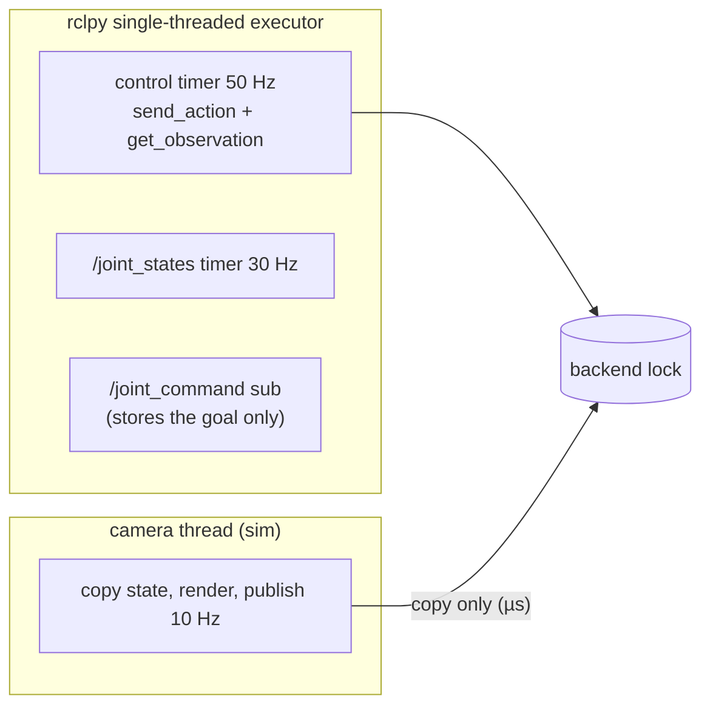
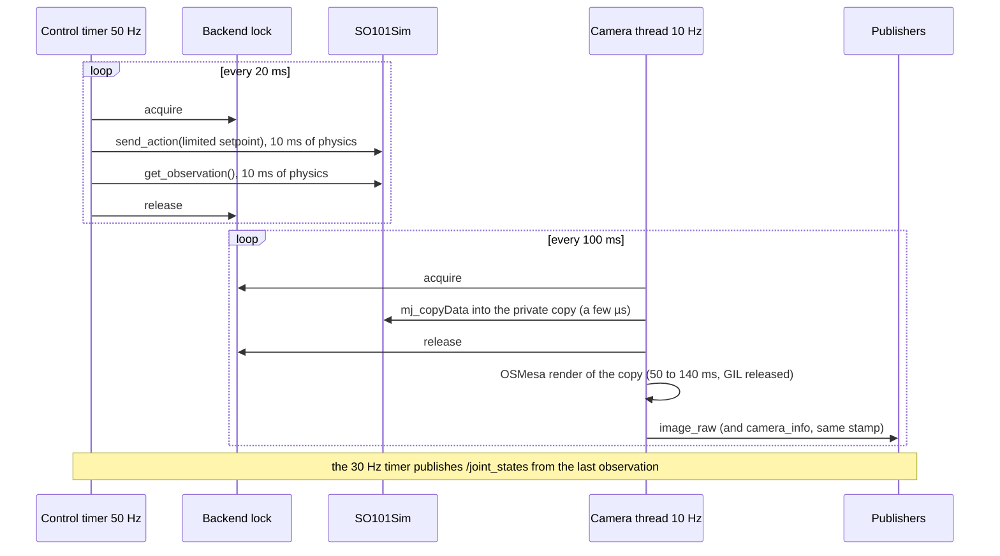

# 03 — `driver_node` design

> Authors: [CTRL] Control & hardware · Reviewers: [ARC], [OPS], [QA]
> Requirements: C-05, C-10 to C-15, C-51 · Decisions: ADR-006, ADR-007, ADR-016, ADR-018, ADR-023, ADR-032

## 0. What the driver does

`driver_node.py` started from **the course stub** (provided `_connect_arm` and `destroy_node`, upstream PR #1 and #2), as the repository did (ADR-039). The provided `_connect_arm` is unchanged except its two `disable_torque()` lines (ADR-032).

| Item | State | Roadmap step (`09`) |
| --- | --- | --- |
| `use_sim` backend, provided `_connect_arm` (explicit failure on calibration mismatch) | ✅ provided | — |
| Upstream #2: `disable_torque()` right after connecting (limp arm, commands ignored) | Commented out, after the clamp, the speed limiter and the shutdown move: the real arm obeys `/joint_command` (ADR-032, `07` §2); to move the arm by hand, stop the stack: the control tick's `send_action` turns the torque back on (`07` §3.1) | 6.1a |
| Partial commands by name; empty name list = `JOINT_NAMES` order | ✅ `command.py` | 1.0 |
| Speed limiter (1.5 rad/s; gripper 200 %/s), as parameters | ✅ `limiter.py` | 1.0, 1.1 |
| `/joint_states` ≥ 20 Hz, gripper in rad, stamp = read time | ✅ 30.0 Hz | 1.0 |
| Sim camera: dedicated thread, render on a copy, backend lock | ✅ 10 Hz, control p99 20.4 ms [MES-34] (ADR-006) | 1.2 |
| **Clamping to joint limits** (C-15): MuJoCo clamps via `ctrlrange` in sim, nothing else would protect the real arm | ✅ `command.py` | 1.1 |
| NaN/inf rejection | ✅ `command.py` | 1.1 |
| `effort` (grasp detection, ADR-016) | ✅ sim, `effort.py`; real: empty, `Present_Load` cannot tell a held cube [MES-56] | 1.3 |
| `/external_cam/camera_info` (C-13); `frame_id` = optical frame (ADR-005) | ✅ `camera.py` | 1.3 |
| `/sim/randomize`, `seed`, ground truth for the bench (§7) | ✅ `randomize.py` | 1.4 |
| Real-arm shutdown: `disconnect()` cuts the torque, the arm falls | ✅ slow move to `PARK` first, 11 s at most (§8, `shutdown.py`) | 6.1a |
| Per-motor `max_relative_target`; serial bus errors | ✅ (§2, §8; ADR-023) | 6.1a |
| Real camera | ✅ `camera_device`, MJPG, 10 Hz; `camera_info` from a calibration YAML (§6; ADR-007) | 6.2a |
| A warning for each late tick (#176) | ✅ `late.py` (§3) | 5.4b |

## 1. Responsibilities

| Does | Does not |
| --- | --- |
| Choose and connect the backend (`use_sim`) | Compute IK or trajectories |
| Pace the control loop (50 Hz) | Interpolate smartly (the brain's job) |
| Apply partial commands, clamp to limits, limit speed (safety) | Decide what to do |
| Publish `/joint_states` (position, effort), the image and `camera_info` | Detect objects |
| Provide **sim-only** services (`/sim/randomize`) | Expose ground truth to the pipeline (C-06) |
| Shut the hardware down cleanly | — |

## 2. Backend abstraction (C-10)

`_connect_arm` and `destroy_node` (§8) are **provided by the course** (upstream PR #1 and #2). We **keep them as is** (ADR-032) and only add what is missing, **next to them**. The one change: the provided `_connect_arm` ends with `robot.bus.disable_torque()` and a "Torque disabled" log ("Comment out this line to control the robot"); the team keeps these lines **commented out** (ADR-032 update) and uncomments them for a session where the arm must be moved by hand.

What the provided version does:

| Mode | Provided `_connect_arm` |
| --- | --- |
| Sim | `SO101Sim()` then `connect()` |
| Real | Checks that `CALIBRATION_FILE` (`/calibration/arm.json`) exists, else `RuntimeError`. Builds `SO101FollowerConfig(port, id=calib.stem, calibration_dir=calib.parent, use_radians=True)`, then `connect(calibrate=False)`. **If the motors do not match the file: `disconnect()` + `RuntimeError`** ("wrong file for this arm?"). Then `bus.disable_torque()` (upstream #2), commented out by the team (above) |

What the team adds, without touching the provided function:

```python
self._robot = self._connect_arm(port)                # provided by the course, unchanged
if not self._use_sim:
    # Hardware safety net (ADR-023): max delta per command, PER MOTOR
    # (a scalar would also apply to the gripper, in %, and freeze it).
    # send_action() re-reads config.max_relative_target on every call.
    self._robot.config.max_relative_target = max_relative_target(  # limiter.py: 0.2 rad, gripper 25 %
        self._p["max_relative_target_arm"], self._p["max_relative_target_gripper"]
    )
```

Real-arm critical points:

- `max_relative_target` triggers a `Present_Position` read at each `send_action` (a few ms on the bus), compatible with 50 Hz. The dict must contain **all 6 motors**, and so must every action: the control loop and the shutdown move always send 6 targets (a shutdown move of the 5 arm joints raised a `ValueError` on the real arm, #194).
- ⚠ **By default `connect()` may call `calibrate()`, which waits for keyboard `input()`** — it would block the node in the container. The provided version calls `connect(calibrate=False)` and **fails explicitly** on mismatch: safer than writing offsets into the motors (a file from another arm would produce wrong motions). What to do: `07` §3.1.
- Backend imports are **module-level** (provided code): harmless, since the driver only runs in the `control` image, which contains both `so101_sim` and `lerobot`.
- **Do not** put the camera in `SO101FollowerConfig.cameras`: `get_observation()` would read the camera inside the control loop (§6).

## 3. Execution model (ADR-006)

Implemented and measured variant: **single-threaded executor** for the control timer, the `/joint_states` timer and the `/joint_command` subscription, plus **one dedicated Python thread** for the sim camera. A single lock protects the backend (MuJoCo and the serial bus are not thread-safe).



Timeline of a control tick and a camera frame:



- **Control tick (50 Hz)**, under the lock: (1) move the setpoint towards the goal through the speed limiter (§4); (2) `send_action(setpoint)` → +10 ms of physics; (3) `obs = get_observation()` → +10 ms. 2 calls per 20 ms tick ⇒ the sim runs **in real time** [MES-02].
- **Camera thread (10 Hz, sim)**: under the lock, `mujoco.mj_copyData` into a private `MjData` (a few µs); **outside the lock**, render that copy with the thread's own `mujoco.Renderer` (OpenGL context bound to that thread), publish, then wait until the next period. Without this, `/joint_states` dropped to **9 Hz** (single thread busy rendering 50–140 ms) [MES-22]; with it: **30.0 Hz**, max period 44 ms [MES-24].
- **Render threads**: OSMesa's llvmpipe renders with one thread per core by default; they starve the control tick (p99 24–25 ms). The driver sets `LP_NUM_THREADS` to half the cores at import, a value set in the environment wins: p99 20.4 ms, image 10 Hz [MES-34].
- **Clocks**: the timers run on the steady clock. The system clock can step back (WSL2: about 2 s every 30 s) and would pause timers on the ROS clock; stamps stay on the ROS clock, they are compared across nodes [MES-37].
- **Late ticks** (#176): the control step and the `/joint_states` timer share the executor; a tick that comes more than 0.25 s after its period (`late.py`, half the brain's `max_joint_state_age_s`) logs `<tick> <s> s late: the driver's executor was held`. A stall of `/joint_states` without that warning was not the driver's: the messages were late on the way, or the brain starved (`13` §2).
- Shutdown: `destroy_node()` sets a stop event and joins the thread before `disconnect()`. SIGINT and SIGTERM only set an event that ends the spin loop of `main()` (#158): rclpy's own handlers are off, since they raised `KeyboardInterrupt` at any bytecode, and one landing while the executor built a `Task` printed a traceback at exit. The context stays valid until `destroy_node()` returns, so no publish fails during the stop.

> Rendering a copy uses `sim.model`/`sim.data`: an internal access **confined to the driver's sim branch** — acceptable because camera rendering is sim-specific anyway (the real arm goes through OpenCV). The rest of the stack still ignores the backend.
> Alternative considered: `MultiThreadedExecutor` + callback groups. Rejected for now: with a thread pool the OpenGL context could be used from different threads; a dedicated thread is simpler and was measured.

## 4. `/joint_command` handling (C-14, C-15)

```text
on_joint_command(msg):
    names = msg.name or JOINT_NAMES               # empty list = full ordered command
    if len(names) != len(msg.position) → reject (throttled warning)
    for (name, value):
        unknown name → ignore
        non-finite value (NaN/inf) → reject the whole message
        "gripper": value = clamp(value, 0, 100)                         # %
        others:    value = clamp(value, lim_min[name], lim_max[name])  # rad, URDF limits
    goal.update(valid pairs)     # PARTIAL COMMAND: other joints keep their goal
```

- **Initialization**: goal = measured position at startup, so no joint jumps to 0.
- **Speed limiter** (safety net, ADR-023): each tick, the setpoint moves towards the goal by at most `max_velocity × dt`. The brain's trajectories are already smooth, so the limiter is idle in nominal operation; it protects against a `ros2 topic pub` jumping a joint by 2 rad.
- **Limits** come from `so101_common` (copy of the URDF limits, checked by a test against the URDF):

| Joint | Min (rad) | Max (rad) | ≈ degrees |
| --- | --- | --- | --- |
| shoulder_pan | −1.91986 | 1.91986 | ±110° |
| shoulder_lift | −1.74533 | 1.74533 | ±100° |
| elbow_flex | −1.69 | 1.69 | ±96.8° |
| wrist_flex | −1.65806 | 1.65806 | ±95° |
| wrist_roll | −2.74385 | 2.84121 | −157° / +163° |
| gripper | 0 % (−0.174533 rad) | 100 % (1.74533 rad) | −10° / +100° |

## 5. `/joint_states` publication

| Field | Content |
| --- | --- |
| `header.stamp` | Node clock at read time |
| `name` | `[shoulder_pan, shoulder_lift, elbow_flex, wrist_flex, wrist_roll, gripper]` (exact URDF names, otherwise RViz shows the arm "in pieces") |
| `position` | rad; gripper converted % → rad: `rad = lo + pct/100·(hi − lo)`, `(lo, hi) = (−0.174533, 1.74533)` — what `robot_state_publisher` expects |
| `velocity` | Optional (filtered finite difference) or empty |
| `effort` | **Normalized load in [−1, 1]** (fraction of max torque). Sim: `actuator_force / forcerange` (`effort.py`); real: empty, by decision (#69): `Present_Load / 1000` reads +0.11 closed on nothing, as much as the sim's held cube, so the brain judges the real grasp by the jaws' gap instead [MES-56]. Sign: positive towards larger angles, except the **gripper: positive = squeezing** (it closes towards smaller angles), so holding the cube reads 0.18 and an empty grasp 0 [MES-35]. Used for grasp detection (ADR-016). Deliberate deviation from REP-103 (N·m): hobby-servo load is not a calibrated torque |

The brain recovers the gripper percentage with the inverse conversion from `so101_common`.

**`/joint_setpoint`** (#200): at each control step, right before `send_action`, the driver publishes the setpoint it sends (after the clamp and the speed limiter) as a `JointState`: the 6 joints in rad, the gripper converted from % (`command.setpoint_positions`), stamped with the node clock. It keeps coming while the bus is retried and stops once the bus is lost, like `/joint_states`; nothing is published during the shutdown move (the executor no longer runs). A second `robot_state_publisher` draws it as the `ghost/` TF tree: the gap between the ghost and the measured arm in RViz is the tracking error (gravity sag, a joint the servo's P gain leaves short, a lag). Both go through the same URDF angles, so a wrong calibration moves both together: the camera overlay checks that (`05` §5.1). Reliable, depth 1: `robot_state_publisher` subscribes Reliable (ADR-004).

## 6. Camera (ADR-007)

| | Sim | Real |
| --- | --- | --- |
| Source | MuJoCo render of `external_cam` on a state copy (dedicated thread) | `camera_device` (`/dev/video0` in `driver_real.yaml`): `OpenCVCamera(index_or_path=camera_device, width=640, height=480, fourcc="MJPG")`, RGB, the camera's own frame rate; a driver thread publishes its newest frame at 10 Hz (`read_latest()`; older than 0.5 s: nothing published). Also with the sim arm: real images without the real arm (`13` §1). No camera: an error in the log, the driver runs without images |
| K | `get_camera_intrinsics()` (fx = fy ≈ 246 px at 320×240), principal point moved to OpenCV pixel centers: cx = 159.5, cy = 119.5 (`camera.py`, [MES-41]) | `camera_info_file`: the ROS calibration YAML of the intrinsic calibration (6.2b, ADR-014), refused if its image size differs; empty: images without `camera_info`, perception waits |
| D (distortion) | 0 | From calibration |
| Publication | `Image` `rgb8` + `CameraInfo` with the **same `stamp`**, `frame_id = external_cam_optical_frame`, 10 Hz | Same |

## 7. Sim-only services and test parameters

- `/sim/randomize` (`std_srvs/Trigger`, step 1.4): under the lock, parks the box out of the way, calls `randomize_object()` (the cube settles for 200 steps, it could otherwise land on a wall), then moves the box by changing `model.body_pos` of the `drop_box` body, then `mj_forward`. The answer carries **no pose**. Required for C-42 (ADR-018). The box center is drawn by `randomize.py`:
  - in r = 0.18–0.30 m from the `base_link` origin, azimuth −90° to −10°: reachable at drop height (`04` §4) and the **whole box in the camera view** with a 5 px margin. Positive azimuths lie close to the camera, where the bottom edge of the image cuts the box. `test_sim_tools.py` projects the box corners with the scene's camera: moving the sim camera (`05` §6) means re-checking this area;
  - at least **0.15 m** from the cube center: box half-diagonal 7.4 cm + cube half-diagonal 3.5 cm + 4 cm for the open jaw grasping the cube next to a wall;
  - position only: the box stays axis-aligned (it is square).
- **Game mode** (`connect4_layout`, the path of `connect4_grid.yaml`, set by `sim.launch.py connect4:=true`; #80, `phase2/P2-02` §7): the driver serves the simulated person in place of `/sim/randomize`, from the pure `connect4_sim.py`. Its `shutdown_pose` is the brain's `HANDOVER` (`driver_connect4.yaml`): from there the joint line to `PARK` crosses the grid's near post [MES-69]. `/sim/connect4/drop_token` (`so101_interfaces/srv/DropToken`: `column`, `color`) puts a spare token above a column and lets it fall; `/sim/connect4/give_token` (`Trigger`) puts a yellow one between the open jaws, where it floats (`qfrc_applied` cancels its weight) until the control step sees both jaws touch it; `/sim/connect4/reset_board` (`Trigger`) parks every token again. They write `MjData` under the lock, never the model, and step nothing. None returns a pose or the board. With `expose_ground_truth`, `/sim/ground_truth/connect4_board` (`so101_interfaces/msg/Connect4Board`, 10 Hz) gives the true cells, a token counted once at rest in its cell: bench only (C-06).
- `seed` (int, default `0`): one seed, two independent streams (`numpy.random.SeedSequence`): the provided `randomize_object()` (set on `SO101Sim` after `_connect_arm`, which takes no seed) and the box sampler; a third one in game mode, the hand's offset of `give_token`. Same seed, same sequence of `/sim/randomize` calls. The cube pose at startup stays unseeded (drawn inside `connect()`).
- `expose_ground_truth` (**`false` by default**): when `true`, publishes `/sim/ground_truth/object` and `/sim/ground_truth/drop_box` (`PoseStamped`, 10 Hz, `base_link`, stamped at read time). The MuJoCo world is `base_link`: the robot base sits at the scene origin with no rotation (`test_sim_tools.py`). **Evaluation bench only**, never read by brain or perception (C-06, CI grep).
- `scene_path` (#44): loads one of our scenes (calibration scene with ArUco markers, ADR-013; Connect Four scene, ADR-036) without modifying `sim/`: right after the provided `_connect_arm`, the driver reconnects `SO101Sim` with that scene (ADR-036). `sim.launch.py connect4:=true` gives it the game's scene at 640×480 (`driver_connect4.yaml`): `so101_bringup.sim_scene` adds the grid, its 42 tokens and its markers from `so101_connect4/config/connect4_grid.yaml` (`phase2/P2-02` §7). On it the tick p99 is 21.5 ms and the image comes at 10 Hz while a whole game of tokens falls [MES-67].

## 8. Lifecycle and shutdown

- **Sim**: stop the camera thread, then `disconnect()` (closes the renderer).
- **Real**: ⚠ `disable_torque_on_disconnect=True` by default — **the arm falls** when torque is cut. `destroy_node()` (provided by upstream #2: disconnect + log) first stops the camera thread, then moves the arm to `shutdown_pose` (the brain's `PARK`) at `shutdown_velocity` (0.5 rad/s) at most, by direct backend calls (the ROS context is already down on SIGINT), until each arm joint is within `shutdown_tolerance` (0.05 rad) or 4 s have passed; then it disconnects. The gripper is not commanded: it keeps a held cube. Also active in sim, where it is tested (`test_shutdown.py`; the post-shutdown test of `test_driver_launch.py`).
  - **11 s**: `PARK` from the farthest pose, `shoulder_pan` 3.8 rad from it at 0.5 rad/s, plus the slow end of the move (the real arm took 8.6 s for 3.4 rad, #195). The entrypoint kills the process group 14 s after its SIGINT, `ros2 launch` the driver 17 s after (`sigterm_timeout` 12 s, then SIGKILL 5 s later), compose 18 s after `stop` (`stop_grace_period`). A second signal does not cut the move (#158), a SIGKILL would.
  - If the move still falls short (a blocked joint), it logs "Shutdown pose not reached" and the arm falls from there. The joints under gravity (shoulder lift, elbow, wrist flex) move at the same time as the pan and usually get there: keep a hand ready to hold the forearm during the first sessions (`07` §2).
  - The entrypoint sends SIGINT to `ros2 launch` only, so that `destroy_node()` runs once, and starts it with `--noninteractive`: compose gives the container a TTY (`tty: true`), and an interactive launch takes a SIGINT for a terminal Ctrl-C that its nodes got too, so it does not forward it. `stop_grace_period: 10s` on `control` covers the move.
- **Serial errors**: a bus error in a control tick (`ConnectionError`, a motor packet error `RuntimeError`, an `OSError` from the port) is retried at the next ticks; after `bus_retries` (3) retries (4 failed ticks in a row, 80 ms) the driver stops the control and `/joint_states` with a "Bus lost" error, until it is restarted. The brain detects missing data (freshness, ADR-017) and stops. On shutdown, a lost bus skips the move and a failed disconnect is logged: the node exits in every case. Faults injected in sim: `test_bus_errors.py`.

## 9. Tests (see `08` and `14`)

| Test | Type | Criterion |
| --- | --- | --- |
| Gripper %↔rad conversion and out-of-range clamping | Unit (`so101_common/test/test_robot.py`) | Error < 1e-9 |
| `so101_common` names and limits = URDF | Unit (`so101_common/test/test_urdf.py`) | Limits equal within 1e-5, names in chain order |
| Command merge: partial commands, clamp, NaN/inf, unknown names, size mismatch | Unit and property (`test_command.py`) | Every goal within the limits for any command; clamping twice changes nothing |
| Speed limiter | Unit (`test_limiter.py`) | One step of `v_max·dt`, no overshoot, gripper in %/s |
| `/joint_states` rate; a partial `shoulder_pan` command only moves that joint, at the limited speed; an unnamed command follows `JOINT_NAMES` order | `launch_testing` (`test_driver_launch.py`) | ≥ 20 Hz (30.0 Hz); target within 0.02 rad, other joints < 5 mrad, mean speed over 20–80 % < 2.0 rad/s (1.48 rad/s, 3.9 without the limiter [MES-33]); gripper 100 % → 1.745 rad, 0 % → −0.175 rad (± 0.05) |
| Effort, camera, `camera_info`, sim tools, parameters, steady timers, late ticks | Unit and `launch_testing` (`test_effort.py`, `test_camera.py`, `test_real_camera.py`, `test_sim_tools*.py`, `test_parameters.py`, `test_steady_timers.py`, `test_late_ticks.py`) | Each file's docstring |
| Shutdown move and serial bus loss, in sim | Unit (`test_shutdown.py`, `test_bus_errors.py`) | `PARK` reached or 11 s, every motor in each command (#194), time for the farthest pose (#195); "Bus lost" after `bus_retries` |

## 10. Structure of the implemented node

```python
class DriverNode(Node):
    def __init__(self):
        ...
        self._robot = self._connect_arm(port)          # provided
        self._obs = self._robot.get_observation()
        self._target = {n: self._obs[f"{n}.pos"] for n in JOINT_NAMES}   # no jump at startup
        self._goal = dict(self._target)
        self._lock = threading.Lock()
        # publishers, /joint_command subscription, control (50 Hz) and joint_states (30 Hz) timers
        if self._use_sim:                               # camera thread, renders a state copy
            self._camera = threading.Thread(target=self._camera_loop, daemon=True)
            self._camera.start()
```

See `ros2_ws/src/so101_driver/so101_driver/driver_node.py` for the complete code.
