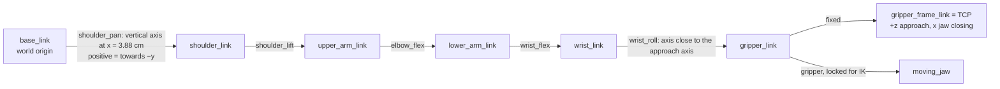
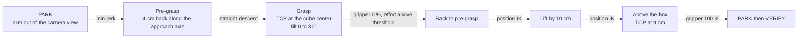

# 04 — Kinematics, IK, grasp strategy and trajectories

> Authors: [KIN] Kinematics & planning · Reviewers: [DEC], [CTRL], [QA]
> Requirements: C-30, C-31, C-41 · Decisions: ADR-005, ADR-008, ADR-009, ADR-010
> Every figure is **measured** (`experiences/exp_kinematics.py`, `exp_reachability.py`, `exp_ikpy_vs_pinocchio.py`, `exp_pick_place_gt.py`).

## 1. Kinematic model



- **Source of truth**: the URDF `so101_description/urdf/so101.urdf` (identical to `sim/.../so101_new_calib.urdf` except for mesh paths).
- **Chain**: `base_link → shoulder_pan → shoulder_lift → elbow_flex → wrist_flex → wrist_roll → gripper_frame_link` (TCP, fixed), plus `gripper` (moving jaw), **locked** for IK.
- **5 DoF**: an arbitrary 6D orientation is **not** reachable. In practice the approach axis always lies in the arm's **vertical plane** (the plane containing the `shoulder_pan` axis).

### 1.1 Measured facts to know by heart

| Fact | Value | Consequence |
| --- | --- | --- |
| URDF FK (`gripper_frame_link`) vs MuJoCo (`gripperframe` site) | Position difference **≤ 0.004 mm** over 500 random configurations [MES-04] | The IK model **is** the sim model: no model error in sim |
| MuJoCo site orientation vs URDF frame | **Constant 90° rotation** [MES-04] | Orientations use **the URDF frame only**; the MuJoCo site is only used to measure positions |
| TCP approach axis | **+z** of `gripper_frame_link` (0.997 alignment with the wrist → TCP axis) [MES-05] | "Gripper pointing down" ⇔ z_TCP = −z_world |
| Jaw closing axis | **x** of `gripper_frame_link` [MES-05] | Used to align the jaws with the cube faces |
| `shoulder_pan` sign | **pan > 0 ⇒ the TCP moves towards −y**: pan ≈ −azimuth [MES-06] | IK seeds must use `pan = −azimuth`; with +azimuth the IK diverges |
| `shoulder_pan` axis | Vertical, at **(x, y) = (0.0388, 0)** in `base_link` [MES-06] | The arm-plane azimuth is computed **from that axis**, not from the origin (fixing this took pick & place from 29/40 to 39/40) |
| TCP at q = 0 | (0.391, 0, 0.226) m — arm stretched horizontally | q = 0 is not a rest pose |
| Joint limits | See `03` §4 | Bounded by the IK; the driver clamp is still to add (`03` §0) |

## 2. Forward kinematics (FK)

- ikpy `forward_kinematics` (or Pinocchio `framesForwardKinematics`): negligible cost.
- The brain publishes `/end_effector_pose` (`PoseStamped`, `base_link`) from `/joint_states` [BOOT milestone 6] — **implemented**.
- **Test**: FK = MuJoCo site within 0.01 mm (sim integration test; ground truth allowed in tests).

## 3. Inverse kinematics (ADR-008)

### 3.0 Chosen solver: **ikpy** (already used in `brain_node.py`), Pinocchio as an option

The cross-review compared both libraries on the **same 100 targets** of the grasp area [MES-21]:

| Solver | Position only (< 1 mm) | Vertical pointing (< 1 mm, < 2°) | Median time |
| --- | --- | --- | --- |
| **ikpy** `inverse_kinematics(p)` | **100 %** (even from q = 0) | — | 14 ms (20 ms from q = 0) |
| **ikpy** `inverse_kinematics(p, [0,0,-1], orientation_mode="Z")` | — | **97 %** | 6 ms |
| Pinocchio DLS, single seed | 100 % | 91 % | 0.3 / 0.8 ms |

**Decision**: **keep ikpy**. It is the team's existing choice, it is robust, and its orientation modes (`"Z"` = approach axis, `"X"` = jaw axis, `"all"` = full pose) cover all our tasks. Pinocchio's 20–50× speed is not needed (a full plan stays well under 1 s and runs in a worker thread). The solver sits behind a `Kinematics` façade (§9) so it can be swapped for Pinocchio without touching the rest. Pinocchio 4.1.0 comes from `ros-jazzy-pinocchio`: `import pinocchio` only works after `source /opt/ros/jazzy/setup.bash`. [MES-21] was reproduced identically on 2026-10-09; phase 2 adds a jaw-axis task (`phase2/P2-02` §2.2, [MES-29]).

The pseudo-code below describes the generic algorithm (DLS) used by the experiment scripts; ikpy does the equivalent with bounded optimization (scipy). The seed, verification and multi-start rules apply **whatever the solver**.

### 3.1 Algorithm

**Damped least squares** (Levenberg–Marquardt style), with clamping to the limits at each iteration:

```text
q ← q0
repeat up to 300–400 iterations:
    e ← task error
    if ‖e_pos‖ < 0.2 mm and ‖e_rot‖ < 2 mrad: success
    J ← task Jacobian
    Δq ← Jᵀ (J Jᵀ + λ I)⁻¹ e            λ = 1e-6, step = 0.5
    q ← clamp(integrate(q, Δq), q_min, q_max)
ALWAYS VERIFY the result with FK before executing it
```

Three tasks, from most to least constrained:

| Task | Constraints | ikpy equivalent | Use | Measured success in the workspace |
| --- | --- | --- | --- | --- |
| `ik_pose(p, R)` | Position + 6D orientation | `orientation_mode="all"` | Grasp with jaws aligned to the faces | Height-dependent (see §4) |
| `ik_point(p, a, roll=None)` | Position + **approach direction** `a` | `orientation_mode="Z"`, `target_orientation=a` | Grasp when the 6D alignment fails | ikpy: 97 % for vertical `a`, z ≤ 6 cm [MES-21] |
| `ik_pos(p)` | Position only (3D) | default | Lift, transport, drop, `/go_to_target` | **100 %** (< 1 mm) over r ∈ [0.18, 0.30] m, z ∈ [2, 12] cm [MES-07], [MES-21] |

- Pointing error: `e_rot = −(z_TCP × a)`, Jacobian `J_r = −[a]ₓ · (−[z]ₓ · J_ω)` in `LOCAL_WORLD_ALIGNED`.
- **Seeds (multi-start)**: `[−az, −0.3, 0.3, 1.2, 0]`, `[−az, 0.5, −0.5, 1.5, 0]`, `[−az, −1.0, 1.0, 0.5, 0]`, plus the current configuration, with `az = atan2(y, x − 0.0388)` = azimuth seen from the pan axis.
- **Time**: 6–14 ms per solve with ikpy, 0.3–5 ms with Pinocchio [MES-11], [MES-21]. A full plan (grasp + pre-grasp + transport, tilt and seed sweep) can take a few hundred ms: it runs in a **worker thread** so the brain never blocks (`06`).

### 3.2 Why not "strictly vertical IK everywhere"?

That was the initial proposal; the cross-review refuted it by measurement:

- a 6D "gripper strictly vertical" IK only succeeds in **58 %** of the workspace [MES-08];
- the reachability map below explains why: above ~8–10 cm a small arm can no longer point straight down far from its base.

## 4. Reachability map (minimal approach tilt)

Smallest |θ| (degrees from vertical) for which position **and** approach direction are reached exactly (< 1 mm, < 1°), azimuth 0, r measured from the `base_link` origin. "+" = tool tip pointing outwards; "-" = no solution in [−80°, 80°] [MES-08].

| z \ r | 0.14 | 0.18 | 0.22 | 0.26 | 0.30 | 0.34 |
| --- | --- | --- | --- | --- | --- | --- |
| **0.02** | 0 | 0 | 0 | 0 | 0 | 20 |
| **0.05** | 0 | 0 | 0 | 0 | 10 | 20 |
| **0.08** | 10 | 0 | 0 | 0 | 10 | 30 |
| **0.11** | - | 20 | 10 | 20 | 20 | 30 |
| **0.14** | - | 30 | 20 | 20 | 30 | 40 |
| **0.17** | 60 | 40 | 40 | 30 | 40 | 40 |
| **0.20** | 70 | 50 | 50 | 40 | 50 | 50 |

Reading: **vertical grasp is possible at cube height** (z = 2.5 cm) almost everywhere; beyond r ≈ 0.27 m, **10° of tilt** is needed. High pre-grasp/transport poses need 10–50°.

## 5. Grasp strategy (ADR-009), validated in closed loop



```text
plan_grasp(p_cube, yaw_cube):
  for θ in [0°, 10°, 20°, 30°]:                         # smallest tilt first
      a ← approach direction tilted by θ in the arm plane (azimuth from the pan axis)
      1) ALIGNED attempt: ik_pose with jaws ⟂ to a face (4 yaw candidates yaw + k·90°, cube symmetry)
      2) otherwise FREE: ik_point(p, a), roll free
      pre-grasp = p − 0.04·a  (4 cm back along the approach axis, same orientation)
      if grasp and pre-grasp both solved: return
  failure: unreachable target, report it (never "move anyway")

lift     : ik_pos(p_cube + 10 cm in z)
transport: ik_pos(p_box + (0, 0, h_drop))      free orientation: the cube falls
```

**Results in sim, using ground truth to isolate kinematics from perception** [MES-09]:

| Measurement | Value |
| --- | --- |
| Pick & place success (cube lands in the box) | **39 / 40** random episodes |
| Closed-loop TCP error (MuJoCo, after settling) | **0.1 to 0.3 mm**: requirement C-41 (< 1 cm) is easily met in sim |
| Vertical grasp (θ = 0) | 26 / 40; θ = 10° for 14 / 40 (cubes at r ≥ 0.27 m) |
| Robustness to jaw misalignment | Grasp succeeds up to **44°** of misalignment w.r.t. the faces (the cube's tunnels help) |
| Single failure | Released 11 cm above the box: the cube bounced out. Fix: **release lower** (TCP ≈ 9 cm) and **verify the drop** |

**Chosen parameters** (brain defaults):

| Parameter | Value | Rationale |
| --- | --- | --- |
| Grasp height | TCP at the cube center (z ≈ 2.5 cm) | Measured: stable grasp |
| Pre-grasp back-off | 4 cm along the approach axis | Straight descent without sweeping the cube |
| Lift height | +10 cm | Clears the box walls (5 cm) |
| Drop height (TCP) | ≈ 9 cm above the box floor | Avoids the bounce seen at 11 cm |
| Tilts tried | 0, 10, 20, 30° | Covers the whole randomization area |

## 6. Trajectory generation (ADR-010)

- **Joint-space minimum-jerk interpolation** (quintic `s(τ) = 10τ³ − 15τ⁴ + 6τ⁵`): zero velocity/acceleration at both ends, no jerk — standard practice for position servos.
- **Duration** from the most constrained joint: `T = max(T_min, max_j |Δq_j| · 1.875 / v_max)` (1.875 = normalized peak velocity of the quintic), `v_max` = 1.0 rad/s in sim, 0.5 rad/s on the real arm to start with.
- **Streaming**: the brain publishes `/joint_command` at **50 Hz** during the motion; the driver just follows (its limiter only kicks in on anomalies).
- **Descent/lift**: short segment (4 cm); joint interpolation is nearly straight in sim. Recommended for the real arm: **Cartesian interpolation** with 5–10 IK waypoints along the approach axis, to guarantee a straight descent.
- **End of motion**: target reached when `max_j |q_meas − q_target| < 0.01 rad` (gripper: < 3 %), or a `T + 1 s` timeout → error.

## 7. Accuracy measurement protocol (C-41: "< 1 cm, measured")

**In sim** (automated, `test/test_ik_accuracy.py`):

1. Draw 20 random XYZ targets in the workspace (z ∈ [3, 12] cm).
2. Call the `/go_to_target` service (`so101_interfaces/GoToTarget`, implemented) and wait for settling.
3. Measure the `gripperframe` site position (ground truth, allowed in tests) → error.
4. Report mean, p95, max. Expected < 1 mm (driver + brain smoke test: 0.13 mm [MES-24]).

**On the real arm**:

1. A3 mat printed with a millimeter grid and the robot base outline (positioning jig).
2. A fine pointer fixed in the gripper (known offset from the TCP).
3. Aim at 10 grid points, measure the gap with a ruler/caliper.
4. Report mean/max with a photo per point. Target < 1 cm.

## 8. Pitfalls (code-review checklist)

- [ ] IK seeds with `pan = −azimuth`, azimuth seen from **the pan axis** (x = 3.88 cm).
- [ ] Orientation: **URDF frame only** (the MuJoCo site is rotated by 90°).
- [ ] Always verify the solution with FK, reject if error > 1 mm.
- [ ] Never execute an unconverged solution ("moving anyway", see [KO2 p28]).
- [ ] Roll slightly changes the TCP position (≈ 8 mm offset from the roll axis): when roll is frozen, re-solve the position.
- [ ] Units: rad everywhere, gripper in % only in `/joint_command`.
- [ ] ikpy builds the chain by following the **first** child joint in URDF order (`gripper_link` has two children): assert that the last link is `gripper_frame_joint`.
- [ ] Clip the seed into the joint bounds before calling ikpy: measured joints can sit slightly past a URDF limit (sim overshoot, real arm at rest), and scipy then raises "x0 is infeasible", which kills the node.
- [ ] Position-only IK leaves the orientation free (approach tilt up to 90° measured from the real rest pose): use `ik_point` or `ik_pose` for grasps.

## 9. Proposed API (`so101_brain/kinematics.py`, ROS-free, testable)

The brain starts from the course stub (ADR-039): FK/IK go **directly** into this module (step 2.1), tested without ROS; `brain_node.py` only wires it to ROS. The bootstrap prototype had them inside `brain_node.py`.

```python
class Kinematics:                                    # façade: ikpy inside, Pinocchio possible
    def __init__(self, urdf_path: str): ...
    def fk(self, q: np.ndarray) -> np.ndarray: ...   # 4x4 TCP pose
    def ik_pos(self, p, q_seed=None) -> np.ndarray | None: ...
    def ik_point(self, p, approach, q_seed=None, roll=None) -> np.ndarray | None: ...
    def ik_pose(self, p, R, q_seed=None) -> np.ndarray | None: ...
    def ik_jaw_normal(self, p, n, q_seed=None) -> np.ndarray | None: ...  # phase 2 (phase2/P2-02 §2.2)
    def arm_azimuth(self, p) -> float: ...           # from the pan axis

class GraspPlanner:
    def plan(self, cube_pose, box_pose, q_current) -> GraspPlan | None: ...   # grasp, pre-grasp, lift, drop
```

## 10. State of the art and evolution paths

| Approach | Benefit | When to consider it |
| --- | --- | --- |
| **Pink** (QP differential IK on Pinocchio) | Weighted tasks + hard limits, very clean | Avoidance constraints or task priorities (phase 2) |
| **mink** (differential IK on MuJoCo) | Same idea on the MuJoCo side | Sim prototyping |
| Analytical IK (pan + planar 3R + roll) | Deterministic, fast, exposes all solutions | If multi-start becomes too slow (not needed: ~10 ms) |
| TRAC-IK / KDL / MoveIt 2 | Industry standards | If MoveIt is adopted in phase 2 |
| Visual servoing of the last centimeter | Corrects the real residual error | If real accuracy is insufficient |
