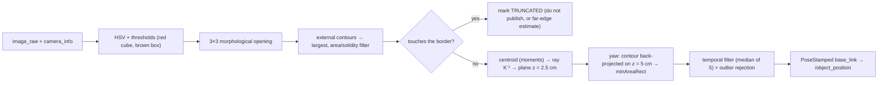
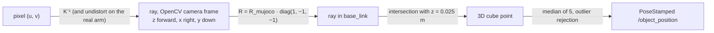
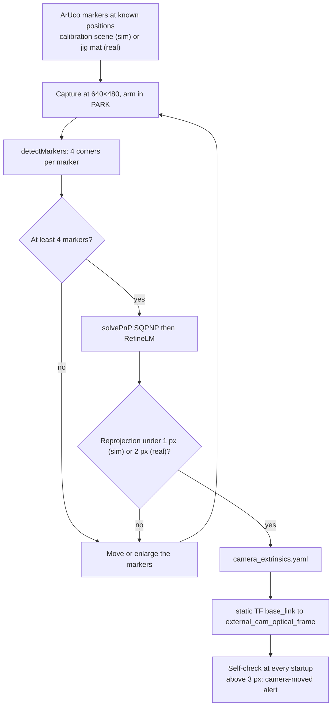

# 05 — Perception, camera geometry and calibration

> Authors: [VIS] Vision & calibration · Reviewers: [KIN], [ARC], [QA]
> Requirements: C-20 to C-24 · Decisions: ADR-011, ADR-012, ADR-013, ADR-014, ADR-021
> Measurements: `experiences/exp_perception_calib.py`, `exp_calibration_methods.py` [MES-12 to MES-16], [MES-25]

## 1. Pipeline



The box follows the same pattern (brown mask, centroid, plane z = 2.5 cm = mid-height of the walls); the **center of the floor** (z = 0) is published.

## 2. Color detection (ADR-011)

### 2.1 Why HSV rather than YOLO or an ArUco on the object

| Criterion | HSV | YOLO / learned segmentation | ArUco glued on the object |
| --- | --- | --- | --- |
| Known object, single saturated color | ✅ ideal | Overkill | Changes the object (the brief imposes the printed cube) |
| Data needed | None | Annotated sim + real dataset | None |
| Compute cost | **0.5 ms/frame** [MES-13] | 10–50 ms CPU | ~1 ms |
| Lighting robustness | Medium → **camera in manual mode** + tunable thresholds | Good with a varied dataset | Good |
| Explainability / debugging | Excellent (mask visible in RViz) | Poor | Good |

**Decision**: HSV with runtime-tunable thresholds and guards (minimum area, solidity, truncation). YOLO stays a **phase-2** option, or a fallback if real lighting makes HSV unstable (`07`).

### 2.2 Thresholds (OpenCV: H ∈ [0, 180], S, V ∈ [0, 255])

| Object | Model color | Theoretical HSV | Ranges used |
| --- | --- | --- | --- |
| Cube (red PLA) | rgba (0.80, 0.05, 0.22) | H ≈ 173, S ≈ 239, V ≈ 204 (the scene notes ~(168, 185) **as seen by the real camera**) | **H ∈ [160, 180] ∪ [0, 8]**, S ≥ 100, V ≥ 60 — red wraps around 0/180, hence **two ranges** |
| Box | rgba (0.35, 0.20, 0.12) | H ≈ 10, S ≈ 168, V ≈ 89 | H ∈ [5, 25], S ≥ 90, V ∈ [40, 220] |
| Floor, robot | Gray (S ≈ 0) | — | Excluded by the saturation threshold |

Result in sim: **0 missed detection, 0 false positive** over 80 episodes [MES-13]. ⚠ The provided stub uses **yellow** thresholds (old golden ball): replace them.

ROS parameters (`config/perception.yaml`, read at each image, so `ros2 param set` tunes them at runtime): `hsv_cube_h_min`, `hsv_cube_h_max`, `hsv_cube_s_min`, `hsv_cube_v_min`, `hsv_box_h_min`, `hsv_box_h_max`, `hsv_box_s_min`, `hsv_box_v_min`, `hsv_box_v_max`, `min_area_px`, `min_solidity`. A hue interval wraps around 180 when `h_min > h_max`: the red cube is `160`, `8`.

### 2.3 Detection guards

- Minimum area 15 px at 320×240 (the whole cube covers 330–620 px in the reference images).
- **Truncation**: if the bounding box touches the image border, the detection is marked "truncated" (biased centroid, §6).
- Solidity (area / convex hull area) > 0.6: rejects reflections and fragments.
- One object expected: keep the largest valid contour.

## 3. Camera model — THE main pitfall

### 3.1 Conventions

From pixel to published position:



- **OpenCV / REP-103 optical**: x right, **y down**, **z forward**.
- **MuJoCo**: x right, **y up**, the camera looks along **−z**.
- `get_camera_extrinsics()` returns the MuJoCo pose; to use it with K, switch to the OpenCV convention:

```python
FLIP = np.diag([1.0, -1.0, -1.0])
R_world_cam = T_mj[:3, :3] @ FLIP     # rotation camera(OpenCV) → world
t_world_cam = T_mj[:3, 3]
```

Without this FLIP, positions are completely wrong (mirrored, behind the camera) — a classic mistake, caught by the round-trip test of §8.

### 3.2 Intrinsics

- Sim: `fy = H / (2·tan(fovy/2))`, fovy = 52° → **fx = fy ≈ 246 px at 320×240** (≈ 492 at 640×480). No distortion.
- **Principal point, half a pixel**: the provided `get_camera_intrinsics()` gives `cx = W/2`, `cy = H/2`, the OpenGL convention, where pixel *edges* sit on integers. `CameraInfo` and OpenCV put pixel *centers* on integers, so the driver publishes **`cx = (W − 1)/2`, `cy = (H − 1)/2`** (`so101_driver/camera.py`), 159.5 and 119.5 at 320×240. With `W/2`, every OpenCV centroid reads 0.5 px off in u and v: 2.6 mm instead of 0.5 mm on the cube [MES-41].
- Real: from the intrinsic calibration (ADR-014), with distortion → `cv2.undistortPoints` before back-projection.
- Perception reads K **only** from `/external_cam/camera_info`, never from the backend (C-05).

## 4. Pixel → 3D (ADR-012)

Chosen assumption: **the object rests on the table**, so its center lies at a known height `z₀ = 0.025 m` (half edge) — the "assumption of its own" required by C-22.

```python
def pixel_to_world(u, v, K, R_wc, t_wc, z0):        # so101_perception/geometry.py
    d = R_wc @ np.linalg.solve(K, [u, v, 1.0])     # ray direction in the world
    if d[2] * (z0 - t_wc[2]) <= 0.0:                # parallel to the plane, or the plane behind the camera
        return None
    return t_wc + (z0 - t_wc[2]) / d[2] * d         # intersection with the plane z = z0
```

| Measurement (sim, exact camera pose, 68 non-truncated detections) | Value [MES-13] |
| --- | --- |
| Mean XY error | **2.7 mm** |
| p95 / max | 4.1 mm / 4.5 mm |
| Mean bias | (+0.5, −2.6) mm. Mostly the half pixel of §3.2, not the side faces: with the OpenCV principal point, mean **0.50 mm**, max 1.00 mm over 50 scenes [MES-41] |
| After removing the constant bias | mean **0.8 mm**, max 1.9 mm |
| Box (centroid, plane z = 2.5 cm) | mean 2.9 mm, max 5.4 mm [MES-15] |

On the reference images (`test_geometry.py`, exact camera pose of the labels): cube mean **0.8 mm**, max 1.6 mm over the 32 whole cubes (2.4 mm and 3.9 mm with the provided principal point, §3.2); box floor center mean **3.4 mm**, max 11.3 mm over 44, the worst where the arm hides 15 % of the box.

**Cube yaw** (to align the jaws): back-project the contour points onto the top-face plane (z = 5 cm), then `cv2.minAreaRect` in metric coordinates → median error **1.3°**, p90 8.3° [MES-14] (modulo 90°, cube symmetry). **Since step 3.3c** `geometry.cube_yaw` does it on the detected contour, yaw in [−45°, 45°), published as the orientation of `/object_position` (a quaternion about z); on the 32 whole cubes of the reference images: median 0.46°, p90 2.62° (`test_geometry.py`).

> Rejected alternatives: **known size** (distance from apparent size) is less accurate at 320×240 (1 px error on ~15 px side ≈ 7 % of the distance); **depth camera** unavailable in sim; **stereo** out of scope.

## 5. Own extrinsic calibration (ADR-013) — mandatory in the end (C-23)

### 5.1 Method: ArUco markers on the floor at known positions in `base_link`



1. Place **≥ 4** ArUco markers (`DICT_4X4_50`, 7.5 cm black side) **spread over the image**, outside the grasp area.
2. Detect them with `cv2.aruco.ArucoDetector` → 4 corners per marker.
3. 3D ↔ 2D correspondences: known corners in `base_link` ↔ detected corners.
4. `cv2.solvePnP(..., flags=SOLVEPNP_SQPNP)` then `cv2.solvePnPRefineLM` → `T_cam←world` → inverted into `T_base←cam`.
5. Quality check: mean reprojection error < 1 px (sim) / < 2 px (real), otherwise reject.
6. Write `config/camera_extrinsics.yaml`; perception loads it and publishes the **static TF** `base_link → external_cam_optical_frame`.

**The file** (`geometry.save_extrinsics` and `load_extrinsics`): `T_base_cam`, the 4×4 transform from the camera's OpenCV optical frame to `base_link`; `parent_frame: base_link`; `child_frame: external_cam_optical_frame`; `method`; `date`; `reprojection_error_px` (`null` without a calibration). `load_extrinsics` refuses other frames and a transform that is not rigid. Until step 3.4, the file holds the provided camera pose through `geometry.from_mujoco` (FLIP, §3.1), with `method: provisional (provided pose), replaced at step 3.4`.

### 5.2 Measured results in sim [MES-16]

| Configuration | Detected markers | Camera pose error | Induced object error |
| --- | --- | --- | --- |
| 4 poorly placed markers, 320×240 | 1 | 1,071 mm / 86° (ambiguous single-marker pose) | 161 mm |
| 6 spread markers, **320×240** | 1 | 23 mm / 0.8° | 11 mm |
| 6 spread markers, **640×480** | **5** | **0.9 mm / 0.06°** | **1.8 mm** (max 2.5) |

Review conclusions:

- **Several well-spread markers are required** (a single marker gives an ill-conditioned pose).
- **Calibrate at 640×480**: at 320×240 distant markers cover ~12 px and are not detected. The extrinsics do not depend on resolution, so calibrate at 640×480 and work at 320×240 with a rescaled K (the driver publishes the right K for each resolution).

### 5.3 Sim implementation without touching `sim/`

- Create **in our repo** a `scene_calib.xml` that **includes** `scene_tek5.xml` and adds ArUco-textured planes (method validated in `exp_perception_calib.py`).
- The driver loads it through the `scene_path` parameter during the calibration session, by reconnecting `SO101Sim` right after the provided `_connect_arm`, which stays untouched; the provided assets are copied next to our scene so that the `include` resolves (ADR-036).
- Marker positions are **known by construction** in the scene.

### 5.4 Real implementation

- Print the markers at 100 % scale (check the side with a caliper) on a **jig mat** that also carries the robot base outline → marker positions in `base_link` known by construction.
- More accurate variant, **touch probing**: bring the TCP (pointer in the gripper) onto the marker corners and read the FK → corners in `base_link` without manual measurement.
- **Startup self-check**: perception detects the still-visible markers and computes the reprojection error with the stored extrinsics → above 3 px: warning "camera moved, recalibrate".

## 6. Field of view: 21 % of cube positions are truncated [MES-12]

With the provided camera at 320×240, over 2,000 positions drawn like `randomize_object()`:

- **79 %**: cube fully visible;
- **21 %**: cube **cut by the bottom edge** of the image (positions close to the camera);
- 0 %: completely out of view.

**Mitigations, in order of preference**:

1. **Move the sim camera** (allowed by the teaching staff, 2026-10-16): place it like the real camera, with the whole randomization area in view with margin (ADR-021), on a copy of the scene edited with `mujoco.MjSpec` (ADR-036), never in `sim/`. Then recalibrate (step 3.4) and re-measure MES-12. The evaluation is not settled, but partial occlusions by the robot should be handled when possible (§7).
2. **Far-edge** method for truncated detections: the top edge (opposite the camera) is still visible → back-project it on z = 5 cm, then step back 2.5 cm along the viewing direction projected on the floor. Less accurate; needs a dedicated test.
3. A higher resolution (640×480) does **not** change the field of view, only accuracy.
4. On the **real** arm: place the camera to cover the whole area **with margin** (ADR-021).

## 7. Arm occlusions and freshness

- When the arm is above the cube, perception may lose it or see it truncated. **The brain locks the target** while the arm is in the `PARK` pose, off the workspace (`[1.9, −1.7, 1.5, 0.7, 0]`: the cube never hidden, the box at worst 9 % hidden over 50 scenes [MES-39]), and then no longer depends on perception until the final verification (C-33, ADR-017).
- Perception **publishes nothing** when the detection is invalid (absent, truncated, outlier): freshness is carried by `header.stamp`, the brain judges its age.
- **A held cube is still detected.** The mask only looks for red, so the cube in the jaws stays `OK` in the debug image and is published. Its position is wrong: the ray meets the plane z = 2.5 cm beyond the cube, about 12 cm off for a 10 cm lift (computed from the camera pose). It is harmless because the brain reads `/object_position` only at `PARK`, in `WAIT_TARGET` and `VERIFY` (06 §3); during the grasp it relies on the gripper effort (ADR-016). It is also why RViz shows the cube the brain locked rather than the live detection (§9).
- Temporal filter: rolling median of 5; a measurement more than 2 cm away from the median is rejected (unless it persists 5 times = the object really moved). Implemented in `filter.py`, one filter per object; the window and the jump are `filter_size` and `filter_jump_m` since 5.1a; the box is filtered at z = 2.5 cm and published at its floor, z = 0.

## 8. Tests

| Test | Type | Criterion |
| --- | --- | --- |
| Projection round trip 3D → pixel → 3D (FLIP convention) | Unit | < 1e-9 m |
| Detection on reference images (sim renders + labels, below) | Unit | 100 % detected when not truncated, error < 5 mm |
| HSV thresholds: no floor/robot pixel in the mask | Unit | 0 false positive |
| ArUco calibration on the calibration scene | Sim integration | Pose error < 5 mm / 0.3° |
| Publication rate | `launch_testing` | 5–10 Hz when the object is visible |
| Pipeline without `get_camera_extrinsics` / `get_object_position` | CI grep | 0 occurrence outside `test/` (C-06, C-23) |

**Reference images** (step 3.2a), in `so101_perception/test/data/`:

- **Content**: 44 PNG at 320×240 (32 whole cubes, 8 cut by the border, 4 out of view; 2.2 MB, ADR-029) and `labels.json`.
  - Per image: cube center and yaw (in [0, π/2)), box floor center, all in `base_link`; `cube_view` = `full`, `truncated` or `out_of_view` (the 8 projected cube corners against the image bounds); the fractions of the cube and of the box that the arm leaves visible.
  - Once: K, the camera pose in the OpenCV optical frame, the arm joints and the seed.
- **Scenes**: drawn as `/sim/randomize` draws them, with the arm at `PARK` (06 §6), where the brain locks its target. The arm never hides the cube there; it hides part of the box in 8 images (85 % visible at worst), from MuJoCo segmentation against the same scene with the arm lifted out of the picture.
- **Generator**: `so101_bringup/tools/make_perception_dataset.py`. It lives in `so101_bringup`, since `so101_perception` may not touch the sim (C-05). The labels come from the sim state, so they belong in test data only (C-06).
- **Tests**:
  - `so101_bringup` regenerates the committed seed and must find the same labels and images. Change the generator, the scene, the camera (§6) or the brain's `PARK` (the generator reads it), and this test fails until the data is regenerated:

    ```bash
    docker compose exec -u "$(id -u):$(id -g)" control bash -lc "source /ros2_ws/install/setup.bash && \
      ros2 run so101_bringup make_perception_dataset --out /ros2_ws/src/so101_perception/test/data"
    ```

  - `so101_perception` checks the size budget, and that the labels agree with the pixels: no red pixel when out of view, red on the border exactly when truncated, blob centroid within 3 px of the projected center.
  - `test_detection.py` runs `detection.py` on every image: each whole cube within 2 px of its projected center (0.7 px at worst), each truncated cube flagged, no red pixel out of view, the box within 4 px (2.8 px with 15 % hidden by the arm). Synthetic scenes cover the red on both sides of H = 0, the box limits, the guards and the four borders. Median 0.6 ms per frame.
  - `test_geometry.py`: the FLIP on a MuJoCo camera of known pose, the round trip over the workspace (< 1e-9 m), no point for a ray that misses the table, the cube and box errors of §4, the extrinsics file (round trip, refused files), and the committed file within 5 mm / 0.3° of the labels' camera pose: still true once 3.4 replaces it.

## 9. Visualization (C-24)

- `/perception/debug_image`: the image with the masks painted (cube in green, box in blue), a red cross on each centroid and the cube status `OK`, `TRUNCATED` or `LOST`, same header, Best effort (`debug.py`).
- RViz: `Pose` display on `/object_position` and `/drop_box_position`, plus the box `Marker` (provided). The cube itself shows as the brain's locked target in `/brain/markers`, from `APPROACH` to `LIFT` (06 §7), not as a marker following `/object_position`, which would draw the held cube off (§7).
- RViz `Camera` display (optional): overlays the 3D model on the image through the camera TF — an **excellent visual check** of the extrinsic calibration.

## 10. Extrinsic calibration methods compared (including the demo's single ArUco)

The course demo used **a single ArUco marker**; the method is left open (C-23). Sim measurements at 640×480 with **0.5 px detection noise** (100 draws) [MES-25]:

| Configuration | Detected markers | Camera pose (p95) | Object error (mean / p95) | Verdict |
| --- | --- | --- | --- | --- |
| 1 marker 7.5 cm in the workspace (demo) | 1 | 1,021 mm / 86° | 18 mm / 50 mm | ❌ **Pose ambiguity** of a planar square: noise flips the solution |
| 1 marker 15 cm in the workspace | 0 | — | — | ❌ Cut by the image border (area close to the camera, §6) |
| 4 markers at the workspace corners | 2 | 52 mm / 3.5° | 8.7 mm / 15.6 mm | ⚠ Too clustered and partly out of view |
| **6 markers spread over the whole image** | 6 | **3.4 mm / 0.23°** | **1.6 mm / 2.7 mm** | ✅ Chosen |

Overview of possible methods:

| Method | Principle | Expected accuracy | Effort | Sim | Real | Role |
| --- | --- | --- | --- | --- | --- | --- |
| Single ArUco (demo) | PnP on 4 corners | Low, ambiguous | Very low | ✅ | ✅ | Rough estimate only |
| **Several spread ArUco** at known positions | PnP on 4N corners | **Good** [MES-25] | Low | ✅ (calibration scene) | ✅ (jig mat) | **Main method** |
| ChArUco board | Checkerboard corners + IDs, sub-pixel | Very good | Low (rigid print) | ✅ | ✅ | Main alternative; also used for intrinsics (ADR-014) |
| AprilTag | Like ArUco, more robust to blur and lighting | Good | Low | ✅ | ✅ | If ArUco detects poorly on the real setup |
| **Robot as a target**: marker on the gripper or TCP touch probing | FK 3D points ↔ pixels (PnP) or `cv2.calibrateRobotWorldHandEye` | Good, **directly in the robot frame** | Medium | Possible (marker to add to the model) | ✅ | **Independent validation**, or measuring marker positions |
| Cube placed by the robot at N known positions | Detected centroids ↔ FK | Medium (cube-in-gripper offset uncertain) | Medium | ✅ | ✅ | End-to-end check |
| Manual measurement of the camera pose | Tape measure, protractor | Poor (1° ≈ 1 cm at 60 cm) | Low | — | ✅ | To avoid |

**Chosen procedure (real arm)**:

1. Intrinsics with a ChArUco board (RMS < 0.5 px, ADR-014).
2. ≥ 4 (ideally 6) ArUco markers of at least 7.5 cm on a **jig mat** aligned with the robot base, **spread over the whole image** (not only the grasp area), all visible with the arm in PARK.
3. `solvePnP` SQPNP + `RefineLM`, averaged over 30 frames (reduces noise).
4. **Robot validation**: the TCP (pointer in the gripper) touches 4 known points; perceived vs FK gap < 1 cm, otherwise redo.
5. Reprojection self-check at every startup (§5.4).

If **only one** marker can be used (space constraints): 15 cm minimum, **fully visible**, near the image center, `SOLVEPNP_IPPE_SQUARE`, multi-frame averaging, **and** mandatory robot validation (step 4).

## 11. Future work (phase 2)

- **Phase 2 is Connect Four** (`phase2/`): the grid is read with an ArUco pose plus per-cell HSV (`phase2/P2-02` §3). The options below remain possible extensions.
- Learned segmentation (YOLOv8/11-seg) or open-vocabulary detectors (Grounding DINO, OWL-ViT) for multiple or non-colored objects.
- 6D pose estimation (FoundationPose), visual tracking during the approach (visual servoing).
- ChArUco for intrinsics + extrinsics with a single board.
