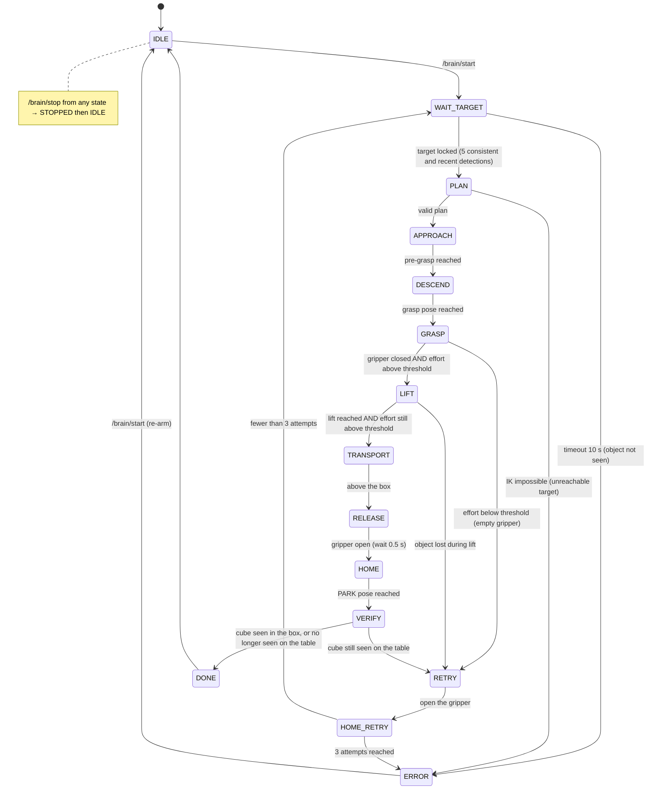

# 06 — `brain_node`: state machine, decision and robustness

> Authors: [DEC] Autonomy & decision · Reviewers: [KIN], [VIS], [QA], [CTRL]
> Requirements: C-30 to C-36, C-33 (non-blocking) · Decisions: ADR-009, ADR-010, ADR-015, ADR-016, ADR-017

## 1. Role and current state

- **Inputs**: `/joint_states`, `/object_position`, `/drop_box_position`, services `/brain/start`, `/brain/stop`, `/go_to_target`.
- **Outputs**: `/joint_command` (only channel to the motors, C-05), `/brain_state`, `/end_effector_pose`, `/brain/markers`.
- **Phase 2** adds the `/brain/pick_place` action, served by the same motion code (ADR-037), and `/brain/set_gripper` for the token handover (ADR-038, `phase2/P2-02` §6).
- **Starting point**: the course stub (ADR-039). The bootstrap prototype (outside the repository) had ikpy FK + `/end_effector_pose`, `/go_to_target` (position IK, rejected if error > 1 cm), the command sent **in one go** (the driver's speed limiter smoothed it): enough for C-41, not for pick & place, which needs trajectories (§5); target reached within 0.13 mm [MES-24].

## 2. Code organization

```text
so101_brain/
├── brain_node.py       # ROS glue only: subs, pubs, services, timers
├── fsm.py              # PURE state machine (no ROS import) → testable with a fake clock
├── kinematics.py       # FK/IK façade (ikpy) — see 04
├── grasp_planner.py    # grasp / pre-grasp / lift / drop (strategy ADR-009)
└── trajectory.py       # min-jerk, duration, 50 Hz sampling
```

Rule: **all logic is testable without ROS**; the node only feeds messages to `fsm.step(now, inputs) → outputs`.

## 3. State machine (ADR-015)



### 3.1 Transition table (implementation contract)

| State | Entry action | Exit condition | Timeout → |
| --- | --- | --- | --- |
| `IDLE` | Nothing (the arm keeps its target) | `/brain/start` | — |
| `WAIT_TARGET` | Go to `PARK` (arm out of the camera view); clear the detection history | 5 detections of the object **and** the box, spread < 5 mm, age < 0.5 s | 10 s → `ERROR` |
| `PLAN` | Start `grasp_planner.plan()` in a **worker thread** (future); checked every tick | Future done: valid plan or `None` | 2 s → `ERROR` |
| `APPROACH` | Min-jerk trajectory to the pre-grasp, gripper **open (100 %)** | `max(abs(q − q_target)) < 0.01 rad` | T + 1 s → `ERROR` |
| `DESCEND` | Trajectory to the grasp (4 cm back-off; Cartesian recommended on the real arm) | Reached | T + 1 s → `ERROR` |
| `GRASP` | Gripper → **0 %**, wait 0.8 s | Normalized gripper effort **> 0.06** → `LIFT`, otherwise `RETRY` | 1.5 s |
| `LIFT` | Back to the pre-grasp, then +10 cm (position IK) | Reached **and** effort > threshold | T + 1 s |
| `TRANSPORT` | Trajectory to the drop point (position IK, TCP ≈ 9 cm above the box floor) | Reached | T + 1 s |
| `RELEASE` | Gripper → 100 %, wait 0.5 s | Elapsed | — |
| `HOME` | Back to `PARK` | Reached | T + 1 s |
| `VERIFY` | Read fresh detections (arm out of view) | Cube within the box footprint or gone from the table → `DONE`; still on the table → `RETRY` | 2 s → `DONE` with a warning |
| `RETRY` | Open the gripper, increment the counter | → `HOME_RETRY` | — |
| `STOPPED` | Freeze: publish the **measured** position as the target | Immediately → `IDLE`; the next `/brain/start` starts a new cycle (`01` §3.2) | — |
| `ERROR` | Freeze, log the cause, publish `/brain_state = ERROR:<cause>` | `/brain/start` (re-arm) | — |

**Effort threshold**: in sim, the normalized gripper load is **0.12–0.19** when holding the cube vs **0** when empty [MES-10] → threshold 0.06 (×2 margin). It is a parameter, **to recalibrate on the real arm**.

### 3.2 Why `VERIFY`?

The cross-review found one drop failure out of 40: the cube released too high bounced out of the box [MES-09]. **Success is never declared without observation.** This turns "thinks it succeeded" into "succeeded", and feeds the evaluation bench metrics directly.

## 4. Non-blocking behavior (C-33, ADR-017)


| Rule | Implementation |
| --- | --- |
| No `sleep`, no `spin_until_future_complete` in a callback | The FSM runs in a **50 Hz timer**; waits are timestamp comparisons |
| Subscription callbacks only store | `self._last_object = (msg, stamp)` |
| Long computations (planning) never block the tick | `concurrent.futures.ThreadPoolExecutor(max_workers=1)`; `PLAN` polls `future.done()` |
| Perception missing or late | Use **the last known value** with its age; only request fresh data in `WAIT_TARGET` and `VERIFY` |
| `/joint_states` missing for > 0.5 s | `ERROR:no_joint_states`, stop sending commands |
| Services | Immediate answer (`success`/`message`); the effect is asynchronous, visible on `/brain_state` |

## 5. Motions

- Every motion goes through `trajectory.min_jerk(q_start, q_goal, v_max)` (`04` §6), sampled at 50 Hz and published on `/joint_command`.
- `q_start` = **measured position** (not the last command), so nothing jumps if the arm was blocked.
- The gripper is commanded in the same message as the joints (partial command if only `gripper`).
- Speeds: `v_max` = 1.0 rad/s (sim), 0.5 rad/s (real) to start with — parameter.

## 6. Parameters (YAML `so101_bringup/config/brain.yaml`)

| Parameter | Default | Origin |
| --- | --- | --- |
| `grasp.tilts_deg` | [0, 10, 20, 30] | Reachability map [MES-08] |
| `grasp.pregrasp_backoff_m` | 0.04 | [MES-09] |
| `grasp.lift_dz_m` | 0.10 | 5 cm walls + margin |
| `grasp.drop_tcp_z_m` | 0.09 | Failure observed at 0.11 [MES-09] |
| `grasp.effort_threshold` | 0.06 | [MES-10] |
| `grasp.close_pct` / `open_pct` | 0 / 100 | LeRobot convention |
| `motion.v_max_rad_s` | 1.0 (sim) / 0.5 (real) | Safety |
| `motion.reach_tol_rad` | 0.01 | — |
| `fsm.target_lock_n` | 5 | — |
| `fsm.target_lock_spread_m` | 0.005 | — |
| `fsm.max_retries` | 3 | — |
| `fsm.park_pose` | [1.9, -1.7, 1.6, 0.7, 0.0] | Out of the camera view (verified); **to validate mechanically on the real arm** |

## 7. Observability

- `/brain_state` (transient_local): the current state is always visible, even for late subscribers.
- Log on every transition: `old → new (reason, time spent in state)`.
- `/brain/markers`: pre-grasp (yellow sphere), grasp (green), drop (blue), approach (arrow).
- rosbag2 recording of demo episodes (`ros2 bag record /joint_states /joint_command /object_position /drop_box_position /brain_state`) to replay and analyze failures.

## 8. Tests

| Test | Type |
| --- | --- |
| Every transition of table §3.1 (simulated inputs, fake clock) | Unit `fsm.py` |
| `/brain/stop` from every state → `STOPPED` | Unit |
| Perception silent during `TRANSPORT` → the cycle still completes | Integration (launch_testing) |
| Unreachable target (r = 0.5 m) → `ERROR:unreachable`, **no** command sent | Integration |
| 50-episode evaluation bench (randomized cube and box) | System (`08`) |

## 9. Alternatives to the hand-written FSM

| Option | Pros | Cons | Verdict |
| --- | --- | --- | --- |
| **Hand-written FSM (Enum + table)** | Explicit (imposed C-32), zero dependency, testable | Tooling to write ourselves | **Chosen** |
| SMACH / FlexBE | ROS tooling, introspection | Dependencies, poorly maintained on Jazzy | No |
| Behavior trees (py_trees, BT.CPP) | State of the art for complex missions, reactive | Not an "explicit state machine"; overkill for ~10 states | Phase-2 option |

## 10. The course's robustness questions and our answers (C-36)

The day-2 slides ask "is your code robust?" with five situations [BOOT2 p12]. Each one maps to a design element and a test; the teaching staff wants a quick demo of each (2026-10-16), planned at step 5.4 (`results/robustness_demo.md`):

| Situation [BOOT2 p12] | Our answer | Where | Test |
| --- | --- | --- | --- |
| The object moves mid-action: recompute the movement? | The target is locked with the arm in PARK (out of view); a moved cube shows up as an **empty grasp** (effort) or in `VERIFY`, then `RETRY` re-acquires it and **replans**. Option, not planned: re-check while the cube is still visible during `APPROACH`, replan above 2 cm | §3, ADR-016, ADR-017 | `/sim/randomize` during `APPROACH` (ticket 4.4) |
| The grasp fails: how do you know, what do you do? | Normalized gripper effort below threshold → `RETRY` (max 3), then `ERROR:grasp_failed`; the drop is checked by `VERIFY` | §3.1–§3.2, ADR-016 | Unit (FSM) + fault injection |
| The object leaves the view: what does perception publish, is there a memory? | Perception publishes **nothing** when invalid; the brain keeps the last value with its age and only needs fresh data in `WAIT_TARGET` and `VERIFY` | §4, `05` §7, ADR-017 | Perception stopped during `TRANSPORT` → cycle completes |
| Target out of reach: what does IK return, does the arm move anyway? | The planner returns `None` with a reason → `ERROR:unreachable`; **never** "move anyway" | `04` §5 and §8, ADR-009 | Target at r = 0.5 m → no command |
| Lighting changes: does the color threshold hold? | Camera in manual exposure/white balance, runtime-tunable HSV thresholds, debug image to see the mask; YOLO-seg as fallback | `05` §2, `07` §4–§5, ADR-011 | Dimmed scene copy in sim (step 5.4), then a real image set under varied lighting (step 6.4) |
