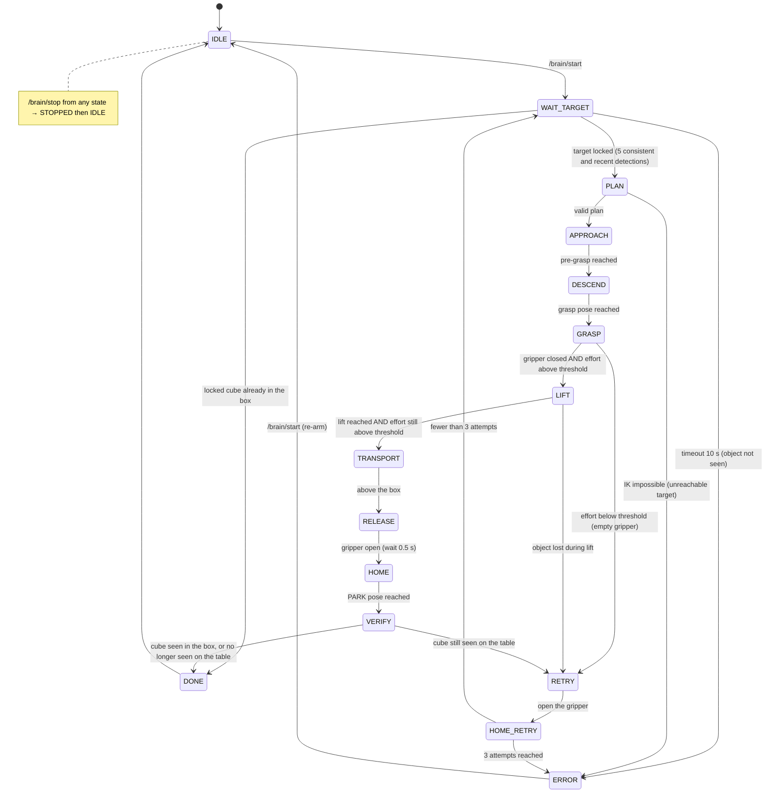
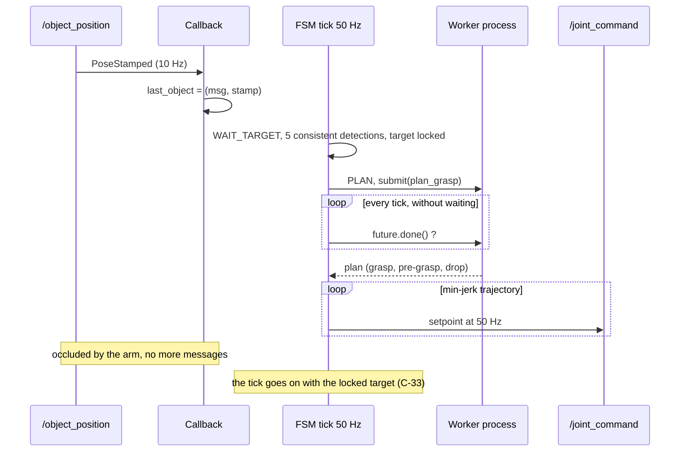

# 06 — `brain_node`: state machine, decision and robustness

> Authors: [DEC] Autonomy & decision · Reviewers: [KIN], [VIS], [QA], [CTRL]
> Requirements: C-30 to C-36, C-33 (non-blocking) · Decisions: ADR-009, ADR-010, ADR-015, ADR-016, ADR-017

## 1. Role and current state

- **Inputs**: `/joint_states`, `/object_position`, `/drop_box_position`, services `/brain/start`, `/brain/stop`, `/go_to_target`.
- **Outputs**: `/joint_command` (only channel to the motors, C-05), `/brain_state`, `/end_effector_pose`, `/brain/markers`.
- **Phase 2** adds the `/brain/pick_place` action, served by the same motion code (ADR-037), and `/brain/set_gripper` for the token handover (ADR-038, `phase2/P2-02` §6).
- **Starting point**: the course stub (ADR-039). The bootstrap prototype (outside the repository) had ikpy FK + `/end_effector_pose`, `/go_to_target` (position IK, rejected if error > 1 cm), the command sent **in one go** (the driver's speed limiter smoothed it): enough for C-41, not for pick & place, which needs trajectories (§5); target reached within 0.13 mm [MES-24].
- **Today**: the full cycle runs in sim with the real perception (4.3a, #139). `fsm.py` (§3) is driven by the node's 50 Hz tick, with `/brain/start`, `/brain/stop` and `/brain_state`; `PLAN` runs the planner in a worker process (§4); the plan and the locked cube show on `/brain/markers` (§7). The ground-truth stub (`so101_bringup/test/gt_stub.launch.py`, 4.2c, C-06) stays for development and for the tests that isolate the brain. The success rate: the nightly bench (`08` §2).

## 2. Code organization

```text
so101_brain/
├── brain_node.py       # ROS glue only: subs, pubs, services, timers
├── fsm.py              # PURE state machine (no ROS import) → testable with a fake clock
├── kinematics.py       # FK/IK façade (ikpy) — see 04
├── grasp_planner.py    # grasp / pre-grasp / lift / drop (strategy ADR-009)
└── trajectory.py       # min-jerk, duration, 50 Hz sampling
```

Rule: **all logic is testable without ROS**; the node only feeds messages to `fsm.step(now, inputs) → outputs`.

## 3. State machine (ADR-015)



### 3.1 Transition table (implementation contract)

| State | Entry action | Exit condition | Timeout → |
| --- | --- | --- | --- |
| `IDLE` | Nothing (the arm keeps its target); `/go_to_target` is served in this state only | `/brain/start` (without fresh `/joint_states`: `ERROR:no_joint_states`) | — |
| `WAIT_TARGET` | Go to `PARK` (arm out of the camera view); the detection history restarts once `PARK` is reached | 5 detections of the object **and** the box received since `PARK`, within 5 mm of each other, the newest younger than 0.5 s; target = their mean, yaw = the newest → `PLAN`. A locked cube already within the box footprint (`VERIFY`'s test, `fsm.box_half_size_m`) → `DONE` "cube already in the box", with no motion: grasping it would close the jaws on the box wall too (#143) | `PARK` not reached at T + 1 s → `ERROR:timeout:WAIT_TARGET`; 10 s after `PARK` → `ERROR:object_lost` |
| `PLAN` | Start `grasp_planner.plan()` in a **worker process** (future); checked every tick | Future done: valid plan → `APPROACH`; `None` → `ERROR:<reason>` (`unreachable`, `lift_unreachable`, `drop_unreachable`) | 6 s → `ERROR:timeout:PLAN` |
| `APPROACH` | Min-jerk trajectory to the pre-grasp, gripper **open (100 %)** | `max(abs(q − q_target)) < 0.01 rad` **and** the measured gripper within 3 % of open | T + 1 s → `ERROR:timeout:APPROACH` |
| `DESCEND` | Trajectory to the grasp (4 cm back-off; Cartesian recommended on the real arm) | Reached | T + 1 s → `ERROR:timeout:DESCEND` |
| `GRASP` | Gripper → **0 %**, wait 0.8 s | From 0.8 s, normalized gripper effort **> 0.06** → `LIFT` | Still below at 1.5 s → `RETRY` (empty gripper) |
| `LIFT` | Back to the pre-grasp, then +10 cm (position IK) | Reached: effort > threshold → `TRANSPORT`, otherwise → `RETRY` (judged once lifted, not on one sample) | T + 1 s per motion → `ERROR:timeout:LIFT` |
| `TRANSPORT` | Trajectory to the drop point (position IK, TCP ≈ 9 cm above the box floor) | Reached | T + 1 s → `ERROR:timeout:TRANSPORT` |
| `RELEASE` | Gripper → 100 %, wait 0.5 s | Elapsed | — |
| `HOME` | Back to `PARK` | Reached | T + 1 s → `ERROR:timeout:HOME` |
| `VERIFY` | Read the detections received since `VERIFY` (arm in `PARK`, out of view) | Cube center within ±5 cm of the locked box center (`08` §3) → `DONE`; elsewhere → `RETRY` | 2 s without a detection → `DONE` with a warning (gone from the table) |
| `RETRY` | Open the gripper, count the failed attempt | → `HOME_RETRY` | — |
| `HOME_RETRY` | Back to `PARK` | Reached: fewer than `fsm.max_retries` failed attempts → `WAIT_TARGET` (a new lock), otherwise → `ERROR:grasp_failed` | T + 1 s → `ERROR:timeout:HOME_RETRY` |
| `DONE` | Nothing | → `IDLE` | — |
| `STOPPED` | Freeze: publish the **measured** position as the target | Immediately → `IDLE`; the next `/brain/start` starts a new cycle (`01` §3.2) | — |
| `ERROR` | Freeze if a motion was running (none out of `PLAN` or `WAIT_TARGET`'s lock: no command at all), log the cause, publish `/brain_state = ERROR:<cause>` | `/brain/start` (re-arm → `IDLE`) | — |

**In every state of a cycle** (all but `IDLE`, `DONE`, `STOPPED`, `ERROR`), `/joint_states` older than 0.5 s → `ERROR:no_joint_states`, and the commands stop (no freeze from stale joints). `/brain/stop` wins over everything, from every state. At most one transition per tick: `DONE`, `RETRY` and `STOPPED` last one tick (20 ms), each one still published on `/brain_state`.

**Settled by the implementation** (`so101_brain/fsm.py`, step 4.1; `test_fsm.py`: one test per row, `/brain/stop` from every state, a timeout per motion state):

- **Lock age on the newest detection**: perception publishes valid detections only, so a dropped frame must not reset the lock; the 5 mm spread already rejects a cube that moved. Detections taken while the arm parks do not count (it crosses the view).
- **Failed attempts**: `fsm.max_retries` = 3 counts failed attempts, so 3 attempts in all (the diagram's "3 attempts reached"); `/brain/start` resets the count.
- **`HOME_RETRY`** had no row: it parks before the next lock (or the error), so the arm is never left low near the cube.
- **`ERROR` freezes only a running motion**: `ERROR:unreachable` sends no command at all (§8, §10).
- **Clock**: `Fsm.step(now, inputs)`, `now` from the node's steady clock; ages from the reception time on the same clock, never `time.time()` [MES-37].
- **`PLAN` timeout 6 s** (step 4.2b; 2 s before): the planner's slowest answer, a cube out of reach, takes 1.7 s to fail, 2.4 s on the CI runner (2.0 s locally while the planner ran in a worker thread); with 2 s it showed as `ERROR:timeout:PLAN` instead of `ERROR:unreachable` [MES-40]. The arm is parked during `PLAN`, so a hung planner costs nothing more. `test_grasp_planner.py` keeps that failure under half the timeout.
- **`APPROACH` waits for the open gripper** (step 4.2b): `DESCEND` must not bring closed jaws onto the cube. The other motions do not wait for it: in `TRANSPORT` the cube keeps the jaws from closing to 0 %.

**Effort threshold**: in sim, the normalized gripper load is **0.12–0.19** when holding the cube vs **0** when empty [MES-10] → threshold 0.06 (×2 margin in `GRASP`). Measured where the FSM judges it, on the nightly's 40 scenes [MES-48]: the `GRASP` window never below 0.120, empty always 0.000, but **the end of `LIFT` drops to 0.087** (the jaws carry the cube instead of squeezing it against the table): the tightest margin is ×1.45 there. Kept at 0.06, which sorts all 120 measured grasps right: lowering it would only move the margin to the empty side, which is exactly 0 in sim only. It is a parameter, **to recalibrate on the real arm** (#69).

### 3.2 Why `VERIFY`?

The cross-review found one drop failure out of 40: the cube released too high bounced out of the box [MES-09]. **Success is never declared without observation.** This turns "thinks it succeeded" into "succeeded", and feeds the evaluation bench metrics directly.

## 4. Non-blocking behavior (C-33, ADR-017)



| Rule | Implementation |
| --- | --- |
| No `sleep`, no `spin_until_future_complete` in a callback | The FSM runs in a **50 Hz timer**; waits are timestamp comparisons |
| Subscription callbacks only store | `self._last_object = (msg, stamp)` |
| Long computations (planning) never block the tick | `concurrent.futures.ProcessPoolExecutor(max_workers=1)`, started with the node (forkserver: the node is multithreaded); `PLAN` polls `future.done()`. A process, not a thread: the planner holds the GIL, and a worker thread delayed the tick to 27–29 ms at p99 during `PLAN` [MES-40] |
| Perception missing or late | Use **the last known value** with its age (from its reception, steady clock [MES-37]); only request fresh data in `WAIT_TARGET` and `VERIFY` |
| `/joint_states` missing for > 0.5 s | `ERROR:no_joint_states`, stop sending commands |
| Services | Immediate answer (`success`/`message`); the effect is asynchronous, visible on `/brain_state` |

## 5. Motions

- Every motion goes through `trajectory.min_jerk(q_start, q_goal, v_max)` (`04` §6), sampled at 50 Hz and published on `/joint_command`.
- `q_start` = **measured position** (not the last command), so nothing jumps if the arm was blocked.
- The gripper is commanded in the same message as the joints (partial command if only `gripper`).
- Speeds: `v_max` = 1.0 rad/s (sim), 0.5 rad/s (real) to start with — parameter.

## 6. Parameters (YAML `so101_bringup/config/brain.yaml`)

Declared by `brain_node` (read-only, with ranges): `motion.*` since step 2.2; `grasp.effort_threshold`, `grasp.open_pct`, `grasp.close_pct` and `fsm.*` since step 4.2a (`fsm.park_pose` checked against the URDF limits at startup); the planner's `grasp.tilts_deg`, `grasp.pregrasp_backoff_m`, `grasp.lift_dz_m` and `grasp.drop_tcp_z_m` since step 4.2b (defaults: the planner's own). **Since 5.1a every value of `fsm.Params` is a parameter**: the timeouts of §3.1, the ages, the box footprint, the shortest motion and its margin (`test_parameters.py`). A key the node does not declare stops it at startup. On the real arm, `brain_real.yaml` sets `motion.v_max_rad_s` to 0.5 (`01` §3.3).

| Parameter | Default | Origin |
| --- | --- | --- |
| `grasp.tilts_deg` | [0, 10, 20, 30] | Reachability map [MES-08] |
| `grasp.pregrasp_backoff_m` | 0.04 | [MES-09] |
| `grasp.lift_dz_m` | 0.10 | 5 cm walls + margin |
| `grasp.drop_tcp_z_m` | 0.09 | Failure observed at 0.11 [MES-09] |
| `grasp.effort_threshold` | 0.06 | [MES-10], [MES-48] |
| `grasp.close_pct` / `open_pct` | 0 / 100 | LeRobot convention |
| `grasp.gripper_tol_pct` | 3 % | `APPROACH` waits for the open gripper (§3.1) |
| `motion.v_max_rad_s` | 1.0 (sim) / 0.5 (real) | Safety |
| `motion.reach_tol_rad` | 0.01 | — |
| `motion.min_duration_s` | 0.5 s | `04` §6 |
| `motion.timeout_margin_s` | 1.0 s | T + margin → `ERROR:timeout:<state>` (§3.1) |
| `fsm.target_lock_n` | 5 | — |
| `fsm.target_lock_spread_m` | 0.005 | — |
| `fsm.max_retries` | 3 | — |
| `fsm.max_detection_age_s` / `fsm.max_joint_state_age_s` | 0.5 s / 0.5 s | The lock's newest detection; stale `/joint_states` → `ERROR:no_joint_states` |
| `fsm.wait_target_s` | 10 s | No lock after `PARK` → `ERROR:object_lost` |
| `fsm.plan_timeout_s` | 6 s | Slowest answer 1.7 s, 2.4 s on CI [MES-40] |
| `fsm.grasp_wait_s` / `fsm.grasp_timeout_s` | 0.8 s / 1.5 s | `GRASP` (§3.1) |
| `fsm.release_wait_s` | 0.5 s | `RELEASE` |
| `fsm.verify_timeout_s` | 2 s | `VERIFY`: no detection → `DONE` with a warning |
| `fsm.box_half_size_m` | 0.05 m | The box footprint (`08` §3), for `VERIFY` and the lock (#143) |
| `fsm.park_pose` | [1.9, -1.7, 1.5, 0.7, 0.0] | Off the workspace view: the cube never hidden, the box at worst 9 % hidden with the provided camera, 1 % with the moved one [MES-45]; elbow 1.6 pressed the lower arm on the shoulder, 0.01 rad short [MES-39]; **to validate mechanically on the real arm** |

## 7. Observability

- `/brain_state` (transient_local): the current state is always visible, even for late subscribers.
- Log on every transition: `old → new (reason, time spent in state)`.
- Log when leaving `PLAN` (step 4.2b): the planner's time and the longest tick period meanwhile, `PLAN: planner answered in 0.23 s; longest tick period 20.6 ms over 12 ticks` (C-33, MES-40).
- `/brain/markers`: pre-grasp (yellow sphere), grasp (green), drop (blue), approach (arrow from the pre-grasp to the grasp). Since step 4.2b: published when the cycle follows a plan, at the TCP of each of its configurations. Since 3.3b (#129): the locked cube, a red 5 cm cube turned by its yaw (unturned when the yaw is unknown).
  - **When it shows**: published with the plan when `APPROACH` starts, deleted on entering `LIFT` (about 5 s per cycle). From `LIFT` on, the arm model shows where the cube is, and a cube left at the pick place would be a ghost.
  - **In RViz** (#159): its own display, "Cube (locked)", with its checkbox in the Displays panel. It reads `/brain/markers` with only the `cube` namespace ticked, and "Brain targets" leaves `cube` out: one topic, never drawn twice. RViz applies the saved namespace states to a namespace before its first marker arrives.
  - **Why only then**: it is the target the brain locked, not a live detection. Perception still sees the cube in the jaws but places it about 12 cm off (`05` §7), so a marker following `/object_position` would draw a ghost during the transport.
  - **Limits**: nothing before the plan (`IDLE`, `WAIT_TARGET`, `PLAN`), nor when planning fails. After a stop or an error before `LIFT` it stays, where the untouched cube still is, until the next plan replaces it; it is off if the jaws pushed the cube. `/brain/markers` is not latched: RViz started during a cycle shows it from the next plan.
- rosbag2 recording of demo episodes (`ros2 bag record /joint_states /joint_command /object_position /drop_box_position /brain_state`) to replay and analyze failures.

## 8. Tests

| Test | Type |
| --- | --- |
| Every transition of table §3.1 (simulated inputs, fake clock) | Unit `fsm.py` |
| `/brain/stop` from every state → `STOPPED` | Unit |
| The cube moved during `APPROACH` (`/sim/randomize`) → empty grasp, `RETRY`, a new lock, `DONE` | Scripted run against the stack (`experiences/exp_fault_scenarios.py approach`, #54) |
| Perception container stopped during `TRANSPORT` → the cycle still completes (`VERIFY` → `DONE` with a warning) | Scripted run against the stack (`experiences/exp_fault_scenarios.py watch`, #54) |
| Unreachable target (r = 0.5 m) → `ERROR:unreachable`, **no** command sent | Integration (`test_brain_launch.py`, test_9) |
| A full cycle with the ground-truth stub: `DONE`, the cube in the box | System, sim (`so101_bringup/test/test_pick_place_gt_launch.py`) |
| 50-episode evaluation bench (randomized cube and box) | System (`08`) |

## 9. Alternatives to the hand-written FSM

| Option | Pros | Cons | Verdict |
| --- | --- | --- | --- |
| **Hand-written FSM (Enum + table)** | Explicit (imposed C-32), zero dependency, testable | Tooling to write ourselves | **Chosen** |
| SMACH / FlexBE | ROS tooling, introspection | Dependencies, poorly maintained on Jazzy | No |
| Behavior trees (py_trees, BT.CPP) | State of the art for complex missions, reactive | Not an "explicit state machine"; overkill for ~10 states | Phase-2 option |

## 10. The course's robustness questions and our answers (C-36)

The day-2 slides ask "is your code robust?" with five situations [BOOT2 p12]. Each one maps to a design element and a test; the teaching staff wants a quick demo of each (2026-10-16): step 5.4a (#103), one command per case, `ros2 launch so101_bringup robustness_demo.launch.py case:=<n>`, outcomes in `results/robustness_demo.md`. Cases 1 to 4 are handled; the lighting is not, the box is lost under a dim light [MES-49]:

| Situation [BOOT2 p12] | Our answer | Where | Test |
| --- | --- | --- | --- |
| The object moves mid-action: recompute the movement? | The target is locked with the arm in PARK (out of view); a moved cube shows up as an **empty grasp** (effort) or in `VERIFY`, then `RETRY` re-acquires it and **replans**. Option, not planned: re-check while the cube is still visible during `APPROACH`, replan above 2 cm | §3, ADR-016, ADR-017 | Demo case 1: `/sim/randomize` during `APPROACH` → `RETRY`, a new lock, `DONE` (also `exp_fault_scenarios.py`, #54): **handled** |
| The grasp fails: how do you know, what do you do? | Normalized gripper effort below threshold → `RETRY` (max 3), then `ERROR:grasp_failed`; the drop is checked by `VERIFY` | §3.1–§3.2, ADR-016 | Unit (FSM); demo case 2: `/sim/randomize` at each `DESCEND` → three `RETRY`, `ERROR:grasp_failed`: **handled** |
| The object leaves the view: what does perception publish, is there a memory? | Perception publishes **nothing** when invalid; the brain keeps the last value with its age and only needs fresh data in `WAIT_TARGET` and `VERIFY` | §4, `05` §7, ADR-017 | Demo case 3a: perception stopped during `TRANSPORT` → the cycle completes (also `exp_fault_scenarios.py`, #54); 3b: stopped before the cycle → `ERROR:object_lost`, no motion: **handled** |
| Target out of reach: what does IK return, does the arm move anyway? | The planner returns `None` with a reason → `ERROR:unreachable`; **never** "move anyway" | `04` §5 and §8, ADR-009 | `test_9` of `test_brain_launch.py`; demo case 4: target at r = 0.5 m → `ERROR:unreachable`, no `APPROACH`: **handled** |
| Lighting changes: does the color threshold hold? | Camera in manual exposure/white balance, runtime-tunable HSV thresholds, debug image to see the mask; YOLO-seg as fallback | `05` §2, `07` §4–§5, ADR-011 | Demo case 5, `lighting:=dim` (every light ×0.4, warm): **not handled**, 0/5 cycles, the box under `hsv_box_v_min` [MES-49]; then a real image set under varied lighting (step 6.4) |
