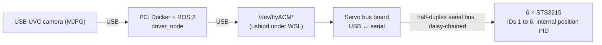
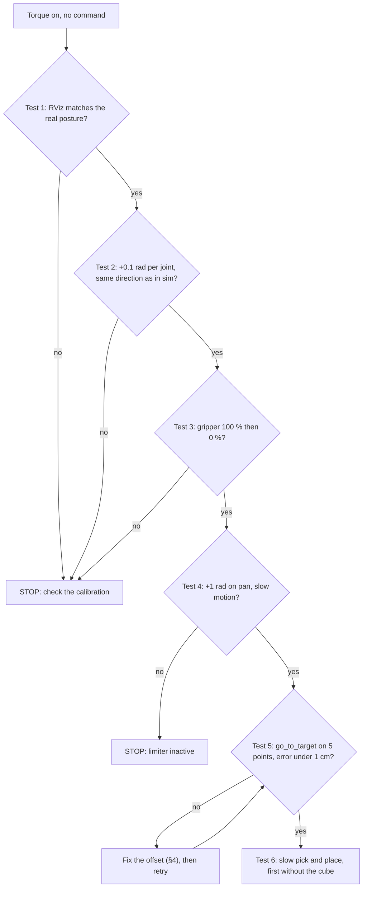
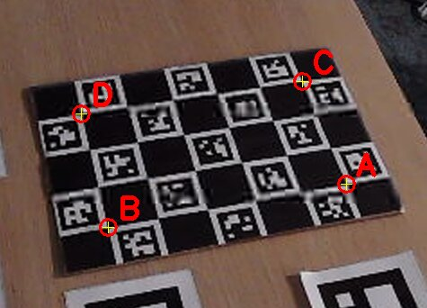
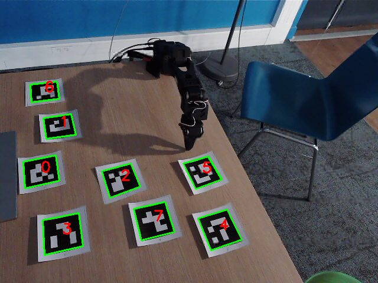
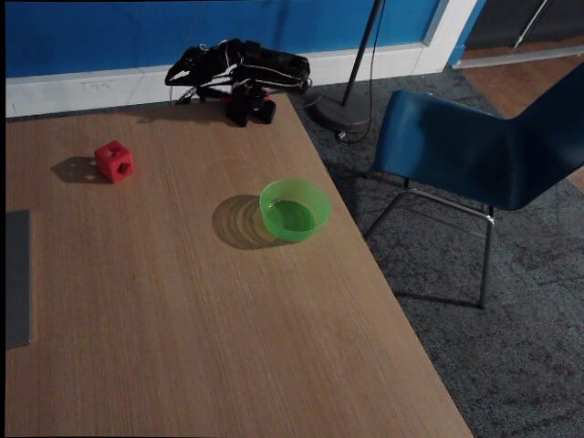

# 07 — Real arm: safety, commissioning and sim → real transfer

> Authors: [CTRL] Control & hardware (+ Safety role) · Reviewers: [VIS], [KIN], [CP]
> Requirements: C-43, C-51 · Decisions: ADR-007, ADR-014, ADR-021, ADR-023, ADR-032

## 1. Hardware chain



## 2. Safety — defense in depth (ADR-023)

| Layer | Mechanism | Initial setting |
| --- | --- | --- |
| 1. Procedure | Clear workspace, hands off while moving, power plug within reach, **every new command tested in sim first** (C-51) | Checklist §7 |
| 2. Brain | Min-jerk trajectories, unreachable targets rejected | 1.0 rad/s, as in sim (ADR-023 Update) |
| 3. Driver | Clamping to URDF limits + speed limiter on every command | 1.5 rad/s, as in sim |
| 4. LeRobot | Per-motor `max_relative_target` (max delta per command), set after the provided `_connect_arm` | 0.2 rad; gripper 25 % |
| 5. Servos | LeRobot `configure()`: gripper limited to 50 % torque, protection current, P = 16 | Provided |
| 6. Stop | `/brain/stop` → arm frozen; Ctrl-C → back to PARK, then torque off | — |
| 7. Physical | Power switch / plug | — |

> **State of the driver**: layers 3 (clamp and NaN rejection, speed limiter, at the sim's speeds since 2026-11-06, ADR-023 Update), 4 (per-motor `max_relative_target`) and 6 (slow move to `PARK` before the torque is cut, 4 s at most) are in the driver, and a lost serial bus stops it (`03` §8). The provided `disable_torque()` lines are commented out: **the real arm holds its pose and obeys `/joint_command` as soon as the driver starts with `USE_SIM=false`**. To move it by hand, stop the stack (`tools/so101 down`): the torque is off. Uncommenting those lines no longer frees it: the control tick's `send_action`, 50 times a second, turns the torque back on. Tests 1–3 of §3.2 passed on 2026-10-09 with the bootstrap prototype, which had the same safety layers (the project history of the design index; check the calibration zero first, [MES-30]); with this repository's driver they are step 6.1b (#65).

⚠ **Torque off = the arm falls.** `disable_torque_on_disconnect=True` by default: the driver brings the arm to the rest pose **before** `disconnect()`. During the first sessions, keep a hand ready to hold the forearm.

## 3. Commissioning, step by step

### 3.1 Prepare the host

1. `usbipd bind` (once, admin) then `usbipd attach --wsl --busid <X-Y>` (`02` §5).
2. `ls /dev/ttyACM*` in WSL.
3. Calibration file: the teaching staff recommends **recalibrating the arm with the LeRobot (Hugging Face) calibration tools** (2026-10-16; the slides said it was done already [BOOT p11]), then checking the zero [MES-30]. Put the JSON's **actual path** in `CALIBRATION_FILE` (`docker/.env`).
   - ⚠ If that path does not exist, Docker Compose **creates an empty root-owned directory** in its place and the driver fails ("No calibration"). Check the file exists before `up`.
   - If the file does not match the motors, the driver (provided code) **refuses to start** with "does not match the motors". First check that it is **the right file for this arm**, then only recalibrate.
   - No JSON, but the motors are already calibrated (by the staff): **read** their calibration into a file instead of recalibrating (read-only, no motion): `r = SO101Follower(SO101FollowerConfig(port=..., id="arm", calibration_dir=Path("/ros2_ws/calibration_tmp"), use_radians=True))`, `r.bus.connect()`, `r.calibration = r.bus.read_calibration()`, `r.bus.disconnect(disable_torque=False)`, `r._save_calibration()`, then copy the JSON to the host path of `CALIBRATION_FILE`. The file mirrors the motors, so `is_calibrated` always passes and its quality is that of the previous calibration: check the zero first [MES-30].
   - To (re)calibrate yourself (no `lerobot-calibrate` CLI in the image), the stack stopped: `tools/so101-arm calibrate` (#199). It refuses while the driver runs (two programs on the bus garble it), backs up `CALIBRATION_FILE` to `<name>.<date-time>.json`, then runs LeRobot's `calibrate()` on the bus alone in a throwaway container with only the port (`connect()` would run `configure()`, which turns the torque on), says what to do at each prompt and prints each joint's range and its middle against 2047. **Torque is off while moving the arm by hand.** At "middle", hold the URDF zero (stretched, horizontal); then, still the stack stopped and the arm held there, `tools/so101-arm zero-offsets -n 3` prints the readings, their spread and the `joint_zero_offsets:` line for `driver_real.yaml` (§4). Both read the port and the file from `docker/.env`; `--dry-run` prints the `docker run` line.
4. `USE_SIM=false` and `REAL_ROBOT_PORT=/dev/ttyACM0` in `.env`, then `docker compose up -d control viz`.
5. Logs: "Mode: hardware", no calibration error.
6. Torque: the provided `_connect_arm` ends with `robot.bus.disable_torque()` and its log (upstream #2), which leave the arm limp. The repository comments them out (ADR-032): ⚠ **the arm holds its pose and obeys `/joint_command` from the first start**. To move the arm by hand, stop the stack: the torque is off and `tools/so101-arm` reads the joints. Uncommenting those lines no longer frees it, the control tick turns the torque back on (2026-11-06).

### 3.2 Checks before any autonomous motion



| # | Test | Expected | On failure |
| --- | --- | --- | --- |
| 1 | **Read only**: torque on, no command; compare `/joint_states` / RViz with the physical posture (or torque off, §3.1 step 6, and move the arm by hand) | RViz reproduces the real posture **exactly** | Wrong sign/zero → calibration, **stop** |
| 2 | **Sign check**: `+0.1 rad` on each joint, one at a time, sim then real | Same direction as in sim (pan positive = towards −y) | Calibration / `drive_mode` — do not "fix" it in code |
| 3 | Gripper: 100 % then 0 % | Full opening / closing | Calibration range |
| 4 | Limiter: +1 rad command on `shoulder_pan`, with RViz's "Commanded arm (ghost)" ticked | Slow, progressive motion; the ghost leads, the arm follows and covers it at rest (the gap per joint is the tracking error, #200) | Limiter inactive → **stop** |
| 5 | `/go_to_target` on 5 points 10 cm above the table | Reached without jerk; measured error (grid) < 1 cm | Systematic offset → §4 |
| 6 | Pick & place at reduced speed, arm **without** then **with** the cube | Full cycle | Analyze the rosbag |

## 4. Sim → real gaps and countermeasures

| Gap | Expected effect | Countermeasure |
| --- | --- | --- |
| **Servo gains** (P = 16 real vs kp ≈ 998 sim) | Static error under gravity (mm range, larger with the arm stretched) | Measure on the grid; if needed, small setpoint correction or an outer loop on the measured FK |
| **Mechanical backlash** (± 0.5° modeled) | A few mm at the TCP | Always approach from the same direction; slow descent |
| Bus / camera latency | Tens of ms of delay | Target locked with the arm still; moderate speeds |
| **Lighting** | Invalid HSV thresholds, reflections | **Manual exposure, gain, white balance** (`v4l2-ctl`); thresholds tuned on recorded real images; diffuse lighting |
| Intrinsics / distortion | Pixel → 3D error | Intrinsic calibration (ADR-014), `undistortPoints` |
| Extrinsics | Pixel → 3D error growing with distance | ArUco + jig / touch probing (`05` §5.4, §10); startup self-check (6.3a) |
| Actual table height ≠ 0 | Bias in z | The table **defines** z = 0 (base resting on it) |
| **Calibration zero**: LeRobot's zero is the middle of the recorded range, not the pose held during calibration | For this arm, up to 23° on `shoulder_lift` if the URDF zero is the held pose: TCP off by centimeters (rest pose computed at z = −2.9 cm) [MES-30] | Measure the rest-pose TCP with a ruler (`exp_calibration_zero.py`); `joint_zero_offsets` in `driver_real.yaml` (#196): the driver subtracts them from what it reads and adds them to what it sends (`zero_offsets.py`, after the provided `_connect_arm`). Measured on 2026-11-06 on the bench's arm, the arm held at the URDF zero: elbow 0.186 rad (10.7°) [MES-55]; they belong to one arm and one calibration, to measure again after each (`tools/so101-arm zero-offsets`) |
| Cube friction, gripper compliance | Grasp differs from sim | Tune grasp height and jaw alignment (more useful on the real arm than in sim) |
| **Static error** (P = 16) | The arm stops 0.02 to 0.08 rad off its target under gravity, `wrist_roll` up to 0.17 rad, with no effect on the TCP | `motion.reach_tol_rad` 0.10 and `motion.reach_tol_roll_rad` 0.25 in `brain_real.yaml` |
| Stick-slip at low speed | Small jerks in slow motions (no bus gap above 44 ms) | Harmless; less visible at the sim's speeds |
| Reach | Reliable from 18 to 28 cm of the pan axis; a cube at 29 cm misses, a target under 14 cm is `drop_unreachable` | Keep the working area there [`results/bench_real_2026-11-06.md`](../../results/bench_real_2026-11-06.md) |
| Grasp signal | `Present_Load` cannot tell a held cube (closed empty: +0.11); 0 % on the cube trips `Overload`, bus refused until a power cycle [MES-56] | No effort on the real arm: the jaws' gap (`grasp.hold_gap_pct`), `grasp.close_pct` under the contact opening (#69): the jaws stop at 4.2–4.5 % on the cube's wall in a cycle, 1 % commanded, held from 2.8 % [MES-60]. An `Overload` anyway: the driver loses the bus and stops, the brain ends in `ERROR` (stale `/joint_states`); power-cycle the arm |

## 5. Real camera (ADR-007, ADR-021)

- **Type**: 720p/1080p USB UVC webcam with MJPG (tested: integrated webcam at 27.5 fps 640×480 MJPG through usbipd [MES-17]). **Rigid** mount (tripod or arm clamped to the table).
- **Placement**: reproduce the sim viewpoint (high, on the side, ~30–40° down). The **whole** grasp area, the box **and** the markers must be visible with margin: the provided sim camera cut 21 % of the cubes [MES-12], ours none [MES-45].
- **Locked settings** (auto-exposure ruins HSV thresholds):

```bash
v4l2-ctl -d /dev/video0 --list-ctrls                     # exact names depend on the camera
v4l2-ctl -d /dev/video0 -c auto_exposure=1 -c exposure_time_absolute=200 \
         -c white_balance_automatic=0 -c white_balance_temperature=4500 -c focus_automatic_continuous=0
```

- **Format**: `fourcc="MJPG"` mandatory through usbip.
- **Recalibrate** the extrinsics if the camera is bumped (§9 step 9). Nothing reports it yet: the startup self-check of `05` §5.4 is not built.
- **The link**: through usbip the UGREEN webcam gives 3.4–4.3 frames/s, and its link dropped three times in a day, every 30 to 40 min [MES-61]; `13` has the recovery.
- **Phase 2**: a second webcam faces the Connect Four grid at about 45 cm (`phase2/P2-02` §8); optionally a wrist camera, its cable with slack for a ±90° wrist roll (`phase2/P2-02` §3.1).

## 6. Real accuracy measurement (C-41, real version)

See `04` §7: A3 mat with mm grid + base jig, pointer in the gripper, 10 points, mean/max, photos. First result, by eye, on the real pick & place: the jaws within 1 cm of the cube's center seen from above, the TCP 5 mm low under gravity (test 5, 2026-11-06).

## 7. Safety checklist (print and tick at every session)

- [ ] Workspace clear (screens, cables, mugs): cube and box only (phase 2: grid with its depth guide on its jig, arm and riser clamped).
- [ ] Everyone knows how to cut the power.
- [ ] Today's code went through the sim **with the same parameters**.
- [ ] Speeds as decided: 1.5 / 1.0 rad/s (`max_joint_velocity` / `v_max`, the sim's, ADR-023 Update): the arm reaches a quarter turn in under 2 s, react accordingly.
- [ ] Test 1 (read only) passed: RViz = real.
- [ ] No autonomous grasp until `grasp.close_pct` and `grasp.hold_gap_pct` are measured and set in `brain_real.yaml` (#69): `close_pct` = 0 % on the cube trips `Overload`.
- [ ] Hands off as soon as the brain is armed. Phase 2: hands near the gripper only while waiting for a token (arm still); "done" only once the hands are out.
- [ ] One person watches the arm, one the terminal (`/brain/stop` ready).
- [ ] End of session: arm in PARK, then power off.

## 8. Demo video (C-53)

- 30 s: wide shot of the real arm + RViz inset (mask, FSM state), no cut during the cycle.
- Show 2–3 different cube positions (proves generalization).
- Keep a pre-recorded backup video [KO2 p25].
- For the final defense, also a video of the demo **with the team on it** [BRIEF], and one for the phase-2 application (`09` stage 7).

## 9. Real setup, from the bare arm to the first cycle

The whole procedure, in order, each step with its pass criterion. It takes about two hours the first time. Two people for every step that moves the arm (§7). A new setup (another arm, another table, the camera moved) starts again at the step it changes: another arm at step 5, a moved camera at step 9.

### 9.1 What you need

| Item | Why | Note |
| --- | --- | --- |
| SO-101 follower arm, its power supply, its USB cable | | The calibration and the joint zeros belong to one arm |
| **Clamp** for the base | The arm tips over when stretched | The table is z = 0: the base rests on it |
| USB webcam (UVC, MJPG, 640×480) | | Autofocus off if it has one |
| **Rigid mount** for the webcam: tripod or clamped arm | Any bump means a new calibration (step 9) | About 65 cm above the table |
| USB hub or adapter | If the PC has no USB-A | Each replug means a new `usbipd attach` |
| PC with Docker, WSL2 and usbipd (`02`) | | |
| **Printer** and A4 paper, or the prints below | | |
| [`charuco_board.pdf`](media/charuco_board.pdf), printed | Steps 8 and 9 | Printed at **100 %**: its squares measure 38 mm |
| [`aruco_markers.pdf`](media/aruco_markers.pdf), printed and cut | Step 9, the check | Black square 75 mm, cut on the 100 mm line. Optional |
| **Stiff cardboard** and glue | A curled board gives a wrong calibration | The board glued on it, flat |
| **Ruler or tape measure**, 30 cm, a caliper if you have one | Check the prints; place the sheets | Without it, the printed scale is only known at step 9 |
| **Tape** (masking tape) | Holds the board and the sheets flat | Without it they lift at the edges |
| Red 5 cm cube | The object | Another size: `cube_side_m`, step 10 |
| Drop target: a box or a bowl about 5 cm high, 12 cm wide at least, of a color that stands out | | Another height: `box_height_m`, step 10 |
| Matte table, diffuse light | Reflections and hard shadows break the color thresholds | Nothing red or of the target's color in the view |

The PDFs come from `tools/calibration_sheets.py`.

### 9.2 Procedure

1. **Print and check.** Print the board at **100 %** ("actual size", never "fit to page"), measure a black square: 38 mm. A board printed 11 % too large fills the sheet and gets clumsy to handle, even though step 9 measures the scale. Glue it on the cardboard.

2. **Lay out the bench.** Clamp the base at the middle of a table edge, **not in a corner**: the cube and the target need table on both sides of the pan axis, 18 to 28 cm from it (§4, `results/bench_real_2026-11-06.md`). Mount the webcam high, on one side, 35° to 55° down, so that the base, the whole working area and a margin stay in view. ⚠ 640×480 is the central 75 % of the width of a 16:9 webcam: frame it at this resolution.

3. **Attach the USB devices**, in an admin PowerShell the first time for each device, then at each replug:

   ```powershell
   usbipd list
   usbipd bind --busid <X-Y>            # once per device, admin
   usbipd attach --wsl --busid <X-Y>    # arm and webcam, the stack stopped
   ```

   Pass: `ls /dev/ttyACM0 /dev/video0` in WSL. A device that shows up as `/dev/video1`: a driver still holds the old one, stop the stack and attach again.

4. **Configure.** In `docker/.env`: `USE_SIM=false`, `REAL_ROBOT_PORT=/dev/ttyACM0`, `CALIBRATION_FILE=<absolute path of the arm's .json>`.

5. **Calibrate the arm**, the stack stopped. The torque is off: hold it.

   ```bash
   tools/so101 down
   tools/so101-arm calibrate
   ```

   At the first prompt `c`, then ENTER. At "middle", the URDF zero: stretched forward, horizontal, the wrist in line. Then each joint to both its stops, **the gripper too**. Pass: every range printed above 500 steps, about 1500 for the gripper. Then back at the URDF zero, held still, the jaws in line with the forearm:

   ```bash
   tools/so101-arm zero-offsets -n 3
   ```

   Put the `joint_zero_offsets` line in `driver_real.yaml`. Pass: each value within 2° of what the "middle" pose implies (`(2047 − middle) · 2π / 4096`); 7° on a joint means it was not held at the same pose, measure again.

6. **Commission.** `tools/so101 up`, then the log says "Mode: hardware" and RViz shows the arm. Tests 1 to 4 of §3.2. A missing arm or image in RViz: the driver died at its start, `tools/so101 logs`.

7. **Lock the camera** (§5), once the light is the one of the session.

8. **Intrinsics.** In `tools/so101 shell`:

   ```bash
   ros2 run so101_perception calibrate_intrinsics --out /ros2_ws/src/so101_bringup/config/camera_real_intrinsics.yaml
   ```

   Show the board all over the image, near and far, tilted. A view counts when the board is still: lay it down or prop it on an object rather than holding it. Pass: 25 views, RMS under 0.5 px. Then `tools/so101 restart`, the arm held: the driver publishes `camera_info`.

9. **Camera pose.** Tape the board flat on the table in the working area, its corners within the arm's reach. Its corners to touch are the crossings one square in from each corner of the pattern. With the text at the bottom of the page: `0` top left, `5` top right, `18` bottom left, `23` bottom right. Then, for each of them, the stack stopped, the jaws closed by hand and held on the crossing, the gripper as vertical as you can:

   ```bash
   tools/so101 down
   tools/so101-arm touch 0     # then 5, 18, 23: each prints its --touch argument
   ```

   Move the arm off the board without touching it, then `tools/so101 up` and, in `tools/so101 shell`, with the 4 printed arguments:

   ```bash
   ros2 run so101_perception calibrate_touch --touch 0 … --touch 5 … --touch 18 … --touch 23 … \
     --out /ros2_ws/src/so101_perception/config/camera_extrinsics_real.yaml
   ```

   

   Pass: touches within 4 mm, the print scale at 1.00. Then `tools/so101 restart perception`: it stops by itself as long as this file is missing, which is normal. Check, if you printed them: the ArUco sheets on the table come out square and at their printed size (MES-59).

   

   The board and the sheets can then go, the camera and the base **must not move any more**.

10. **Colors and sizes.** Put the cube and the target on the table. In RViz, `/perception/debug_image` shows what is detected. Tune without restarting, then copy the values into `perception_real.yaml`:

    ```bash
    ros2 param set /so101_perception hsv_cube_s_min 120
    ```

    

    Pass: both found, in several places of the working area, nothing else (§4). Another object: `cube_side_m` and `box_height_m` in the same file.

11. **Grasp.** The jaws must stop on the cube, never reach 0 % on it (`Overload`, power cycle). In `tools/so101 shell`, close on the cube's wall by steps, stop when the measure stays above the command, and note that opening:

    ```bash
    ros2 topic pub --once -w 1 --keep-alive 1 /joint_command sensor_msgs/msg/JointState '{name: [gripper], position: [8.0]}'
    ros2 topic echo --once --field position /joint_states sensor_msgs/msg/JointState   # the last value, rad
    ```

    `%` = `(rad + 0.1745) / 1.9199 × 100`. In `brain_real.yaml`: `grasp.close_pct` about 3 % under that opening; `grasp.hold_gap_pct` so that `close_pct + hold_gap_pct` falls between the empty opening and the one on the cube. In a cycle the jaws stop lower than by hand: read `gripper` in the `GRASP` transition of the log and adjust. Then `tools/so101 restart`.

12. **Test 5** (§3.2): `/go_to_target` above the cube, read from `/object_position`. Pass: the jaws above its center, within 1 cm, seen from straight above.

13. **First cycle.** Hands off, `/brain/stop` ready, one person at the terminal:

    ```bash
    tools/so101 cycle
    ```

    Pass: `DONE`, the cube in the target. Then the 10 trials of #72.

14. **End of the session.** `tools/so101 down`, a hand on the arm, power off, `USE_SIM=true` in `docker/.env`.
