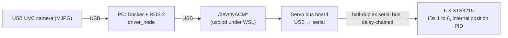
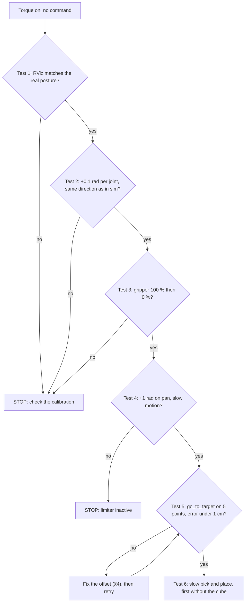

# 07 — Real arm: safety, commissioning and sim → real transfer

> Authors: [CTRL] Control & hardware (+ Safety role) · Reviewers: [VIS], [KIN], [CP]
> Requirements: C-43, C-51 · Decisions: ADR-007, ADR-014, ADR-021, ADR-023, ADR-032

## 1. Hardware chain



## 2. Safety — defense in depth (ADR-023)

| Layer | Mechanism | Initial setting |
| --- | --- | --- |
| 1. Procedure | Clear workspace, hands off while moving, power plug within reach, **every new command tested in sim first** (C-51) | Checklist §7 |
| 2. Brain | Min-jerk trajectories, reduced `v_max`, unreachable targets rejected | 0.5 rad/s |
| 3. Driver | Clamping to URDF limits + speed limiter on every command | 0.8 rad/s |
| 4. LeRobot | Per-motor `max_relative_target` (max delta per command), set after the provided `_connect_arm` | 0.2 rad; gripper 25 % |
| 5. Servos | LeRobot `configure()`: gripper limited to 50 % torque, protection current, P = 16 | Provided |
| 6. Stop | `/brain/stop` → arm frozen; Ctrl-C → back to PARK, then torque off | — |
| 7. Physical | Power switch / plug | — |

> **State of the driver**: layers 3 (clamp and NaN rejection, speed limiter; 0.8 rad/s on the real arm, `driver_real.yaml`; the brain's motions at 0.5 rad/s, `brain_real.yaml`), 4 (per-motor `max_relative_target`) and 6 (slow move to `PARK` before the torque is cut, 4 s at most) are in the driver, and a lost serial bus stops it (`03` §8). The provided `disable_torque()` lines are commented out: **the real arm holds its pose and obeys `/joint_command` as soon as the driver starts with `USE_SIM=false`**. To move it by hand (test 1 of §3.2, taught poses), uncomment them for that session only, never in a commit. Tests 1–3 of §3.2 passed on 2026-10-09 with the bootstrap prototype, which had the same safety layers (the project history of the design index; check the calibration zero first, [MES-30]); with this repository's driver they are step 6.1b (#65).

⚠ **Torque off = the arm falls.** `disable_torque_on_disconnect=True` by default: the driver brings the arm to the rest pose **before** `disconnect()`. During the first sessions, keep a hand ready to hold the forearm.

## 3. Commissioning, step by step

### 3.1 Prepare the host

1. `usbipd bind` (once, admin) then `usbipd attach --wsl --busid <X-Y>` (`02` §5).
2. `ls /dev/ttyACM*` in WSL.
3. Calibration file: the teaching staff recommends **recalibrating the arm with the LeRobot (Hugging Face) calibration tools** (2026-10-16; the slides said it was done already [BOOT p11]), then checking the zero [MES-30]. Put the JSON's **actual path** in `CALIBRATION_FILE` (`docker/.env`).
   - ⚠ If that path does not exist, Docker Compose **creates an empty root-owned directory** in its place and the driver fails ("No calibration"). Check the file exists before `up`.
   - If the file does not match the motors, the driver (provided code) **refuses to start** with "does not match the motors". First check that it is **the right file for this arm**, then only recalibrate.
   - No JSON, but the motors are already calibrated (by the staff): **read** their calibration into a file instead of recalibrating (read-only, no motion): `r = SO101Follower(SO101FollowerConfig(port=..., id="arm", calibration_dir=Path("/ros2_ws/calibration_tmp"), use_radians=True))`, `r.bus.connect()`, `r.calibration = r.bus.read_calibration()`, `r.bus.disconnect(disable_torque=False)`, `r._save_calibration()`, then copy the JSON to the host path of `CALIBRATION_FILE`. The file mirrors the motors, so `is_calibrated` always passes and its quality is that of the previous calibration: check the zero first [MES-30].
   - To (re)calibrate yourself (no `lerobot-calibrate` CLI in the image), the stack stopped: `tools/so101-arm calibrate` (#199). It refuses while the driver runs (two programs on the bus garble it), backs up `CALIBRATION_FILE` to `<name>.<date-time>.json`, then runs LeRobot's `calibrate()` on the bus alone in a throwaway container with only the port (`connect()` would run `configure()`, which turns the torque on), says what to do at each prompt and prints each joint's range and its middle against 2047. **Torque is off while moving the arm by hand.** At "middle", hold the URDF zero (stretched, horizontal); then, still the stack stopped and the arm held there, `tools/so101-arm zero-offsets -n 3` prints the readings, their spread and the `joint_zero_offsets:` line for `driver_real.yaml` (§4). Both read the port and the file from `docker/.env`; `--dry-run` prints the `docker run` line.
4. `USE_SIM=false` and `REAL_ROBOT_PORT=/dev/ttyACM0` in `.env`, then `docker compose up -d control viz`.
5. Logs: "Mode: hardware", no calibration error.
6. Torque: the provided `_connect_arm` ends with `robot.bus.disable_torque()` and its log (upstream #2), which leave the arm limp. The repository comments them out (ADR-032): ⚠ **the arm holds its pose and obeys `/joint_command` from the first start**. To move the arm by hand for test 1, uncomment them for that session only, never in a commit.

### 3.2 Checks before any autonomous motion



| # | Test | Expected | On failure |
| --- | --- | --- | --- |
| 1 | **Read only**: torque on, no command; compare `/joint_states` / RViz with the physical posture (or torque off, §3.1 step 6, and move the arm by hand) | RViz reproduces the real posture **exactly** | Wrong sign/zero → calibration, **stop** |
| 2 | **Sign check**: `+0.1 rad` on each joint, one at a time, sim then real | Same direction as in sim (pan positive = towards −y) | Calibration / `drive_mode` — do not "fix" it in code |
| 3 | Gripper: 100 % then 0 % | Full opening / closing | Calibration range |
| 4 | Limiter: +1 rad command on `shoulder_pan`, with RViz's "Commanded arm (ghost)" ticked | Slow, progressive motion; the ghost leads, the arm follows and covers it at rest (the gap per joint is the tracking error, #200) | Limiter inactive → **stop** |
| 5 | `/go_to_target` on 5 points 10 cm above the table | Reached without jerk; measured error (grid) < 1 cm | Systematic offset → §4 |
| 6 | Pick & place at reduced speed, arm **without** then **with** the cube | Full cycle | Analyze the rosbag |

## 4. Sim → real gaps and countermeasures

| Gap | Expected effect | Countermeasure |
| --- | --- | --- |
| **Servo gains** (P = 16 real vs kp ≈ 998 sim) | Static error under gravity (mm range, larger with the arm stretched) | Measure on the grid; if needed, small setpoint correction or an outer loop on the measured FK |
| **Mechanical backlash** (± 0.5° modeled) | A few mm at the TCP | Always approach from the same direction; slow descent |
| Bus / camera latency | Tens of ms of delay | Target locked with the arm still; moderate speeds |
| **Lighting** | Invalid HSV thresholds, reflections | **Manual exposure, gain, white balance** (`v4l2-ctl`); thresholds tuned on recorded real images; diffuse lighting |
| Intrinsics / distortion | Pixel → 3D error | Intrinsic calibration (ADR-014), `undistortPoints` |
| Extrinsics | Pixel → 3D error growing with distance | ArUco + jig / touch probing (`05` §5.4, §10); startup self-check (6.3a) |
| Actual table height ≠ 0 | Bias in z | The table **defines** z = 0 (base resting on it) |
| **Calibration zero**: LeRobot's zero is the middle of the recorded range, not the pose held during calibration | For this arm, up to 23° on `shoulder_lift` if the URDF zero is the held pose: TCP off by centimeters (rest pose computed at z = −2.9 cm) [MES-30] | Measure the rest-pose TCP with a ruler (`exp_calibration_zero.py`); `joint_zero_offsets` in `driver_real.yaml` (#196): the driver subtracts them from what it reads and adds them to what it sends (`zero_offsets.py`, after the provided `_connect_arm`). Measured on 2026-10-30, the arm held at the URDF zero: elbow 0.241 rad (13.8°); to measure again after each recalibration (`tools/so101-arm zero-offsets`) |
| Cube friction, gripper compliance | Grasp differs from sim | Tune grasp height and jaw alignment (more useful on the real arm than in sim) |
| Grasp signal | `Present_Load` cannot tell a held cube (closed empty: +0.11); 0 % on the cube trips `Overload`, bus refused until a power cycle [MES-56] | No effort on the real arm: the jaws' gap (`grasp.hold_gap_pct`), `grasp.close_pct` just below the contact opening (#69). An `Overload` anyway: the driver loses the bus and stops, the brain ends in `ERROR` (stale `/joint_states`); power-cycle the arm |

## 5. Real camera (ADR-007, ADR-021)

- **Type**: 720p/1080p USB UVC webcam with MJPG (tested: integrated webcam at 27.5 fps 640×480 MJPG through usbipd [MES-17]). **Rigid** mount (tripod or arm clamped to the table).
- **Placement**: reproduce the sim viewpoint (high, on the side, ~30–40° down). The **whole** grasp area, the box **and** the markers must be visible with margin: the provided sim camera cut 21 % of the cubes [MES-12], ours none [MES-45].
- **Locked settings** (auto-exposure ruins HSV thresholds):

```bash
v4l2-ctl -d /dev/video0 --list-ctrls                     # exact names depend on the camera
v4l2-ctl -d /dev/video0 -c auto_exposure=1 -c exposure_time_absolute=200 \
         -c white_balance_automatic=0 -c white_balance_temperature=4500 -c focus_automatic_continuous=0
```

- **Format**: `fourcc="MJPG"` mandatory through usbip.
- **Recalibrate** the extrinsics if the camera is bumped (the startup self-check of `05` §5.4, to build in 6.3a, will report it).
- **Phase 2**: a second webcam faces the Connect Four grid at about 45 cm (`phase2/P2-02` §8); optionally a wrist camera, its cable with slack for a ±90° wrist roll (`phase2/P2-02` §3.1).

## 6. Real accuracy measurement (C-41, real version)

See `04` §7: A3 mat with mm grid + base jig, pointer in the gripper, 10 points, mean/max, photos.

## 7. Safety checklist (print and tick at every session)

- [ ] Workspace clear (screens, cables, mugs): cube and box only (phase 2: grid with its depth guide on its jig, arm and riser clamped).
- [ ] Everyone knows how to cut the power.
- [ ] Today's code went through the sim **with the same parameters**.
- [ ] `max_joint_velocity` / `v_max` at "real" values (≤ 0.8 / 0.5 rad/s).
- [ ] Test 1 (read only) passed: RViz = real.
- [ ] No autonomous grasp until `grasp.close_pct` and `grasp.hold_gap_pct` are measured and set in `brain_real.yaml` (#69): `close_pct` = 0 % on the cube trips `Overload`.
- [ ] Hands off as soon as the brain is armed. Phase 2: hands near the gripper only while waiting for a token (arm still); "done" only once the hands are out.
- [ ] One person watches the arm, one the terminal (`/brain/stop` ready).
- [ ] End of session: arm in PARK, then power off.

## 8. Demo video (C-53)

- 30 s: wide shot of the real arm + RViz inset (mask, FSM state), no cut during the cycle.
- Show 2–3 different cube positions (proves generalization).
- Keep a pre-recorded backup video [KO2 p25].
- For the final defense, also a video of the demo **with the team on it** [BRIEF], and one for the phase-2 application (`09` stage 7).
