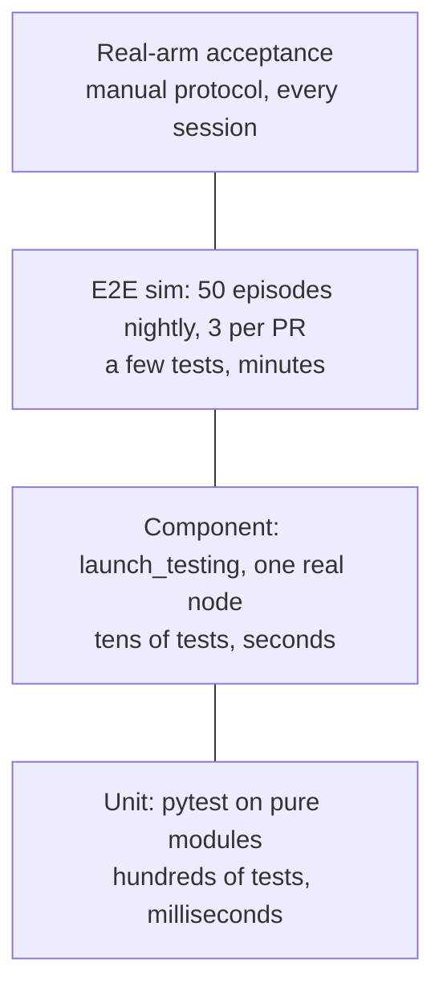

# 08 — Quality, tests, metrics and Git workflow (summary)

> Authors: [QA] Quality & tests · Reviewers: [OPS], [CP], every node owner
> Requirements: C-06, C-07, C-41, C-42, C-50 · Decisions: ADR-019, ADR-020, ADR-026
> Detailed, validated pipeline (jobs, tools, alternatives, budget): **`14_quality_pipeline_ci.md`**.

## 1. Test pyramid



| Level | Content | Tool | Where | When |
| --- | --- | --- | --- | --- |
| **Unit** (fast, ROS-free) | Gripper conversion, clamping, partial-command merge, FK/IK, pixel ↔ 3D projection, HSV detection on reference images, FSM transitions with a fake clock | `pytest` | `<pkg>/test/` | Every commit (pre-commit + CI) |
| **Component** (one node) | `/joint_states` rate, partial command, clamping, `camera_info`, service answers | `launch_testing` + `pytest` | `<pkg>/test/test_*_launch.py` | Every PR (CI) |
| **System** (full stack in sim) | Evaluation bench: N randomized pick & place episodes | `ros2 run so101_bringup evaluate` + test-only ground truth | `so101_bringup/so101_bringup/evaluate.py` | Every PR touching brain/perception/driver (N small), nightly (N = 50) |
| **Real-arm acceptance** | Manual protocol (`07` §3.2) + accuracy measurement | Checklist | — | Every session on the arm |

## 2. Metrics and success thresholds

| Metric | Target | Measured so far (spikes, bootstrap prototype) |
| --- | --- | --- |
| `/joint_states` rate | ≥ 20 Hz (imposed); target 30–50 Hz | **30.0 Hz** (bootstrap prototype) [MES-24] |
| Control loop jitter (p99) | ≤ 25 ms | 25 ms with render on a copy; 52 ms otherwise [MES-20] |
| Image / `camera_info` | 10 Hz, same `stamp` | Image 10.0 Hz; `camera_info` to do |
| IK success in the workspace | 100 % (position) | 100 % [MES-07], [MES-21] |
| **Measured TCP accuracy (C-41)** | < 1 cm | Sim: 0.1–0.3 mm closed loop [MES-09]; 0.13 mm through `/go_to_target` [MES-24] |
| Object position error (perception) | < 5 mm (sim), < 1 cm (real) | 2.7 mm with the exact camera pose; 1.6–1.8 mm induced by the ArUco calibration [MES-13], [MES-16], [MES-25] |
| Detection rate (non-truncated) | 100 % | 100 % [MES-13] |
| **Pick & place success (C-42), randomized cube + box** | **≥ 90 %** over 50 episodes | Ground-truth spike: 39/40 [MES-09] |
| Cycle duration | < 30 s | Spike: ~12 s |
| Ground truth used in the pipeline | **0** | CI grep |

Phase-2 targets: `phase2/P2-01` §4.

## 3. Evaluation bench (sim)

```text
for i in 1..N:
    call /sim/randomize                         # cube AND box
    wait for /brain_state == IDLE
    call /brain/start; start a timer
    wait for DONE | ERROR | timeout (60 s)
    read /sim/ground_truth/* (expose_ground_truth:=true, for this bench ONLY)
    success = cube within the box footprint, z < 6 cm
    write a CSV row: i, poses, final state, duration, failure cause
print success rate, p50/p95 duration, failure-cause breakdown
```

- Fixed seed for reproducibility (driver `seed` parameter in sim).
- Every failure keeps its **rosbag** (`ros2 bag record`), episode number in the file name.
- Milestone CSVs are versioned in `results/` to track progress.

## 4. Automated guards (CI)

| Check | Command | Protects |
| --- | --- | --- |
| Lint / format | `pre-commit run --all-files` (ruff, markdownlint, YAML/XML/TOML…) | Readability |
| Project rules | `bash tools/ci/guards.sh` (backend outside driver, ground truth, provided extrinsics) | **C-05, C-06, C-23** |
| Build | `colcon build` inside the image | — |
| Tests | `colcon test --packages-select <packages with a test/ folder> && colcon test-result --verbose` | — |
| E2E sim smoke | Evaluation bench N = 3, headless (OSMesa) | Integration regressions |

## 5. Code conventions

- **Python 3.12**, `ruff` (rules E, W, F, I, B, UP, N, SIM, RUF), line length 110, type hints on public APIs.
- No magic numbers: constants in `so101_common`, tunables as **ROS parameters** (declared with descriptor and range).
- Logs: `self.get_logger()`, `throttle_duration_sec` in loops, no `print`.
- All non-trivial logic **outside ROS callbacks**, in pure testable modules (`fsm.py`, `kinematics.py`, `geometry.py`, `detection.py`).
- Short docstrings: what, units, frame.

## 6. Git workflow (ADR-020, ADR-028)

| Rule | Why |
| --- | --- |
| Protected `main`: PR required, 1 review, green CI | Quality; and **everyone reviews the others' code**, which serves C-50 (understanding the whole pipeline) |
| Short branches named after their ticket: `feat/12-driver-camera-info`, `fix/34-ik-pan-sign`… (CONTRIBUTING §2) | Continuous integration, few conflicts; the branch points to its ticket |
| **Everyone commits their own work**; when pairing, add a `Co-authored-by:` trailer | **C-07**: each member's history must be visible |
| Conventional commits (`feat:`, `fix:`, `test:`, `docs:`, `refactor:`) | Readable history, changelog |
| Squash merge; tags per functional milestone (`v0.1.0` driver … `v1.0.0` sim pick & place, `v1.1.0` real, `v2.0.0` phase 2 and final defense) | Rollback, demos |
| Course slides stay in `docs/` (versioned by the course); no other PDF/media added | Clean repo (C-53) |
| GitHub Project: one epic per roadmap stage, one PR-sized ticket per sub-step of `09`, PR `Closes #N` (`15` §12, CONTRIBUTING §8) | Visible progress, work an AI agent can pick up too |

### Definition of Done for a PR

- [ ] CI is green (lint, build, tests, C-05/C-06/C-23 guards).
- [ ] A test covers the added or fixed behavior.
- [ ] New parameters are documented (YAML + table in the relevant document).
- [ ] Someone other than the author reviewed it **and can explain it**.
- [ ] The ADR is updated if a decision changed.
