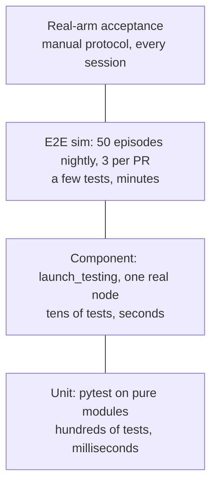

# 08 — Quality, tests, metrics and Git workflow (summary)

> Authors: [QA] Quality & tests · Reviewers: [OPS], [CP], every node owner
> Requirements: C-06, C-07, C-41, C-42, C-50 · Decisions: ADR-019, ADR-020, ADR-026
> Detailed, validated pipeline (jobs, tools, alternatives, budget): **`14_quality_pipeline_ci.md`**.

## 1. Test pyramid



| Level | Content | Tool | Where | When |
| --- | --- | --- | --- | --- |
| **Unit** (fast, ROS-free) | Gripper conversion, clamping, partial-command merge, FK/IK, pixel ↔ 3D projection, HSV detection on reference images, FSM transitions with a fake clock | `pytest` | `<pkg>/test/` | Every commit (pre-commit + CI) |
| **Component** (one node) | `/joint_states` rate, partial command, clamping, `camera_info`, service answers | `launch_testing` + `pytest` | `<pkg>/test/test_*_launch.py` | Every PR (CI) |
| **Sim-backed** (needs `so101_sim`) | Closed-loop grasp, IK accuracy against MuJoCo, the launch files, a full cycle with the ground-truth stub | `pytest`, `launch_testing` | `so101_bringup/test/` only: never under `so101_brain` or `so101_perception` (CI guard) | Every PR (CI) |
| **Scripts** (CI and tooling) | `tools/so101`, the nightly report, the CI skip rules, the course watch: their behavior without network or Docker (fake `gh`, `--dry-run`) | `bash` | `tools/ci/test_*.sh` | Every commit that changes them (pre-commit) |
| **System** (full stack in sim) | Evaluation bench: N randomized pick & place episodes | `ros2 run so101_bringup evaluate` + test-only ground truth | `so101_bringup/so101_bringup/evaluate.py` | Every PR touching brain/perception/driver (N small), nightly (N = 50) |
| **Real-arm acceptance** | Manual protocol (`07` §3.2) + accuracy measurement | Checklist | — | Every session on the arm |

**Mutation testing** of the modules that protect the arm (step 5.1c, [MES-42]): mutmut injects small bugs into `so101_driver/command.py` (merge, clamp, NaN) and `so101_brain/fsm.py`, and counts those no test catches. Its configuration is the `[mutmut]` section of each package's `setup.cfg`: mutmut runs from the package folder, where the module names resolve. By hand, from the repository root, about 1 min:

```bash
docker run --rm -v "$PWD/ros2_ws/src:/src:ro" tek5/control bash -lc '
  pip install -q --break-system-packages --ignore-installed mutmut==3.8.0 pytest==7.4.4 &&
  source /opt/ros/jazzy/setup.bash && cp -r /src /tmp/src && export PYTHONPATH=/tmp/src/so101_common:$PYTHONPATH &&
  for pkg in so101_driver so101_brain; do (cd /tmp/src/$pkg && PYTHONPATH=.:$PYTHONPATH mutmut run && mutmut results); done'
```

`pytest==7.4.4` is the image's own: a newer pytest breaks the `launch_testing` plugin. A surviving mutant gets a test, unless it is equivalent; the equivalent ones and the exact-threshold ties are listed in MES-42.

## 2. Metrics and success thresholds

| Metric | Target | Measured (this repository, unless marked) |
| --- | --- | --- |
| `/joint_states` rate | ≥ 20 Hz (imposed); target 30–50 Hz | **30.0 Hz** (bootstrap prototype) [MES-24] |
| Control loop jitter (p99) | ≤ 25 ms | Driver, camera on: 20.3–20.4 ms [MES-34]; brain tick during `PLAN`: 24.4 ms [MES-40] |
| Image / `camera_info` | 10 Hz, same `stamp` | Image 10.0 Hz [MES-34]; `camera_info` shares each image's header (`test_driver_launch.py`) |
| IK success in the workspace | 100 % (position) | 100 % [MES-07], [MES-21] |
| **Measured TCP accuracy (C-41)** | < 1 cm | Sim: 0.1–0.3 mm closed loop [MES-09]; 0.13 mm through `/go_to_target` [MES-24] |
| Object position error (perception) | < 5 mm (sim), < 1 cm (real) | 2.7 mm with the exact camera pose; 1.6–1.8 mm induced by the ArUco calibration [MES-13], [MES-16], [MES-25] |
| Detection rate (non-truncated) | 100 % | 100 % [MES-13] |
| **Pick & place success (C-42), randomized cube + box** | **≥ 90 %** over 50 episodes | Ground-truth stub: 20/20 [MES-40]; real perception: the nightly bench (below), capped near 80 % by the cubes cut by the image edge [MES-12]; 3/3 on every PR (`e2e-smoke`) |
| Cycle duration | < 30 s | Ground-truth stub: median 14.6 s, max 17.7 [MES-40]; real perception in CI: p50 17.4 s, p95 18.0 s (`e2e-smoke`, 2026-10-24) |
| Ground truth used in the pipeline | **0** | CI grep |

Phase-2 targets: `phase2/P2-01` §4.

**Where to read the bench results**: the issue ["Nightly bench results"](https://github.com/FoxaxeWasTaken/Robotics/issues?q=is%3Aissue+in%3Atitle+%22Nightly+bench+results%22), one comment per nightly bench with its success rate, durations and failure causes (`14` §6); the CSV and the failed episodes' rosbags are the run's artifact for 14 days.

## 3. Evaluation bench (sim)

```text
for i in 1..N:
    call /sim/randomize                         # cube AND box
    wait for /brain_state == IDLE
    call /brain/start; start a timer
    wait for DONE | ERROR | timeout (60 s)
    read /sim/ground_truth/* (expose_ground_truth:=true, for this bench ONLY)
    success = cube within the box footprint, z < 6 cm
    write a CSV row: i, poses, final state, duration, failure cause
print success rate, p50/p95 duration, failure-cause breakdown
```

- Fixed seed for reproducibility (driver `seed` parameter in sim).
- Every failure keeps its **rosbag** (`ros2 bag record`), episode number in the file name.
- Milestone CSVs are versioned in `results/` to track progress.
- **Implementation** (`so101_bringup/evaluate.py`, step 4.5a): `ros2 run so101_bringup evaluate --episodes N --out <csv> [--bags <dir>] [--seed S] [--timeout 60] [--min-success M]`, against a driver started with `expose_ground_truth:=true`. With `--min-success`, fewer than M successes exit 1, after the CSV and the summary: the PR's E2E job runs `--episodes 3 --min-success 3` (#156); the nightly runs without it.
  - **Where the switch is** (4.3a): `sim.launch.py expose_ground_truth:=true`, default false. On a bench domain, `perception:=true` adds the real perception in the same container: `ROS_DOMAIN_ID=77 ros2 launch so101_bringup sim.launch.py expose_ground_truth:=true perception:=true`, then `evaluate` on that domain. The compose stack takes `EXPOSE_GROUND_TRUTH=true`, which only the E2E jobs set; they wait for the stack with `tools/ci/wait_for_stack.sh` before `evaluate`. Only the bench reads the ground truth: the guards check that no node of the pipeline does (C-06).
  - CSV columns: `episode, seed, cube_x, cube_y, cube_z, box_x, box_y, box_z, final_state, duration_s, success, cause`. `final_state` is `DONE`, the `ERROR:…` state, or `TIMEOUT` (the bench then calls `/brain/stop`); `cause` is the error without its prefix, `bench_timeout` or `not_in_box`.
  - Summary line: `success 3/3 (100 %); duration p50 15.7 s, p95 17.5 s; causes: none`. The durations are those of the successful cycles.
  - `--bags`: one `episode_NNN` rosbag per failed episode (the topics of `13` §1 plus the ground truth); a successful episode's bag is deleted.
  - `--seed` checks the driver's `seed` parameter and stops (exit 2) when it differs; no ground truth also stops it (exit 2), and so does no `/end_effector_pose` in time: the brain computes it from `/joint_states`, and refuses a `/brain/start` without them (#132). Each of these checks waits up to 60 s, and the first one, to the driver's parameters, prints how long it took and which request got the reply: on a CI runner, a fresh process once did not find the driver within 10 s, once did not get `/end_effector_pose` within 10 s, and once found the driver but got no reply in 60 s (#141). That request changes nothing, so it is sent again every 5 s without a reply; the others are sent once. The calls during the episodes wait 10 s, so a driver that dies mid-run still stops the bench quickly.

## 4. Automated guards (CI)

| Check | Command | Protects |
| --- | --- | --- |
| Lint / format | `pre-commit run --all-files` (ruff, markdownlint, YAML/XML/TOML…) | Readability |
| Project rules | `bash tools/ci/guards.sh` (backend outside driver, ground truth, provided extrinsics) | **C-05, C-06, C-23** |
| Build | `colcon build` inside the image | — |
| Tests | `colcon test --packages-select <packages with a test/ folder> && colcon test-result --verbose` | — |
| E2E sim smoke | Evaluation bench N = 3, headless (OSMesa) | Integration regressions |

## 5. Code conventions

- **Python 3.12**, `ruff` (rules E, W, F, I, B, UP, N, SIM, RUF), line length 110, type hints on public APIs.
- No magic numbers: constants in `so101_common`, tunables as **ROS parameters** (declared with descriptor and range).
- Logs: `self.get_logger()`, `throttle_duration_sec` in loops, no `print`.
- All non-trivial logic **outside ROS callbacks**, in pure testable modules (`fsm.py`, `kinematics.py`, `geometry.py`, `detection.py`).
- **Property tests** (Hypothesis) when a rule must hold for every input: `@given(st.floats(...))`, then assert the rule, not one value. Example: `so101_common/test/test_robot.py` (round trip, range for any input). Hypothesis tries edge cases first and shrinks a failure to a minimal example; declare `<test_depend>python3-hypothesis</test_depend>` in the package. Its `.hypothesis/` cache is ignored by Git.
- Short docstrings: what, units, frame.

## 6. Git workflow (ADR-020, ADR-028)

| Rule | Why |
| --- | --- |
| Protected `main`: PR required, 1 review, green CI | Quality; and **everyone reviews the others' code**, which serves C-50 (understanding the whole pipeline) |
| Short branches named after their ticket: `feat/12-driver-camera-info`, `fix/34-ik-pan-sign`… (CONTRIBUTING §2) | Continuous integration, few conflicts; the branch points to its ticket |
| **Everyone commits their own work**; when pairing, add a `Co-authored-by:` trailer | **C-07**: each member's history must be visible |
| Conventional commits (`feat:`, `fix:`, `test:`, `docs:`, `refactor:`) | Readable history, changelog |
| Squash merge; tags per functional milestone (`v0.1.0` driver … `v1.0.0` sim pick & place, `v1.1.0` real, `v2.0.0` phase 2 and final defense) | Rollback, demos |
| Course slides stay in `docs/` (versioned by the course); no other PDF/media added | Clean repo (C-53) |
| GitHub Project: one epic per roadmap stage, one PR-sized ticket per sub-step of `09`, PR `Closes #N` (`15` §12, CONTRIBUTING §8) | Visible progress, work an AI agent can pick up too |

### Definition of Done for a PR

- [ ] CI is green (lint, build, tests, C-05/C-06/C-23 guards).
- [ ] A test covers the added or fixed behavior.
- [ ] New parameters are documented (YAML + table in the relevant document).
- [ ] Someone other than the author reviewed it **and can explain it**.
- [ ] The ADR is updated if a decision changed.
