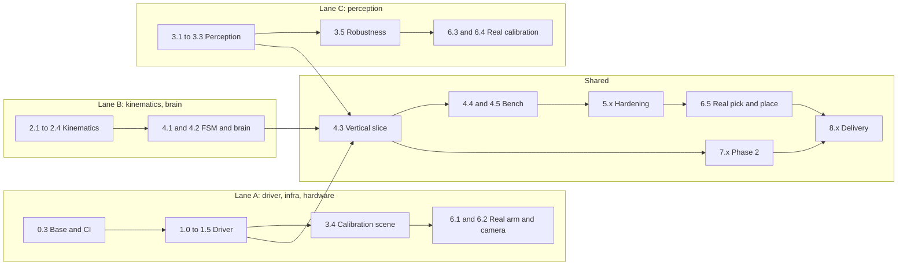

# 09 — Step-by-step roadmap

> Author: [CP] Project lead · Reviewers: all experts
> The dated milestones of the brief (S4, S7) are **deliberately ignored**: this document gives **the logical order of work** and, for each step, **when it is done**. Two expectations of the brief (update of 2026-10-08) still shape the order: the pick & place should ideally work by the mid-term review, hence the **early vertical slice** (4.3); and the final defense includes **phase 2** (own application), hence **stage 7**, started as soon as 4.3 works, in parallel with the real arm.
> **Phase 2 has its own roadmap**, same rules: [`phase2/P2-04_roadmap.md`](phase2/P2-04_roadmap.md) (Connect Four, steps P2.0 to P2.9); it details stage 7 below.
> Vocabulary: **stages 0–8** are this roadmap's work packages; **phase 1** (pick & place) and **phase 2** (go further) are the brief's two parts (`00` §1).

## 0. Steering principles

1. **Sim first, real second**: every command is validated in sim before the real arm (C-51).
2. **Early vertical slice**: an end-to-end pick & place, even naive, as soon as possible; then improve each block. Integration problems show up early.
3. **Every step ends with evidence** (a command, a test, a measurement) — "looks like it works" does not count.
4. **Three parallel lanes** with a frozen interface contract (`01` §3), and **rotating reviews** so that everyone understands everything (C-50).
5. **Spikes never go to production**: the `experiences/` scripts prove feasibility; repo code is rewritten cleanly with tests.

## 1. Overview

| Stage | Steps | Outcome |
| --- | --- | --- |
| **0. Foundations** | 0.1 → 0.3 | Organized team, identical environment for everyone, common base and CI |
| **1. Complete driver (sim)** | 1.0 → 1.5 | Driver compliant with C-10 to C-15, tested |
| **2. Kinematics and motion** | 2.1 → 2.4 | Measured IK < 1 cm (C-41), trajectories, grasp planner |
| **3. Perception** | 3.1 → 3.5 | Object and box localized with **our** calibration |
| **4. Brain and pick & place (sim)** | 4.1 → 4.5 | Full cycle, ≥ 90 % over 50 randomized episodes (C-42) |
| **5. Hardening** | 5.1 → 5.4 | Clean configuration, documentation, shared understanding, the `v1.0.0` release, the robustness demo |
| **6. Real arm** | 6.1 → 6.5 | Filmed real pick & place (C-43); 6.1 starts right after stage 1 |
| **7. Phase 2: go further** | 7.1 → 7.2 | Own application on top of phase 1: pitched, built, filmed (C-54). Chosen and validated: Connect Four ([`phase2/`](phase2/README.md)), own roadmap [`phase2/P2-04`](phase2/P2-04_roadmap.md) |
| **8. Delivery** | 8.1 | Demo videos, defense, final release (C-53) |

### 1.1 Dependencies and critical path

```mermaid
flowchart LR
  S01["0.1 Team and repo"] --> S02["0.2 Env"] --> S03["0.3 Common base + CI"]
  S03 --> S10["1.0 Base driver"] --> S11["1.1 Driver: clamp, NaN, tests"] --> S12["1.2 Camera threading"] --> S13["1.3 camera_info + effort"] --> S14["1.4 /sim/randomize"] --> S15["1.5 Launch tests + RViz"]
  S11 --> S21["2.1 kinematics.py"] --> S22["2.2 Trajectories"] --> S23["2.3 C-41 measurement"]
  S22 --> S24["2.4 Grasp planner"]
  S13 --> S31["3.1 Perception skeleton"] --> S32["3.2 HSV"] --> S33["3.3 Pixel→3D"] --> S34["3.4 ArUco calibration"] --> S35["3.5 Robustness"]
  S24 --> S41["4.1 Pure FSM"] --> S42["4.2 ROS brain"] --> S43["4.3 Pick and place E2E"]
  S33 --> S43
  S14 --> S43
  S43 --> S44["4.4 Grasp, VERIFY, RETRY"] --> S45["4.5 50-episode bench"]
  S34 --> S45
  S15 --> S61["6.1 Real-arm commissioning"]
  S45 --> S51["5.x Hardening"] --> S62["6.2 to 6.5 Real camera and real pick and place"] --> S81["8.x Delivery"]
  S61 --> S62
  S43 --> S71["7.1 Phase-2 pitch"] --> S72["7.2 Phase-2 project"] --> S81
```

**Critical path**: 0.2 → 1.0 → 1.1 → 2.1 → 2.2 → 2.4 → 4.1 → 4.2 → **4.3** → 4.4 → 4.5 → 6.x. Perception (3.x) progresses in parallel and must be ready at step 4.3. Two more parallel tracks: real-arm commissioning (6.1) right after the driver, to surface hardware and calibration problems early (the course's day-2 milestones connect the real arm before IK [BOOT2 p10]); phase 2 (7.x) as soon as 4.3 works. Both end in delivery (8.x).

### 1.2 Proposed split (3 people)

| Lane | Main owner | Steps | Rotating reviewer |
| --- | --- | --- | --- |
| **A — Driver, infra, hardware** | @FoxaxeWasTaken | 0.3, 1.x, 3.4 (driver side of the calibration scene), 6.1–6.2 | @Hasnain-Pyarali |
| **B — Kinematics and brain** | @SamuelValentin974 | 2.x, 4.x | @FoxaxeWasTaken |
| **C — Perception and calibration** | @Hasnain-Pyarali | 3.x, 6.3–6.4 | @SamuelValentin974 |
| Shared | Everyone | 0.1, 0.2, 4.3 (integration), 4.5, 5.x, 6.5, 7.x (phase 2), 8.x | — |

The owners are those of `.github/CODEOWNERS` (0.1d), which requests their review automatically; it is indicative, and any member may approve any PR. **Rule**: nobody merges their own code without review, and every member makes at least one PR in each lane before the end (C-50).

---

## Stage 0 — Foundations

### Step 0.1 — Team and repository

- **Goal**: work as three without stepping on each other.
- **Tasks**
  - [x] Team repository (2026-10-15): private `FoxaxeWasTaken/Robotics`; the course repository is `upstream` with push disabled (`15` §2, ADR-027); members invited; the prepared tree pushed while keeping the history (`15` §11, PR #1).
  - [x] School mirror (`16`, ADR-033): key on a member's account (no admin rights on the school repository), secret in the `main`-only `school-mirror` environment, `SCHOOL_REPO_SSH_URL`, `CI_ENABLED=true`; first run at the merge of PR #1.
  - [x] Starting code decided (2026-10-15): the course stubs as shipped (upstream PR #1 and #2 included); the bootstrap prototype stays outside the repository as a reference (ADR-039).
  - [x] Protect `main` (ruleset "main protection": PR, 1 approval, 5 required checks, squash only, no bypass).
  - [x] GitHub Project set up (2026-10-15, `15` §12): one epic per stage, one PR-sized ticket per sub-step (sub-issues, *blocked by* relationships), milestones = SemVer versions.
  - [x] Assign the lanes (§1.2).
  - [ ] Set a 30-minute weekly sync.
- **Done when**: all three members pushed a commit through a reviewed PR; the first mirror run is green.

### Step 0.2 — Working environment for everyone

- **Tasks**: checklist of `02` §10 on **every** machine, `.env` created, `talker` received in the other container (C-04), RViz open.
- **Done when**: `ros2 topic echo /chatter` works from `control` to `perception` on all three machines; `ros2 node list` shows the driver and the brain.
- **Pitfalls**: no `colcon build` outside containers; webcam/arm held by Windows (`02` §5).

### Step 0.3 — Common base and continuous integration

- **Tasks**
  - [x] Governance and CI files **in place at the repository root** (ruff, pre-commit, markdownlint, editorconfig, gitattributes, gitignore, CONTRIBUTING, README, CODEOWNERS, PR template, issue template, CI/nightly/mirror workflows) — validated (`14`, [MES-23]).
  - [x] Replace the handles in `CODEOWNERS` (#130).
  - [ ] Everyone runs `pre-commit install`.
  - [x] `so101_common` package: `JOINT_NAMES`, `ARM_JOINT_NAMES`, `JOINT_LIMITS`, `GRIPPER_RANGE_RAD`, `pct_to_rad`/`rad_to_pct`, frame names; tests comparing names and limits to the URDF.
  - [x] `so101_bringup` package: `sim.launch.py` (driver + brain), `config/*.yaml`, `rviz/so101.rviz`.
  - [x] `perception` service in `docker-compose.yml`, with its own build folders (`02` §3.1).
- **Done when**: CI is green on `main`; `docker compose up -d control perception viz` starts all three services.

---

## Stage 1 — Complete driver (sim)

> Starting point: the course stub (`03` §0, ADR-039).

### Step 1.0 — Base driver

- **Tasks**: control loop (50 Hz) with the speed limiter; `/joint_states` (rad, gripper in rad, ≥ 20 Hz, target 30 Hz); `/joint_command` (partial commands by name, empty name list = `JOINT_NAMES` order, gripper in %); gripper %↔rad conversion; pytest declared in the package (AGENTS.md trap) and a first `launch_testing` test. The provided `disable_torque()` lines stayed active until 6.1a commented them out (`07` §2).
- **Done when**: `test_driver_launch.py` is green in CI: `/joint_states` ≥ 20 Hz; a partial command moves only the named joint.

### Step 1.1 — Command compliance

- **Tasks**: clamping to the limits (`so101_common`), NaN/inf rejection, command-merge logic extracted into a pure function, unit tests.
- **Done when**: `pytest` covers partial, out-of-range, NaN, unknown-name and size-mismatch commands.

### Step 1.2 — Execution model and non-blocking camera

- **Tasks**: camera in a dedicated thread, render on a state copy, backend lock.
- **Done when**: with the image at 10 Hz, the control period has **p99 ≤ 25 ms** and `test_driver_launch.py` (≥ 20 Hz) is green in CI.

### Step 1.3 — `camera_info`, effort, frames

- **Tasks**: `CameraInfo` with the image's `stamp`; `frame_id = external_cam_optical_frame`; normalized `effort` (sim: `actuator_force/forcerange`).
- **Done when**: `ros2 topic echo --once /external_cam/camera_info` shows K = [[246,0,159.5],[0,246,119.5],[0,0,1]] (OpenCV pixel centers, [MES-41]); the gripper effort rises to ~0.15 when closing on the cube (scripted test).

### Step 1.4 — Sim tools for evaluation

- **Tasks**: `/sim/randomize` service (cube **and** box, no overlap, reachable areas); `expose_ground_truth` parameter (false by default) → `/sim/ground_truth/*`; `seed` parameter.
- **Done when**: 10 calls give 10 different valid configurations (checked by rendering); the C-06 CI guard passes.

### Step 1.5 — Launch tests and RViz

- **Tasks**: `launch_testing` for clamping (rate and partial command: step 1.0); complete, versioned RViz configuration (C-52).
- **Done when**: `colcon test --packages-select so101_driver` is green in CI.

---

## Stage 2 — Kinematics and motion

### Step 2.1 — `kinematics.py` module

- **Tasks**: FK/IK (ikpy) in a testable façade used by `brain_node.py`: FK published on `/end_effector_pose`, `/go_to_target` (position IK, rejected if FK misses the target by more than 1 mm); add `ik_point` (`orientation_mode="Z"`) and `ik_pose` (`"all"`); seeds `pan = −azimuth from the pan axis`; multi-start; FK verification.
- **Done when**: tests pass: FK = MuJoCo site within 0.01 mm; 100 % position success on 200 targets; ≥ 95 % vertical pointing for z ≤ 6 cm [MES-21].
- **Pitfalls**: pan sign, MuJoCo site orientation rotated by 90° (`04` §8).

### Step 2.2 — Trajectories

- **Tasks**: `trajectory.py` (min-jerk, duration from `v_max`); 50 Hz streaming; `/go_to_target` now runs a trajectory instead of a jump.
- **Done when**: unit test (zero velocity at the bounds, no velocity above `v_max`); smooth motion in sim (`/joint_states` plotted in `rqt_plot`/PlotJuggler).

### Step 2.3 — Accuracy measurement campaign (C-41)

- **Tasks**: `test_ik_accuracy.py`: 20 random targets through `/go_to_target`, measured with the MuJoCo site (ground truth allowed in tests), mean/p95/max report; gripper commandable 0–100 %.
- **Done when**: report generated, **max error < 1 cm** (expected < 1 mm), versioned in `results/`.

### Step 2.4 — Grasp planner

- **Tasks**: `grasp_planner.py` per ADR-009 (tilt sweep, jaw alignment with free fallback, pre-grasp along the approach axis, lift, drop); tests with ground truth.
- **Done when**: a test replays the `exp_pick_place_gt.py` spike with **the repo code** and gets ≥ 38/40.

---

## Stage 3 — Perception (in parallel with stages 1–2)

### Step 3.1 — Node skeleton

- **Tasks**: remove `COLCON_IGNORE` (this automatically enables the `perception` CI job), create `launch/perception.launch.py`, image + `camera_info` subscription (best effort, depth 1), `/perception/debug_image`; remove the stub from the ruff exclusion list in `pyproject.toml`.
- **Done when**: the node runs in the perception container, the debug image shows in RViz.

### Step 3.2 — HSV detection

- **Tasks**: `detection.py` (two-range red and brown masks, morphology, contours, guards); reference image set generated from the sim with the ground truth saved **in the test files**.
- **Done when**: 100 % of non-truncated cubes detected, 0 false positive on the reference set.

### Step 3.3 — Pixel → 3D (provisional, with the provided camera pose)

- **Tasks**: `geometry.py` (convention FLIP, ray, plane), yaw estimation, temporal filter, `PoseStamped` publication in `base_link`. **Provisional** camera pose: `get_camera_extrinsics()` fetched once **by a script** and written to `camera_extrinsics.yaml` — the node always reads the YAML (transparent swap at step 3.4).
- **Done when**: mean error < 5 mm on the reference set (expected 2.7 mm); projection round-trip test green.

### Step 3.4 — Own extrinsic calibration (C-23)

- **Tasks**: a calibration scene with ArUco markers **spread over the whole image** (`05` §10), generated from the provided one (3.4a, #44: `so101_bringup.sim_scene`, `markers_sim.yaml`); `calibrate_extrinsics.py` tool (detection, SQPNP + LM `solvePnP`, reprojection check, YAML); static TF `base_link → external_cam_optical_frame`.
- **Done when**: camera pose error < 5 mm / 0.3° (expected 0.9 mm / 0.06° [MES-16]); the provisional YAML is **replaced**; the `get_camera_extrinsics` CI guard passes.

### Step 3.5 — Robustness

- **Tasks**: truncated detections (far-edge method or no publication); outlier rejection; publish only when valid; move the sim camera, allowed by the teaching staff on 2026-10-16 (`05` §6).
- **Done when**: over 200 random positions, no publication is off by more than 2 cm (better to publish nothing).

---

## Stage 4 — Brain and pick & place (sim)

### Step 4.1 — Pure state machine

- **Tasks**: `fsm.py` from the table in `06` §3.1, ROS-free, injected clock.
- **Done when**: one unit test per transition + `stop` from every state.

### Step 4.2 — ROS integration of the brain

- **Tasks**: 50 Hz timer, `/brain/start`, `/brain/stop`, `/brain_state` (transient_local), `/brain/markers`, planning in a worker process (not a thread: the GIL, MES-40), freshness handling.
- **Done when**: `ros2 service call /brain/start …` moves `/brain_state` to `WAIT_TARGET`, and the node never blocks (the tick keeps running during planning).

> **Optional accelerator**: to develop the brain before perception is finished, a small **test** node (`so101_bringup/test/gt_perception_stub.py`, started by `test/gt_stub.launch.py`, step 4.2c) republishes `/sim/ground_truth/*` on `/object_position` / `/drop_box_position`. ⚠ It **never** appears in a final pipeline launch file (CI guard, C-06).

### Step 4.3 — First end-to-end pick & place (vertical slice)

- **Tasks**: plug the real perception, chain `WAIT_TARGET → … → DONE` on fixed then random poses.
- **Done when**: 5 successful cycles in a row in sim, **no ground truth in the pipeline**, screen recording saved.

### Step 4.4 — Grasp detection, verification, retry

- **Tasks**: effort threshold, `VERIFY`, `RETRY` (max 3), explicit error causes (`unreachable`, `object_lost`, `grasp_failed`, `no_joint_states`).
- **Done when**: fault-injection tests pass (cube removed during `APPROACH`, perception killed during `TRANSPORT`, unreachable target).

### Step 4.5 — Evaluation bench (C-42)

- **Tasks**: `ros2 run so101_bringup evaluate` (`08` §3); N = 50 episodes, randomized cube **and** box; CSV + failure rosbags; set `E2E_ENABLED=true` (CI smoke + nightly).
- **Done when**: **≥ 90 % success**, versioned report, failure causes analyzed.

---

## Stage 5 — Hardening (sim)

### Step 5.1 — Configuration and operations

- **Tasks**: every tunable in YAML; single `sim.launch.py` / `real.launch.py` differing only by `use_sim` and a few speed/threshold values; user README; runbook (`13`).
- **Done when**: a member who did not write the code runs a full demo by following the README only.

### Step 5.2 — Shared understanding (C-50)

- **Tasks**: session where **everyone explains a block they did not write** (driver, perception, IK, FSM, calibration); fix the docs wherever the explanation gets stuck.
- **Done when**: every member presented at least two blocks that are not theirs.

### Step 5.3 — Release v1.0.0

- **Tasks**: close the simulation milestone as `15` §6 describes: CHANGELOG, bench report in `results/`, tag `v1.0.0`, GitHub Release.
- **Done when**: the release is published and the tag is on the school repository (mirror).

### Step 5.4 — Robustness demo ([BOOT2 p12])

- **Tasks**: one reproducible sim scenario per robustness case of [BOOT2 p12] (the object moves, the grasp fails, the object leaves the view, out of reach, lighting), reusing the fault scenarios of 4.4; outcome of each in `results/robustness_demo.md`, handled or not, with a short clip. Asked by the teaching staff on 2026-10-16.
- **Done when**: the five cases run from documented commands and their outcome is recorded; `06` §10 points to them.

---

## Stage 6 — Real arm

### Step 6.1 — Safe commissioning

- **When**: as soon as the driver is compliant (1.1) and its real-arm safety is in place (`03` §8) — no need to wait for the sim pick & place [BOOT2 p10].
- **Tasks**: `07` §3.1 and §3.2 tests 1–4; safety checklist.
- **Done when**: tests 1–4 validated and recorded (photos/video).

### Step 6.2 — Real camera

- **Tasks**: rigid mount, placement covering the whole area (ADR-021), MJPG, locked settings, **intrinsic calibration** with ChArUco (RMS < 0.5 px), YAML published as `camera_info`.
- **Done when**: real `camera_info` published; sharp and stable 640×480 image at 10 Hz.

### Step 6.3 — Real extrinsics

- **Tasks**: the ChArUco board touched by the arm (`calibrate_touch`, `05` §5.4, `07` §9); robot validation (`05` §10). The startup self-check moved to #222.
- **Done when**: board reprojection < 1 px, touches within 4 mm; the jaws within 1 cm of a cube the camera located.

### Step 6.4 — Sim → real adjustment

- **Tasks**: record a rosbag of real images; tune HSV offline; grasp check by the jaws' gap: the contact opening, `close_pct` and `hold_gap_pct` (empty/holding, #69); accuracy measurement on the grid (real C-41); test 5 of `07`.
- **Done when**: reliable detection on 20 varied real images; measured TCP error < 1 cm.

### Step 6.5 — Real pick & place

- **Tasks**: first at reduced speed, then the sim's; 10 trials with varied poses; failure analysis.
- **Done when**: **≥ 7/10** (team target: the brief no longer gives a number and asks for the real robot as "preferred" at the final defense), video filmed.

---

## Stage 7 — Phase 2: go further (mandatory at the final defense)

> [BRIEF] (update of 2026-10-08): "Go beyond the pick & place and find your own application. The only constraint is that you need to use the work made in Phase 1." Workshop constraints [BOOT2 p15]: feasible in a few weeks, demonstrable on video, a real robotics skill; 1 arm (5 DoF + gripper, low payload, tabletop workspace), 1 camera + whatever you add; ROS 2 and sim first; slow near humans.

### Step 7.1 — Pitch and choice

- **When**: as soon as the vertical slice (4.3) works (the pitch itself earlier if the teaching staff asks for it).
- **Tasks**: 2–3 ideas checked against the constraints above; check-in "idea in one sentence / the tech to add / the risk" [BOOT p17], [BOOT2 p16]; choose one with the staff; ADR; break it into tickets (same anatomy, `15` §12), riskiest part first.
- **Done when**: pitch validated by the teaching staff; ADR merged; phase-2 tickets created.
- **Choice (2026-10-09)**: **Connect Four against the robot** (ADR-034, [`phase2/`](phase2/README.md)), **validated by the teaching staff** the same day. The phase-2 tickets P2.1a to P2.8d exist under epic E7 (#75 to #95); the demo scenario of 7.1b (#74) remains.

### Step 7.2 — Phase-2 project

- **Tasks**: risk spike first (an `experiences/` script with a measurement, go/no-go); then build on top of the phase-1 pipeline (same interfaces, same quality rules, sim first); define the demo scenario early.
- **Done when**: the demo scenario runs in sim with a measured success rate (on the real arm if possible), filmed.
- **Connect Four roadmap**: steps P2.0 to P2.9 in [`phase2/P2-04`](phase2/P2-04_roadmap.md), the first one (buy and measure a store-bought grid, then the drop spike) can start now; risks and tests in [`phase2/P2-03`](phase2/P2-03_plan_risks_tests.md).

Ideas compatible with the current pipeline (the brief suggests "AI for control or perception, LLM, VLM, voice control, imitation learning, RL"; the slides add candy handout, drawing, tidying a workbench):

| Idea | Block pushed further | Reuses |
| --- | --- | --- |
| Color sorting (several cubes, several boxes) | Multi-object perception, task planning | Everything |
| Natural-language or voice command ("put the red one in the box") | LLM/VLM or speech → FSM goal | Brain, perception |
| Tic-tac-toe against the robot | Grid perception, strategy | IK, grasping |
| Learned grasping (ACT/SmolVLA) compared with model-based | Imitation learning from demonstration (leader arm) | Driver, camera |
| Cube stacking | Precision, 6D orientation | IK, yaw perception |
| Drawing with a pen | Cartesian path following, contact | IK, trajectories |
| Tidying a workbench / candy handout | Several objects and drop zones, human nearby (slow, ADR-023) | Everything |

## Stage 8 — Delivery

### Step 8.1 — Demo and defense

- **Tasks**: 30 s video (real + RViz) + backup video, and a demo video **with the team on it** [BRIEF]; phase-2 demo video; slides **in English**: architecture, decisions (ADRs), **measurements** (bench, accuracy, perception), limitations, **phase 2**; clean repo (README, docs, tags).
- **Done when**: timed rehearsal done; every member can answer a question on any block, phase 2 included.
