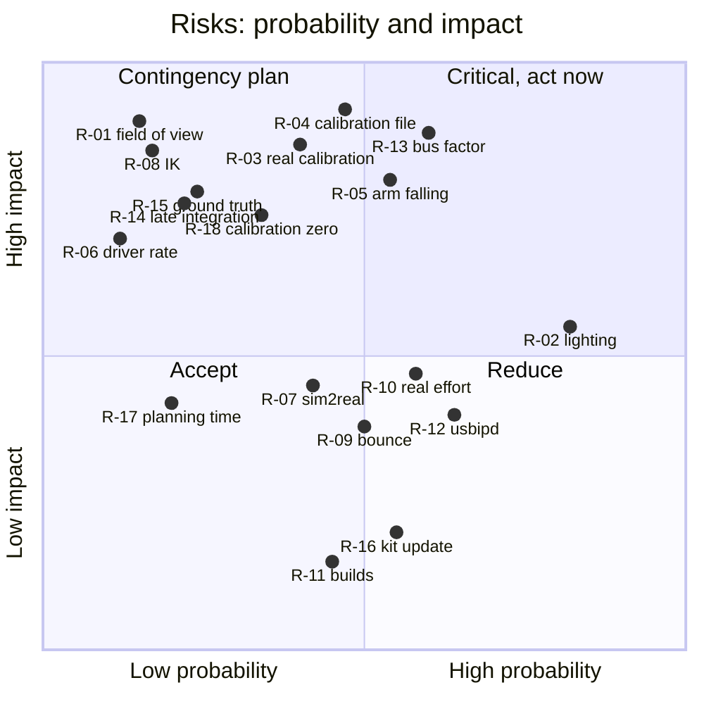

# 10 — Risk register

> Author: [CP] · Reviewers: all · Review at every weekly sync.
> Probability (P) and impact (I) on 3 levels: 1 low, 2 medium, 3 high. Criticality = P × I.

| ID | Risk | P | I | Crit. | Warning sign | Mitigation | Owner |
| --- | --- | --- | --- | --- | --- | --- | --- |
| R-01 | **21 % of the cube positions were truncated** by the simulated camera's field of view [MES-12]: the bench capped below 90 % | 1 | 3 | 3 | `WAIT_TARGET` failures clustered near the camera | **Done (#47)**: the sim camera moved, 0 cube cut over 300 scenes [MES-45]; never publish a dubious detection. Left: the real camera placed alike (ADR-021) | VIS |
| R-02 | Real lighting: unstable HSV thresholds, reflections on the PLA | 3 | 2 | 6 | Holes/noise in the mask on real images | In sim, a dim, warm light is handled (#175, [MES-52]). Real: manual camera settings (exposure, WB); thresholds tuned on a real rosbag; diffuse lighting; YOLO as a last resort | VIS |
| R-03 | Inaccurate real calibration (badly placed jig, camera moved) | 2 | 3 | 6 | > 1 cm error on the grid; reprojection self-check > 3 px | Spread markers (≥ 4), TCP touch probing, robot validation (`05` §10); rigid mount; startup self-check | VIS |
| R-04 | Missing or wrong arm calibration file: blocking or inverted motions | 2 | 3 | 6 | Read-only test: RViz ≠ real | `connect(calibrate=False)` + **refusal to start on mismatch** (provided code, ADR-032); sign tests `07` §3.2; never "fix" a sign in code; recalibrate with the LeRobot tools (staff, 2026-10-16), then check the zero [MES-30] | CTRL |
| R-05 | Arm falling when torque is cut, or sudden motion: damage, injury | 2 | 3 | 6 | — | Defense in depth (ADR-023); PARK before `disconnect()`; safety checklist | CTRL |
| R-06 | ~~Camera rendering blocks the driver's single thread: 9 Hz measured [MES-22]~~ **Fixed** in the driver (step 1.2): 30 Hz with the camera on, control p99 20.4 ms [MES-34]. Residual risk: regression if the camera moves back into the control thread | 1 | 3 | 3 | `ros2 topic hz /joint_states` below 20 Hz; component test red | Component test in CI; ADR-006 | CTRL |
| R-07 | Sim → real accuracy gap (P = 16, gravity, backlash) | 2 | 2 | 4 | TCP error of a few mm to 1 cm | Grid measurement; slow unidirectional approach; setpoint correction if needed | KIN |
| R-08 | IK diverging on some targets (pan sign, azimuth from the origin) | 1 | 3 | 3 | `PLAN` failures | Fixed and tested: seeds `−azimuth` from the pan axis [MES-06]; unit tests | KIN |
| R-09 | Cube released too high, bouncing out of the box | 2 | 2 | 4 | `VERIFY` failure | Release lower (TCP ≈ 9 cm) + `VERIFY` [MES-09] | DEC |
| R-10 | The real gripper effort signal does not discriminate enough | 2 | 2 | 4 | Overlapping empty/holding measurements | Combine with perception (cube gone from the table after lift); `Present_Current` as an alternative | CTRL |
| R-11 | Concurrent builds or root-owned files corrupting the workspace | 2 | 1 | 2 | Strange `colcon` errors | Separate build folders for perception; rules `02` §4 | OPS |
| R-12 | Webcam/arm unavailable through usbipd (held by Windows, YUYV) | 2 | 2 | 4 | `Device busy`, `select() timeout` | Close the apps; MJPG; native Linux as a fallback [MES-17] | OPS |
| R-13 | A single member able to work on a block (bus factor = 1) | 2 | 3 | 6 | Only one person can explain a block | Mandatory cross-reviews; step 5.2; documentation | CP |
| R-14 | Late integration: every block works alone, not together | 1 | 3 | 3 | No E2E cycle after 2 weeks | **Done**: the full cycle runs with the real perception since 4.3a (#139), and E2E runs on every PR | CP |
| R-15 | Accidental use of ground truth in the pipeline (C-06): non-compliance | 1 | 3 | 3 | — | CI grep guards; `expose_ground_truth` false by default | QA |
| R-16 | Course kit updated by the teaching staff (conflicts) | 2 | 1 | 2 | New upstream commits (already happened: PR #1 and #2) | Never modify `sim/`, `core/`, `so101_description`; untouched provided files excluded from lint; `upstream` remote + regular merge; the nightly opens an issue on new course commits (#137) | OPS |
| R-17 | Planning too slow, brain frozen | 1 | 2 | 2 | `PLAN` state lasting > 1 s | Worker process + timeout (a thread shared the GIL with the tick [MES-40]); Pinocchio if needed (20–50× faster) [MES-21] | KIN |
| R-18 | Real-arm zero ≠ URDF zero (LeRobot's zero = middle of the recorded range): centimeter TCP errors [MES-30] | 2 | 3 | 6 | Rest-pose TCP computed below the table (z = −2.9 cm) | `joint_zero_offsets` in the driver (#196): the readings at the URDF zero, elbow 13.8° [MES-55]; measured again after each recalibration | CTRL |

Phase-2 risks (Connect Four) have their own register: `phase2/P2-03` §2.
