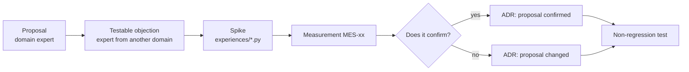

# 11 — Cross-review between experts and measurement register

> Facilitator: [QA] · Participants: [CP], [ARC], [OPS], [CTRL], [SAFE], [KIN], [VIS], [DEC]
> This document is the **trace** of the mutual verification: every expert proposal is challenged by at least one other expert, and the disagreement is settled **by a measurement**, not by authority.

## 1. Protocol



1. An expert proposes a choice with its rationale.
2. At least one reviewer from another domain raises a **testable objection**.
3. A **spike** (throwaway script in `experiences/`) measures the disputed point.
4. The decision (ADR) cites the measurement. If the measurement contradicts the proposal, **the proposal changes**.

## 2. Review log (44 objections, 36 proposals changed)

| ID | Initial proposal (author) | Objection (reviewer) | Verification | Result | Decision |
| --- | --- | --- | --- | --- | --- |
| RC-01 | 6D "gripper strictly vertical" IK for every phase (KIN) | "Can a 5-DoF arm point straight down everywhere?" (DEC) | `exp_reachability.py` | Only **58 %**; vertical impossible above ~8 cm far from the base [MES-08] | **Changed**: minimal tilt relaxed from 0 to 30° for grasping, position-only IK for transport (ADR-009) |
| RC-02 | IK seeds `pan = +azimuth` (KIN) | "Convergence depends on the side" (QA) | FK at pan = +0.5 | The TCP moves towards **−y**: **pan is reversed** [MES-06] | **Changed**: `pan = −azimuth` (ADR-005) |
| RC-03 | Tilt azimuth computed from the base origin (KIN) | "Is the pan axis at the origin?" (ARC) | FK of the pan joint | Axis at **x = 3.88 cm**; the arm plane contains it [MES-06] | **Changed**: azimuth seen from the pan axis → pick & place 29/40 → **39/40** |
| RC-04 | Detect the grasp from the gripper position (DEC) | "Does the gripper really close less when holding the cube?" (CTRL) | Pick & place spike | Gripper at **0 %** with or without the cube (the jaws go through the tunnels); **effort** 0.12–0.19 vs 0 [MES-10] | **Changed**: normalized effort + visual verification (ADR-016) |
| RC-05 | Camera rendering in the driver thread (CTRL, early code) | "How much does a render cost?" (ARC) | Timing + jitter | Render ≈ **51 ms**; control period p99 = 52 ms instead of 20 [MES-03], [MES-20] | **Changed**: render on a copy outside the lock (ADR-006), p99 = 25 ms |
| RC-06 | Use the MuJoCo site or the URDF TCP frame interchangeably (VIS) | "Are the orientations identical?" (KIN) | 500 random configurations | Positions identical within 0.004 mm, **orientations 90° apart** [MES-04] | **Clarified**: orientation = URDF only; the site is for position measurements |
| RC-07 | Calibrate the extrinsics at the working resolution, 320×240 (VIS) | "Are distant markers detectable?" (QA) | `exp_perception_calib.py` | 320×240: 1 marker, 23 mm error; 640×480: 5 markers, **0.9 mm / 0.06°** [MES-16] | **Changed**: calibrate at 640×480 with ≥ 4 spread markers (ADR-013) |
| RC-08 | "The cube is always in the image" (VIS) | "Is the whole randomization area in view?" (QA) | Projection of 2,000 poses | **21 % truncated** at the bottom of the image [MES-12] | **Added**: truncation handling + question to the staff (R-01) |
| RC-09 | Blob centroid = cube center on the plane z = 2.5 cm (VIS) | "Bias from the visible side faces?" (KIN) | 68 detections | Mean 2.7 mm, constant bias (0.5, −2.6) mm; 0.8 mm after correction [MES-13] | **Confirmed** (+ optional bias correction) |
| RC-10 | Start `perception` from the provided compose file (OPS) | "Does the service exist?" (ARC) | Reading `docker-compose.yml` | **Missing** despite the slides | **Added**: perception service with a separate build (ADR-002) |
| RC-11 | Modify `SO101Sim` to randomize the box (OPS) | "Is `sim/` code really used from the volume?" (QA) | Dockerfile inspection | Installed **non-editable**: changes ignored without rebuild | **Changed**: `/sim/randomize` in the driver, `sim/` untouched (ADR-018) |
| RC-12 | Default `SO101Follower.connect()` (CTRL) | "What if the calibration differs?" (SAFE) | Reading `so_follower.py` | `calibrate()` calls **`input()`**: node blocked | **Confirmed**, then refined by RC-29: the provided version fails explicitly instead of writing the calibration |
| RC-13 | `disconnect()` on shutdown (CTRL, early code) | "What about torque?" (SAFE) | Reading the config | `disable_torque_on_disconnect=True`: **the arm falls** | **Changed**: PARK before disconnecting (ADR-023) |
| RC-14 | Images published Best effort (ARC) | "RViz and `ros2 topic echo` often subscribe Reliable" (VIS) | DDS compatibility rule [KO1 p29] | BE publisher + Reliable subscriber = **0 message, no error** | **Changed**: Reliable publisher, BE subscribers if they wish (ADR-004) |
| RC-15 | Webcam with OpenCV's default settings (OPS) | "Do frames go through usbip?" (VIS) | `exp_webcam_formats.py` | YUYV: **0 fps**; MJPG: 27.5 fps [MES-17] | **Changed**: `fourcc="MJPG"` mandatory (ADR-007) |
| RC-16 | Release 11 cm above the box (DEC) | "Does the cube stay in the box?" (QA) | Pick & place spike | 1 cube out of 40 bounces out [MES-09] | **Changed**: TCP ≈ 9 cm + `VERIFY` state |
| RC-17 | Jaw alignment with the faces mandatory (DEC) | "Necessary and always feasible?" (KIN) | Pick & place spike | Grasp works up to **44°** of misalignment; 6D alignment infeasible with 10° tilt for 14/40 cubes [MES-09] | **Changed**: best-effort alignment with free fallback (ADR-009) |
| RC-18 | Publish `/clock` and use `use_sim_time` (ARC) | "Is the sim faster than real time?" (CTRL) | Timing | 10 ms of physics per call, 2 calls per 20 ms tick = **real time** [MES-02] | **Rejected**: wall clock (ADR-005) |
| RC-19 | Recommend Pinocchio for IK (KIN, first version of this folder) | "The team's code already uses ikpy: is it insufficient?" (CP) | `exp_ikpy_vs_pinocchio.py` | ikpy **100 %** position, **97 %** pointing, 6–14 ms; Pinocchio 91 % (single seed), 20–50× faster [MES-21] | **Changed**: **ikpy kept**, façade to switch if needed (ADR-008) |
| RC-20 | Effort in N·m as REP-103 requires (ARC) | "Is a hobby servo's load a calibrated torque?" (CTRL) | STS3215 registers | `Present_Load` in ‰ of max torque, uncalibrated | **Changed**: normalized effort in [−1, 1], documented deviation (ADR-016) |
| RC-21 | "Camera rendering only costs jitter" (CTRL, first version) | "Let's measure the real rate with a component test" (QA) | `colcon test` with `test_driver_launch.py` + `ros2 topic hz` | `/joint_states` at **9 Hz** (4.7 Hz under test) instead of ≥ 20 Hz: **C-11 violated** by the early code [MES-22] | **Changed**: blocking defect, fixed in the merged driver (30 Hz [MES-24]) |
| RC-22 | Test the joint-limit clamp in sim (CTRL) | "MuJoCo already clamps to `ctrlrange`" (KIN) | Reading the MJCF (`ctrlrange` = URDF limits) | A sim test would pass **even without a clamp** in the driver | **Changed**: clamp tested at unit level (ADR-026) |
| RC-23 | Full ruff naming rules (QA) | "`R`, `T`, `K`, `J` are matrices" (KIN) | ruff on the current code | `N806` flags `T` (homogeneous matrix) in `brain_node.py` | **Changed**: `N803`/`N806` ignored (ADR-024) |
| RC-24 | Hook versions pinned from memory (OPS) | "Are they up to date?" (QA) | GitHub API (releases) | ruff 0.16.10, pre-commit-hooks v6.0.0, markdownlint-cli2 v0.23.3, conventional v4.4.0, checkout v7… | **Changed**: pinned to the current versions |
| RC-25 | E2E bench in `tools/evaluate.py` (QA) | "Is `tools/` visible in the container?" (OPS) | Reading the compose file | Only `ros2_ws/` is mounted | **Changed**: `ros2 run so101_bringup evaluate` executable |
| RC-26 | Diagrams checked by eye (ARC) | "Render them automatically" (QA) | mermaid-cli 12.0.1 on 36 diagrams + PNG render | 1 broken diagram (`;` = Mermaid separator); `=` escaped as `&equals;` in a gitGraph | **Changed**: `check_mermaid.sh` in the nightly CI + visual review (ADR-030) |
| RC-27 | "markdownlint is superfluous for docs" (CP) | "It finds real bugs" (QA) | markdownlint-cli2 on the docs | 95 issues, including **a broken table** (`\|q − q_target\|` read as a column separator) | **Changed**: markdownlint in pre-commit (ADR-024) |
| RC-28 | GitHub fork of the course repo (OPS) | "Where does `origin` point? Can a fork be private?" (CP) | `git remote -v` | `origin` = **the teacher's repo**; a fork of a public repo stays public | **Changed**: team repo + `upstream` without push (ADR-027) |
| RC-29 | On calibration mismatch: `write_calibration` into the motors (CTRL, local version and first version of `03`) | "What if the file comes from another arm?" (SAFE); "What does the provided code do?" (CP, after the pull) | Upstream PR #1 (`fix/connect_arm`) | The course chose **explicit failure** (`disconnect` + `RuntimeError`) | **Changed**: keep the provided version, `max_relative_target` safety net added next to it (ADR-032) |
| RC-30 | markdownlint on the whole repository (QA) | "The course kit contains Markdown" (OPS, after the pull) | markdownlint-cli2 on `docs/` | **13 issues in `docs/SUJET.md`** (provided): the `lint` job would fail on a file we must not modify | **Changed**: `docs/SUJET.md` and the provided PDFs excluded from pre-commit and markdownlint |
| RC-31 | Calibrate with a single ArUco like the demo (VIS) | "Robustness to real detection noise?" (QA) | `exp_calibration_methods.py` (0.5 px noise) | Ambiguous pose (p95 1 m / 86°), 18 mm mean object error; 6 spread markers: 1.6 mm [MES-25] | **Changed**: spread multi-markers + robot validation (`05` §10) |
| RC-32 | CI on the school repository (OPS) | "CI must run on a private repo; the school repo is only a mirror" (CP) | Requirement expressed by the team | The copied workflows would also run on the mirror | **Changed**: `mirror.yml` + opt-in workflows (`CI_ENABLED`) (ADR-033) |
| RC-33 | Quickstart as first written: `up -d control perception viz`, `ros2 topic pub --once`, `/brain/start` (CP) | "Replay it literally from the delivered folder" (QA) | Fresh copy, separate compose project [MES-26] | `perception` service missing; `/brain/start` not implemented yet; `--once` applied **0/8** (CLI exits before delivery) | **Changed**: quickstart limited to what works today, `--once -w 1 --keep-alive 1` (8/8), status table in the README |
| RC-34 | Bench "≥ 90 % over 50 episodes, randomized cube and box" and "≥ 7/10 real" cited as imposed (QA) | "The brief changed on 2026-10-08: still imposed?" (CP, after the pull) | `git diff` of `docs/SUJET.md` | Randomization and "7 out of 10" removed; S7 asks for a **robust** sim pick & place, the real robot "preferred" | **Changed**: both kept as team targets (DECIDED), source tags fixed (`00` I-11, ADR-018) |
| RC-35 | Phase 2 "once phase 1 is validated", last step of the roadmap (CP) | "S7 now includes phase 2" (DEC) | Brief + [BOOT2 p15–16] | Phase 2 is part of the final defense, with a pitch and workshop constraints | **Changed**: roadmap stage 7 started after 4.3, in parallel with the real arm; delivery becomes stage 8 |
| RC-36 | Real arm only after the sim hardening (CP) | "The course connects the real arm on day 2, before IK" (CTRL) | [BOOT2 p10], milestones 4–5 | Commissioning tests 1–4 only need the driver and its safety layer | **Changed**: step 6.1 right after stage 1 |
| RC-37 | FSM design of `06` §3 (DEC) | "Does it answer the five robustness questions of the slides?" (QA) | [BOOT2 p12] against `06` | 4/5 answered directly; "object moved mid-action" answered by detection (effort, `VERIFY`) + retry, not by tracking | **Kept**: mapping `06` §10 + C-36; replanning during `APPROACH` listed as an option |
| RC-38 | Roadmap "phases 0–7" (CP) | "'Phase 2' means kinematics here and go-further in the brief" (VIS) | The brief now titles "Phase 1" / "Phase 2" | Ambiguous at the defense | **Changed**: roadmap *stages* 0–8, *phase* reserved for the brief |
| RC-39 | Phase 2: Connect Four grid facing the robot, as for a human player (DEC) | "Can a 5-DoF arm keep a token in that plane?" (KIN) | `exp_connect4_kinematics.py` | Facing: best jaw error 40–62° at 22–30 cm high, 17–23° at 14 cm; edge-on: 1–3° [MES-27] | **Changed**: grid edge-on (ADR-035) |
| RC-40 | A standard store-bought grid (CP) | "Does the arm clear the top of the grid?" (SAFE) | Same script | Standard (slots at 25 cm): 0.5 cm above the far column, link thickness not counted; small grid (slots at 15 cm): ≥ 10.8 cm [MES-28] | **Changed**: small custom grid (ADR-035) |
| RC-41 | Drop poses with ikpy `orientation_mode="X"` (KIN) | "Does it converge everywhere?" (QA) | Same script, 120 targets | 11 % solved with up to 15 seeds; wrist roll locked at ±90° + position IK: every reachable target (81 %); 2.8° residual from the URDF wrist [MES-29] | **Changed**: `drop_ik` (ADR-035) |
| RC-42 | Switch to Pinocchio for phase 2 (KIN) | "Is the speed actually needed?" (CP) | `exp_ikpy_vs_pinocchio.py` rerun + drop-pose timing | MES-21 reproduced identically; 4 poses per move ≈ 1 s in a turn-based game [MES-29] | **Kept**: ikpy (ADR-008); Pinocchio only for visual servoing (stretch) |
| RC-43 | Read the grid with the phase-1 camera at 320×240 (VIS) | "How many pixels per cell?" (QA) | Pinhole projection of the 42 cells | 7.7 × 6.3 px; a camera 45 cm in front of the grid: 13 px [MES-31] | **Changed**: `board_cam` facing the grid in sim, a webcam facing it on the real setup (ADR-036) |
| RC-44 | A store-bought grid after all: nothing to build, robust, recognizable (CP, 2026-10-09) | "RC-40 found 0.5 cm of clearance: what if the arm is raised?" (SAFE) | `exp_connect4_kinematics.py`, riser case | Arm on an 8 cm riser, columns at r = 0.14–0.36 m: all reachable, 6.3–10.5 cm above the 4 far columns [MES-32] | **Changed**: store-bought grid on a riser, depth guide only (ADR-038); RC-40 reversed |

## 3. Code review (2026-10-08)

Summary of the gaps found by [CTRL] and [QA] (details in `03` §0 and `06` §1):

| Block | Compliant | Blocking gaps | Gaps to fix |
| --- | --- | --- | --- |
| `driver_node.py` (merged with upstream) | Provided `_connect_arm`, partial commands, limiter, **30 Hz** (fixed: 9 Hz before) [MES-24], 10 Hz image in a thread, clean shutdown | **Joint-limit clamp (C-15)**; **`camera_info` (C-13)** | NaN; effort; `frame_id`; PARK before `disconnect`; `/sim/randomize` |
| `brain_node.py` | ikpy FK/IK, `/end_effector_pose`, `/go_to_target` with rejection above 1 cm | — | Command sent as a jump (no trajectory); FSM, start/stop services and `/brain_state` to come |
| `driver_node.py`, audit of 2026-10-09 | Upstream #2 merged (torque-off lines commented out) | Speed limiter at 1.5 rad/s on the real arm too (checklist `07` §7: ≤ 0.8 rad/s) | Clamp and NaN rejection still missing; the team's working copy has them (ticket 1.1a) |
| `brain_node.py`, audit of 2026-10-09 | FK = TF = Pinocchio (0 µm); position IK < 1 mm, 100 % of the grasp area from the real rest pose | IK seed not clipped to the bounds: "x0 is infeasible" kills the node when a measured joint sits past a limit (seen on the real arm) | IK inside the service callback (15 ms median, up to 350 ms); ikpy chain built from the first child joint in URDF order; free orientation in `/go_to_target` (approach tilt median 49°) |

## 4. Measurement register

Every measurement is **reproducible**. Generic command, from the repository root:

```bash
docker run --rm -e MUJOCO_GL=osmesa \
  -v $PWD/ros2_ws:/ros2_ws:ro -v $PWD/sim:/opt/so101/sim:ro \
  -v $PWD/docs/project/experiences:/exp -v /tmp/exp_out:/out \
  tek5/control bash -lc "source /opt/ros/jazzy/setup.bash && python3 /exp/<script>.py"
```

| ID | Measurement | Value | Script |
| --- | --- | --- | --- |
| MES-01 | Image build and versions | OK; numpy 1.26.4, mujoco 3.15.0, cv2 4.10, ikpy 4.1.0, pinocchio 4.1.0 | `docker compose build` |
| MES-02 | Simulation step | 2 ms × 5 = **10 ms** of physics per `get_observation`/`send_action`; 0.1 ms CPU | `exp_kinematics.py` |
| MES-03 | Camera render cost (OSMesa) | **51 ms** at 320×240, 57 ms at 640×480 (up to 137 ms on a loaded machine) | inline (§5) |
| MES-04 | URDF FK vs MuJoCo site | Position ≤ **0.004 mm**; orientation 90° apart (constant) | `exp_kinematics.py` |
| MES-05 | TCP axes | Approach = **+z** (0.997); jaw closing = **x** | `exp_kinematics.py`, `exp_pick_place_gt.py` |
| MES-06 | Pan conventions | pan > 0 → TCP towards −y; pan axis at (0.0388, 0) | `exp_kinematics.py` |
| MES-07 | Position-only IK | **100 %** (< 1 mm), r ∈ [0.18, 0.30], z ∈ [2, 12] cm | `exp_ikpy_vs_pinocchio.py` (200 targets, ikpy and Pinocchio both 100 %) |
| MES-08 | Vertical approach reachability | Strict vertical 6D: 58 %; (z, r) → minimal tilt map (`04` §4) | `exp_reachability.py` |
| MES-09 | Pick & place with ground truth (40 episodes) | **39/40**; closed-loop TCP error 0.1–0.3 mm; 14/40 with 10° tilt; grasp tolerant to 44° misalignment | `exp_pick_place_gt.py` |
| MES-10 | Grasp signal | Gripper at 0 % with or without cube; effort −0.41 to −0.64 N·m (0.12–0.19 normalized) vs 0 | `exp_pick_place_gt.py` |
| MES-11 | IK time | Pinocchio DLS ≈ 0.3–5 ms; ikpy ≈ 6–25 ms depending on the task and machine load | `exp_ikpy_vs_pinocchio.py` |
| MES-12 | Field of view | 79 % of cubes fully visible, **21 % truncated**, 0 % out of view | `exp_perception_calib.py` |
| MES-13 | Detection and pixel → 3D | 0.49 ms/frame; 100 % detected (non-truncated); error 2.7 mm mean, 4.5 mm max; bias (0.5, −2.6) mm | `exp_perception_calib.py` |
| MES-14 | Cube yaw | Median error 1.3°, p90 8.3° | `exp_perception_calib.py` |
| MES-15 | Box | 2.9 mm mean, 5.4 mm max | `exp_perception_calib.py` |
| MES-16 | ArUco calibration | 640×480, 6 markers: pose 0.9 mm / 0.06°, induced object error 1.8 mm; 320×240: 23 mm | `exp_perception_calib.py` |
| MES-17 | Webcam through usbipd | YUYV 0 fps; MJPG **27.5 fps** (640×480); `--device` works with Docker Desktop | `exp_webcam_formats.py` |
| MES-18 | Inter-container DDS + X11 | `talker` received by viz and perception; RViz OpenGL 4.5 | manual |
| MES-19 | `colcon build` | 5 packages in ~9 s | `control` logs |
| MES-20 | Control jitter with rendering | No camera p99 = 20.2 ms; render under lock 52.4 ms; render on a copy **25.2 ms** | inline (§5) |
| MES-21 | ikpy vs Pinocchio (100 targets) | ikpy: position 100 %, pointing 97 %, 6–14 ms; Pinocchio (single seed): 100 % / 91 %, 0.3 / 0.8 ms (**reproduced identically on 2026-10-09**) | `exp_ikpy_vs_pinocchio.py` |
| MES-22 | Early driver rate (sim, camera on) | `ros2 topic hz /joint_states`: **9.1 Hz**; image 9.1 Hz; render 137 ms (loaded machine); under `colcon test`: 4.7 Hz | `ros2_ws/src/so101_driver/test/test_driver_launch.py` |
| MES-23 | Proposed tooling validation | ruff 0.16.10: 15 issues and 7 files to reformat on the team's code, 0 on the templates and the provided driver; markdownlint-cli2 0.23.3: 95 → 0; actionlint 1.7.12: 0; mermaid-cli 12.0.1: 36/36 after fixes; `colcon test`: 6 tests in 9.4 s; pre-commit (13 hooks) green on the whole repo | `docs/project/14_quality_pipeline_ci.md` §9 |
| MES-24 | Merged driver (course + team work + camera thread) | 6/6 tests; `/joint_states` **30.0 Hz** (max period 44 ms); image 10.0 Hz; SIGINT/SIGTERM: stop < 0.5 s, exit 0, no traceback; `/go_to_target` (0.22, 0.05, 0.10) → measured TCP within 0.13 mm | `ros2_ws/src/so101_driver/test/` + `ros2 topic hz` + service call |
| MES-25 | Calibration methods (640×480, 0.5 px noise, 100 draws) | 1 ArUco 7.5 cm: p95 1,021 mm / 86°, object 18 mm mean; 1 ArUco 15 cm: not detected (out of view); 4 at the workspace corners: 2 detected, object 8.7 mm; **6 spread: p95 3.4 mm / 0.23°, object 1.6 mm** | `exp_calibration_methods.py` |
| MES-26 | README quickstart replayed from a copy of the delivered folder (separate compose project) | Build (cache) OK; driver + brain ready; `/go_to_target` success; `/joint_states` 30.1 Hz; RViz OpenGL 4.5. `ros2 topic pub --once`: **0/8** commands applied; `-w 1 -r 10 -t 10`: 8/8; `--once -w 1 --keep-alive 1`: **8/8** | manual (`docker compose`, `ros2` CLI) |
| MES-27 | Connect Four drop: jaw-axis error, grid edge-on vs facing the robot | Edge-on: 1–3° over r = 0.14–0.36 m, z = 0.06–0.34 m (4–8° near the base at z ≥ 0.26 m); facing (x = 0.22 m): 40–62° at z = 0.22–0.30 m, 17–23° at 0.14 m, 7–8° at 0.10 m, 1–8° at 0.06 m | `exp_connect4_kinematics.py` |
| MES-28 | Arm clearance above an edge-on grid | Small grid (TCP at 0.18 m, top at 0.15 m): ≥ 10.8 cm, arm never above the 4 near columns; standard grid (top at 0.25 m): 6.7, 6.2, 2.8, 0.5 cm above the 4 far columns (segments between joint origins, link thickness not included) | `exp_connect4_kinematics.py` |
| MES-29 | Jaw axis with wrist roll at ±90°; drop-pose methods | Residual 2.8° (URDF `wrist_roll` origin, rpy 0.0487 rad); 120 targets: wrist roll locked + position IK 81 % (every reachable target), ikpy `orientation_mode="X"` 11 % (up to 15 seeds); 0.26 s median, 1.2 s max per pose | `exp_connect4_kinematics.py` |
| MES-30 | Real arm: LeRobot zero (middle of the recorded range) vs the pose held during calibration | Offsets 2.0, −22.9, −8.6, −3.2, 0° (pan to roll); rest-pose TCP z = −2.9 cm as reported, +2.7 cm if the URDF zero is the held pose; each hypothesis puts one joint slightly outside its URDF limit: **to settle with a ruler** | `exp_calibration_zero.py` |
| MES-31 | Size of a Connect Four cell in the image (pitch 24 mm) | Phase-1 camera: 7.7 × 6.3 px at 320×240, 15.4 × 12.5 px at 640×480; camera 45 cm in front of the grid: 13.0 px at 320×240, 26 px at 640×480; whole grid in view in both cases | `exp_connect4_kinematics.py` |
| MES-32 | Arm clearance above a store-bought grid with the arm on a riser | Same model as MES-28 (pitch 37 mm, top 25 cm above the table), arm on 8 cm, columns at r = 0.14–0.36 m: all 7 reachable; 10.5, 9.9, 7.9, 6.3 cm above the 4 far columns (link thickness not included); without the 2 cm shift, the nearest column is out of reach | `exp_connect4_kinematics.py` |
| MES-33 | Sim joint speed behind the driver's speed limiter (0.5 rad step on `shoulder_pan`, exact sim time) | Limiter at 1.5 rad/s: mean 1.48 rad/s over 20–80 % of the move, but the `sts3215` position actuator oscillates around the ramp (peaks 2.49 rad/s, −0.35 rad/s overshoot at the end); without the limiter: 3.95 rad/s. The limiter bounds the **setpoint**, not the measured speed; the launch test checks < 2.0 rad/s (step 1.0) | `exp_driver_speed.py` |
| MES-34 | Driver control period with the sim camera thread (step 1.2): real `DriverNode` in-process, 30 s, one image subscriber in another process | Camera off: p99 **20.2 ms**. Camera on with llvmpipe's default (one render thread per core, 16 here): p99 **23.9–25.4 ms**, so p99 ≤ 25 ms fails some runs; render threads at half the cores (`LP_NUM_THREADS`, the driver's default): p99 **20.3–20.4 ms**, image **10.0 Hz** (1 thread: 6.2 Hz). One ~170–260 ms period at start-up (renderer creation), before the first frame; the first frames render at ~5 Hz for 2 s. GitHub runner (4 vCPU, so 2 render threads, coverage on): image **4.9 Hz**, `/joint_states` 29.9 Hz, so the launch test only checks ≥ 3 Hz for the image. Shutdown: 100/100 SIGINT/SIGTERM stops in ≤ 314 ms, exit 0, no traceback | `exp_driver_jitter.py` |

## 5. "Inline" measurements (short scripts)

```python
# MES-03 / MES-20: render cost and jitter (excerpt)
import threading, time, numpy as np, mujoco
from so101_sim import SO101Sim
sim = SO101Sim(); sim.connect(); m, d = sim.model, sim.data
lock = threading.Lock(); snap = mujoco.MjData(m)
def cam_snapshot():                              # chosen strategy
    r = mujoco.Renderer(m, 240, 320)
    while True:
        with lock: mujoco.mj_copyData(snap, m, d)   # a few µs under the lock
        r.update_scene(snap, camera="external_cam"); r.render()   # ~50 ms outside the lock
        time.sleep(0.05)
```

## 6. Limits of these experiments

- These are **spikes**: throwaway code proving feasibility and giving orders of magnitude. Project code is rewritten cleanly with tests (roadmap §0).
- MES-09's pick & place uses **ground truth** to isolate kinematics from perception — allowed in tests, **forbidden in the pipeline** (C-06).
- Everything was measured **in sim**, except MES-30 (real-arm calibration and rest pose); every figure must be revalidated on the real arm (`07` §4).
