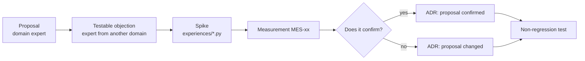

# 11 — Cross-review between experts and measurement register

> Facilitator: [QA] · Participants: [CP], [ARC], [OPS], [CTRL], [SAFE], [KIN], [VIS], [DEC]
> This document is the **trace** of the mutual verification: every expert proposal is challenged by at least one other expert, and the disagreement is settled **by a measurement**, not by authority.

## 1. Protocol



1. An expert proposes a choice with its rationale.
2. At least one reviewer from another domain raises a **testable objection**.
3. A **spike** (throwaway script in `experiences/`) measures the disputed point.
4. The decision (ADR) cites the measurement. If the measurement contradicts the proposal, **the proposal changes**.

## 2. Review log (53 objections, 45 proposals changed)

| ID | Initial proposal (author) | Objection (reviewer) | Verification | Result | Decision |
| --- | --- | --- | --- | --- | --- |
| RC-01 | 6D "gripper strictly vertical" IK for every phase (KIN) | "Can a 5-DoF arm point straight down everywhere?" (DEC) | `exp_reachability.py` | Only **58 %**; vertical impossible above ~8 cm far from the base [MES-08] | **Changed**: minimal tilt relaxed from 0 to 30° for grasping, position-only IK for transport (ADR-009) |
| RC-02 | IK seeds `pan = +azimuth` (KIN) | "Convergence depends on the side" (QA) | FK at pan = +0.5 | The TCP moves towards **−y**: **pan is reversed** [MES-06] | **Changed**: `pan = −azimuth` (ADR-005) |
| RC-03 | Tilt azimuth computed from the base origin (KIN) | "Is the pan axis at the origin?" (ARC) | FK of the pan joint | Axis at **x = 3.88 cm**; the arm plane contains it [MES-06] | **Changed**: azimuth seen from the pan axis → pick & place 29/40 → **39/40** |
| RC-04 | Detect the grasp from the gripper position (DEC) | "Does the gripper really close less when holding the cube?" (CTRL) | Pick & place spike | Gripper at **0 %** with or without the cube (the jaws go through the tunnels); **effort** 0.12–0.19 vs 0 [MES-10] | **Changed**: normalized effort + visual verification (ADR-016) |
| RC-05 | Camera rendering in the driver thread (CTRL, early code) | "How much does a render cost?" (ARC) | Timing + jitter | Render ≈ **51 ms**; control period p99 = 52 ms instead of 20 [MES-03], [MES-20] | **Changed**: render on a copy outside the lock (ADR-006), p99 = 25 ms |
| RC-06 | Use the MuJoCo site or the URDF TCP frame interchangeably (VIS) | "Are the orientations identical?" (KIN) | 500 random configurations | Positions identical within 0.004 mm, **orientations 90° apart** [MES-04] | **Clarified**: orientation = URDF only; the site is for position measurements |
| RC-07 | Calibrate the extrinsics at the working resolution, 320×240 (VIS) | "Are distant markers detectable?" (QA) | `exp_perception_calib.py` | 320×240: 1 marker, 23 mm error; 640×480: 5 markers, **0.9 mm / 0.06°** [MES-16] | **Changed**: calibrate at 640×480 with ≥ 4 spread markers (ADR-013) |
| RC-08 | "The cube is always in the image" (VIS) | "Is the whole randomization area in view?" (QA) | Projection of 2,000 poses | **21 % truncated** at the bottom of the image [MES-12] | **Added**: truncation handling + question to the staff (R-01) |
| RC-09 | Blob centroid = cube center on the plane z = 2.5 cm (VIS) | "Bias from the visible side faces?" (KIN) | 68 detections | Mean 2.7 mm, constant bias (0.5, −2.6) mm; 0.8 mm after correction [MES-13] | **Confirmed** (+ optional bias correction) |
| RC-10 | Start `perception` from the provided compose file (OPS) | "Does the service exist?" (ARC) | Reading `docker-compose.yml` | **Missing** despite the slides | **Added**: perception service with a separate build (ADR-002) |
| RC-11 | Modify `SO101Sim` to randomize the box (OPS) | "Is `sim/` code really used from the volume?" (QA) | Dockerfile inspection | Installed **non-editable**: changes ignored without rebuild | **Changed**: `/sim/randomize` in the driver, `sim/` untouched (ADR-018) |
| RC-12 | Default `SO101Follower.connect()` (CTRL) | "What if the calibration differs?" (SAFE) | Reading `so_follower.py` | `calibrate()` calls **`input()`**: node blocked | **Confirmed**, then refined by RC-29: the provided version fails explicitly instead of writing the calibration |
| RC-13 | `disconnect()` on shutdown (CTRL, early code) | "What about torque?" (SAFE) | Reading the config | `disable_torque_on_disconnect=True`: **the arm falls** | **Changed**: PARK before disconnecting (ADR-023) |
| RC-14 | Images published Best effort (ARC) | "RViz and `ros2 topic echo` often subscribe Reliable" (VIS) | DDS compatibility rule [KO1 p29] | BE publisher + Reliable subscriber = **0 message, no error** | **Changed**: Reliable publisher, BE subscribers if they wish (ADR-004) |
| RC-15 | Webcam with OpenCV's default settings (OPS) | "Do frames go through usbip?" (VIS) | `exp_webcam_formats.py` | YUYV: **0 fps**; MJPG: 27.5 fps [MES-17] | **Changed**: `fourcc="MJPG"` mandatory (ADR-007) |
| RC-16 | Release 11 cm above the box (DEC) | "Does the cube stay in the box?" (QA) | Pick & place spike | 1 cube out of 40 bounces out [MES-09] | **Changed**: TCP ≈ 9 cm + `VERIFY` state |
| RC-17 | Jaw alignment with the faces mandatory (DEC) | "Necessary and always feasible?" (KIN) | Pick & place spike | Grasp works up to **44°** of misalignment; 6D alignment infeasible with 10° tilt for 14/40 cubes [MES-09] | **Changed**: best-effort alignment with free fallback (ADR-009) |
| RC-18 | Publish `/clock` and use `use_sim_time` (ARC) | "Is the sim faster than real time?" (CTRL) | Timing | 10 ms of physics per call, 2 calls per 20 ms tick = **real time** [MES-02] | **Rejected**: wall clock (ADR-005) |
| RC-19 | Recommend Pinocchio for IK (KIN, first version of this folder) | "The team's code already uses ikpy: is it insufficient?" (CP) | `exp_ikpy_vs_pinocchio.py` | ikpy **100 %** position, **97 %** pointing, 6–14 ms; Pinocchio 91 % (single seed), 20–50× faster [MES-21] | **Changed**: **ikpy kept**, façade to switch if needed (ADR-008) |
| RC-20 | Effort in N·m as REP-103 requires (ARC) | "Is a hobby servo's load a calibrated torque?" (CTRL) | STS3215 registers | `Present_Load` in ‰ of max torque, uncalibrated | **Changed**: normalized effort in [−1, 1], documented deviation (ADR-016) |
| RC-21 | "Camera rendering only costs jitter" (CTRL, first version) | "Let's measure the real rate with a component test" (QA) | `colcon test` with `test_driver_launch.py` + `ros2 topic hz` | `/joint_states` at **9 Hz** (4.7 Hz under test) instead of ≥ 20 Hz: **C-11 violated** by the early code [MES-22] | **Changed**: blocking defect, fixed in the merged driver (30 Hz [MES-24]) |
| RC-22 | Test the joint-limit clamp in sim (CTRL) | "MuJoCo already clamps to `ctrlrange`" (KIN) | Reading the MJCF (`ctrlrange` = URDF limits) | A sim test would pass **even without a clamp** in the driver | **Changed**: clamp tested at unit level (ADR-026) |
| RC-23 | Full ruff naming rules (QA) | "`R`, `T`, `K`, `J` are matrices" (KIN) | ruff on the current code | `N806` flags `T` (homogeneous matrix) in `brain_node.py` | **Changed**: `N803`/`N806` ignored (ADR-024) |
| RC-24 | Hook versions pinned from memory (OPS) | "Are they up to date?" (QA) | GitHub API (releases) | ruff 0.16.10, pre-commit-hooks v6.0.0, markdownlint-cli2 v0.23.3, conventional v4.4.0, checkout v7… | **Changed**: pinned to the current versions |
| RC-25 | E2E bench in `tools/evaluate.py` (QA) | "Is `tools/` visible in the container?" (OPS) | Reading the compose file | Only `ros2_ws/` is mounted | **Changed**: `ros2 run so101_bringup evaluate` executable |
| RC-26 | Diagrams checked by eye (ARC) | "Render them automatically" (QA) | mermaid-cli 12.0.1 on 36 diagrams + PNG render | 1 broken diagram (`;` = Mermaid separator); `=` escaped as `&equals;` in a gitGraph | **Changed**: `check_mermaid.sh` in the nightly CI + visual review (ADR-030) |
| RC-27 | "markdownlint is superfluous for docs" (CP) | "It finds real bugs" (QA) | markdownlint-cli2 on the docs | 95 issues, including **a broken table** (`\|q − q_target\|` read as a column separator) | **Changed**: markdownlint in pre-commit (ADR-024) |
| RC-28 | GitHub fork of the course repo (OPS) | "Where does `origin` point? Can a fork be private?" (CP) | `git remote -v` | `origin` = **the teacher's repo**; a fork of a public repo stays public | **Changed**: team repo + `upstream` without push (ADR-027) |
| RC-29 | On calibration mismatch: `write_calibration` into the motors (CTRL, local version and first version of `03`) | "What if the file comes from another arm?" (SAFE); "What does the provided code do?" (CP, after the pull) | Upstream PR #1 (`fix/connect_arm`) | The course chose **explicit failure** (`disconnect` + `RuntimeError`) | **Changed**: keep the provided version, `max_relative_target` safety net added next to it (ADR-032) |
| RC-30 | markdownlint on the whole repository (QA) | "The course kit contains Markdown" (OPS, after the pull) | markdownlint-cli2 on `docs/` | **13 issues in `docs/SUJET.md`** (provided): the `lint` job would fail on a file we must not modify | **Changed**: `docs/SUJET.md` and the provided PDFs excluded from pre-commit and markdownlint |
| RC-31 | Calibrate with a single ArUco like the demo (VIS) | "Robustness to real detection noise?" (QA) | `exp_calibration_methods.py` (0.5 px noise) | Ambiguous pose (p95 1 m / 86°), 18 mm mean object error; 6 spread markers: 1.6 mm [MES-25] | **Changed**: spread multi-markers + robot validation (`05` §10) |
| RC-32 | CI on the school repository (OPS) | "CI must run on a private repo; the school repo is only a mirror" (CP) | Requirement expressed by the team | The copied workflows would also run on the mirror | **Changed**: `mirror.yml` + opt-in workflows (`CI_ENABLED`) (ADR-033) |
| RC-33 | Quickstart as first written: `up -d control perception viz`, `ros2 topic pub --once`, `/brain/start` (CP) | "Replay it literally from the delivered folder" (QA) | Fresh copy, separate compose project [MES-26] | `perception` service missing; `/brain/start` not implemented yet; `--once` applied **0/8** (CLI exits before delivery) | **Changed**: quickstart limited to what works today, `--once -w 1 --keep-alive 1` (8/8), status table in the README |
| RC-34 | Bench "≥ 90 % over 50 episodes, randomized cube and box" and "≥ 7/10 real" cited as imposed (QA) | "The brief changed on 2026-10-08: still imposed?" (CP, after the pull) | `git diff` of `docs/SUJET.md` | Randomization and "7 out of 10" removed; S7 asks for a **robust** sim pick & place, the real robot "preferred" | **Changed**: both kept as team targets (DECIDED), source tags fixed (`00` I-11, ADR-018) |
| RC-35 | Phase 2 "once phase 1 is validated", last step of the roadmap (CP) | "S7 now includes phase 2" (DEC) | Brief + [BOOT2 p15–16] | Phase 2 is part of the final defense, with a pitch and workshop constraints | **Changed**: roadmap stage 7 started after 4.3, in parallel with the real arm; delivery becomes stage 8 |
| RC-36 | Real arm only after the sim hardening (CP) | "The course connects the real arm on day 2, before IK" (CTRL) | [BOOT2 p10], milestones 4–5 | Commissioning tests 1–4 only need the driver and its safety layer | **Changed**: step 6.1 right after stage 1 |
| RC-37 | FSM design of `06` §3 (DEC) | "Does it answer the five robustness questions of the slides?" (QA) | [BOOT2 p12] against `06` | 4/5 answered directly; "object moved mid-action" answered by detection (effort, `VERIFY`) + retry, not by tracking | **Kept**: mapping `06` §10 + C-36; replanning during `APPROACH` listed as an option |
| RC-38 | Roadmap "phases 0–7" (CP) | "'Phase 2' means kinematics here and go-further in the brief" (VIS) | The brief now titles "Phase 1" / "Phase 2" | Ambiguous at the defense | **Changed**: roadmap *stages* 0–8, *phase* reserved for the brief |
| RC-39 | Phase 2: Connect Four grid facing the robot, as for a human player (DEC) | "Can a 5-DoF arm keep a token in that plane?" (KIN) | `exp_connect4_kinematics.py` | Facing: best jaw error 40–62° at 22–30 cm high, 17–23° at 14 cm; edge-on: 1–3° [MES-27] | **Changed**: grid edge-on (ADR-035) |
| RC-40 | A standard store-bought grid (CP) | "Does the arm clear the top of the grid?" (SAFE) | Same script | Standard (slots at 25 cm): 0.5 cm above the far column, link thickness not counted; small grid (slots at 15 cm): ≥ 10.8 cm [MES-28] | **Changed**: small custom grid (ADR-035) |
| RC-41 | Drop poses with ikpy `orientation_mode="X"` (KIN) | "Does it converge everywhere?" (QA) | Same script, 120 targets | 11 % solved with up to 15 seeds; wrist roll locked at ±90° + position IK: every reachable target (81 %); 2.8° residual from the URDF wrist [MES-29] | **Changed**: `drop_ik` (ADR-035) |
| RC-42 | Switch to Pinocchio for phase 2 (KIN) | "Is the speed actually needed?" (CP) | `exp_ikpy_vs_pinocchio.py` rerun + drop-pose timing | MES-21 reproduced identically; 4 poses per move ≈ 1 s in a turn-based game [MES-29] | **Kept**: ikpy (ADR-008); Pinocchio only for visual servoing (stretch) |
| RC-43 | Read the grid with the phase-1 camera at 320×240 (VIS) | "How many pixels per cell?" (QA) | Pinhole projection of the 42 cells | 7.7 × 6.3 px; a camera 45 cm in front of the grid: 13 px [MES-31] | **Changed**: `board_cam` facing the grid in sim, a webcam facing it on the real setup (ADR-036); reversed for the sim by RC-47 |
| RC-44 | A store-bought grid after all: nothing to build, robust, recognizable (CP, 2026-10-09) | "RC-40 found 0.5 cm of clearance: what if the arm is raised?" (SAFE) | `exp_connect4_kinematics.py`, riser case | Arm on an 8 cm riser, columns at r = 0.14–0.36 m: all reachable, 6.3–10.5 cm above the 4 far columns [MES-32] | **Changed**: store-bought grid on a riser, depth guide only (ADR-038); RC-40 reversed |
| RC-45 | A generic `PickPlace` action served by the brain, `/brain/start` moved onto it (ARC, ADR-037) | "Two weeks left: is refactoring the code the phase-1 bench guards worth it?" (CP) | Prototype of a `/brain/drop` service in the brain's tick | The service replies at the end of the move with the tick at 22.5 ms at most; in the default callback group it froze the tick [MES-64] | **Changed**: a `/brain/drop` service in its own callback group, `fsm.py` untouched (ADR-037 Update) |
| RC-46 | Drop pose: wrist roll ±90°, the TCP on the slot plane (KIN, ADR-035) | "Does a token fall in the slot from there?" (QA) | 28 drops in the sim prototype | **0 of 28**: the token rests on the fixed jaw, 3.15 mm off the TCP; aimed at the token's centre, tilt 70°: every column [MES-64] | **Changed**: `release_pose` targets the token's centre (`drop.py`) |
| RC-47 | A camera facing the grid, `board_cam` (VIS, RC-43) | "Is a second camera needed at 640×480?" (CTRL) | 50 boards rendered by the phase-1 camera, unmoved | 2100 cells of 2100, the grid's pose within 0.8 mm [MES-65]; on the game's scene 2100 of 2100 [MES-68] | **Changed**: the phase-1 camera at 640×480, no `board_cam` (ADR-036 Update); RC-43 reversed |
| RC-48 | A move of 5 to 8 s (KIN, from 4.7–5.2 s without the pre-drop) | "Measured through the brain, with the lift?" (QA) | 50 drops on the stack | 13.1 to 19.1 s: the lift is 5 motions of 0.5 s and each leg ends on the measured joints [MES-69]; 11.5 to 17.0 s with faster empty legs [MES-73] | **Changed**: `move_timeout_s` 90 s, the game's durations in the docs; faster legs with the token held are not for `v2.0.0` |
| RC-49 | The driver ends its day at `PARK`, as in phase 1 (CTRL) | "What does the joint line from `HANDOVER` to `PARK` cross?" (SAFE) | The scene's distance from the arm to the grid along the line | The gripper goes 30 mm into the grid's near post [MES-69] | **Changed**: `shutdown_pose` is `HANDOVER` in game mode, `/brain/start` refused (ADR-023 Update) |
| RC-50 | Levels by depth: easy 2, medium 6, hard 10 (DEC) | "Does a deeper search really win?" (QA) | `levels.py`, 40 games a pair of depths | 2 against 6: 15 – 15; in order: 1, 4 and 10 (2 – 28, 7 – 26) [MES-70] | **Changed**: easy 1, medium 4, hard 10 (ADR-040) |
| RC-51 | Legs back at 1.4 rad/s and `HANDOVER`'s pan at −0.8, estimated gain 1.9 to 2.5 s (KIN, review of 2026-11-12) | "Each change alone, and does the reading hold at −0.8?" (QA, VIS) | 50 drops three times, 50 game states read, the scene's clearances | 50/50 each time; 1.8 to 2.4 s less a move; 2100 cells of 2100; 11 mm or more from the grid [MES-73] | **Changed**: both kept, the speed as a ratio of the brain's (ADR-040) |
| RC-52 | A dispenser of 21 tokens as one gravity rail folded in three levels (KIN, 2026-11-13) | "At a turn a token lies on the one below: does that one roll out from under it?" (CTRL) | A force estimate at the turn; one straight rail on the sim | The token below needs 0.024 N·R of friction overcome with 0.0055 N·R of drive: it jams. A straight rail feeds 7 of 7 [MES-75] | **Changed**: three straight rails stacked, each with its station (ADR-041) |
| RC-53 | Rails at 10°, tokens rolling, the tokens' angular damping removed (KIN) | "That damping is part of the contact set the 50 drops were measured with" (QA) | The same rail at 25° with the scene's damping | 7 of 7 fed and taken at 25°, sliding, nothing of the contact set changed [MES-75] | **Changed**: 25° in the sim, the slope a setting (ADR-041) |

## 3. Code review (2026-10-08)

Summary of the gaps [CTRL] and [QA] found in the code of that date (the course stubs merged with the bootstrap work), kept as a record: every one is fixed since (`03` §0 for the driver, `04` and `06` for the brain).

| Block | Compliant | Blocking gaps | Gaps to fix |
| --- | --- | --- | --- |
| `driver_node.py` (merged with upstream) | Provided `_connect_arm`, partial commands, limiter, **30 Hz** (fixed: 9 Hz before) [MES-24], 10 Hz image in a thread, clean shutdown | **Joint-limit clamp (C-15)**; **`camera_info` (C-13)** | NaN; effort; `frame_id`; PARK before `disconnect`; `/sim/randomize` |
| `brain_node.py` | ikpy FK/IK, `/end_effector_pose`, `/go_to_target` with rejection above 1 cm | — | Command sent as a jump (no trajectory); FSM, start/stop services and `/brain_state` to come |
| `driver_node.py`, audit of 2026-10-09 | Upstream #2 merged (torque-off lines commented out) | Speed limiter at 1.5 rad/s on the real arm too (checklist `07` §7: ≤ 0.8 rad/s) | Clamp and NaN rejection still missing; the team's working copy has them (ticket 1.1a) |
| `brain_node.py`, audit of 2026-10-09 | FK = TF = Pinocchio (0 µm); position IK < 1 mm, 100 % of the grasp area from the real rest pose | IK seed not clipped to the bounds: "x0 is infeasible" kills the node when a measured joint sits past a limit (seen on the real arm) | IK inside the service callback (15 ms median, up to 350 ms); ikpy chain built from the first child joint in URDF order; free orientation in `/go_to_target` (approach tilt median 49°) |

## 4. Measurement register

Every measurement is **reproducible**. Generic command, from the repository root:

```bash
docker run --rm -e MUJOCO_GL=osmesa \
  -v $PWD/ros2_ws:/ros2_ws:ro -v $PWD/sim:/opt/so101/sim:ro \
  -v $PWD/docs/project/experiences:/exp -v /tmp/exp_out:/out \
  tek5/control bash -lc "source /opt/ros/jazzy/setup.bash && python3 /exp/<script>.py"
```

| ID | Measurement | Value | Script |
| --- | --- | --- | --- |
| MES-01 | Image build and versions | OK; numpy 1.26.4, mujoco 3.15.0, cv2 4.10, ikpy 4.1.0, pinocchio 4.1.0 | `docker compose build` |
| MES-02 | Simulation step | 2 ms × 5 = **10 ms** of physics per `get_observation`/`send_action`; 0.1 ms CPU | `exp_kinematics.py` |
| MES-03 | Camera render cost (OSMesa) | **51 ms** at 320×240, 57 ms at 640×480 (up to 137 ms on a loaded machine) | inline (§5) |
| MES-04 | URDF FK vs MuJoCo site | Position ≤ **0.004 mm**; orientation 90° apart (constant) | `exp_kinematics.py` |
| MES-05 | TCP axes | Approach = **+z** (0.997); jaw closing = **x** | `exp_kinematics.py`, `exp_pick_place_gt.py` |
| MES-06 | Pan conventions | pan > 0 → TCP towards −y; pan axis at (0.0388, 0) | `exp_kinematics.py` |
| MES-07 | Position-only IK | **100 %** (< 1 mm), r ∈ [0.18, 0.30], z ∈ [2, 12] cm | `exp_ikpy_vs_pinocchio.py` (200 targets, ikpy and Pinocchio both 100 %) |
| MES-08 | Vertical approach reachability | Strict vertical 6D: 58 %; (z, r) → minimal tilt map (`04` §4) | `exp_reachability.py` |
| MES-09 | Pick & place with ground truth (40 episodes) | **39/40**; closed-loop TCP error 0.1–0.3 mm; 14/40 with 10° tilt; grasp tolerant to 44° misalignment | `exp_pick_place_gt.py` |
| MES-10 | Grasp signal | Gripper at 0 % with or without cube; effort −0.41 to −0.64 N·m (0.12–0.19 normalized) vs 0 | `exp_pick_place_gt.py` |
| MES-11 | IK time | Pinocchio DLS ≈ 0.3–5 ms; ikpy ≈ 6–25 ms depending on the task and machine load | `exp_ikpy_vs_pinocchio.py` |
| MES-12 | Field of view | 79 % of cubes fully visible, **21 % truncated**, 0 % out of view | `exp_perception_calib.py` |
| MES-13 | Detection and pixel → 3D | 0.49 ms/frame; 100 % detected (non-truncated); error 2.7 mm mean, 4.5 mm max; bias (0.5, −2.6) mm | `exp_perception_calib.py` |
| MES-14 | Cube yaw | Median error 1.3°, p90 8.3° | `exp_perception_calib.py` |
| MES-15 | Box | 2.9 mm mean, 5.4 mm max | `exp_perception_calib.py` |
| MES-16 | ArUco calibration | 640×480, 6 markers: pose 0.9 mm / 0.06°, induced object error 1.8 mm; 320×240: 23 mm | `exp_perception_calib.py` |
| MES-17 | Webcam through usbipd | YUYV 0 fps; MJPG **27.5 fps** (640×480); `--device` works with Docker Desktop | `exp_webcam_formats.py` |
| MES-18 | Inter-container DDS + X11 | `talker` received by viz and perception; RViz OpenGL 4.5 | manual |
| MES-19 | `colcon build` | 5 packages in ~9 s | `control` logs |
| MES-20 | Control jitter with rendering | No camera p99 = 20.2 ms; render under lock 52.4 ms; render on a copy **25.2 ms** | inline (§5) |
| MES-21 | ikpy vs Pinocchio (100 targets) | ikpy: position 100 %, pointing 97 %, 6–14 ms; Pinocchio (single seed): 100 % / 91 %, 0.3 / 0.8 ms (**reproduced identically on 2026-10-09**) | `exp_ikpy_vs_pinocchio.py` |
| MES-22 | Early driver rate (sim, camera on) | `ros2 topic hz /joint_states`: **9.1 Hz**; image 9.1 Hz; render 137 ms (loaded machine); under `colcon test`: 4.7 Hz | `ros2_ws/src/so101_driver/test/test_driver_launch.py` |
| MES-23 | Proposed tooling validation | ruff 0.16.10: 15 issues and 7 files to reformat on the team's code, 0 on the templates and the provided driver; markdownlint-cli2 0.23.3: 95 → 0; actionlint 1.7.12: 0; mermaid-cli 12.0.1: 36/36 after fixes; `colcon test`: 6 tests in 9.4 s; pre-commit (13 hooks) green on the whole repo | `docs/project/14_quality_pipeline_ci.md` §9 |
| MES-24 | Merged driver (course + team work + camera thread) | 6/6 tests; `/joint_states` **30.0 Hz** (max period 44 ms); image 10.0 Hz; SIGINT/SIGTERM: stop < 0.5 s, exit 0, no traceback; `/go_to_target` (0.22, 0.05, 0.10) → measured TCP within 0.13 mm | `ros2_ws/src/so101_driver/test/` + `ros2 topic hz` + service call |
| MES-25 | Calibration methods (640×480, 0.5 px noise, 100 draws) | 1 ArUco 7.5 cm: p95 1,021 mm / 86°, object 18 mm mean; 1 ArUco 15 cm: not detected (out of view); 4 at the workspace corners: 2 detected, object 8.7 mm; **6 spread: p95 3.4 mm / 0.23°, object 1.6 mm** | `exp_calibration_methods.py` |
| MES-26 | README quickstart replayed from a copy of the delivered folder (separate compose project) | Build (cache) OK; driver + brain ready; `/go_to_target` success; `/joint_states` 30.1 Hz; RViz OpenGL 4.5. `ros2 topic pub --once`: **0/8** commands applied; `-w 1 -r 10 -t 10`: 8/8; `--once -w 1 --keep-alive 1`: **8/8** | manual (`docker compose`, `ros2` CLI) |
| MES-27 | Connect Four drop: jaw-axis error, grid edge-on vs facing the robot | Edge-on: 1–3° over r = 0.14–0.36 m, z = 0.06–0.34 m (4–8° near the base at z ≥ 0.26 m); facing (x = 0.22 m): 40–62° at z = 0.22–0.30 m, 17–23° at 0.14 m, 7–8° at 0.10 m, 1–8° at 0.06 m | `exp_connect4_kinematics.py` |
| MES-28 | Arm clearance above an edge-on grid | Small grid (TCP at 0.18 m, top at 0.15 m): ≥ 10.8 cm, arm never above the 4 near columns; standard grid (top at 0.25 m): 6.7, 6.2, 2.8, 0.5 cm above the 4 far columns (segments between joint origins, link thickness not included) | `exp_connect4_kinematics.py` |
| MES-29 | Jaw axis with wrist roll at ±90°; drop-pose methods | Residual 2.8° (URDF `wrist_roll` origin, rpy 0.0487 rad); 120 targets: wrist roll locked + position IK 81 % (every reachable target), ikpy `orientation_mode="X"` 11 % (up to 15 seeds); 0.26 s median, 1.2 s max per pose | `exp_connect4_kinematics.py` |
| MES-30 | Real arm: LeRobot zero (middle of the recorded range) vs the pose held during calibration | Offsets 2.0, −22.9, −8.6, −3.2, 0° (pan to roll); rest-pose TCP z = −2.9 cm as reported, +2.7 cm if the URDF zero is the held pose; each hypothesis puts one joint slightly outside its URDF limit: **to settle with a ruler** | `exp_calibration_zero.py` |
| MES-31 | Size of a Connect Four cell in the image (pitch 24 mm) | Phase-1 camera: 7.7 × 6.3 px at 320×240, 15.4 × 12.5 px at 640×480; camera 45 cm in front of the grid: 13.0 px at 320×240, 26 px at 640×480; whole grid in view in both cases | `exp_connect4_kinematics.py` |
| MES-32 | Arm clearance above a store-bought grid with the arm on a riser | Same model as MES-28 (pitch 37 mm, top 25 cm above the table), arm on 8 cm, columns at r = 0.14–0.36 m: all 7 reachable; 10.5, 9.9, 7.9, 6.3 cm above the 4 far columns (link thickness not included); without the 2 cm shift, the nearest column is out of reach | `exp_connect4_kinematics.py` |
| MES-33 | Sim joint speed behind the driver's speed limiter (0.5 rad step on `shoulder_pan`, exact sim time) | Limiter at 1.5 rad/s: mean 1.48 rad/s over 20–80 % of the move, but the `sts3215` position actuator oscillates around the ramp (peaks 2.49 rad/s, −0.35 rad/s overshoot at the end); without the limiter: 3.95 rad/s. The limiter bounds the **setpoint**, not the measured speed; the launch test checks < 2.0 rad/s (step 1.0) | `exp_driver_speed.py` |
| MES-34 | Driver control period with the sim camera thread (step 1.2): real `DriverNode` in-process, 30 s, one image subscriber in another process | Camera off: p99 **20.2 ms**. Camera on with llvmpipe's default (one render thread per core, 16 here): p99 **23.9–25.4 ms**, so p99 ≤ 25 ms fails some runs; render threads at half the cores (`LP_NUM_THREADS`, the driver's default): p99 **20.3–20.4 ms**, image **10.0 Hz** (1 thread: 6.2 Hz). One ~170–260 ms period at start-up (renderer creation), before the first frame; the first frames render at ~5 Hz for 2 s. GitHub runner (4 vCPU, so 2 render threads, coverage on): image **4.9 Hz**, `/joint_states` 29.9 Hz, so the launch test only checks ≥ 3 Hz for the image. Shutdown: 100/100 SIGINT/SIGTERM stops in ≤ 314 ms, exit 0, no traceback | `exp_driver_jitter.py` |
| MES-35 | Gripper effort in the team driver (step 1.3), `SO101Sim` in-process, gravity off so the cube stays between the open jaws, then closed 1 s | Empty: **−0.001**. Cube turned 90° (the jaws enter a tunnel): **0.184**, as in MES-10. Cube not turned: raw **0.053**, below the 0.06 grasp threshold: the grasp orientation matters. Raw MuJoCo sign is negative when squeezing: the driver reports the gripper's closing force (positive when holding) | `so101_driver/test/test_effort.py` |
| MES-36 | IK seeds over the whole joint space (step 2.1): 2000 random arm configurations within the URDF limits, target = FK, `ik_pos` | Seeds of `04` §3.1 only: **307 misses** (288 with the target past the pan range, \|azimuth\| > 1.92 rad: the forward seeds stay stuck on the pan stop); with the fallback grid (both pan families, shoulder and elbow both ways): **0 misses**. Time median 16 ms either way (forward targets solve with the first seed), p99 738 ms | `exp_ik_seeds.py` |
| MES-37 | System-clock steps on WSL2 and their effect on the sim stack (#112): wall clock against `time.monotonic()`, `/joint_states` arrival gaps, `/go_to_target` back and forth every 4 s, 95 s per run | The wall clock steps back every **30.0 s**: −0.83 to −0.91 s then −1.74 s (≈ −2.6 s); once +1038 s in 3 minutes. Timers on the ROS clock pause until it catches up: before, `/joint_states` stops **2.65–2.68 s** at each step and the brain's stream freezes in mid-motion (2 pauses of 2.62 s over 24 motions). Timers and motion time on the steady clock: largest `/joint_states` gap **37 ms** (155 ms once, with two stacks running in parallel), no freeze (one 0.12 s pause in 3 runs, not at a step). A rewind of the motion only happens with sim time, where rcl keeps timers running across a jump: 423 mrad back before, none after (`test_clock_step_launch.py`) | `exp_clock_steps.py` |
| MES-38 | Repository grasp chain (steps 2.1b, 2.4a, 2.4b): `kinematics.py` + `grasp_planner.py` + min-jerk, in closed loop behind the driver's tick and limiter, `SO101Sim` in-process, ground truth, cube and box randomized | **40/40** in the box on 3 seeds (15 s per run). Free roll in position-only IK: the lift (6 cm) spun the wrist 2.3–4.1 rad in 7/10 episodes, 4.4–7.7 s instead of 0.5 s; roll kept: motion time per episode median **13.6 → 7.2 s**, max 17.3 → 11.1 s. First aligned face found: median wrist turn 100°, shortest first motion: 61°. Drop with a free orientation: 2/40 missed, the gripper tilted 62–68° (successes ≤ 32°), the cube hooked on a jaw inside a tunnel; gripper as vertical as reachable: 40/40. Planner over 200 scenes: 200 plans, 170 aligned, p95 0.37 s; `ik_pose` aligned and vertical: 76 % of 50 targets; `ik_point` vertical: 188/200, the 12 others with no vertical solution from 100 more seeds. Roll kept in `/go_to_target` too: motions median 2.1 s (max 5.3 instead of 9.5), but one C-41 target 3.9 cm high stayed blocked 20 mm above it: not kept | `so101_bringup/test/test_grasp_closed_loop.py`, `so101_brain/test/test_grasp_planner.py` |
| MES-39 | PARK pose in sim (step 4.2a): reached through the actuators behind the driver's tick and limiter (the earlier spikes set it in `qpos`), then the cube and box pixels the external camera sees (segmentation), 50 scenes drawn as `/sim/randomize` does, against the arm lifted out of the picture | `[1.9, −1.7, 1.6, 0.7, 0]`: the lower arm **touches the shoulder**, the elbow stays **0.010–0.0115 rad** short, so `WAIT_TARGET` never reached it within the 0.01 rad tolerance (`ERROR:timeout:WAIT_TARGET` on the sim stack). Elbow **1.5**: no self-contact, error **0.0004 rad**. Both poses: the cube never hidden; the box partly hidden in 8/50 scenes (worst 87 % visible) at 1.6, **7/50 (worst 91 %)** at 1.5. `fsm.park_pose` → `[1.9, −1.7, 1.5, 0.7, 0]` | `exp_park_pose.py`; `so101_bringup/test/test_grasp_closed_loop.py` |
| MES-40 | Brain planning off the tick, full cycles in sim (steps 4.2b, 4.2c): `gt_stub.launch.py` (driver, brain, ground-truth stub), 20 `/sim/randomize` + `/brain/start` cycles per worker variant, the tick period logged per FSM state; a second sim stack ran on the machine | **20/20** cubes in the box, 0 retries, cycle median 14.6 s (max 17.7). Tick period during `PLAN`: worker **thread** p99 29.4 ms, max 39.7, 6.04 % over 25 ms, against 0.4–2.1 % in the other states (a 1 ms GIL switch interval: worse, 4.07 %); worker **process**: p99 **24.4 ms**, max 26.4, 0.94 %, like the other states (0.7–2.0 %). Planner median 0.30 s, max 0.82 s; a cube out of reach fails in 1.7 s (2.0 s with the thread; 2.4 s on the CI runner), so the `PLAN` timeout went from 2 to 6 s | `exp_gt_cycles.py`, `exp_tick_by_state.py`; `so101_bringup/test/test_pick_place_gt_launch.py`, `so101_brain/test/test_grasp_planner.py` |
| MES-41 | Sim camera principal point (#122): the cube's red blob (HSV, `05` §2.2) against its exact silhouette, the hull of its 8 corners projected with K, 50 scenes drawn by `randomize_object()` with the arm lifted out of the picture; then the blob centroid on the plane z = 2.5 cm against the cube center | Provided K (`cx = W/2`, `cy = H/2`, pixel edges on integers): blob − silhouette **(−0.53, −0.63) px**, cube error mean **2.63 mm**, max 4.16 mm. OpenCV K (`(W − 1)/2`, `(H − 1)/2`, pixel centers on integers): **(−0.03, −0.13) px**, mean **0.50 mm**, max 1.00 mm. The "constant bias" of MES-13 was mostly this half pixel. The driver publishes the OpenCV K | `exp_principal_point.py`; `so101_driver/test/test_camera.py` |
| MES-42 | Mutation testing of the arm-protecting modules (step 5.1c, #59): mutmut 3.8.0 on `so101_driver/command.py` (`test_command.py`) and `so101_brain/fsm.py` (`test_fsm.py`), command of `08` §1 | `command.py`: **36/39 killed (92.3 %)**, 34/39 before (2 tests added: the rejection reason, an unknown name before a known joint); the 3 survivors are `zip(..., strict=…)` variants, equivalent behind the length check. `fsm.py`: **384/415 (92.5 %)**, 315/415 before (tests added: the reason of every transition, the lock window after an outlier, the newest detection's freshness, box detections without the cube, the exact staleness age). The 31 survivors: 17 exact-threshold ties (`>` vs `>=` on a continuous time, effort or distance), 8 initial values overwritten before any use, 6 `dtype=float` on inputs already float | `08` §1; the `[mutmut]` sections of both `setup.cfg` |
| MES-43 | Position IK solutions that collide with the arm itself, and the seed of `test_ik_accuracy` (#142): the test's 20 seeded targets (seed-0 `/sim/randomize` obstacles), 5 `ik_pos` solves each with 1e-4 rad of seed noise, a solution bad if the elbow folds past 1.6 rad or MuJoCo finds a contact on the arm; the test run 3 times with coverage on 2 cores, chained and from each seed | Seeded from q = 0 (arm straight, singular): **1/20 bad**, target 4 with the elbow at its 1.69 rad limit and the lower arm on the shoulder; in the test the arm stopped at elbow 1.593, **28.4 mm** short, the same way in 3/3 runs. Chained seeds (each target from the previous one): target 15 took 2.55, 4.42 or 6.8 s of motion depending on the run, and once in CI it stayed 13.9 mm above its target. Seeded from HOME (0, −1.0, 0.7, 0, 0), TCP 28.5 cm above the table: **0/20 bad**; 3/3 runs: mean 0.161 mm, max 0.218 mm, the same 20 motion durations. Also: the obstacles read after the call to `/sim/randomize` were the old ones in 2 of 6 runs, 0 of 8 once read after its reply. **Since #145** (`Kinematics.self_collides`, `04` §8): seeded from q = 0, **0/20 bad**. The rule against MuJoCo on 30,000 random poses (pan 0, the other joints uniform in their bounds): 3,788 in contact, **0 missed**, 9.6 % of the free poses flagged. The tightest rule with no miss, on a grid of 5 mm, 1 cm and 0.05 rad: elbow at most 1.55 rad, the lower arm, wrist and gripper out of a 9 cm cylinder around the pan axis below 12 cm; the folded wrist matters (with `wrist_flex` 1.6, the gripper meets the shoulder from an elbow of 0.2–1.0 rad) | `exp_ik_self_collision.py` |
| MES-44 | A SIGINT at a random moment against two ways to stop a node (#158): 1 or 50 timers at 1 kHz, SIGINT 0.05–0.35 s after the node is ready, 150 stops per case, 1 CPU, its stderr read | `rclpy.spin()` with rclpy's handlers: the half-built `Task` traceback (`Exception ignored in Future.__del__`) in **1/150** stops with 1 timer, **3/150** with 50, no other error. rclpy's handlers off, an event ending a `spin_once()` loop: **0/150** in both, every node stopped. Rare by nature (the window is a `Task` being built); the event removes the cause, since no exception is raised during the spin | `exp_sigint_stop.py` |
| MES-45 | Sim camera pose (#47): look-at poses 30–40° down on the work area, the provided fovy at 320×240; 2000 cubes and 2000 boxes of `/sim/randomize`, every corner ≥ 10 px inside the image; the best pose per sector, then each pose rendered in its own process: cubes cut by the image edge over 300 scenes, cube and box hidden by the arm in PARK over 50, a cube lying in the box (48 cases) read inside its footprint, as `VERIFY` needs | Provided pose (0.45, 0.45, 0.55): margin −29 px, cube 18.1 px wide, **57/300 cut (19 %)**, box partly hidden in PARK in 7/50, in-box 48/48. Every sector's best at 30° down: 0/300 cut, but a cube in the box misread outside it: front (24.9 px) and front-left (24.7 px) 3/48, left 7/48; front-right (20.6 px) and right (17.8 px) 48/48. **Front-left 35° down, (0.458, 0.339, 0.363), 0.59 m from the work area: 23.2 px, margin 11.1 px, 0/300 cut, in-box 48/48, box hidden in PARK in 2/50 (99 % visible), chosen** (the provided camera's side, ADR-021); at 40°: 22.2 px, 48/48. The 30° front-left pose, tried first, failed 8 of 50 bench episodes (`VERIFY` misread the placed cube, then a grasp in the box) | `exp_camera_pose.py` |
| MES-46 | Perception with the moved sim camera (#47, step 3.5): next to a stack with the ground truth on its own domain, 200 `/sim/randomize` scenes with the arm in PARK, 2 s of `/object_position` once the cube has settled, each against the ground truth; every 10th scene, `/go_to_target` 10 cm from the cube towards the camera, then back to PARK | Arm in PARK: the cube published in **200/200 scenes** (79 % of the cubes were whole before the move, MES-12), 3,838 poses, error mean **0.7 mm**, p95 1.3 mm, max 2.8 mm, **0 above 2 cm**. Arm between the camera and the cube: 14 scenes kept (6 dropped: the arm pushed the cube), 921 poses in about 1,148 images (the cube hidden about 20 % of the time), max **17.4 mm**, 0 above 2 cm: a partly hidden cube is still published, its center pulled towards its visible part (20.5 mm with the arm left in front of it, an early run of the script). 50-episode bench, real perception, driver seed 0 (the nightly's scenes): **50/50**, p50 14.5 s, p95 17.5 s, where `main` scored 40/50 (10 `object_lost`) | `exp_perception_robustness.py`, `evaluate` |
| MES-47 | Our extrinsic calibration in sim (#45, step 3.4b): the calibration scene at 640×480, the arm in PARK, against the camera MuJoCo renders | 8 markers; corners without sub-pixel refinement: 1.17 px of mean reprojection (refused by the 1 px gate), 1.24 mm / 0.062°; **sub-pixel corners: 0.87 px, 0.53 mm / 0.024°**. The tool on the running stack (10 frames, arm at its start pose): 6 markers, 0.887 px, 0.75 mm / 0.056°; arm in PARK, the file perception loads (#46): 8 markers, 0.868 px, 0.53 mm / 0.024°. Perception on it (MES-46's script, 50 scenes): 50/50 published, mean 0.9 mm, max 1.8 mm | `so101_bringup/test/test_sim_scene.py`, `calibrate_extrinsics`; `results/calibration_sim_2026-10-26.md` |
| MES-48 | Gripper effort where the FSM judges it (#54, step 4.4a): the repository's planner, min-jerk motions and the driver's limiter on `SO101Sim` in-process (the mechanics of `test_grasp_closed_loop.py`), the deployed parameters, ground-truth cube, the 40 scenes of the driver's seed 0 (the nightly's); the normalized gripper effort at every tick of the `GRASP` window (0.8–1.5 s after the close command) and once `LIFT` is reached; jaws aligned (yaw known), free roll (yaw unknown, #128), and empty (the cube moved 30 cm away before closing) | Aligned: window max min **0.120**, median 0.143; end of `LIFT` min **0.099**, median 0.119; 40/40 lifted. Free roll: window max min 0.129, median 0.293; end of `LIFT` min **0.087**, median 0.116; 40/40 lifted. Empty: **0.000** in all 40 windows. The 0.053 flat-face case of MES-35 never occurs with the planner. The 0.06 threshold sorts the 120 grasps right; the tightest margin is the end of `LIFT` (the jaws carry the cube instead of squeezing it against the table): ×1.45, not the ×2 of `GRASP`. **Kept: 0.06** (the empty side is exactly 0 in sim only; the real arm is recalibrated in #69) | `exp_grasp_effort.py` (34 s) |
| MES-49 | The robustness demo's lighting change (#103, case 5): every light of our scene ×0.4 and tinted (1.0, 0.8, 0.55) (`sim_scene.yaml`, `lighting:=dim`); 5 full cycles per run on the demo's own stack, the cube and box detections counted while the brain waits for its target; then the box's, cube's and floor's pixels (MuJoCo segmentation, arm in PARK, seed 0) in OpenCV HSV against the ranges of `perception.yaml`; the recorded RViz clips | Default light: 5/5 cycles in 4 runs (4/5 in one, a `/joint_states` stall), cube and box detected on every image. **Dim: 0/5 in each of 6 runs**, every cycle `ERROR:object_lost`: the cube detected on 99–100 % of the images, **the box on none**, for two reasons. (1) **The floor turns box-colored**: its grey (H 120, S 29) becomes orange (H 14, S 99, V 26–43), and **42 %** of the floor falls in the box range: the box mask grows from 1,125 px (1,121 on the box) to **30,587 px, 29,864 on the floor** (the debug image of the clip shows the light checker squares as box), a blob the shape guards reject. (2) **The box gets too dark**: V median 73 → 29 against `hsv_box_v_min` = 40, 99 % → **11 %** of its pixels in range. Brightness no longer separates them (floor V 26–43, box V 25–50); saturation still does (box S 198–207, floor S 93–106). Cube V median 168 → 68 against `hsv_cube_v_min` = 60: 100 % → 81 % in range. The failure is safe (no lock, no motion) but the task is not done; not fixed in #103 | `exp_lighting_hsv.py`; `ros2 launch so101_bringup robustness_demo.launch.py case:=5 lighting:=dim`; `results/robustness_demo.md` |
| MES-50 | The perception node stopped by a SIGINT at a random moment (#177): MES-44's script with `--perception`, the installed node fed 30 Hz 640×480 images of a red square and `camera_info`, SIGINT 0.05–0.35 s after its "ready" log, 200 stops per case, 1 CPU, two such runs side by side | `rclpy.spin()` with rclpy's handlers (before #177): **2/200** stops with an error or a non-zero exit (with blank images: 0/200; the window is the taking and processing of a message). Handlers off, an event ending a `spin_once()` loop, as the driver (#158): **0/200** | `exp_sigint_stop.py --perception` |
| MES-51 | `/joint_states` gaps on a Windows + WSL2 machine (#176): a sim stack of its own (driver camera on, brain), a subscriber in the same container recording arrival times (steady clock) and stamps, 20 min idle, then 17 min of the `gt_stub` stack running 60 bench cycles; the driver's late-tick warning on (0.25 s) | Idle: 36,001 messages at 30.0 Hz, arrival gap p50 33.2 ms, p99 34.9 ms, max 49 ms. Cycles: 60/60 DONE, p99 34.7 ms, max 37 ms. **No gap over 0.1 s**, no late tick, no `no_joint_states`: the stalls of #103 (0.5 s, 1.36 s, with RViz and a second stack on the machine) are not reproduced by the stack alone. The warning names the driver the next time one comes | `exp_joint_states_gaps.py` |
| MES-52 | HSV ranges that hold under the default and the dim light (#175): MES-49's script over 20 placements drawn as `/sim/randomize` does (arm in PARK, segmentation), plus an "other" region (arm, base); then the robustness demo's case 5 and the default-light bench | Lowest S of the box 164, of the cube 205; highest S of the dim floor 106, of the dim arm and base 113; box V down to 24, cube V to 41 under `dim`. New ranges: **box S ≥ 140, V 20–220; cube S ≥ 150, V ≥ 30** (were S ≥ 90, V ≥ 40; S ≥ 100, V ≥ 60). In range, default / dim: box 96.6 % / 99.9 %, cube 99.2 % / 99.0 %, floor in the box range 0 / 500 px over 20 scenes (588,523 before), in the cube range 282 / 421 px. Box and cube found at their segmented centroid (3 px, 2 px) in 20/20 scenes under both lights (before, dim: box 0/20, cube 8/20). Case 5 under `dim`: **5/5 cycles in each of 2 runs** (0/5 before); default-light bench **50/50**, p50 15.2 s, p95 18.3 s | `exp_lighting_hsv.py 20`; `test_lighting_detection.py`; `results/robustness_demo.md` |
| MES-53 | Partly hidden cubes (#167): the cube blob's pixels (Pick, from its outline) against the smallest silhouette of a whole 5 cm cube at its back-projected point over the yaws (`geometry.cube_area_ratio`), rendered without ROS on our scene, perception's detection and ray, 300 scenes per case: whole cubes (arm in PARK), the arm's TCP put by IK 6–14 cm towards the camera and 2–12 cm above the cube (5–95 % hidden), the cube lying in the box or just behind its front wall; then MES-45's in-box test, MES-46 and the bench | A first ratio, against a 5 cm square at the depth, spread whole cubes over 1.21–1.6 with the view angle: at 1.2, 67/594 hidden cubes were still published, up to 11.6 mm off. Against the silhouette: **whole cubes 0.917–1.1** (dim light 0.94–1.07), hidden ones from 0.04. At **0.85** (`min_cube_area_ratio`): no whole cube dropped, 516/594 hidden ones not published, the rest at most 11.8 mm off (47.9 mm before). MES-46: PARK 200/200 published, max 2.5 mm; the arm passing max **9.6 mm** (17.4 before), 0 above 2 cm. A cube lying in the box (48 cases): 0 outside its footprint from the 30° front, front-left and left poses (3, 3, 7 before), at ours 18 inside, 30 not published (48 inside before). Bench 50/50, p50 16.3 s, p95 20.4 s (15.2, 18.3 before: `VERIFY` waits 2 s when the cube in the box is not published) | `exp_cube_occlusion.py`; `exp_camera_pose.py <pose>`; `exp_perception_robustness.py` |
| MES-54 | The sim calibration view of `test_sim_scene.py` (#187: a CI runner gave 1.17 px against the 1.0 px gate, two corners of marker 3 unrefined; the rerun passed): rendered by OSMesa at 640×480, the arm in PARK, then the calibration's detection and solve, one process per setting, on an i7-11800H (AVX-512) | Without a seed, every run renders other pixels (the image hash changes: `connect()` draws the cube's pose) but gives the same **0.868 px**, worst corner 2.52 px (marker 1), marker 3's corners refined. The same over 200 seeds (0 beyond the tests' bounds), with `LP_NUM_THREADS` 1, 2 or all, `LP_NATIVE_VECTOR_WIDTH` 128 or 256, on 1, 2 or 4 CPUs (`--cpuset-cpus`), with Mesa 24.0.5, 25.1.7 or 25.2.8, and with OpenCV's AVX-512, AVX2, FMA3 and AVX paths disabled (`OPENCV_CPU_DISABLE`). Not reproduced: the two CI attempts built their control image from two different GHA cache manifests, and ran on runners whose CPU is not known; the test now prints the machine in its failure. **2026-11-02** (#217, run 41379393437 of PR #215): **AMD EPYC 7763, AVX2 without AVX-512**, OSMesa 25.1.7, gave **1.11 px**, a corner of marker 3 **5.8 px** off; the i7-11800H checks above, rerun with the same OSMesa, still give 0.868 px and 2.52 px. No AMD machine at hand to reproduce it. The tests' bounds come from these three machines: the sim gate 1.5 px (was 1.0), the corner bound 8 px (was 5; a wrong order is ≥ 28 px) | `exp_sim_calibration_render.py [seeds]` |
| MES-55 | Real arm, 2026-10-30, calibration of 13:55: each joint's reading at the URDF zero (the arm stretched and horizontal, held by hand, torque off; one placement) | −0.028, +0.056, **+0.241**, −0.090, +0.019 rad (pan to roll): the elbow 13.8° off. The arm on the bench on 2026-11-06, another one, calibration of 14:56, three placements: −0.103, +0.002, **+0.186**, −0.027, −0.002 rad. Uncorrected, RViz showed the forearm inside the upper arm and the elbow could not reach PARK; `joint_zero_offsets` (#196). With them: PARK reached, and the shutdown move took 8.6 s for 3.4 rad of `shoulder_pan` (#195) | `exp_zero_offsets.py` |
| MES-56 | Real arm, 2026-10-30: the gripper's `Present_Load` / 1000 (the driver's planned effort, `03` §5), 20 samples after 1.5 s, two runs | Open, empty: −0.116 / −0.116; closed at 0 %, empty: +0.108 / +0.112 (the jaws push on their stops, as much as the sim's held cube); closed at 0 % on the cube: `Overload error`, every read and write refused, the torque cannot be cut until a power cycle (#69) | `exp_gripper_load.py` |
| MES-57 | Gripper opening where the FSM judges the grasp (#69): the mechanics of MES-48 (planner, min-jerk, the driver's limiter on `SO101Sim` in-process, ground-truth cube, the 40 scenes of seed 0), the measured `gripper.pos` (%) over the `GRASP` window and at the end of `LIFT`, closing to 0 % | Aligned jaws: lowest opening **0.02 %** (all 40), end of `LIFT` 0.02 %, 40/40 lifted; free roll: 0.02–0.03 %, 40/40; empty (cube moved 30 cm): **0.00 %**. The jaws close on a tunnel wall: in sim the opening cannot tell a held cube, the effort can (MES-48). The real arm judges by the gap (`hold_gap_pct`), the sim by the effort | `exp_grasp_position.py` |
| MES-58 | Real webcam intrinsics (#67), 640×480, `calibrate_intrinsics`: 25 views of the ChArUco board, 41 to 87 cm, tilts 6° to 71° | **RMS 0.36 px**, 0.38 px on views left out. fx 500.3, fy 501.4, D small. cx moves from 266 to 320 px with the model (free, no tangential, centered): held-out RMS 0.383 to 0.465. The image's left and bottom were poorly covered | The free model kept: it reprojects best; the table plane does not depend on it (MES-59); `camera_real_intrinsics.yaml` |
| MES-59 | Camera pose by touch (#68): the board flat, corners 0, 5, 18, 23 touched by the jaws, TCP by FK, `calibrate_touch`; check: the 8 ArUco sheets, not in the solve, read back on the table | Touches within **2.7 mm**, board 0.49 px, print scale **1.114**. Sheets: 73.1 mm, sigma 1.1 mm (75 printed, or 2.5 % far from the board), up within 2° of +x (3.3° at the image's edge). Camera 62.5 cm high, 51.6° down | The method of `05` §5.4; `camera_extrinsics_real.yaml`; `05` §5.4, `07` §9 |
| MES-60 | Real grasp on the cube's tunnel wall (#69): by hand with the jaws driven by steps, then in cycles | By steps: 2 % commanded stops at 5.8 %, 3 % at 6.0 %, 2.6 % empty. In a cycle, 4.5 % at 2 % commanded, 4.2 % at 1 % | `close_pct` 1 %, `hold_gap_pct` 1.8 %: held from 2.8 %. Measure in a cycle: the 5 % threshold from the hand measure judged two good grasps empty; `brain_real.yaml`, `07` §4 |
| MES-61 | The UGREEN webcam through usbip, 640×480 MJPG, 6–10 s windows, read directly, then through a hub | 3.4 to 4.3 frames/s, 1.8 at 1280×720, 0.9 at 1920×1080, 62–64 KB a frame, worst gap 297 ms: a bandwidth limit, the cause unconfirmed. Not the hub alone: the same with the webcam replugged. The link dropped three times, "connection reset by peer" | The driver's `read_latest` accepts 500 ms; `13` for the recovery. 640×480 is the central 75 % of the width; `07` §5, `13` |
| MES-62 | Timing of the real control loop over a full cycle, `/joint_setpoint` and `/joint_states` recorded next to the stack | No setpoint gap above 44 ms, no state gap above 65 ms; the arm stalled in 2–5 % of the moving samples; speed std/mean 0.40–0.74. Tracking error up to 0.08 rad, `wrist_roll` 0.155 | The jerks are the servos' stick-slip at low gain, not the bus; `07` §4 |
| MES-63 | Connect Four sim, scene and contacts (#74): a prototype on a copy of the provided scene, the model grid (token Ø 34 × 6.5 mm, gaps 8.5–10.5 mm), the real `DriverNode` with 42 tokens and a render at 10 Hz (320×240); full moves without ROS | Keep the base at the origin, lower the floor; riser **10 cm**, at 8 `lower_arm` hits the guide. Working set: elliptic, `impratio` 100, token `solref` 4 ms, `solmix` 1000, damping 0.005, margin 0, sleeping, 2 ms (provided defaults: 70 mm/s creep, token lost; `solref` 20 ms: 84/84 through the bottom; margin 0.5 mm: NaN). Tick p99 **20.3 ms**, max 21.2 (phase 1: 20.5; no sleeping, shadows on: 29.7). Drops **378/378**, settled ≤ 0.66 s; stack pitch = token diameter. Moves 14/14, ±5 mm TCP 117/118, planning blind 39/39; capture ±16 mm along, −10/+6 mm across. Grip holds up to 1.5 rad/s, slip < 4 mm. Repark 19 µs + `mj_forward` 0.04 ms. **Update 2026-11-12 (#76), one layout**: `phase2/P2-02` §7 (azimuth −40°, the slot plane 3.85 mm off the pan axis, row pitch 34 mm, guide 30 mm, riser 10 cm, the phase-1 camera) with MES-64's drop pose through the brain's `Kinematics` (roll +1.6195 rad, tilt 70°, the token centre aimed 1 mm towards the fixed jaw): **100/100** with `give_token`'s offsets (±3 mm along, ±5 mm in depth), **100/100** with ±5 mm on the TCP too: **go**. Capture around the aimed point −16/+16 mm along, −6/+8 mm across (aim 0 or 2 mm: the same 100/100; aimed 1 mm towards the moving jaw instead, 96/100, 4 jammed). Arm to guide on the 7 columns ≥ **16.0 mm**, column 6 the closest; with ±5 mm on the TCP, 0.7 mm once (column 6, 4.7 mm outwards: `upper_arm`). One joint move from the release to the pre-drop swept the fixed jaw into the guide at column 6 (0.0 mm): the lift goes straight up through IK waypoints every 5 mm, the pre-drop 25 mm above the release (at 30 mm column 6 is at its reach). Two grids filled through the guide, row by row: 84/84 tokens in their cell, then reading/'s method (PnP on the 4 markers, 640×480) read 84/84 cells | `experiences/connect4/scene/`; #76: `exp_connect4_scene.py spike`, `stacks` |
| MES-64 | Connect Four sim, drop pose and grip (#74): `SO101Sim` in-process, driver tick + min-jerk, about 2,200 closed-loop moves, a solid-wall grid | Roll ±90°, TCP on the slot plane: **0/28**. Token centre at TCP x = −3.15 mm, on the fixed jaw. Roll +1.6195 rad, TCP line 8 mm off the pan axis: jaw error 0.00–0.03°. Tilt 70° solves all columns; bare `ik_pos` flips the tool (6/135, tilt 114–149°). `ik_pos` → pan → `ik_point`: 10–36 ms. Direct `HANDOVER` → release → `HANDOVER`, no guide: **42/42** full grid, gaps 8.5 and 9.5, offsets ±3/±5 mm; window −2…+0.5 mm across (8.5), ±12 mm along; arm clearance 19.6 mm, token 8.1 mm. Default contact: jaws squeeze through; needed: token 10 g, priority 1, `solref` 0.004, `solimp` 0.99 0.999 0.0005 0.5 2. A free token falls 30 mm in 0.1 s, jaws close in 0.46 s. Held 2.70 %, effort 1.0; empty 0.00 %, 0.000. Move 4.7–5.2 s; 9.1 robot moves a game, max 18. `async` service in its own group: tick max 22.5 ms; default group: frozen. 1 NaN in 2,200 moves | `experiences/connect4/drop/` |
| MES-65 | Connect Four sim, reading the grid (#74): a prototype on the phase-1 camera, riser 8 cm, the real driver on a loaded machine, boards filled by placing tokens | Camera unmoved, `camera_extrinsics.yaml` reused: grid off by **0.4 mm** with the floor lowered, 79.4 mm with the base raised. Azimuth −40°: cells 28–33 × 21–29 px at 640×480; 30 mm markers 4/4; 320×240 unreliable below 60 mm. Tick p99 20.4–22 ms (baseline 20.6–24.4); image 3.4 Hz, 4.8 with `shadowsize` 1024 and floor `reflectance` 0 (baseline 6.3–6.9), 3.2 on 4 cores. **2100/2100 cells**, 50 boards, shadows, arm at `HANDOVER` with a token: token fraction ≥ 0.90, empty 0.00; 100 % at 320×240 and in dim light. Yellow `hsv_ranges(18, 40, 120, 30)`, threshold 0.35. Grid pose at the slot entries: 0.3 mm along, 0.8 across, 0.9 in z. A read: 21 ms. Pan ≤ −0.7 hides nothing. Default contacts stack badly (cylinders 0/10 columns, a 24-gon prism 7/10): the working set of MES-63 settles it, to confirm in #76 | `experiences/connect4/reading/` |
| MES-66 | Connect Four engine and turns (#74): pure-Python prototypes, Python 3.12, a fake world, seven rclpy games on a fake stack | 1 s reaches depth 10–12 on an empty board, 12–17 mid-game, longest move 1.10 s; 100/100 against random from depth 2; 100 games at depth 4: 1–1.7 s, with the 1 s budget 446 s. Random human: 12 plies, 6 robot moves, a full column in 16/100, no draw; engine human: 35 plies, 18 moves, full column in 98/100. The arm moved outside `MOVE` 0 times in 8 fault campaigns. `THINK` tick p99 ≤ 130 ms. `restart` keeps the old environment, `up` applies it. Building `so101_connect4` in the perception image: +20 s | `experiences/connect4/game/` |
| MES-67 | Connect Four scene in the running driver (#79): `sim_scene.generate(connect4=...)` on the layout of `connect4_grid.yaml`, the real `DriverNode` in-process at 640×480 with an image subscriber, the arm moving, a token dropped each 0.75 s under the driver's lock, 60 s, 16 CPUs | Tick p50 **19.9 ms**, p99 **21.5 ms**, max 21.9 (target 25); image **10.0 Hz** (target 3); **42/42** tokens in their cell, full stacks. The phase-1 camera, unmoved, finds the 4 markers within 8 px of where `layout.py` puts them. Arm to grid at the 7 releases and pre-drops ≥ **17.2 mm** (moving jaw to guide; near post 17.8 mm). The tests fail on `solref` 20 ms, on the provided cone and `solmix`, on a riser of 8 cm. **Through the driver's services (#80)**: the 42 tokens played by `/sim/connect4/drop_token`, 42/42, the tick p99 21.6 ms; a token from `give_token`, the jaws closed at 0 %: held, 1.4 mm of slip after two moves at 1.5 rad/s. Closing effort **0.36 to 0.79** on a token over the hand's offsets (±3 mm, ±5 mm), **0.00** empty; the jaws end at 0.07 to 0.13 % against 0.00 %: the effort is the signal, not the position. **The whole stack in game mode (#231)**: a Reliable subscriber receives the 640×480 images at 10.0 Hz, a best-effort one at 1.1 Hz (`ros2 topic hz`: 1.3); the scene generated with the default arguments is byte-identical to the one before the game | `so101_bringup/test/test_connect4_driver.py`, `test_connect4_scene.py` |
| MES-68 | Reading the Connect Four grid on the game's scene (#81, #82): `so101_connect4/board.py` on images of the phase-1 camera at 640×480, the markers found by `detect_markers`, 50 random game states (0 to 42 tokens, settled in the slots), the arm at `HANDOVER` holding a token; the pose through `camera_extrinsics.yaml`, against the scene's `grid` body | **2100/2100** cells; the 4 markers found on every state, reprojection ≤ 0.43 px; grid pose error at most **0.1 mm** along, **0.3 mm** across, **0.7 mm** in height. Five reference images committed (empty, first move, 17, 34 and 42 tokens): 210/210. Through ROS on the whole stack, `board_reader_node` publishes the board the ground truth shows after three `drop_token`, then `counts:3-1` for a third red token. The tests fail on a threshold of 0.9, on cells projected 3 cm off the tokens' face, on a BGR conversion, on a filter of 1 read | `so101_bringup/test/test_connect4_reading.py` (`CONNECT4_READING_STATES=50`), `so101_connect4/test/test_board.py`, `experiences/connect4/reading/render_reference.py` |
| MES-69 | One move of the game through the brain, on the sim (#84, #85): the stack of `sim.launch.py connect4:=true` (the driver on the game's scene, the brain in game mode); `/brain/handover`, then 50 times `/sim/connect4/give_token` and `/brain/drop` on `board.column_target` of a random column, the grid where the layout puts it, the board cleared every 21 tokens; 10 calls with empty jaws first; scored on the true board | **50/50** tokens in their cell, the reply at `HANDOVER` each time; token held **50/50**; empty jaws: **10/10** `no_token`, the arm within 0.02 rad of `HANDOVER`. A move: **13.1 to 15.4 s** on columns 0 to 5, **19.1 s** on column 6, at its reach (median 14.1 s; the estimate was 5 to 8 s: the lift is 5 motions of 0.5 s, and each leg ends on the measured joints). The brain's tick during the moves: p99 **21.4 ms**, max 23.1 ms; on a fake arm 20.9 and 21.1 ms. Arm to grid on straight joint lines, kinematic: to `HANDOVER` from the release, the pre-drop and half-way of the turn of the 7 columns, **11.3 mm** or more (as after a stopped move); from `HANDOVER` to `PARK`, **−29.9 mm**, the gripper in the near post: `/brain/start` is refused in game mode and the game's driver ends at `HANDOVER`. A `no_token` replied before the jaws were open again made the next `give_token` fail (`jaws not open: 0 %`): the reply waits 0.5 s for them. The tests fail on a lift in one joint move, a descent at the motion's speed, a grip never judged, the pan turned before the rise, a move started away from `HANDOVER`, a stop or stale joints ignored, a reply at the start | `so101_bringup/test/test_connect4_drop_launch.py` (`CONNECT4_DROPS=50`), `so101_brain/test/test_drop.py`, `test_drop_services.py` |
| MES-70 | Does a deeper search play better? The package's engine against itself (#244), depth against depth: 40 games a pair from random two-token openings, each side first in half of them, no time budget | Depth orders the strength only loosely: 2 against 6, **15 – 15** and 10 draws; 6 against 10, 15 – 18; 2 against 10, 9 – 18. Three depths are in order: 1 against 4, **2 – 28**; 4 against 10, **7 – 26**; 1 against 10, **2 – 32**. They are the levels: easy 1, medium 4, hard 10. The longest move at depth 10: 0.64 s. The leaf evaluation (threats and the centre) is what limits the engine, not the depth | `experiences/connect4/game/levels.py` |
| MES-71 | Full games on the sim (#86, #87), target P2-06: the stack of `sim.launch.py expose_ground_truth:=true perception:=true connect4:=true` (driver, brain, game node, board reader, one container), the game bench with its scripted person, the robot at its hard level, scored on the true board. `evaluate --games 10 --seed 0`, then `evaluate --games 2 --human engine` | Random person: **10 games of 10**, 7 to 16 tokens a game, p50 59.7 s, p95 122.0 s, the robot wins each. Engine person at the medium level: **2 of 2**, 40 tokens in 323 s and 15 in 120 s. Over the 12 games: 80 drops, none lost, none in another column, each 13.1 to 18.9 s; no arm joint moved more than 0.05 rad during a person's turn; the game node's tick period during `THINK` 101 ms at most, a search 0.3 s at most | `so101_bringup/games.py` (`tools/so101 bench --game`) |
| MES-72 | Where a game's time goes (#245): the game bench with the seconds of `/connect4/state` by state, on the stack of MES-71. `evaluate --games 5 --seed 0`, then `evaluate --games 1 --human engine` | Random person, 5 games of 5: 58 to 61 s a game, 7 or 8 tokens. A robot's move: **13.4 to 14.1 s** in `MOVE`, its search **0.2 s** in `THINK`, a read of the grid **0.4 s** a token. Engine person, one game of 40 tokens: 320 s, a move 14.9 s, the search 0.2 s, a read 0.4 s. The arm's move is over 95 % of the robot's turn: only faster moves shorten a game (#247) | `so101_bringup/games.py` (`tools/so101 bench --game`) |
| MES-73 | Faster moves of the game (#247): the stack and the 50 drops of MES-69 (`CONNECT4_DROPS=50`), three times, one change at a time: the speeds of MES-69 (every leg at 1.0 rad/s, `HANDOVER`'s pan at −1.0); then the two legs back with empty jaws, `clear` and `handover`, at 1.4 times the motion's speed; then `HANDOVER`'s pan at −0.8 too. The seconds of each step come from the brain's log line of each move. Then the reading of MES-68 (`CONNECT4_READING_STATES=50`) with the arm at the new `HANDOVER`, under the default light and the robustness demo's dim one, and the scene's distance from the arm to the grid along a whole drop | **50/50** tokens in their cell and held 50/50 in each of the three runs. A move, median by column 0 to 6, before: 14.8, 14.2, 13.3, 13.3, 14.1, 15.5, 19.3 s (13.2 to 19.4); with the faster legs: 13.5, 12.9, 12.2, 12.2, 12.9, 14.1, 17.6 s; with the pan at −0.8 too: **12.9, 12.3, 11.5, 11.6, 12.3, 13.5, 16.9 s** (11.5 to 17.0): **1.8 to 2.4 s less a move**. By step, median, before → after: close 0.8, rise 1.1, column 3.2 → 2.8, descent 1.6, release 0.5, lift 2.6, clear 3.2 → 2.0, handover 1.1 → 0.8 s: the two turns of the pan were 6.4 s of 14, they are 4.8. The brain's tick during the moves: p99 20.9 ms, max 21.7 ms. Reading at the new `HANDOVER`: **2100/2100** cells under the default light (pose within 0.7 mm), 2100/2100 under the dim one (0.8 mm). The arm stays **11.2 mm** or more from the grid on every leg of a drop to every column, 10.1 mm on a `/brain/handover` from above a column | `so101_bringup/test/test_connect4_drop_launch.py` (`CONNECT4_DROPS=50`), `test_connect4_reading.py` (`CONNECT4_READING_STATES=50`), `test_connect4_scene.py` |
| MES-74 | Mutation testing of the game's modules that decide when and how the arm moves (#252), as MES-42 for phase 1: mutmut 3.8.0 on `so101_connect4/turns.py` (`test_turns.py`) and `so101_brain/drop.py` (`test_drop.py`), command of `08` §1 | `turns.py`: **372/388 killed (95.9 %)**, 342/390 before (tests added: the state before any game, each transition's line, the engine asked for the robot's side, a win in one ply, the seconds' rounding, a new game's result, two tokens lost and two in another column in one game, whose turn it is while the robot plays; one line removed, set again before any use). The 16 survivors: 6 exact-threshold ties (`>` vs `>=` on a continuous time), 4 initial values set again at each new game, 3 `zip(..., strict=…)` variants on equal lengths, 2 `from_cells` players where only the mask is read, 1 `plies >= 0` under `if plies`. `drop.py`: **280/316 (88.6 %)**, 268/316 before (tests added: a target whose pre-drop alone is out of reach, the steps' names, a gripper command of a step that ends at once, the last tick's command, the wrist roll's own tolerance, the jaws' gap counted from their command). The 36 survivors: 14 IK seeds (the same pose from any seed on the 7 columns, `test_the_seed_does_not_change_the_pose`), 10 `dtype=float` on inputs already float, 7 exact-threshold ties, 2 rolls given twice (the seed carries it), 1 third pass of a fixed point, 1 initial value, 1 output of a timeout's tick that is always empty. In the same run, phase 1's modules: `fsm.py` 422/455 (92.7 %), 33 survivors (31 of 415 at MES-42), `command.py` 39/42 (3 of 39 at MES-42); both grew since. The first runs also found two faults of the robustness demo's measure, not of the game: the arm's place was taken from the first joints after a step's action, not before it, and a refusal's "arm still" was read at once | `08` §1; the `[mutmut]` sections of `so101_connect4/setup.cfg` and `so101_brain/setup.cfg` |
| MES-75 | A token dispenser the arm takes from (#257): where the drop's pose (`release_pose`) reaches; what the open jaws occupy around a token there; then one rail on the game's scene, tokens on edge between two walls down to a stop, the arm coming straight down with open jaws, closing, lifting 40 mm, 7 tokens in turn; a hand-given token closed on at `HANDOVER` as the reference | The pick pose reaches a token centre **25 to 41 cm** from the pan axis up to 5 cm above the base (21 to 41 at 10 cm, 18 to 40 at 15). The open jaws go **5 mm under the token's centre and 7 mm beyond it outwards**, the rest of the gripper on the arm's side; the moving jaw's tip is 42 to 64 mm aside at 40 % open. Rail at 25°, the scene's contacts: **7 of 7 fed**, each stopped within 0.03 mm, **7 of 7 taken**; the arm 2.5 to 3.7 mm from the rail; the token in the jaws 1.5 to 2.3 mm across, tilted 3.5° (hand-given: 1.4 to 1.9 mm, 3.5°). Without a wake: 2 of 7, since the token behind follows the lifted one's rim slower than the sleep tolerance and falls asleep 3 mm further (`wake_probe.py`: a token teleported away, or carried up at 0.1 m/s, lets the queue come down; carried up at the arm's 0.03 m/s it does not; one step of 1 µN then brings it down). At 10° the scene's tokens do not roll (their joint damping); without angular damping, 7 of 7 too. The scene camera sees a flat marker beside a station at azimuth 60° at 44° from its normal, 0.44 m away | `experiences/connect4/dispenser/reach.py`, `rail.py`, `wake_probe.py` |
| MES-76 | The token dispenser placed by the camera (#258): the game's scene with the dispenser set down at 20 places (its layout's, then ±3° of azimuth, ±10 mm outwards and in height), the phase-1 camera at 640×480 with our calibration, the arm at `HANDOVER`; `board.dispenser_in_camera` on its own markers, each station against the scene's; then which stations hold a token, on the scene and on the five reference images | Markers at the corners of the marker plate, 90 × 165 mm apart: the stations within **1.38 mm** (mean 0.85) under the default light, 1.44 mm (mean 0.70) under the dim one; reprojection 0.7 px at most. Four markers in a 45 mm block: 6.7 and 7.1 mm, the corners being read within 1 px on 30 px markers seen at 45°. Two markers on a shelf beside the highest station: the middle station read empty, hidden by the shelf. Stations: a full dispenser read (1, 1, 1), the middle rail emptied (1, 0, 1); the five reference images as the scene had them | `so101_bringup/test/test_connect4_dispenser.py` (`CONNECT4_DISPENSER_PLACES=20`), `so101_connect4/test/test_board.py` |
| MES-77 | The arm takes its tokens at the dispenser (#259): `/brain/pick`'s steps on the game's scene with its contacts, the brain's tick and the driver's at 50 Hz (`so101_bringup/test/test_connect4_dispenser.py`), then on the stack: 50 picks each followed by its drop (`test_connect4_drop_launch.py`, `CONNECT4_DROPS=50`, the poses where the layout puts them), and full games with the poses the camera measures (`evaluate --games 10 --seed 0`, the game bench of MES-71). Probes: `experiences/connect4/dispenser/pick_probe.py`, `pose_noise.py` | **The stop**: 4 mm wide in the tokens' plane, the moving jaw passed 0.6 mm from it shut on nothing and touched it as it shut at each pick (0.6 mm in, 2 ticks); 2 mm wide, still touched on an empty station (0.2 mm in): the jaws do not close parallel, the fixed jaw was 4.1 mm from it and the moving one 1.6 mm. 2 mm wide and half-way between the jaws where they shut: 2.7 mm or more over a whole pick, no contact. **First version of the pick**, aimed at the slot's middle all the way down: 50 picks and drops of 50 with the layout's poses, but **9 games of 10** then 10 of 10 with the measured ones, one pick stopped on its way down (`timeout:down_3`). The measured poses were not the cause: over 1488 images of a game the stations stay 0.36, 0.42 and 0.70 mm from the truth, the same at each image, the columns within 1 mm at p99; nor the IK (900 targets moved by 1 mm, no joint step over 0.12 rad between waypoints); nor a leaning token (0.9° at most before 84 picks). The driver's contacts showed the fixed jaw brushing the token's rim on the way down, 0.1 to 0.3 s: it comes down 0.8 mm from the face of a token in the slot's middle, and the slot leaves 1.5 mm of play. Reproduced at will: the token 1.5 mm towards the fixed jaw and the aim 0.5 mm or more the other way, `timeout:down_3`; the token held 1.5 mm off the middle on the other side rubs the 30 mm rail wall as it is lifted, `timeout:lift_2`. **Final pick**: down 2.5 mm aside, the fixed jaw seated sideways, the station's low walls over the 33 mm a lifted token sweeps: the token taken at the 9 combinations of its place (−1.5, 0, +1.5 mm) and of the aim (−1.5, 0, +1.5 mm), at the lowest and the highest station, 18 of 18, the arm touching nothing of the dispenser. A token closed on sits 0.8 mm nearer the fixed jaw than `TOKEN_IN_TCP` says, tilted 3.5°, as a hand-given one. **On the stack**: **50 tokens of 50 taken and dropped in their column**, held 50 of 50; a pick 8.2 to 12.3 s (median by step: above 2.3, down 2.0, seat 0.5, close 0.8, lift 2.0, handover 2.3; 8.2 s at the highest station, 12.3 s at the lowest, where the wrist turns 1.8 rad each way), a drop 11.4 to 16.7 s as before; the brain's tick p99 22.8 ms, max 27.9 ms. **Full games with the final pick, the poses as the camera measures them: 20 of 20** (two runs of 10), a game 86 to 187 s (p50 88 and 90 s), the robot's turn 21 s, no token lost, none in another column, the arm still during the person's turns. **A stop during a pick**: a `/brain/handover` in one joint motion from the bottom of a station swept the moving jaw 9 mm into the stop; with a rise of 40 mm first, 2.7 mm or more from any pose of a pick; the same rise above column 6 came 4.0 mm from the guide, so it follows a pick cut short only. Mutation testing as MES-74: `drop.py` **462/513 killed (90.1 %)** (test added: the names of the pick's steps); the 51 survivors are the 36 of MES-74 and, on the pick and the handover's rise, 6 `dtype=float` on inputs already float, 8 IK seeds (the same pose from any seed) and 1 exact-threshold tie. `turns.py` **411/431 (95.4 %)**; the 20 survivors are the 16 of MES-74 and, on the choice of the station, its two waits at their exact threshold, and `_taking` set to `""` in place of `None` twice (only `is` reads it). | `so101_bringup/test/test_connect4_dispenser.py`, `test_connect4_drop_launch.py`, `so101_brain/test/test_drop.py`, `experiences/connect4/dispenser/` |
| MES-78 | How near the grid a move of the game passes, and what the brain can know of it (#260). The game's scene, the grid where the layout puts it, then set down elsewhere (nearer, further, across, carried around the arm, 30 random places); the arm put, without dynamics, at every 0.02 rad of the joint lines of a drop to each column and of a pick at each station. Truth: `mujoco.mj_geomDistance` between the arm's collision geoms and every geom of the grid, its posts and base included; the scene draws those without contacts, so no game and no test had shown the arm near them. Two models: the arm's polyline with a radius per segment (as `kinematics.self_collides`); then `so101_brain.clearance`, 2,692 points every 8 mm on the convex hulls of the URDF's collision meshes, the grid as two boxes (`layout.grid_boxes`) | **Truth, the layout's grid**: 21.1 mm on columns 0 to 5 (the jaws, at the release) and **11.2 mm on column 6** (the upper arm above the grid's near end). **Set down elsewhere**: carried ±10° around the arm or ±5 mm across, the same 11.1 to 11.2 mm; 10 mm nearer 8.1 mm, 15 mm nearer 5.3 mm, **20 mm nearer 2.1 mm** (the shoulder beside the near post, on every column); 3 mm further 10.2 mm, **5 mm further 3.5 mm** (the lower arm above the guide's end, column 6). Every column has a pose in each case: the IK refuses none. **The polyline**: a hull is up to 54 mm from its line on the upper arm, 26 on the lower arm, 22 on the wrist, 36 on the tool; radii that never say more than the truth refuse a game's own moves. **The hulls' points**: model minus truth over 68,524 poses with the arm within 10 cm of the grid, p1 −1.0, median 0.1, p99 1.4, **max 3.6 mm**; on the 18,566 poses where the arm is inside the grid in truth, 3.6 mm at most. With the brain's 5 mm margin a move it accepts keeps 1.4 mm or more in truth, and the grid is played from 15 mm nearer to 3 mm further. Cost: 0.13 to 0.28 s per move, 2.5 s once to load the meshes. **In the scene**: as a mocap body, moved through `MjData`, the grid kept the tokens resting in it awake, creeping at 0.4 to 2.2 mm/s (asleep and still on a fixed body), and three tests of the scene failed; with sleep enabled MuJoCo computes a fixed body's pose once, so the grid's pose written in the model moved nothing in `MjData` before one forward pass without sleep. **On the stack**: the 50 picks and drops of MES-77 with the board reader running and the targets on the poses it measures (`test_connect4_drop_launch.py`, `CONNECT4_DROPS=50`): **50 tokens of 50 taken and dropped in their column**, a pick 8.1 to 12.4 s and a drop 11.4 to 16.7 s, as before; **20 games of 20** (`evaluate --games 10 --seed 0`, twice: 86.5 to 190.1 s, p50 89.1 and 88.8 s); the game is `ready` about 4 s after the poses, the time of its 10 checks; the robustness demo, g1 to g8, eight of eight (`results/robustness_demo.md`). The brain's tick keeps its period, p99 20.6 to 21.3 ms on a quiet machine; with the test suites or a mutation run on the same machine it reached 40 to 75 ms and one pick ended `no_joint_states`. A check asked during a move held that tick for its IK, 0.5 s: the brain now answers `busy`. **Mutation testing** (mutmut 3.8.0, as MES-74): `placement.py` 123 of 137 killed (89.8 %), `clearance.py` 127 of 136 (93.4 %), `drop.py` 508 of 570 (89.1 %; 90.1 % of 513 before `edge_on` and `wait_pose`), `turns.py` 411 of 431 as before. The survivors of the new code are equivalent (`zip`'s `strict`, a `dtype`, a clip that never clips, `−π` for `+π` under a modulo of 2π, a seed the IK finds without, the start pose judged once more) or exact-threshold ties; the mesh loading, `hulls.py`, is not mutated (a mutant there builds clouds of gigabytes) | `experiences/connect4/drop/e13_grid_clearance.py moved wide 30`; `so101_bringup/test/test_connect4_clearance.py` |
| MES-79 | How far from edge-on a drop and a pick still work (#260). The arm has 5 axes: it holds a token in its own vertical plane, the one through the pan axis. The game's scene with the grid turned about one column (0, 3, 6), or the dispenser about one station, −8° to +8°; the move aimed at the true pose, with the scene's contacts and the brain's tick, a token given at `HANDOVER` then dropped, or taken at the station; the angle between the slot's plane and the arm's at the release (`drop.off_plane`) | **Where the layout puts them** the arm's plane is 0.3° to 0.8° before the grid's slot plane (column 6 to 0) and 0.3° to 0.4° before the dispenser's. **Drop**: the token falls in its column from −8.8° to +1.2°, 25 drops of 25; from +1.5° to +7.7°, on the fixed jaw's side, it falls beside it, 14 of 14 (`token in no cell`). **Pick**: the token is taken at every angle, −8.4° to +7.7°, 39 of 39; the arm touches nothing from −4.4° to +5.7°, and the dispenser's stop from 6° on (the moving jaw one way, the gripper the other). The brain refuses a drop outside −6° to +1° and a pick outside ±4° (`drop.EDGE_ON`, `not_edge_on`). The layout stands 1.5° from the drop's limit: the camera's pose of the grid is within 2 mm over its 30 cm, 0.4° | `experiences/connect4/drop/e14_edge_on.py grid`, `… dispenser` |
| MES-80 | Why the nightly bench loses an episode to `ERROR:no_joint_states` now and then (#274: 2026-11-06, episode 8; 2026-11-14, episode 2). In both failed episodes' rosbags the driver's topics are silent while perception's go on, and the brain's error comes as the recorder's first messages do, 2 s after the episode's start. The sim stack and the bench in a container held to 4 cores, as the runner; the driver's late-tick warning counted (a timer 0.25 s late: "the driver's executor was held", #176) | A process that joins the ROS graph holds the driver's executor for **0.29 to 0.43 s, about once in ten**: 90 s idle, 0; 25 rosbag recorders started on the bench's topics, 2; 25 more on no topic of the driver, 3. The bench starts a recorder at each episode, and it joined during the cycle: 50 episodes with `--bags`, **4 holds, all during a cycle**; without `--bags`, 0 during a cycle. With the bench waiting for its recorder before the episode (`evaluate.Bench.joined`): 50 episodes with `--bags`, **0 hold during a cycle**, 3 before one, 50/50. The three local runs end 50/50: 0.4 s is under the brain's 0.5 s limit; on the runner the driver's topics were silent for 0.85 s at least (the rosbag of 2026-11-14). Why the executor is held is not known (#273) | `exp_recorder_joins.sh`; `ros2 run so101_bringup evaluate --episodes 50 --bags …` in `docker run --cpuset-cpus 0-3` |

## 5. "Inline" measurements (short scripts)

```python
# MES-03 / MES-20: render cost and jitter (excerpt)
import threading, time, numpy as np, mujoco
from so101_sim import SO101Sim
sim = SO101Sim(); sim.connect(); m, d = sim.model, sim.data
lock = threading.Lock(); snap = mujoco.MjData(m)
def cam_snapshot():                              # chosen strategy
    r = mujoco.Renderer(m, 240, 320)
    while True:
        with lock: mujoco.mj_copyData(snap, m, d)   # a few µs under the lock
        r.update_scene(snap, camera="external_cam"); r.render()   # ~50 ms outside the lock
        time.sleep(0.05)
```

## 6. Limits of these experiments

- These are **spikes**: throwaway code proving feasibility and giving orders of magnitude. Project code is rewritten cleanly with tests (roadmap §0).
- MES-09's pick & place uses **ground truth** to isolate kinematics from perception — allowed in tests, **forbidden in the pipeline** (C-06).
- Everything was measured **in sim**, except MES-30, MES-55, MES-56 and MES-58 to MES-62 (real-arm calibration, zeros, gripper, camera, control loop). The real pick & place itself: [`results/bench_real_2026-11-06.md`](../../results/bench_real_2026-11-06.md).
