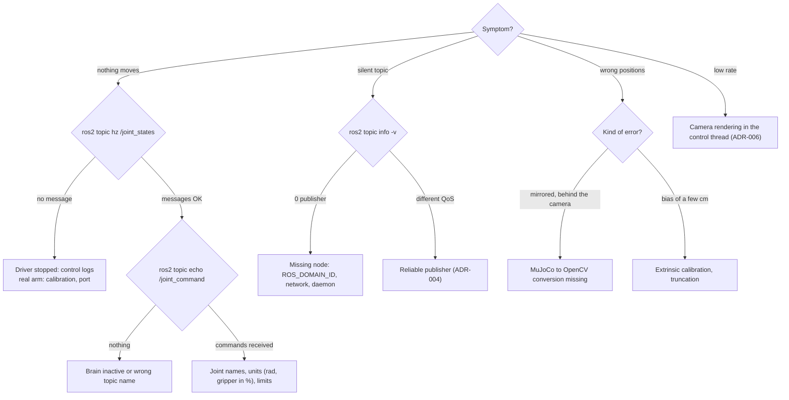

# 13 — Runbook: operations and troubleshooting

> Author: [OPS] · Contributions: everyone. **Add a row for every problem you solve.**

## 1. Everyday commands

`tools/so101` (#133) runs the everyday commands from anywhere in the repository. It prints each `docker compose` command it runs, and `--dry-run` only prints it; `tools/so101 --help` lists them. With `USE_SIM=false` in `docker/.env` they run the real arm, after the checklist of `07` §7; `bench` and `robustness` are simulation tools.

```bash
# Build, start, stop
tools/so101 build                         # the images (~10 min the first time); again after a Dockerfile change
tools/so101 up                            # control, perception, viz; perception builds its packages, then starts
tools/so101 up --game                     # the Connect Four game instead (sim only; or CONNECT4=true tools/so101 up); down, then up, to come back
tools/so101 wait                          # until the running stack is ready: the first start builds the workspace
tools/so101 demo                          # the pick & place in one command (sim only): up, wait, a console of cycles with their times
tools/so101 demo --game                   # the game in one command: up --game, wait, play
tools/so101 logs                          # control's logs: wait for "Brain node ready." (logs perception, logs viz)
tools/so101 restart                       # reload Python code changes (symlink-install); restart perception too
tools/so101 down                          # SIGINT → destroy_node() → clean stop

# A cycle, the bench, the tests
tools/so101 cycle                         # /sim/randomize (sim), /brain/start, then /brain_state until DONE or ERROR
tools/so101 play                          # game mode (tools/so101 up --game): Connect Four from this terminal
                                          # keys: 1 to 7 a column, ? a hint, a the computer plays your turns, n / r a new game,
                                          # e m h the level, s stop, q quit
tools/so101 bench --game -n 3             # measured Connect Four games against a scripted player; its own stack, domain 77
tools/so101 bench --perception -n 10      # evaluation bench, real pipeline, on ROS domain 77 (below)
tools/so101 bench --stub -n 10            # the same with the ground-truth stub in place of perception
tools/so101 robustness 3a                 # a case of the robustness demo, on ROS domain 78, the stack stopped
tools/so101 robustness 5 --lighting dim   # case 5 under the dim light (-n N cycles, 5 by default)
tools/so101 robustness g2                 # the same questions asked of a Connect Four game: g1 to g6 (g5: --lighting dim); g7, g8: the grid set down elsewhere
tools/so101 test                          # all our packages, in a new control container (no stack needed)
tools/so101 test so101_brain -k fsm       # one package; the options go to pytest: the fast loop on one test
tools/so101 run 'colcon test --packages-select so101_brain'   # next to someone's stack: a throwaway container,
# no network, the sources copied and built there; --stack starts the sim first (--game: in game mode),
# --out DIR is mounted at /out
# A full run: stop the stack first (tools/so101 down). The planner's timing tests (p95 under 1 s) fail when the
# simulation shares the CPU; colcon test gives each package its own free ROS domain anyway.

# ROS shell inside the container (the workspace sourced), RViz
tools/so101 shell
tools/so101 rviz

# Rebuild after changing setup.py / package.xml / .srv
cd /ros2_ws && colcon build --symlink-install && source install/setup.bash

# Introspection
ros2 node list ; ros2 topic list ; ros2 topic hz /joint_states
ros2 topic info -v /external_cam/image_raw     # QoS of publishers and subscribers
ros2 topic echo --once /object_position
ros2 service call /brain/start std_srvs/srv/Trigger    # a full cycle (tools/so101 cycle randomizes first)
ros2 service call /sim/randomize std_srvs/srv/Trigger  # sim: new cube and box positions
ros2 service call /brain/handover std_srvs/srv/Trigger       # game mode: the jaws open, the arm to HANDOVER
ros2 service call /sim/connect4/give_token std_srvs/srv/Trigger  # game mode: a token of the robot's color between the jaws, for /brain/drop (06 §5.1)
ros2 service call /sim/connect4/fill_dispenser std_srvs/srv/Trigger  # game mode: the robot's tokens that are not in the grid back in the rails
ros2 service call /sim/connect4/move_grid so101_interfaces/srv/MoveGrid "{nearer: 0.01, around: 0.05}"  # game mode: the empty grid set down elsewhere; zeros: back
rviz2 -d /ros2_ws/install/so101_bringup/share/so101_bringup/rviz/so101.rviz     # connect4.rviz in game mode: the board and the grid's 3D shapes shown, the pick & place displays off

# Manual commands
ros2 topic pub --once -w 1 --keep-alive 1 /joint_command sensor_msgs/msg/JointState '{name: [shoulder_pan], position: [0.5]}'
ros2 topic pub --once -w 1 --keep-alive 1 /joint_command sensor_msgs/msg/JointState '{name: [gripper], position: [100.0]}'
ros2 service call /go_to_target so101_interfaces/srv/GoToTarget \
  '{target_pose: {header: {frame_id: base_link}, pose: {position: {x: 0.22, y: 0.0, z: 0.08}}}}'

# The bench (step 4.3a) starts its own driver (with the ground truth, for the bench only, C-06), brain and
# perception (or the ground-truth stub, development only, step 4.2c) on ROS domain 77, never the stack's 69, runs
# evaluate, then stops them. It refuses to start when a stack already answers on 77. CSV in ros2_ws/eval_bench.csv;
# --bags /ros2_ws/bags keeps a rosbag of each failed episode in ros2_ws/bags. To watch it, RViz on the same domain:
cd docker && docker compose exec -e ROS_DOMAIN_ID=77 control bash -lc "source /ros2_ws/install/setup.bash && \
  (ros2 launch so101_description viz.launch.py &) && rviz2 -d /ros2_ws/install/so101_bringup/share/so101_bringup/rviz/so101.rviz"

# Record an episode
ros2 bag record -o ep_$(date +%H%M%S) /joint_states /joint_command /object_position /drop_box_position /brain_state

# Real webcam (step 6.2a, 02 §5.2): attach it, find its color capture node (index 0), lock its settings (07 §5)
"/mnt/c/Program Files/usbipd-win/usbipd.exe" attach --wsl --busid <X-Y>   # Windows loses it until detach
for f in /sys/class/video4linux/video*; do echo "$f $(cat $f/name) index=$(cat $f/index)"; done
sudo apt install -y v4l-utils && v4l2-ctl -d /dev/video0 --list-ctrls    # on the WSL host: not in the image
v4l2-ctl -d /dev/video0 -c auto_exposure=1 -c exposure_time_absolute=200 -c white_balance_automatic=0 \
  -c white_balance_temperature=4500 -c focus_automatic_continuous=0       # names depend on the camera
# The webcam with the SIM arm (real images, no real arm), on another ROS_DOMAIN_ID than the stack's driver
docker compose exec control bash -lc "source /ros2_ws/install/setup.bash && export ROS_DOMAIN_ID=78 && \
  ros2 run so101_driver driver --ros-args -p camera_device:=/dev/video0 -p camera_width:=640 -p camera_height:=480"
docker compose exec control bash -lc "source /ros2_ws/install/setup.bash && export ROS_DOMAIN_ID=78 && \
  ros2 topic hz /external_cam/camera_info"  # 10 Hz, sent with each image (needs camera_info_file); on the
# 640x480 images themselves ros2 topic hz reads about 1 Hz: its subscription is best effort and loses the
# 0.9 MB images; a Reliable subscriber, as the board reader, gets the 10 Hz [MES-67]
"/mnt/c/Program Files/usbipd-win/usbipd.exe" detach --busid <X-Y>

# Real arm, the stack stopped (tools/so101 down), port and file from docker/.env (07 §3.1, #199)
tools/so101-arm calibrate                 # back up CALIBRATION_FILE, then LeRobot's calibration and its prompts
tools/so101-arm zero-offsets -n 3         # read-only, the arm held at the URDF zero: the joint_zero_offsets line

# Local quality checks (host, repo root)
pre-commit run --all-files && bash tools/ci/guards.sh
```

## 2. Troubleshooting



Per-symptom details:

| Symptom | Likely cause | Fix |
| --- | --- | --- |
| `ros2 topic pub --once /joint_command …` has no effect (driver fine) | The short-lived CLI process exits before DDS discovery/delivery completes (measured 0/8 applied) [MES-26] | `ros2 topic pub --once -w 1 --keep-alive 1 …` (8/8), or `-w 1 -r 10 -t 10` |
| Arm "in pieces" in RViz | No `/joint_states` (driver stopped) or wrong joint names | `ros2 topic hz /joint_states`; names = URDF names |
| `ros2 topic echo` receives nothing, no error | **QoS mismatch** (Best-effort publisher, Reliable subscriber) | `ros2 topic info -v`; publish Reliable (ADR-004) |
| Topic invisible from the other container | Different `ROS_DOMAIN_ID`, network, or cached ROS daemon | Same `.env`; `ros2 daemon stop`; `ros2 topic list --no-daemon` |
| `ros2 topic echo`: "Could not determine the type" right after startup | DDS discovery not finished yet | Wait 2–3 s or pass the type: `ros2 topic echo /chatter std_msgs/msg/String` |
| `/chatter` shows two interleaved counters (`tek5 6542`, `tek5 207`, …) | Two talkers on the same domain: an earlier `ros2 run example_py_pkg talker` still running | `ros2 node list` shows `/talker` twice; Ctrl-C the old one, or `docker compose restart control` |
| `docker images` lists no `tek5/*` image; `docker compose up` builds again | Docker Desktop lost its images (seen twice, on 2026-10-16 and 2026-10-21) | `cd docker && docker compose build`: a few minutes, the build cache survives |
| `ros2 topic list` empty **from WSL** | Expected: native ROS and the Docker bridge network are separate | Use `docker compose exec control bash` |
| `colcon`: "Permission denied" on `build/`/`install/` | Files created by root in the container | `sudo rm -rf ros2_ws/{build,install,log}`; never build outside the container |
| Editing `sim/` code changes nothing | `so101_sim` is installed **non-editable** in the image | Do not modify `sim/` (ADR-018); otherwise `docker compose build` |
| `tools/so101 cycle`: "the stack runs the game", `tools/so101 play`: "the stack does not run the game", or `tools/so101 up`: "the stack runs …: tools/so101 down first" | The stack is in the other mode, and an `up` never changes the mode of a running stack: `CONNECT4=true` was given to the last `up` (or is set in `docker/.env`), or was not. `restart` keeps the mode of the last `up` | `tools/so101 down`, then `tools/so101 up` (pick & place) or `tools/so101 up --game` (the game; `tools/so101 demo` also waits and opens the console) |
| `tools/so101 play`: "waiting: no /connect4/grid_pose…" for more than a minute, in game mode | `/connect4/state` says `ready: false`, and `not_ready` names what the game node waits for: the brain's first pose, the grid's pose from the board reader, the brain's services and, with `token_source: dispenser`, the dispenser's pose and a first read of its stations. The perception container builds its packages before it starts the reader | `tools/so101 logs perception` until "Board reader ready."; `tools/so101 logs` for "Game node ready." |
| `tools/so101 play`: "waiting: column 7: unsafe_path:column", or `unreachable`, `not_edge_on`, with a station too | The brain would not play there (`phase2/P2-02` §2.5): the grid or the dispenser stands too near the arm, too far, or its slots are not in a plane through the arm's pan axis. The columns and the stations are numbered as the console's keys. "waiting: checking where the grid stands" lasts about 4 s after a start or a move of the grid | Set the grid or the dispenser down again: the game asks the brain again once the camera sees it 5 mm or 2° elsewhere. The brain's log says how near the arm would pass (`/brain/drop: unsafe_path:column, -2.5 mm from the grid`) |
| The game stops in `FIX_BOARD` | The grid seen is not the one the game expects: `not_seen:human` (no new red token after `human_done`), `not_seen:robot` (its token did not show), `board_not_empty` (tokens left at a new game), `unexpected_token` (a token while the robot was to play), `not_one_human_token` or `not_one_robot_token` (two tokens, the wrong color, or not where a token lands), or the reader's reason (`markers:<n>`: a hidden marker; `out_of_view`: a cell outside the image; `gravity:<column>`, `counts:<h>-<r>`: an impossible board). The arm does not move | Sim: `n` in the console, a new game clears the grid. With a real grid: put the tokens right, then `/connect4/human_done` reads again |
| No `/connect4/dispenser_pose`, or `/connect4/stations` stays silent | Fewer than 3 of the dispenser's 4 markers (ids 14 to 17, on its marker plate) are in the image, or a station lies outside it | Look at `/connect4/debug_image`: a ring is drawn at each station once the dispenser is placed. Clear what hides the marker plate; in simulation the layout's `dispenser.placement` puts it in view (`phase2/P2-02` §3) |
| The game waits in `WAIT_HUMAN`, reason `no_token` or `token_lost` | The jaws closed on nothing (`no_token`), or the robot's token did not show on the grid (`token_lost`): the turn is still the robot's | The console answers by itself. By hand: `/connect4/human_done`, and the robot takes a token again at the dispenser; with `token_source: hand`, `/sim/connect4/give_token` first |
| The game waits in `WAIT_HUMAN`, reason `dispenser_empty` or `dispenser_not_seen` | No station of the dispenser holds a token, or no read of `/connect4/stations` came within 5 s of the robot's move (a hidden marker, the reader stopped). The arm has not moved | The console fills the dispenser by itself. By hand: `/sim/connect4/fill_dispenser`, or clear what hides the marker plate, then `/connect4/human_done` |
| The game ends in `ERROR` | `stopped` (`s`, `/connect4/stop`), `timeout:MOVE` or `timeout:THINK`, `brain_refused:<message>` (`not_at_handover`: `/brain/drop` and `/brain/pick` start from `HANDOVER` only; `unreachable`, `not_edge_on`, `unsafe_path:<step>`: the grid or the dispenser moved during the game to where the brain would not play, `phase2/P2-02` §2.5) | `n` starts a new game: it brings the arm back to `HANDOVER` first. The brain's log line of the move says in which step it ended |
| RViz: "could not connect to display" | X11 not allowed | `xhost +local:docker`; `DISPLAY` passed by compose |
| Irregular `/joint_states` while the camera runs | Rendering (~50 ms) in the control thread | Render on a copy in a dedicated thread (ADR-006): what the driver does (`03` §3); a regression if it changes |
| IK "unreachable" on nearby targets | Seeds with the wrong pan sign, or azimuth taken from the origin | `pan = −azimuth` from the pan axis, x = 3.88 cm (ADR-005) |
| Perceived positions mirrored / behind the camera | MuJoCo/OpenCV convention not converted | `R = R_mj @ diag(1, −1, −1)` (`05` §3.1) |
| Cube off by a few cm near the bottom of the image | Truncated detection (21 % of the cubes with the provided camera, none with ours [MES-45]) | Perception marks it `TRUNCATED` and publishes nothing (`05` §2.3); check the camera pose (`05` §6) |
| Gripper closed "on nothing", but holds the cube | Gripper position is not a reliable indicator | Use the normalized effort (ADR-016) |
| `usbipd attach`: "Device busy (exported)" | Windows uses the device (Teams, Discord, browser) | Close the app; last resort `usbipd bind --force` |
| Webcam: `select() timeout`, 0 frames | YUYV through usbip | `fourcc="MJPG"` (ADR-007) |
| Several `/dev/video*` | Capture, metadata, infrared | `cat /sys/class/video4linux/video*/name` and `index` (0 = capture) |
| Real driver stuck at startup | `calibrate()` waits for `input()` | `connect(calibrate=False)` (provided code); provide the calibration file |
| Real driver: "does not match the motors: wrong file for this arm?" | Calibration file from another arm, or reconfigured motors | Check the file (arm ID); otherwise recalibrate (`tools/so101-arm calibrate`, `07` §3.1). Never force-write the calibration |
| RViz shows no arm and no image, real arm | The driver died at its start: it also publishes the camera, and fails on the arm first. "does not match the motors": another arm or another calibration | `tools/so101 logs`; `07` §9 step 5 |
| The image stops; driver log "read thread is not running", brain `ERROR:object_lost`; `usbipd list` shows the webcam `Shared`, not `Attached` | The usbip link dropped ("connection reset by peer" in `dmesg`): three times on 2026-11-06, every 30 to 40 min [MES-61]. The driver does not reopen the camera | The stack stopped first, or the webcam comes back as `/dev/video1`: `tools/so101 down && usbipd.exe attach --wsl --busid <X-Y> && tools/so101 up` |
| Perception container `Exited`, `USE_SIM=false`: "No such file" on `camera_extrinsics_real.yaml` | No real pose yet | `07` §9 step 9, then `tools/so101 restart perception`; the driver and RViz keep working |
| `ERROR:timeout:<state>` on the real arm, the arm in place | `reach_tol_rad`, or `wrist_roll` past `reach_tol_roll_rad`: the log gives the joint error | `07` §4; measure, then `brain_real.yaml` |
| `GRASP → RETRY`, "empty gripper", the cube in the jaws | `gripper` in the log is under `close_pct + hold_gap_pct` | `07` §9 step 11 |
| `ERROR:unreachable` or `drop_unreachable`, real arm | Cube past about 29 cm of the pan axis, target under 14 cm | The working area: 18 to 28 cm (`07` §4) |
| The calibration wrote a gripper range of 1 step | The gripper was not moved at the last prompt | `tools/so101-arm calibrate` now refuses it: again, gripper to both stops |
| `tools/so101 test` fails on perception with `USE_SIM=false` in `.env` | A test not pinned to the sim | `USE_SIM=true tools/so101 test …` |
| "No calibration" although `CALIBRATION_FILE` is set | Path does not exist: compose created an **empty root-owned directory** | Fix the path; `sudo rm -rf` the created directory |
| Real arm: the driver dies on `stop` with `ValueError: max_relative_target keys must match`, torque left on | A shutdown move that sent the 5 arm joints only (fixed, #194) | Update; meanwhile hold the arm and cut its power |
| Real arm: no webcam images, `ros2 param get /so101_driver camera_device` empty | `driver.yaml` loaded after `driver_real.yaml` (fixed, #197) | Update; check `camera_device` is `/dev/video0` after each start |
| Real arm: RViz shows links inside each other, the elbow cannot reach `PARK` (`Relative goal position magnitude had to be clamped`) | The joint zeros of LeRobot differ from the URDF's (`07` §4) | The stack stopped, the arm held at the URDF zero: `tools/so101-arm zero-offsets -n 3`, its line in `joint_zero_offsets` (`driver_real.yaml`, #196) |
| The real arm collapses on shutdown; log "Shutdown pose not reached" | The move to `PARK` before `disconnect()` ran out of its 11 s (a blocked joint), or the bus was lost (no move) | Stop the arm near `PARK` (the brain parks it after each cycle); hold the forearm (`03` §8) |
| Real arm: a joint stays short of the ghost arm ("Commanded arm (ghost)" ticked) at rest | Gravity sag or the servo's P gain on that joint (#200); a gap that grows with speed is a lag | Note the gap per joint; a large steady gap: check the load and the calibration (`07` §4) |
| Real arm: `/joint_states` stops; log "Bus lost after 3 retries" | Serial bus: cable, servo board power, usbipd detached (`ls /dev/ttyACM*`) | Fix the link, then `tools/so101 restart` |
| Real arm: the gripper stalls on the cube, then every bus read and write fails (`Overload`), the brain ends in `ERROR` | The gripper driven far past the cube: `grasp.close_pct` too low (0 % on the cube trips it, MES-56) | Power-cycle the arm (the torque cannot be cut otherwise); measure the contact opening and set `grasp.close_pct` just below it in `brain_real.yaml` (#69) |
| Driver log "No camera image: Failed to open" | Webcam not attached (`usbipd attach`), or `camera_device` is not its color capture node (index 0) | `02` §5.2; `cat /sys/class/video4linux/video*/name` |
| Driver log "No camera image: … failed to capture frames during warmup" | Not in MJPG (YUYV gives 0 frames through usbip [MES-17]), or the webcam is busy in Windows | Close the Windows app using it; the driver asks for MJPG, check the log for a fourcc warning |
| Driver log "Camera: … latest frame is too old" | The usbip stream stalled | `usbipd detach`, then `attach` again |
| The cube bounces out of the box | Released too high | `grasp.drop_tcp_z_m` ≈ 0.09 + `VERIFY` state |
| RViz crashes (segfault, no log) when a **Pose** display is unchecked | Upstream rviz2 bug (14.1.24): the display frees its handler while messages keep arriving | Do not uncheck it: remove the display or close RViz |
| `/end_effector_pose` hard to see in RViz | Pose display drawn as a 1.3 m arrow by default | Shape `Axes`, length 0.05 m; check the topic name with `ros2 topic list` |
| RViz: "Frame [map] does not exist", no arm | RViz started without the project configuration | `rviz2 -d /ros2_ws/install/so101_bringup/share/so101_bringup/rviz/so101.rviz` (Fixed Frame `world`) |
| RViz shows an empty image panel ("No Image") for a display that is unticked | In the `.rviz` file the display has `Enabled: false` with `Value: true`: RViz shows the panel at `Value` and never hides it (#283) | Set both keys alike; `so101_bringup/test/test_rviz.py` checks the two files |
| Real driver: "could not open port /dev/ttyACM0" after replugging the arm | Windows took the USB device back | `usbipd attach --wsl --busid <X-Y>` again, or `--auto-attach` (`02` §5.1) |
| Every 30 s on WSL2, `/joint_states` stops and a motion freezes for ~2.6 s | The system clock steps back (WSL2 time sync); timers or durations on the ROS clock | Schedule on the steady clock, durations with `time.monotonic()`; in tests, count messages instead of fixed windows [MES-37] |
| Brain dies with "x0 is infeasible" on `/go_to_target` | IK seed (measured joints) slightly outside the URDF bounds | Clip the seed into the bounds before ikpy (`04` §8) |
| The whole sim arm freezes after a manual command | A NaN in `/joint_command` reached MuJoCo, which then resets every step | Driver rejects non-finite values (step 1.1); never publish NaN |
| `docker compose up`: "pull access denied for tek5/control" | Local images deleted (prune), so compose tries to pull them | `docker compose build` first |
| A node stops at startup: "Unknown parameters ['…']: a typo in a config file?" | A key in a `config/*.yaml` file, or a `-p` argument, that the node does not declare; ROS would ignore it (#57) | Fix the name: the declared names are in `01` §3.3, `05` and `06` §6 |
| `import pinocchio`: "No module named pinocchio" | Pinocchio comes from the ROS apt package | `source /opt/ros/jazzy/setup.bash` first |
| Real arm: computed TCP below the table at rest (z < 0) | LeRobot's zero (middle of the recorded range) ≠ URDF zero [MES-30] | Ruler check of the rest pose; per-joint offset (`07` §4) |
| `colcon test` fails on a package without tests ("NO TESTS RAN") | Python 3.12 unittest exits 5 when it finds no test | Test only packages with a `test/` folder (`ci.yml` does it). A package's **first** test also needs `tests_require=["pytest"]` in `setup.py` and `<test_depend>python3-pytest</test_depend>` in `package.xml`, otherwise colcon falls back to unittest: same exit 5 |
| CI jobs all skipped | `CI_ENABLED` variable missing on the private repo | Settings → Variables → `CI_ENABLED=true` (`14` §10) |
| A change pushed to the school repo disappeared | The mirror force-pushes `main` (`16` §3) | Never push there: go through a PR on the private repo |
| pre-commit: markdownlint fails to install (`libatomic.so.1`) | Minimal image without libatomic | `apt-get install libatomic1` (present on Ubuntu and GitHub runners) |
| `pip install pre-commit`: "externally-managed-environment" | Ubuntu 24.04 refuses pip outside a virtual environment (PEP 668) | `sudo apt install pre-commit`, or `pipx install pre-commit` (CONTRIBUTING §1) |
| A build or `up` fails on Windows; Docker Desktop stops or its disk is full | Docker Desktop's virtual disk lives on `C:`; the build cache alone reached 16.6 GB, beyond the images' 7 GB (#58) | `docker builder prune` (every project's cache: the next builds are slower); free space on `C:` |
| `tools/so101 bench` prints `the driver answered…`, then nothing for a minute | Episode 1 waits for the stack to start; then one line per episode as it ends, about 15 s each (#58) | Wait |
| `tools/so101 bench`: "a stack already runs on ROS domain 77" right after a Ctrl-C | The previous bench's stack is still stopping | Wait a few seconds, then again. From a terminal, Ctrl-C reaches the bench in the container (#58) |
| A launch test times out ("did not answer"), or `ERROR:no_joint_states` in a cycle, or a game in `ERROR:brain_refused:no_joint_states` | The CPU is shared: RViz (~290 % CPU in software rendering), a second stack, the robustness demo; on WSL2 `/joint_states` also stalled 0.5–1.4 s twice in about 80 cycles (#103), not reproduced by a stack alone [MES-51]. With Fast DDS's shared-memory transport (`FASTDDS_BUILTIN_TRANSPORTS` at `DEFAULT` or `LARGE_DATA`, or an image built before #274 started by hand), a process that joins the ROS graph (RViz, `ros2 bag record`, a `ros2` command) holds the driver's executor for 0.3 s about once in ten, 0.85 s at least on the nightly's runner [MES-80] | Run the tests alone (`tools/so101 down`, RViz closed); `echo $FASTDDS_BUILTIN_TRANSPORTS` in the container says `UDPv4` (else `tools/so101 down`, rebuild the images, `up`); after `ERROR:no_joint_states`, `/brain/start` re-arms. The driver's log tells who stalled: `… s late: the driver's executor was held` is the driver (#176); no such line, the messages were late on the way or the brain starved |
| The robustness demo prints "2 drivers on this ROS domain" | It runs next to another stack on its domain | `tools/so101 down`, then `tools/so101 robustness <case>` (its own container and domain; it refuses to start next to the stack) |
| Under a dim, warm light the perception debug image paints the floor as box, and every cycle ends `ERROR:object_lost` | The tinted floor falls in the box's HSV range and the box gets too dark [MES-49] | Fixed in sim by #175: saturation floors keep the lit floor out of the box's range [MES-52]. If it comes back (another light, the real camera), measure the colors with `exp_lighting_hsv.py` and adjust the HSV floors of `perception.yaml`; on the real arm, fixed exposure and white balance (`07` §4) |
