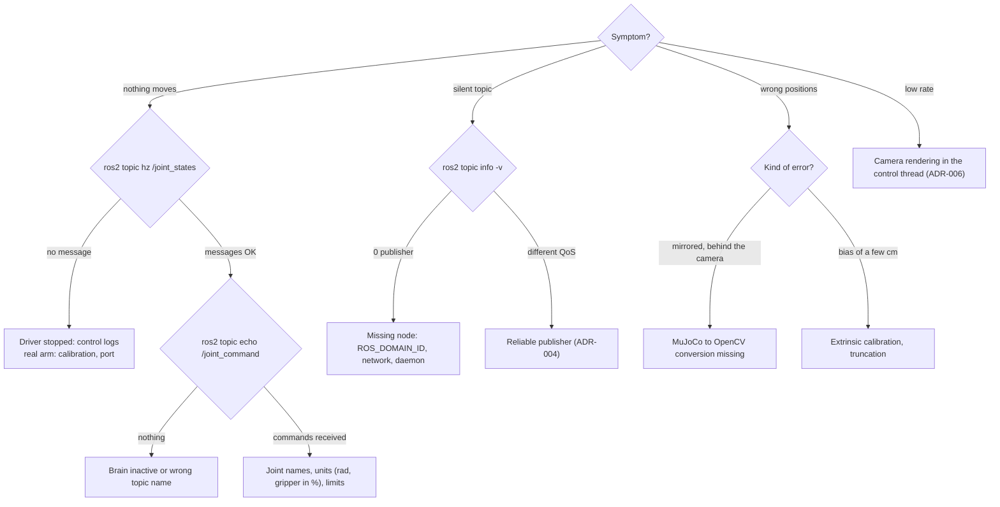

# 13 — Runbook: operations and troubleshooting

> Author: [OPS] · Contributions: everyone. **Add a row for every problem you solve.**

## 1. Everyday commands

```bash
# Start / stop
cd docker && docker compose up -d control perception viz   # perception builds its packages, then starts
docker compose logs -f control            # wait for "Brain node ready."
docker compose restart control            # reload Python code changes (symlink-install)
docker compose down                       # SIGINT → destroy_node() → clean stop

# ROS shell inside the container
docker compose exec control bash
source /ros2_ws/install/setup.bash

# Rebuild after changing setup.py / package.xml / .srv
cd /ros2_ws && colcon build --symlink-install && source install/setup.bash

# Introspection
ros2 node list ; ros2 topic list ; ros2 topic hz /joint_states
ros2 topic info -v /external_cam/image_raw     # QoS of publishers and subscribers
ros2 topic echo --once /object_position
ros2 service call /brain/start std_srvs/srv/Trigger    # parks, then WAIT_TARGET (full cycle: perception, or the stub below)
ros2 service call /sim/randomize std_srvs/srv/Trigger  # sim: new cube and box positions
rviz2 -d /ros2_ws/install/so101_bringup/share/so101_bringup/rviz/so101.rviz

# Manual commands
ros2 topic pub --once -w 1 --keep-alive 1 /joint_command sensor_msgs/msg/JointState '{name: [shoulder_pan], position: [0.5]}'
ros2 topic pub --once -w 1 --keep-alive 1 /joint_command sensor_msgs/msg/JointState '{name: [gripper], position: [100.0]}'
ros2 service call /go_to_target so101_interfaces/srv/GoToTarget \
  '{target_pose: {header: {frame_id: base_link}, pose: {position: {x: 0.22, y: 0.0, z: 0.08}}}}'

# Development only (step 4.2c): a full cycle before perception, the ground truth standing in for it (C-06).
# Its own driver and brain: on another ROS_DOMAIN_ID than the running stack. Then RViz on the same domain.
docker compose exec control bash -lc "source /ros2_ws/install/setup.bash && export ROS_DOMAIN_ID=77 && \
  (ros2 launch so101_description viz.launch.py &) && ros2 launch /ros2_ws/src/so101_bringup/test/gt_stub.launch.py"
docker compose exec control bash -lc "source /ros2_ws/install/setup.bash && export ROS_DOMAIN_ID=77 && \
  ros2 service call /sim/randomize std_srvs/srv/Trigger && ros2 service call /brain/start std_srvs/srv/Trigger"

# Evaluation bench on the real pipeline (step 4.3a): driver with the ground truth for the bench only, brain and
# the real perception, on their own ROS_DOMAIN_ID. Stop the ground-truth stub above first: one stack per domain.
docker compose exec control bash -lc "source /ros2_ws/install/setup.bash && export ROS_DOMAIN_ID=77 && \
  ros2 launch so101_bringup sim.launch.py expose_ground_truth:=true perception:=true"
docker compose exec control bash -lc "source /ros2_ws/install/setup.bash && export ROS_DOMAIN_ID=77 && \
  ros2 run so101_bringup evaluate --episodes 10 --out /tmp/eval.csv --bags /tmp/bags && cat /tmp/eval.csv"

# Record an episode
ros2 bag record -o ep_$(date +%H%M%S) /joint_states /joint_command /object_position /drop_box_position /brain_state

# Local quality checks (host, repo root)
pre-commit run --all-files && bash tools/ci/guards.sh
```

## 2. Troubleshooting



Per-symptom details:

| Symptom | Likely cause | Fix |
| --- | --- | --- |
| `ros2 topic pub --once /joint_command …` has no effect (driver fine) | The short-lived CLI process exits before DDS discovery/delivery completes (measured 0/8 applied) [MES-26] | `ros2 topic pub --once -w 1 --keep-alive 1 …` (8/8), or `-w 1 -r 10 -t 10` |
| Arm "in pieces" in RViz | No `/joint_states` (driver stopped) or wrong joint names | `ros2 topic hz /joint_states`; names = URDF names |
| `ros2 topic echo` receives nothing, no error | **QoS mismatch** (Best-effort publisher, Reliable subscriber) | `ros2 topic info -v`; publish Reliable (ADR-004) |
| Topic invisible from the other container | Different `ROS_DOMAIN_ID`, network, or cached ROS daemon | Same `.env`; `ros2 daemon stop`; `ros2 topic list --no-daemon` |
| `ros2 topic echo`: "Could not determine the type" right after startup | DDS discovery not finished yet | Wait 2–3 s or pass the type: `ros2 topic echo /chatter std_msgs/msg/String` |
| `ros2 topic list` empty **from WSL** | Expected: native ROS and the Docker bridge network are separate | Use `docker compose exec control bash` |
| `colcon`: "Permission denied" on `build/`/`install/` | Files created by root in the container | `sudo rm -rf ros2_ws/{build,install,log}`; never build outside the container |
| Editing `sim/` code changes nothing | `so101_sim` is installed **non-editable** in the image | Do not modify `sim/` (ADR-018); otherwise `docker compose build` |
| RViz: "could not connect to display" | X11 not allowed | `xhost +local:docker`; `DISPLAY` passed by compose |
| Irregular `/joint_states` while the camera runs | Rendering (~50 ms) in the control thread | Render on a copy in a dedicated thread (ADR-006) — done in the bootstrap prototype; keep it when writing step 1.2 |
| IK "unreachable" on nearby targets | Seeds with the wrong pan sign, or azimuth taken from the origin | `pan = −azimuth` from the pan axis, x = 3.88 cm (ADR-005) |
| Perceived positions mirrored / behind the camera | MuJoCo/OpenCV convention not converted | `R = R_mj @ diag(1, −1, −1)` (`05` §3.1) |
| Cube off by a few cm near the bottom of the image | Truncated detection (21 % of cases) | Mark and do not publish, or far-edge method (`05` §6) |
| Gripper closed "on nothing", but holds the cube | Gripper position is not a reliable indicator | Use the normalized effort (ADR-016) |
| `usbipd attach`: "Device busy (exported)" | Windows uses the device (Teams, Discord, browser) | Close the app; last resort `usbipd bind --force` |
| Webcam: `select() timeout`, 0 frames | YUYV through usbip | `fourcc="MJPG"` (ADR-007) |
| Several `/dev/video*` | Capture, metadata, infrared | `cat /sys/class/video4linux/video*/name` and `index` (0 = capture) |
| Real driver stuck at startup | `calibrate()` waits for `input()` | `connect(calibrate=False)` (provided code); provide the calibration file |
| Real driver: "does not match the motors: wrong file for this arm?" | Calibration file from another arm, or reconfigured motors | Check the file (arm ID); otherwise recalibrate (`07` §3.1). Never force-write the calibration |
| Real arm limp, ignores `/joint_command`; log "Torque disabled" | The provided `disable_torque()` lines of upstream #2 are active | Comment them out (`07` §3.1 step 6, ADR-032) |
| "No calibration" although `CALIBRATION_FILE` is set | Path does not exist: compose created an **empty root-owned directory** | Fix the path; `sudo rm -rf` the created directory |
| The real arm collapses on shutdown | Torque cut by `disconnect()` | PARK before `disconnect()` (ADR-023) |
| The cube bounces out of the box | Released too high | `grasp.drop_tcp_z_m` ≈ 0.09 + `VERIFY` state |
| RViz crashes (segfault, no log) when a **Pose** display is unchecked | Upstream rviz2 bug (14.1.24): the display frees its handler while messages keep arriving | Do not uncheck it: remove the display or close RViz |
| `/end_effector_pose` hard to see in RViz | Pose display drawn as a 1.3 m arrow by default | Shape `Axes`, length 0.05 m; check the topic name with `ros2 topic list` |
| RViz: "Frame [map] does not exist", no arm | RViz started without the project configuration | `rviz2 -d /ros2_ws/install/so101_bringup/share/so101_bringup/rviz/so101.rviz` (Fixed Frame `world`) |
| Real driver: "could not open port /dev/ttyACM0" after replugging the arm | Windows took the USB device back | `usbipd attach --wsl --busid <X-Y>` again, or `--auto-attach` (`02` §5.1) |
| Every 30 s on WSL2, `/joint_states` stops and a motion freezes for ~2.6 s | The system clock steps back (WSL2 time sync); timers or durations on the ROS clock | Schedule on the steady clock, durations with `time.monotonic()`; in tests, count messages instead of fixed windows [MES-37] |
| Brain dies with "x0 is infeasible" on `/go_to_target` | IK seed (measured joints) slightly outside the URDF bounds | Clip the seed into the bounds before ikpy (`04` §8) |
| The whole sim arm freezes after a manual command | A NaN in `/joint_command` reached MuJoCo, which then resets every step | Driver rejects non-finite values (step 1.1); never publish NaN |
| `docker compose up`: "pull access denied for tek5/control" | Local images deleted (prune), so compose tries to pull them | `docker compose build` first |
| `import pinocchio`: "No module named pinocchio" | Pinocchio comes from the ROS apt package | `source /opt/ros/jazzy/setup.bash` first |
| Real arm: computed TCP below the table at rest (z < 0) | LeRobot's zero (middle of the recorded range) ≠ URDF zero [MES-30] | Ruler check of the rest pose; per-joint offset (`07` §4) |
| `colcon test` fails on a package without tests ("NO TESTS RAN") | Python 3.12 unittest exits 5 when it finds no test | Test only packages with a `test/` folder (`ci.yml` does it). A package's **first** test also needs `tests_require=["pytest"]` in `setup.py` and `<test_depend>python3-pytest</test_depend>` in `package.xml`, otherwise colcon falls back to unittest: same exit 5 |
| CI jobs all skipped | `CI_ENABLED` variable missing on the private repo | Settings → Variables → `CI_ENABLED=true` (`14` §10) |
| A change pushed to the school repo disappeared | The mirror force-pushes `main` (`16` §3) | Never push there: go through a PR on the private repo |
| pre-commit: markdownlint fails to install (`libatomic.so.1`) | Minimal image without libatomic | `apt-get install libatomic1` (present on Ubuntu and GitHub runners) |
