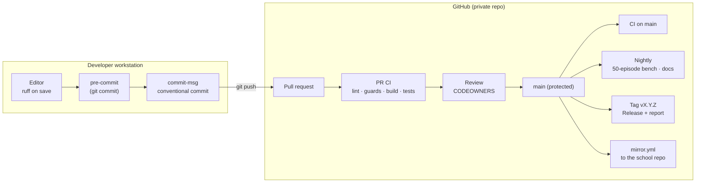
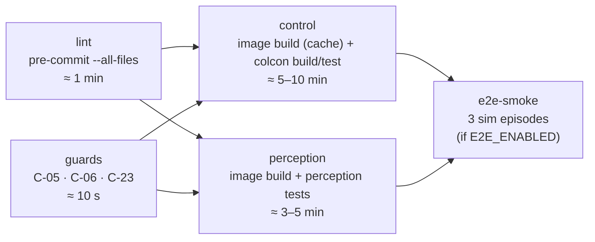
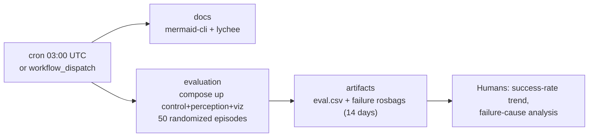
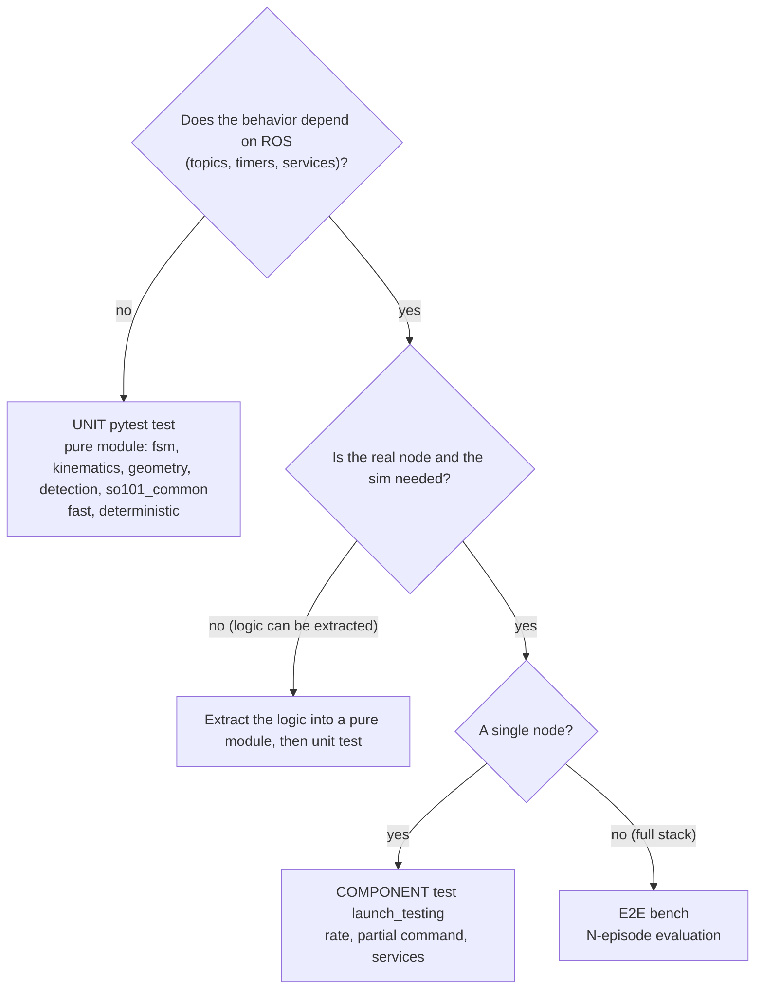

# 14 — Quality pipeline: tests, lint, continuous integration

> Authors: [QA] Quality & tests, [OPS] DevOps · Reviewers: [ARC], [CP], [CTRL]
> Decisions: ADR-019, ADR-024, ADR-025, ADR-026, ADR-030, ADR-033 · Files installed at the repository root: `.github/`, `pyproject.toml`, `.pre-commit-config.yaml`, `tools/ci/`
> **Everything described here was executed**: ruff, markdownlint, actionlint, mermaid-cli, pre-commit, `colcon test` [MES-22], [MES-23], [MES-24].

## 1. What the pipeline guarantees

| Guarantee | Mechanism | Requirement served |
| --- | --- | --- |
| The project **follows the brief's rules**, permanently | Automated guards (`tools/ci/guards.sh`) | C-05, C-06, C-23 |
| No regression is merged into `main` | Mandatory CI on every PR (protected branch) | C-42 and all |
| Homogeneous code whoever the author | ruff (lint + format), pre-commit | C-50, C-53 |
| Announced performance is **measured**, not assumed | Component tests (rates), E2E bench | C-11, C-41, C-42 |
| Documentation stays correct (diagrams render, links alive) | markdownlint, mermaid-cli, lychee | C-53 |
| Readable history attributable to each member | Conventional commits, reviewed PRs | C-07 |

## 2. Overview

### 2.1 Feedback loops

| Loop | When | Target duration | What it catches |
| --- | --- | --- | --- |
| Editor (ruff, markdownlint) | While typing | Instant | Style, imports, trivial errors |
| `pre-commit` | Every `git commit` | < 10 s | Lint, format, invalid YAML/XML/TOML, large files, private keys, commit message |
| Local tests (`colcon test --packages-select …`) | Before pushing | < 1 min per package | Unit and component regressions |
| PR CI | Every push to a PR | ≈ 10–15 min (cached) | All of the above + project-rule guards + clean build + short E2E |
| Nightly | Every night or on demand | 30–60 min | 50-episode success rate, diagrams, external links |
| Release | Every tag | — | Frozen evaluation report, release notes |

## 3. Check matrix: who checks what, and where

| Check | Editor | pre-commit | PR CI | Nightly | Tool |
| --- | --- | --- | --- | --- | --- |
| Python lint | ✅ | ✅ | ✅ | | ruff |
| Python format | ✅ | ✅ | ✅ | | ruff format |
| Markdown lint | ✅ | ✅ | ✅ | | markdownlint-cli2 |
| Valid YAML / TOML / XML | | ✅ | ✅ | | pre-commit-hooks |
| Files > 1 MB blocked, private keys | | ✅ | ✅ | | pre-commit-hooks |
| LF line endings | ✅ (editorconfig) | ✅ | ✅ | | mixed-line-ending + `.gitattributes` |
| Conventional commit message | | ✅ (commit-msg) | ✅ PR title (= the squash commit) | | conventional-pre-commit · `pr-title.yml` |
| Workflows: syntax and security (pinned actions, token scope, injection) | | ✅ | ✅ | | actionlint · zizmor |
| Shell scripts · Dockerfiles | | ✅ | ✅ | | shellcheck (warnings) · hadolint (`.hadolint.yaml`) |
| Secrets in the whole history | | | ✅ | | gitleaks |
| `package.xml` against the ROS schema | | | ✅ | | `ament_xmllint` (control job) |
| **Project-rule guards** (C-05, C-06, C-23) | | | ✅ | | `tools/ci/guards.sh` |
| `colcon` build (control and perception images) | | | ✅ | | Docker + colcon |
| Unit tests | | | ✅ | | pytest via `colcon test` |
| Component tests (real node, headless sim) | | | ✅ | | launch_testing |
| Short E2E (3 episodes) | | | ✅* | | `ros2 run so101_bringup evaluate` |
| **Full E2E (50 episodes, randomized cube and box)** | | | | ✅* | same |
| Rendering of every Mermaid diagram | | | | ✅ | mermaid-cli (`tools/ci/check_mermaid.sh`) |
| External links | | | | ✅ | lychee |

\* enabled once the bench exists (step 4.5): repository variable `E2E_ENABLED=true`. Every CI job also requires `CI_ENABLED=true` (opt-in, so nothing runs on the school mirror, `16`).

## 4. Tool choices (options considered)

| Need | Options | Choice | Why |
| --- | --- | --- | --- |
| Python lint and format | flake8 + black + isort · `ament_flake8`/`ament_pep257` (ROS ament_lint) · **ruff** | **ruff** (ADR-024) | One tool, 10–100× faster, autofix, configured in `pyproject.toml`; ament_lint imposes per-package config and redundant lint tests |
| Hook manager | husky (Node) · lefthook · **pre-commit** | **pre-commit** | Python ecosystem; **same configuration locally and in CI** |
| Commit messages | commitlint (Node) · **conventional-pre-commit** | **conventional-pre-commit** + a PR-title check | No Node install for the team. Squash merge writes the **PR title** on `main`, so a few lines of shell check it (no third-party action, no token) |
| Workflow security | none · **zizmor** · CodeQL for Actions | **zizmor** in pre-commit; actions pinned by commit SHA, updated by Dependabot (7-day cooldown) | CodeQL needs GitHub Team + Code Security on a private repository; zizmor is free and local |
| Secrets | `detect-private-key` · GitHub secret scanning · **gitleaks** | **gitleaks** on the whole history in the lint job | Secret scanning and push protection need a paid plan on a private repository; free once public |
| Code quality platform | **none for now** · SonarQube Cloud (free: private projects ≤ 50k lines, 5 users) · CodeQL | Planned: SonarQube Cloud once coverage exists (non-blocking), CodeQL and secret scanning when the repository goes public | Sonar adds a gate on new code (coverage, duplication, complexity); without coverage it adds little to ruff |
| Typing | mypy · pyright · none | **Staged**: not blocking in phase 1, then `mypy` on pure modules (`so101_common`, `kinematics`, `fsm`, `geometry`) once stable | rclpy nodes have few stubs; maximal gain on pure logic |
| Tests | unittest · **pytest** · **launch_testing** | **pytest + launch_testing** through `colcon test` | Already in the image (pytest 7.4.4, launch_testing, launch_testing_ros) [MES-23] |
| Coverage | pytest-cov · none | **Non-blocking report** on pure modules, target ≥ 80 % | `coverage` is not in the image: add it in a Docker layer when needed |
| Markdown | markdownlint-cli2 · remark | **markdownlint-cli2** | Same rules as the VS Code extension |
| Diagrams | Exported images · **Mermaid** in Markdown | **Mermaid, rendering checked in CI** (ADR-030) | Rendered natively by GitHub, versionable; broken syntax is detected |
| CI | GitLab CI · Jenkins · **GitHub Actions** | **GitHub Actions** (ADR-025) | Repo on GitHub, free for public repos, built-in Docker cache |
| CI environment | `ros-tooling/setup-ros` (native ROS on the runner) · `industrial_ci` · **our Docker images** | **Our images** | **Strict parity** with the dev workstation: mujoco, SO101Sim, numpy<2… only live in our Dockerfiles |

## 5. Pull-request CI

### 5.1 Job graph

| Job | Fails when… | Artifacts |
| --- | --- | --- |
| `lint` | A ruff, markdownlint, actionlint, zizmor, shellcheck or hadolint rule is violated, a file is not formatted, a YAML is invalid, a file exceeds 1 MB, gitleaks finds a secret in the history | Diff shown (`--show-diff-on-failure`) |
| `PR title` (`pr-title.yml`) | The PR title is not `type(scope): description` | — |
| `guards` | brain or perception imports the backend; ground truth or provided extrinsics appear in the pipeline | Offending lines |
| `control` | `colcon build` fails or a test fails (`colcon test-result --verbose`); only packages with a `test/` folder are tested | Each package's `pytest.xml` |
| `perception` | Same for the perception packages (separate build, ADR-002); **skipped until `COLCON_IGNORE` is removed** (step 3.1) | — |
| `e2e-smoke` | Fewer than 3 successful episodes out of 3 | `eval.csv` |

### 5.2 Technical notes

- **Docker cache**: `docker/build-push-action` with `cache-from/to: type=gha`. First build ≈ 10 min (apt + pip), then 1–2 min if the Dockerfiles did not change.
- **Runner disk**: the `control` image is 4.2 GB, fine on `ubuntu-24.04`; if space runs out, add a cleanup step (remove preinstalled SDKs) before the build.
- **Headless**: `MUJOCO_GL=osmesa`: sim and rendering run on CPU, no GPU or X11 [MES-02], [MES-03].
- **`concurrency`**: a new push cancels the previous run of the same PR; runs on `main` are never cancelled (each merged commit gets its full CI).
- **Supply chain**: every action pinned by commit SHA (version in a comment), updated by Dependabot after a 7-day cooldown; `persist-credentials: false` on every checkout (zizmor).
- **Minimal permissions**: `contents: read`.
- Validated by **actionlint 1.7.12: 0 error** on `ci.yml`, `nightly.yml`, `mirror.yml` [MES-23].

### 5.3 Minute budget

| Repo | GitHub quota (free plan) | Estimate | Consequence |
| --- | --- | --- | --- |
| Public | Unlimited | — | Daily nightly without constraint |
| Private, GitHub Pro (our plan) | 3,000 min/month | Measured on 2026-10-15: a cached PR run ≈ 3.4 min of jobs, ≈ 6 billed (each job rounded up to the minute); first build ≈ 10 min. 100 PR pushes ≈ 600 min, leaving room for a nightly bench (≈ 45 min) most days | Daily nightly once the bench exists; watch Settings → Billing |

## 6. Nightly

- The bench writes one CSV row per episode: poses, final state, duration, failure cause (`08` §3).
- Reports of important milestones are **versioned by hand** in `results/` (small CSV/MD), never the rosbags (ADR-029).

## 7. Tests: conventions (ADR-026)

### 7.1 Where should a test go?

### 7.2 Rules

| Rule | Detail |
| --- | --- |
| Location | `ros2_ws/src/<pkg>/test/`: `test_*.py` (unit), `test_*_launch.py` (component) |
| Declaration | `setup.py`: `tests_require=["pytest"]`; `package.xml`: `<test_depend>python3-pytest</test_depend>`, `<test_depend>launch_testing_ros</test_depend>` (done for `so101_driver`) |
| Running | `colcon test --packages-select <pkg> --event-handlers console_direct+` then `colcon test-result --verbose` |
| Determinism | Fixed seed (`seed`); no test-order dependency; no network |
| Timing tests | Measure over ≥ 3 s **after** a 1 s warm-up; explicit tolerances; values as parameters, not hard-coded |
| ⚠ Masked by the sim | MuJoCo already clamps setpoints to `ctrlrange`: a sim test does **not** prove the driver clamps (C-15). The clamp is tested at **unit** level on the command-merge function |
| Ground truth | Allowed **only** under `test/` and in the bench (C-06), enforced by the guards |
| Flaky tests | Forbidden in `main`: `@pytest.mark.flaky_quarantine` marker, excluded from CI, issue opened with a 1-week fix deadline |
| Test data | Small reference images (< 200 KB each) in `test/data/`, generated by a versioned script |

### 7.3 Example tests and what they revealed [MES-22], [MES-24]

Two tests of the bootstrap prototype (outside the repository since 2026-10-15, ADR-039), kept here as an example:

| Test | Type | Early driver | Merged driver |
| --- | --- | --- | --- |
| `test_gripper_conversion.py` (5 cases) | Unit | ✅ 5/5 | ✅ 5/5 |
| `test_driver_launch.py::test_2_partial_command…` | Component | ✅ | ✅ |
| `test_driver_launch.py::test_1_joint_states_rate` | Component | ❌ **4.7 Hz** instead of ≥ 20 (`ros2 topic hz`: 9 Hz) | ✅ **30 Hz** |

**The pipeline did its job before it was even installed**: it detected a non-compliance with the brief (C-11) that manual testing did not show (30 Hz announced in the code). The fix is ADR-006 (camera in a dedicated thread rendering a copy). Total: 6 tests in ~9.4 s.

## 8. Project-rule guards

| Guard | Pattern searched | Where | Requirement |
| --- | --- | --- | --- |
| No backend outside the driver | `SO101Sim`, `SO101Follower`, `so101_sim`, `lerobot` | `so101_brain`, `so101_perception` | C-05 |
| No ground truth in the pipeline | `get_object_position`, `get_drop_box_position`, `ground_truth` | brain, perception (outside `test/`) | C-06 |
| No launch file enables ground truth | `gt_perception_stub`, `expose_ground_truth … True` | `*.launch.py` (outside `test/`) | C-06 |
| No provided extrinsics | `get_camera_extrinsics` | perception (outside `test/`) | C-23 |

`git grep --untracked` also covers files not committed yet when run locally.

## 9. Lint on the existing code [MES-23]

State of the code with the final configuration (ruff 0.16.10), before the cleanup:

| File | Issues | Nature |
| --- | --- | --- |
| `so101_perception/perception_node.py` (provided stub) | 8 | 7 unused imports, 1 import order |
| `so101_brain/brain_node.py` | 4 | Import order, `zip()` without `strict`, long line, list concatenation |
| `so101_driver/driver_node.py` | 1 | `zip()` without `strict` |
| `so101_driver/launch/driver.launch.py` (provided) | 2 | Long lines (comments) |
| **Total** | **15** (9 auto-fixable), **7 files to reformat** | |
| *Course-provided driver (HEAD after the 2026-10-08 pull)* | *0* | *Compliant* |

What was done so that CI is green from the first push **without diverging from upstream**:

- **Team code** (`driver_node.py`, `brain_node.py`): fixed and formatted (≈ 6 lines; the provided part of the driver is untouched).
- **Provided files still identical to upstream** (perception stub, launch files, `example_py_pkg`, `ros2_ws/.gitignore`, `__init__.py` in mode 755): **excluded** in `pyproject.toml` / `.pre-commit-config.yaml` rather than modified. Remove a file from the exclusion list when the team rewrites it.
- Course content (`core/`, `sim/`, `so101_description`, `docs/SUJET.md`, slides) is excluded from every check; `docs/SUJET.md` would otherwise raise 13 markdownlint issues [RC-30].
- `docs/` and `*.md` are excluded from ruff, which also formats Python blocks inside Markdown (doc snippets are deliberately compact).
- Rule excluded after review: `N803`/`N806` (upper-case variables): `R`, `T`, `K`, `J` denote matrices by robotics convention.

Result: **13/13 pre-commit hooks green on the whole repository**, guards green, 6/6 driver tests [MES-23]. The CI command itself exited 1 at the time (packages without tests count as failed under Python 3.12); fixed on 2026-10-09 and replayed: exit 0, 6/6.

For any future mass reformatting: one dedicated `style:` commit, then its SHA in `.git-blame-ignore-revs` (`git config blame.ignoreRevsFile .git-blame-ignore-revs` locally; GitHub reads the file automatically).

## 10. Setup

Files are **already in place at the repository root** (workflows, hooks, configurations, driver example tests). Remaining GitHub settings:

1. Replace `@member1/2/3` in `.github/CODEOWNERS`.
2. Every member: `pip install pre-commit && pre-commit install --install-hooks -t pre-commit -t commit-msg`.
3. Private repo → Settings → Variables: `CI_ENABLED=true` (CI and nightly are opt-in so they do not run on the school mirror, `16`).
4. Settings → Rules (or Branches): protect `main` (PR required, 1 approval, required checks **by their displayed job names**: `Lint (pre-commit)`, `Project rules (C-05, C-06, C-23)`, `Build + tests (control image)`, `Build + tests (perception image)`, `PR title (conventional commit)`). A private repository needs GitHub Pro for this (`15` §12.5). Done on 2026-10-15 (ruleset "main protection", no bypass).
5. School mirror: `16` §5.
6. Step 3.1: the `perception` job enables itself once `COLCON_IGNORE` is removed from the package.
7. Step 4.5: variable `E2E_ENABLED=true`.
