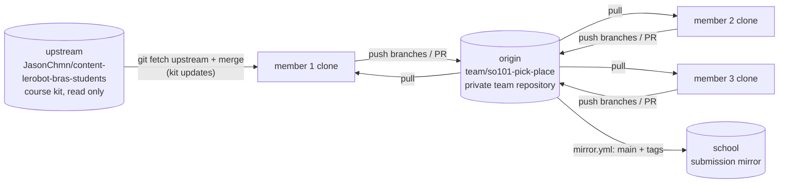
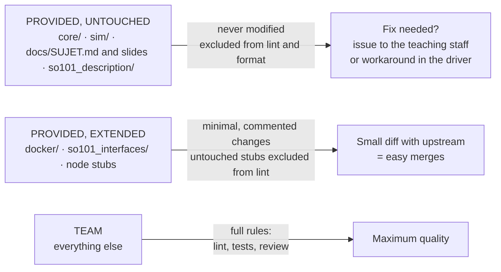
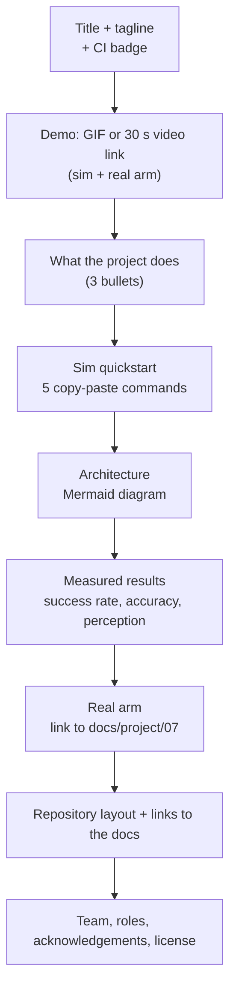
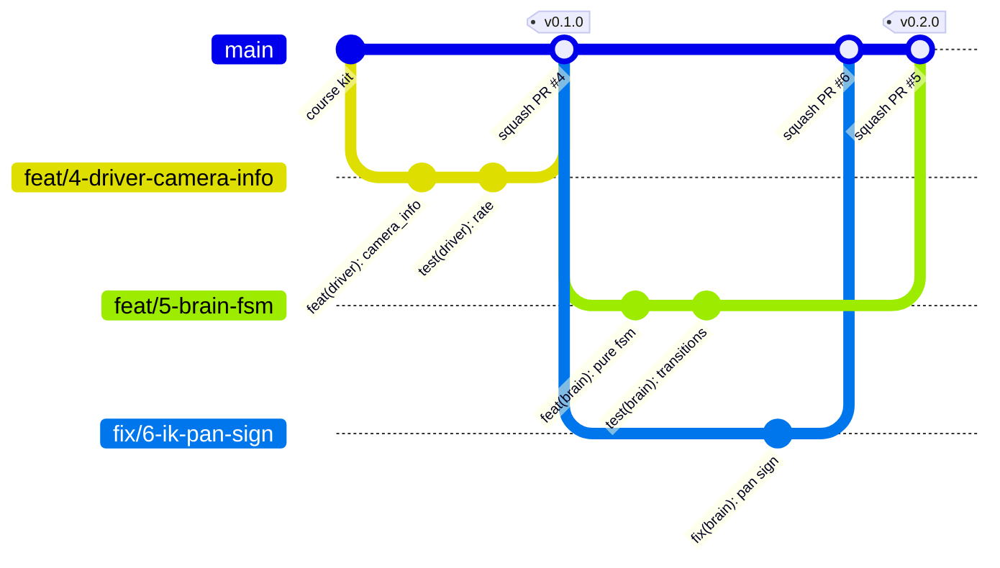
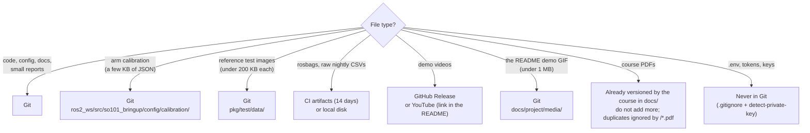
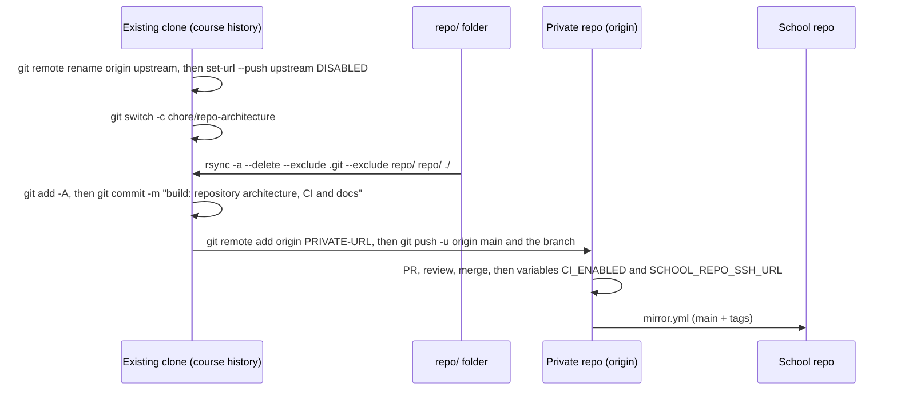
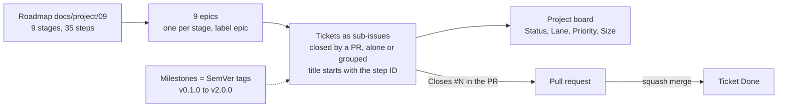

# 15 — Repository hygiene and governance

> Authors: [CP] Project lead, [OPS] DevOps · Reviewers: [QA], all
> Decisions: ADR-020, ADR-027, ADR-028, ADR-029, ADR-030, ADR-031, ADR-033 · Files: at the repository root
> Goal: a repository **readable by a jury or a recruiter**, **reproducible**, **compliant** (C-07, C-53) and **easy to resync** with the course kit.

## 1. Starting point (2026-10-08)

| Item | State | Risk |
| --- | --- | --- |
| `origin` remote | **`JasonChmn/content-lerobot-bras-students`, the teacher's repository** | Pushing to the wrong repository (refused at best, accidental publication at worst); no team repository |
| `README.md` | 6 lines | Unreadable for an outsider |
| CONTRIBUTING, LICENSE, CHANGELOG, CI, templates | Missing | No shared rules |
| `.gitignore` | 3 rules (`__pycache__`, `.env`) | Rosbags, ruff/pytest caches or videos committable by mistake. The PDF slides are **versioned by the course in `docs/`** since 2026-10-08; root copies are untracked duplicates |
| Line endings | No rule (no `.gitattributes`) | A Windows CRLF clone breaks `control_entrypoint.sh` in Docker |
| Work in progress | Driver, brain, RViz modified, not committed | Lost work, empty history (C-07) — since merged with upstream and prepared in the repository tree |

All of this is now addressed in the repository tree (`README`, `CONTRIBUTING`, `CHANGELOG`, `.github/`, configurations, `docs/project/`).

## 2. Remotes: team repository + upstream + school mirror (ADR-027, ADR-033)



| Option | Pros | Cons | Choice |
| --- | --- | --- | --- |
| **GitHub fork** of the course repo | Visible link with the original | **A fork of a public repo is public**; PRs target the teacher by default | No |
| **New team repository** + `upstream` remote | Visibility of your choice (private during the project, public at the end for the CV); full history kept | One more command to sync | **Yes** |
| Copy the files without history | — | Loses history, hard to sync | No |

Commands (run **by the team**, on one machine):

```bash
git remote rename origin upstream                        # the course kit becomes "upstream"
git remote set-url --push upstream DISABLED              # safety net: pushing to the course is impossible
git remote add origin git@github.com:<team>/<repo>.git
git push -u origin main
# later, sync with a kit update:
git fetch upstream && git merge upstream/main            # merge, not rebase: the shared history stays stable
git rev-parse upstream/main > .github/upstream-sha       # the course commit now merged, in the same PR (#137)
```

The nightly `upstream` job opens one issue, "Course repository: new commits", when the course's `main` moves past the commit recorded in `.github/upstream-sha`, and updates it on the next nights (#137). The sync PR writes the merged commit there and closes that issue with its `Closes #<n>` line. Not "is `upstream/main` an ancestor of `main`": the ruleset only allows squash merges, so the course's commits never become ancestors of `main`.

The school mirror is described in `16`.

## 3. Target repository layout

```text
.
├── README.md                    ← showcase: demo, quickstart, architecture, results          [team]
├── CONTRIBUTING.md              ← contribution rules                                          [team]
├── CHANGELOG.md                 ← release notes (Keep a Changelog)                            [team]
├── AGENTS.md  CLAUDE.md         ← instructions for AI coding agents (CLAUDE.md imports AGENTS.md) [team]
├── LICENSE                      ← to be decided (ADR-031)                                     [OPEN]
├── pyproject.toml               ← ruff configuration                                          [team]
├── .pre-commit-config.yaml  .markdownlint-cli2.yaml  .hadolint.yaml  .lycheeignore  .editorconfig  .gitattributes  .gitignore  .gitleaksignore
├── sonar-project.properties  .sonarlint/connectedMode.json   ← SonarQube Cloud analysis and its IDE binding (14 §4)
├── .git-blame-ignore-revs       ← purely mechanical commits (formatting)
├── .github/
│   ├── workflows/ci.yml  pr-title.yml  nightly.yml  mirror.yml
│   ├── CODEOWNERS  PULL_REQUEST_TEMPLATE.md  dependabot.yml
│   └── ISSUE_TEMPLATE.md
├── .vscode/extensions.json  settings.json   ← shared recommendations and the SonarQube binding (everything else ignored)
├── tools/so101                  ← the everyday commands (stack, cycle, bench, robustness demo, tests) [team]
├── tools/so101-arm, so101_arm.py ← the real arm's calibration and joint zeros (07 §3.1)     [team]
├── tools/ci/                    ← the CI scripts (guards.sh, check_mermaid.sh, reports…) and their tests [team]
├── docs/                        ← SUJET.md + PDF slides (versioned by the course)           [provided, untouched]
│   └── project/                 ← design, ADRs, roadmap, measurements; phase2/ = Connect Four; media/ = the README GIF [team]
├── results/                     ← milestone evaluation reports (light CSV/MD)                 [team]
├── docker/                      ← Dockerfiles, compose, entrypoint                            [provided → extended]
├── core/                        ← real-arm driver extracted from LeRobot                      [provided, untouched]
├── sim/                         ← SO101Sim + MuJoCo scenes                                    [provided, untouched]
└── ros2_ws/
    └── src/
        ├── so101_description/   ← URDF + meshes                                               [provided, untouched]
        ├── so101_interfaces/    ← .srv / .msg                                                 [provided → extended]
        ├── so101_common/        ← constants, conversions                                       [team]
        ├── so101_driver/  so101_brain/  so101_perception/   (+ test/ in each)                 [team]
        ├── so101_connect4/      ← phase 2: engine, board reader, game node (planned, ADR-037)  [team]
        └── so101_bringup/       ← launch, YAML config, RViz, sim scenes, the bench, sim-backed tests [team]
```

### 3.1 Three zones, three rules



## 4. Governance files

| File | Role | Location | Validated |
| --- | --- | --- | --- |
| `README.md` | Project showcase (§5) | root | markdownlint |
| `CONTRIBUTING.md` | How to contribute: setup, branches, commits, PRs, tests, safety, mirror | root | markdownlint |
| `CHANGELOG.md` | What changes between versions | root | markdownlint |
| `AGENTS.md` | Instructions for AI coding agents: build/test commands, prohibitions checked by CI, traps. Read natively by most agents; `CLAUDE.md` only imports it (one source of truth). Update it when a command or a rule changes | root | markdownlint |
| `LICENSE` | Reuse rights | — | **OPEN** (ADR-031) |
| `.gitignore` | Artifacts, secrets, heavy data, duplicated slides | root | — |
| `.gitattributes` | LF everywhere, declared binaries | root | — |
| `.editorconfig` | UTF-8, LF, indentation per file type | root | — |
| `.git-blame-ignore-revs` | Hides formatting commits from `git blame` | root | — |
| `CODEOWNERS` | Automatic reviewers per lane | `.github/` | — |
| `PULL_REQUEST_TEMPLATE.md` | PR checklist (Definition of Done) — **a single global template**: with several PR templates GitHub shows no chooser and requires a `?template=` URL parameter | `.github/` | markdownlint |
| `ISSUE_TEMPLATE.md` | **A single issue template**: the ticket anatomy of §12, also used for bugs. "New issue" opens it directly: no template chooser, no `?template=` in the URL | `.github/` | markdownlint |
| `dependabot.yml` | Monthly GitHub Actions updates, a release a week old at least | `.github/` | valid YAML |
| `.vscode/*.json` | Shared extensions and settings (ruff on save, Mermaid, the SonarQube Cloud binding, `14` §4) | `.vscode/` | — |

## 5. Root README: target structure



Principle: **a hurried reader must understand the project in 30 seconds** (title, demo, results) and **run it in 5 minutes** (quickstart); everything else is a link into `docs/project/`.

## 6. Branches, commits, merges, versions (ADR-020, ADR-028)



| Topic | Convention | Example |
| --- | --- | --- |
| Branches | `<type>/<issue#>-<short-topic>` (CONTRIBUTING §2), a few days long | `feat/31-perception-hsv`, `fix/12-driver-clamp`, `docs/40-adr-024` |
| Commits | [Conventional Commits](https://www.conventionalcommits.org/): `<type>(<scope>): <summary>`, scope = package | `feat(driver): publish camera_info` · `fix(brain): reject unconverged IK` |
| Types | `feat` `fix` `docs` `test` `refactor` `perf` `build` `ci` `chore` `revert` | — |
| PR merges | **Squash merge**: 1 PR = 1 commit on `main`, author = PR author, co-authors kept (`Co-authored-by`) | Linear history, always attributable (C-07) |
| `main` branch | Protected: PR, 1 approval, green CI, no force-push (private repo: needs GitHub Pro, §12.5) | — |
| Versions | SemVer tags per **functional milestone** | `v1.0.0` sim pick & place validated · `v1.1.0` real arm · `v2.x` phase 2 (no `v0.x` tag was made, ADR-028 update) |
| Release | One GitHub Release per tag: notes (CHANGELOG), bench report, **link** to the video | — |
| Changelog | [Keep a Changelog](https://keepachangelog.com/en/1.1.0/), updated in the PR preparing the tag | Option: generated from commits (git-cliff) |
| Language | **English** for code, commits, docs and presentations | Consistency with the conventional commits and the defense |

## 7. Where does each file go? (ADR-029)



- **Git LFS: not used**: limited free quota (1 GB storage and bandwidth) and complexity for every clone; nothing in the project justifies it if the rules above are followed. Provided STL meshes are already in Git, which is fine.
- The `check-added-large-files` hook (1 MB) blocks accidental additions (provided `docs/` content is excluded so upstream syncs are not blocked).

## 8. Secrets and privacy

- `.env` stays ignored; only `.env.example` is versioned.
- `detect-private-key` hook; CI secrets (school deploy key) live in GitHub Secrets of the private repository only.
- Commit e-mail: enable GitHub's "noreply" address if the repository becomes public.
- No personal data in published rosbags/videos (blur faces if needed).

## 9. License (ADR-031, OPEN)

| Item | Known license |
| --- | --- |
| `core/lerobot_min` | Apache-2.0 (derived from LeRobot, headers kept) |
| `so101_description`, stub packages | Apache-2.0 declared in `package.xml` (`example_py_pkg`: MIT) |
| Course kit (scenes, Dockerfiles, brief, slides) | **Not specified** |

Default proposal for **our** code: **Apache-2.0** (consistent with the rest, compatible with LeRobot). **Before making the repository public**, ask the teaching staff about the kit's distribution terms.

## 10. Continuous hygiene

| Frequency | Action | Owner |
| --- | --- | --- |
| Every PR | PR template checklist; branch deleted after merge | Author |
| Weekly | Board review in the sync (§12.4): Backlog → Ready, blocked tickets, WIP; review the risk register (`10`); merge Dependabot PRs; an open "Course repository: new commits" issue (the nightly watches the course, #137) | CP |
| Every tag | CHANGELOG, bench report in `results/`, GitHub Release | CP + QA |
| End of project | Final README (demo, results), videos, `v2.0.0` tag, public visibility (after staff approval), archive | Everyone |

## 11. Putting the prepared tree in place (keeping the history)

**Done on 2026-10-15** (PR #1 of `FoxaxeWasTaken/Robotics`); kept as the procedure. The prepared tree (the `repo/` folder delivered on 2026-10-08) contains the complete repository. To **keep the history** (course and team commits, C-07, upstream sync), do **not** `git init` inside it: copy its content into the existing clone.

⚠ `rsync --delete` makes the clone identical to `repo/`: anything changed in the clone **outside** `repo/` (work-in-progress fixes, scripts) is overwritten or deleted. Save what you want to keep **outside the clone** first (the bootstrap prototype was saved this way on 2026-10-15, ADR-039), and keep the files that must never be pushed outside the clone.



```bash
cd <existing-clone>
git remote rename origin upstream && git remote set-url --push upstream DISABLED
git switch -c chore/repo-architecture
rsync -a --delete --exclude .git --exclude repo/ --exclude 'ros2_ws/build*' --exclude 'ros2_ws/install*' --exclude ros2_ws/log --exclude docker/.env repo/ ./
rm -rf repo/                                   # the source folder is no longer needed
git add -A && git status                       # review before committing
git commit -m "build: repository architecture, CI and docs"
git remote add origin git@github.com:<you>/<private-repo>.git && git push -u origin main chore/repo-architecture
```

## 12. Planning: the GitHub Project

> Decided by [CP] with [OPS]; reviewed by [QA] (checkable tickets) and [SAFE] (real-arm tickets).

### 12.1 Options considered

| Option | Pros | Cons | Verdict |
| --- | --- | --- | --- |
| Roadmap checkboxes in `09` only | Zero setup | No owner, no status, invisible progress, merge conflicts on one file | No (kept as the source of the plan) |
| External tool (Trello, Notion, Jira) | Rich boards | Second place to look, no link with PRs and CI, accounts for everyone | No |
| **GitHub Projects + issues + sub-issues** | Next to the code; PRs close tickets; native *blocked by*; free | Some settings only in the web UI | **Yes** |

### 12.2 Structure



| Item | Convention |
| --- | --- |
| Epic | One issue per roadmap stage (label `epic`); tickets are its **sub-issues** (automatic progress bar) |
| Ticket | ≤ L; closed by a PR, alone or grouped with related tickets (one commit and one `Closes #` each); title `[<step><letter>] <imperative summary>`, e.g. `[3.4b] Extrinsic calibration tool`; body = *Task* form (CONTRIBUTING §8) |
| Dependencies | Native **blocked by** relationship (Issue → Relationships), never a label |
| Milestones | The functional SemVer versions of §6 (`v0.1.0 — Foundations and driver` … `v2.0.0 — Phase 2 and final defense`), **no due date** (the plan follows logic, not dates, `09`) |
| Labels | `task`, `bug`, `epic`, `safety`, `staff-question`, `area:infra` `area:ci` `area:bringup` `area:driver` `area:kinematics` `area:perception` `area:brain` `area:eval` `area:docs` `area:connect4`; `report` for an issue that collects reports, not a work item ("Nightly bench results", #151): the project views leave it out |

### 12.3 Fields, views, automations

| Field | Values |
| --- | --- |
| Status | Backlog · **Ready** (Definition of Ready met) · In progress · In review · Done |
| Lane | A — driver/infra/hardware · B — kinematics/brain · C — perception/calibration · Shared |
| Priority | P0 critical path · P1 needed for the final defense · P2 optional |
| Size | XS < 2 h · S ≤ ½ day · M ≤ 1 day · L ≤ 2–3 days (bigger: split) |

| View | Layout | Setup |
| --- | --- | --- |
| Board | Board by Status | Filter `-label:epic`; WIP limit 5 per person, checked in the sync |
| Backlog | Table grouped by **Parent issue** | Sorted by Priority; columns Lane, Size, Milestone, Assignees |
| My work | Board | Filter `assignee:@me -status:Done` |
| Lanes | Board by Lane | Filter `-status:Done`: who is blocked, who is overloaded |

Built-in workflows to enable (Project → Workflows; names as GitHub shows them): *Item added* → Backlog · *Pull request linked to issue* → In review · *Code changes requested* → In progress · *Item closed* and *Pull request merged* → Done · *Auto-add to project* (`is:issue,pr is:open`, this repository) · *Auto-add sub-issues* · *Auto-archive* (`is:closed updated:<@today-14d`).

### 12.4 Rituals

- **Weekly sync (30 min)**: walk the board right to left (In review → In progress → Ready); move tickets whose blockers are Done to Ready; reassign if a lane is overloaded; open questions → `staff-question`.
- **New work** (a bug, a split, a forgotten task) → a ticket written with the same anatomy, placed under its epic, *before* the code.
- **Closing a milestone** = CHANGELOG + tag + GitHub Release (§6).

### 12.5 Plan limits (GitHub changes them: re-check at setup)

- **Branch protection and rulesets on a private repository need GitHub Pro** (or an organization on a paid plan). Students get Pro for free with the GitHub Student Developer Pack. Without it: make the repository public (staff approval, `09` step 0.1) or apply the rules by convention.
- A **user-owned Project** does not inherit repository access: invite the teammates on the Project itself (Settings → Manage access, *Write*).
- Free plans allow one *Auto-add* workflow per Project: enough for one repository.
- Issue types (Task/Bug/Feature) exist only for organizations: labels play that role here.
