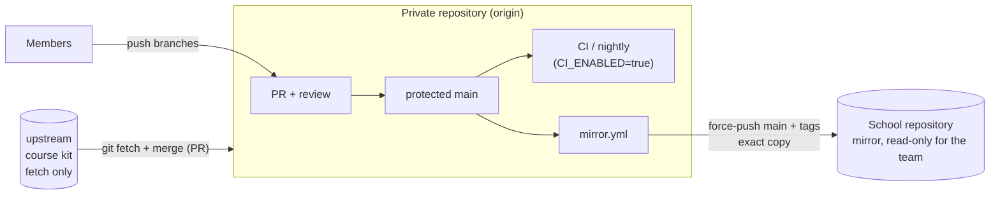

# 16 — Mirroring: private repository (CI) → school repository (submission)

> Author: [OPS] · Reviewers: [CP], [QA] · Decision: ADR-033 · Workflow: `.github/workflows/mirror.yml`

## 1. Need

- Daily work (branches, PRs, reviews, CI, nightly) happens on a **private repository** the team controls (Actions, variables, secrets, protections).
- The **school repository** receives the submission. It must show **each member's history** (C-07) and must **never** be modified directly.
- The course kit stays a read-only source (`upstream`, ADR-027).



## 2. Options considered

| Option | Pros | Cons | Choice |
| --- | --- | --- | --- |
| **`mirror.yml` GitHub Action** on pushes to `main`, and on demand (tags go with the next run: no tag trigger, a tag can point at unreviewed code) | Automatic, traceable, workstation-independent; only pushes what passed review | One key to configure once | **Yes** |
| Local double push URL (`git remote set-url --add --push origin <school>`) | No GitHub configuration | Depends on every workstation; also pushes work branches; easy to forget | Fallback |
| `git push --mirror` | Exact copy of every ref | Pushes work branches, **deletes** on the school side what no longer exists; fails on read-only `refs/pull/*` | No |
| GitLab native push mirroring | Built-in | Only if the private repository is on GitLab | If GitLab |
| Pull mirroring on the school side | Nothing to do for the team | Depends on the school's infrastructure | If offered |

## 3. Rules

| Rule | Why |
| --- | --- |
| Only **`main` and the tags** (`v*` by convention) are pushed to the school | Submission = reviewed, tested state; no work branches |
| **Forced push** (`--force`, since 2026-10-15): the school repository is an exact copy of the private `main` | Nobody pushes there, so a force only overwrites accidental changes; the submission always equals the reviewed state |
| **Nobody commits to the school repository** | It is only a mirror |
| No history rewrite on the private `main` (no force-push, ruleset) | The mirror would copy the rewrite, and the C-07 history would be altered |
| Commit authors are kept (squash merge = PR author, plus `Co-authored-by`) | C-07: each member's history stays visible on the school side |
| No secret in the code: everything in `main` becomes visible on the school side | Secrets live in the private repository's GitHub Secrets |

## 4. Workflows and the mirror

The `.github/workflows/*` files are copied to the school repository too. To keep them from running there, every job is **opt-in**:

| Workflow | Condition | Private repository | School repository |
| --- | --- | --- | --- |
| `ci.yml`, `pr-title.yml`, `nightly.yml` | `vars.CI_ENABLED == 'true'`; Dependabot PRs also run, in this repository only (`github.repository`) | Variable set → runs | Variable missing → jobs skipped, Dependabot PRs included |
| `mirror.yml` | `vars.SCHOOL_REPO_SSH_URL != ''` | Variable set → pushes | Variable missing → skipped (no loop) |

## 5. Setup (once)

```bash
ssh-keygen -t ed25519 -N "" -C "mirror-ci" -f ~/.ssh/school_mirror   # dedicated key pair, no passphrase, outside the repo
```

1. **School repository** → Settings → Deploy keys → *Add*: content of `school_mirror.pub`, **Allow write access** ticked. This needs admin rights on the school repository; without them, add the public key to the GitHub account that has write access (done this way on 2026-10-15) and rely on the environment of step 2.
2. **Private repository** → Settings → Environments → `school-mirror`, deployment branches: **`main` only** (done on 2026-10-15). Only reviewed code on `main` can read the key, which matters when the key is a personal account key (no admin on the school repository, so no deploy key there):
   - environment secret `SCHOOL_DEPLOY_KEY` = content of `school_mirror` (private key); keep the local file **outside any repository** (`~/.ssh/school_mirror`, mode 600) or delete it;
   - variable `SCHOOL_REPO_SSH_URL` = `git@github.com:<school-org>/<repo>.git`;
   - variable `SCHOOL_GIT_HOST` if the school is not on `github.com` (e.g. a GitLab instance);
   - variable `CI_ENABLED` = `true`.
3. First mirror: automatic at the first push to `main` (the merge of PR #1), or Actions → *Mirror* → **Run workflow**; then check:

```bash
git ls-remote origin refs/heads/main ; git ls-remote <school-url> refs/heads/main   # same SHA expected
```

**If the school forbids deploy keys**: a *fine-grained token* limited to the school repository (*Contents: write*, short expiry) stored in the secret, with an HTTPS URL. Never push to the school repository by hand (CONTRIBUTING §3).

## 6. Diagnosis

| Symptom | Cause | Fix |
| --- | --- | --- |
| A new tag (a release) is missing on the school side | The mirror runs on `main` pushes, not on tags | Actions → *Mirror* → **Run workflow** after the tag, then `git ls-remote --tags <school-url>` |
| A change made on the school side disappeared | The mirror force-pushes `main` | Never push to the school repository: make the change through a PR on the private one |
| `Permission denied (publickey)` | Key not added or without write access | §5 step 1 |
| `Host key verification failed` | Wrong `SCHOOL_GIT_HOST` | Fix the variable |
| CI runs on the school repository | `CI_ENABLED` defined there | Remove the variable on the school side |
| "Dependabot Updates" run, or a Dependabot PR, on the school repository | `dependabot.yml` is mirrored; Dependabot needs admin rights to be turned off there | Harmless: its PRs skip every job; close them by hand (ADR-033) |
