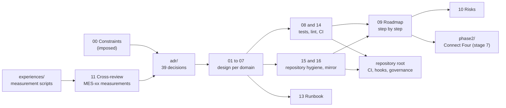

# Project documentation — SO-ARM101 pick & place (Tek5)

This folder gathers **every choice** of the project, its rationale (imposed by the brief or decided by the team, with evidence), and **the step-by-step path** to complete the project cleanly.

> Written by a virtual team of experts who **checked each other's work** (`11_cross_review_and_measurements.md`). Disagreements were settled by **reproducible measurements** (`experiences/`, tools actually run; 32 for the cross-review, 57 in all, `11` §4): out of 44 objections, **36 initial proposals were changed**. The folder contains **40 diagrams** (plus one in the root README), all rendered and checked by mermaid-cli.

## Where to start?

| You are… | Read in this order |
| --- | --- |
| New to the team | `00` → `01` → `09` → `02` §10 |
| Driver owner | `03` → ADR-006, 007, 016, 018, 023, 032 → `07` |
| Kinematics and brain owner | `04` → `06` → ADR-008, 009, 010, 015, 017 |
| Perception owner | `05` → ADR-011 to 014, 021 |
| Quality, tooling or repository owner | `14` → `15` → `16` → ADR-024 to 033 |
| Preparing the defense | `README` (this file) → `presentations/` (the previous decks) → `11` → `08` §2 → `09` step 8.1 → `phase2/README` |
| Something is broken | `13_runbook_troubleshooting.md` |
| Working on phase 2 (Connect Four) | `phase2/README` → `P2-01` → `P2-02` → `P2-04` (roadmap) → `P2-03` → ADR-034 to 038 |

## Index

| Document | Content |
| --- | --- |
| [00_constraints_and_scope.md](00_constraints_and_scope.md) | **Imposed requirements** (C-xx traceability matrix), freedoms, kit inconsistencies and resolutions, Definition of Done |
| [01_architecture.md](01_architecture.md) | Architecture, packages, **interface contract** (topics, services, QoS, frames), nominal sequence |
| [02_environment_infrastructure.md](02_environment_infrastructure.md) | Docker, WSL2, usbipd, camera, workspace rules, performance, onboarding |
| [03_driver.md](03_driver.md) | `driver_node` design, **code review**, execution model, commands, camera, safety |
| [04_kinematics_ik.md](04_kinematics_ik.md) | Model, FK/IK (ikpy), **reachability map**, grasp strategy, trajectories, < 1 cm measurement |
| [05_perception_calibration.md](05_perception_calibration.md) | HSV, camera conventions, pixel → 3D, **ArUco calibration**, field of view, **calibration methods compared** |
| [06_brain_state_machine.md](06_brain_state_machine.md) | State machine (diagram + table), non-blocking behavior, grasp detection, parameters |
| [07_real_arm_safety_sim2real.md](07_real_arm_safety_sim2real.md) | Real-arm commissioning, layered safety, sim → real gaps, real camera, checklist |
| [08_quality_tests.md](08_quality_tests.md) | Test pyramid, target metrics, evaluation bench, conventions, Git workflow (summary) |
| [09_roadmap_step_by_step.md](09_roadmap_step_by_step.md) | **The step-by-step roadmap**: 9 stages (phase 2 of the brief = stage 7), 35 steps, each with "Done when…" |
| [10_risks.md](10_risks.md) | Risk register (P × I) and mitigations |
| [11_cross_review_and_measurements.md](11_cross_review_and_measurements.md) | **Cross-review log** (44 objections) and register of the 72 measurements |
| [12_glossary_references.md](12_glossary_references.md) | Glossary and references |
| [13_runbook_troubleshooting.md](13_runbook_troubleshooting.md) | Everyday commands, decision tree and troubleshooting table |
| [14_quality_pipeline_ci.md](14_quality_pipeline_ci.md) | **Quality pipeline**: feedback loops, check matrix, tool choices, PR CI and nightly, test conventions, lint adoption |
| [15_repository_hygiene.md](15_repository_hygiene.md) | **Repository hygiene**: remotes (upstream / origin / school), target layout, governance files, branches, commits, versions, heavy data, license, **planning with the GitHub Project** |
| [16_mirroring_school_repo.md](16_mirroring_school_repo.md) | **Mirror** private repository (CI) → school repository: options, rules, workflow, setup, diagnosis |
| [adr/](adr/README.md) | **39 decision records** and their map (context, options, decision, evidence) |
| [phase2/](phase2/README.md) | **Phase 2 — Connect Four against the robot** (validated by the teaching staff): pitch, scope and demo, design, plan, risks and tests |
| [experiences/](experiences/README.md) | Reproducible measurement scripts |
| [presentations/](presentations/README.md) | The review decks as presented (PDF) and their videos |

## Legend

- **Statuses**: **IMPOSED** (brief or slides) · **DECIDED** (team choice, backed by evidence) · **RECOMMENDED** (to confirm on the hardware) · **OPEN** (to settle).
- **Sources**: [BRIEF] `docs/SUJET.md` (wins) · [BOOT] Bootstrap slides · [KO1]/[KO2] kickoff slides · [CODE] provided kit · [MES-xx] team measurement.
- **Requirements**: `C-xx` (defined in `00`); phase-2 targets `P2-xx` and risks `P2-R-xx` (`phase2/`).

## The expert team (roles)

| Code | Role | Main documents |
| --- | --- | --- |
| [CP] | Project lead / integrator | 00, 09, 10, 15 |
| [ARC] | ROS 2 architect | 01, ADR-001 to 005, 022, 030 |
| [OPS] | DevOps / infrastructure | 02, 13, 14, 15, 16, ADR-002, 018, 025, 027, 029, 033 |
| [CTRL] | Control & hardware | 03, 07, ADR-006, 007, 016, 032 |
| [SAFE] | Safety (paired with CTRL) | 07 §2 and §7, ADR-023 |
| [KIN] | Kinematics & planning | 04, ADR-008, 009, 010 |
| [VIS] | Vision & calibration | 05, ADR-011 to 014, 021 |
| [DEC] | Autonomy & decision | 06, ADR-015, 017 |
| [QA] | Quality & tests (runs the cross-review) | 08, 11, 14, ADR-019, 024, 026 |

## Key decisions on one page

| # | Decision | Status | Evidence |
| --- | --- | --- | --- |
| 1 | ROS 2 Jazzy, Python, 3 nodes in 2 containers (+ viz); **`perception` service added**, missing from the compose file | Imposed + decided | Inter-container `talker` [MES-18] |
| 2 | Driver: 50 Hz tick = 2 backend calls, the **sim runs in real time**; **sim camera in a dedicated thread rendering a state copy** | Decided | 9 Hz → 30 Hz [MES-22], [MES-24]; jitter p99 25 ms [MES-20] |
| 3 | Provided `_connect_arm` kept (explicit failure on calibration mismatch); partial commands, speed limiter, **clamp** to the joint limits and `camera_info` (`03` §0) | Imposed + decided | ADR-032; C-13, C-15 |
| 4 | **IK: ikpy** (the team's choice, confirmed) behind a façade; seeds `pan = −azimuth` from the pan axis | Decided (revised) | 100 % position, 97 % pointing [MES-21]; pan sign [MES-06] |
| 5 | Grasp **as vertical as possible (0 → 30°)**, best-effort jaw alignment, transport with position-only IK | Decided | **39/40** sim pick & place, TCP error 0.1–0.3 mm [MES-09] |
| 6 | **Minimum-jerk** trajectories streamed at 50 Hz by the brain | Decided | [MES-09] |
| 7 | **HSV** perception (two ranges for red), ray → plane z = 2.5 cm, PoseStamped in `base_link` | Imposed (justify) + decided | 2.7 mm mean error, 0 false positive [MES-13] |
| 8 | **ArUco extrinsic calibration**: ≥ 4 markers spread over the whole image, 640×480, SQPNP + LM, robot validation; the demo's single marker rejected | Imposed (own) + decided | 1.6 mm vs 18 mm with 0.5 px noise [MES-25]; 0.9 mm / 0.06° [MES-16] |
| 9 | **Hand-written explicit FSM** with `VERIFY` and `RETRY`, non-blocking (target locked with the arm out of view) | Imposed + decided | Bounce out of the box observed [MES-09] |
| 10 | **Grasp detected by gripper effort** (position is useless) + visual verification | Decided (revised) | 0.12–0.19 vs 0 [MES-10] |
| 11 | `/sim/randomize` (cube **and** box) in the driver, **without modifying `sim/`**; ground truth only for the bench | Decided | C-42, C-06 |
| 12 | Layered safety; **PARK before cutting torque**; webcam in **MJPG** | Decided | [MES-17]; LeRobot code review |
| 13 | Quality: **ruff + pre-commit + markdownlint + conventional commits**; **GitHub Actions CI inside our Docker images** (parity), opt-in; project-rule guards; 50-episode nightly; SonarQube Cloud in the nightly, on trial (`14` §4) | Decided | Tooling executed, 13/13 hooks green [MES-23]; CI would have caught C-11 [MES-22] |
| 14 | Repository: **private team repo + `upstream` without push + school mirror** (`main` + tags, forced exact copy, key in a `main`-only environment); squash merge, SemVer tags per milestone; no LFS; English everywhere; license to decide | Decided / open | `git remote -v`; ADR-027 to 033 |
| 15 | **Phase 2: Connect Four against the robot** (validated by the staff): store-bought grid placed edge-on, the arm on a riser, depth guide, drop poses with the wrist roll locked, a `/brain/drop` service in the brain; `v2.0.0` in sim, the real arm in `v2.1.0` | Decided | [MES-27] to [MES-29], [MES-31], [MES-32]; ADR-034 to 038 |
| 16 | **Starting code: the course stubs**; the bootstrap prototype stays outside the repository, as a reference (every line goes through a reviewed PR, C-50) | Decided | ADR-039; [MES-24] for what the prototype proved |

## Questions for the teaching staff (answered on 2026-10-16)

Sent on Teams on 2026-10-16 and answered the same day (ticket 0.1c). *Team* marks a question the team settled itself.

1. **Field of view** (21 % of the randomized cube positions partly out of the image [MES-12]): **the scene camera may be moved and its parameters changed**, for instance to match the real camera; the staff agrees the provided pose is misplaced and will post a general message. Recalibrate after moving it. The evaluation is not settled yet, but partial occlusions (by the robot) should be handled when possible (`05` §6–§7).
2. **`perception` service**: expected. `Dockerfile.perception` is provided and the service was missing from the compose file; Docker files and nodes may be adapted freely (ADR-002).
3. **Robustness evaluation**: a bench drawing random cube **and** box poses is what is expected; showing that it works on a few draws is enough. "Robust" means the five cases of [BOOT2 p12]: the object moves mid-action, the grasp fails, the object leaves the view, the target is out of reach, the lighting changes. Show a quick example of how each one is handled, or not (ADR-018).
4. **Calibration scene**: our own scene is fine, and markers other than ArUco are allowed if they work better (ADR-013, ADR-036).
5. **Real arm and cameras**: recalibrate the arm with the LeRobot (Hugging Face) calibration tools (`07` §3.1). Any USB webcam works as the scene camera and the grid webcam (a phone only as a stopgap: latency). The wrist camera is probably the WowRobo 2 MP USB module for SO-ARM100/101 (30 fps, 3 m cable), with a printable wrist mount (STL shared on Teams); whether each campus has one: the staff will confirm (ADR-038).
6. **License** (*team*): not asked for now, the repository is private. ADR-031 stays OPEN until a public release (8.1c).
7. **School repository** (*team*): question withdrawn. Without admin rights there, the mirror uses a key on a member's account and force-pushes `main` (ADR-033, `16`); Dependabot PRs that may appear there are closed by hand.

Phase-2 questions and answers (riser, cameras, real-arm sessions, taught poses, 3D printer): `phase2/P2-03` §4.

## Project history

What the repository does today: the Status section of the [repository README](../../README.md); the work in progress: the GitHub Project (`15` §12). Below, the dated events these documents rest on, newest first.

- **Phase-2 scope (2026-11-07)**: the hand-in is 2026-11-20 23:42. `v2.0.0` is Connect Four in sim, `v2.1.0` the real arm (ADR-034 Update), after an expert review that measured the sim on prototypes [MES-63 to MES-66]. Dates: `phase2/P2-04` §3.

- **Upstream pull on 2026-10-23** (#136): the day-3 visio slides on perception, `docs/J3_visio_perception.pdf` [J3]. No code or kit change. Impact absorbed in `00` (sources, the review calendar).

- **Teaching staff answers (2026-10-16)**: the sim camera may be moved, our own scenes and markers are allowed, the random cube + box bench is the expected measure and "robust" means the five cases of [BOOT2 p12] (questions above).
- **Team repository created (2026-10-15)**, private. It starts from the **course stubs**: the bootstrap prototype (driver, FK/IK, RViz file, teleop) stays outside the repository as a reference, its measurements remain valid as feasibility evidence (ADR-039).
- **Phase 2 validated by the teaching staff** (2026-10-09): Connect Four against the robot (ADR-034, [`phase2/`](phase2/README.md)). Own roadmap: `phase2/P2-04`. Kinematics checked by measurement before any build [MES-27 to MES-29].
- **Real arm (2026-11-06)**: another arm on the bench, recalibrated; camera intrinsics and pose measured [MES-58, MES-59]; tests 1 to 5 of `07` §3.2 passed; first real pick & place, 14/17 at the sim's speeds ([`results/bench_real_2026-11-06.md`](../../results/bench_real_2026-11-06.md)).
- **Real arm (2026-10-30)**: recalibrated; tests 1 to 3 of `07` §3.2 passed; the joint zeros measured at the URDF zero, the elbow 13.8° off [MES-55], corrected by `joint_zero_offsets` (#196); four driver faults found and fixed (#194 to #197); the gripper's load measured: not enough alone to tell a grasp, and 0 % on the cube trips the motor's overload [MES-56].
- **Real arm (2026-10-09)**: commissioning tests 1–3 of `07` §3.2 passed with the bootstrap prototype (clamp, NaN rejection and a reduced real-arm speed included). At rest the computed TCP is 2.9 cm below the table: check the calibration zero with a ruler first [MES-30].
- **Upstream pull on 2026-10-09, second** (fast-forward to `42737bf`, PR #2): the provided `_connect_arm` now cuts the torque after connecting (comment those lines out once the driver commands the real arm, ADR-032), and `destroy_node` disconnects the backend. The repository keeps both as shipped (ADR-039).
- **Upstream pull on 2026-10-09** (fast-forward to `9ec4183`, docs only): brief updated (phase 2 mandatory at the final defense, "robust" pick & place, real robot "preferred", video with the team, S2 and "7/10" removed) and new slides [BOOT2]. **No code or kit change: every measurement remains valid.** Impact absorbed in `00` (C-36, C-42, C-43, C-53, C-54, I-11), `06` §10, `09` (stages, phase 2 = stage 7, early real-arm commissioning), RC-34 to RC-38.
- **Upstream pull on 2026-10-08** (fast-forward to `bc00df7`): slides versioned in `docs/`, `_connect_arm` **provided** in the driver stub (PR #1). Sim, Docker, URDF, brain and perception unchanged: **every measurement in this folder remains valid**. `driver_node.py` merged with the provided `_connect_arm` kept (ADR-032).
- Environment validated (images, X11, DDS, usbipd, MJPG webcam).
- **Bootstrap prototype** (outside the repository, ADR-039): `/joint_states` at **30 Hz** (9 Hz before the camera thread), tests 6/6, `/go_to_target` within 0.13 mm [MES-24]. Reference for steps 1.0, 1.2 and 2.1.
- Quality tooling, CI, mirror and governance files: **in place in this repository** (`14`, `15`, `16`); GitHub settings applied on 2026-10-15 (ruleset on `main`, squash only, `school-mirror` environment, variables). CODEOWNERS handles filled in (#130); the GitHub Project exists since 2026-10-15 (`15` §12).
