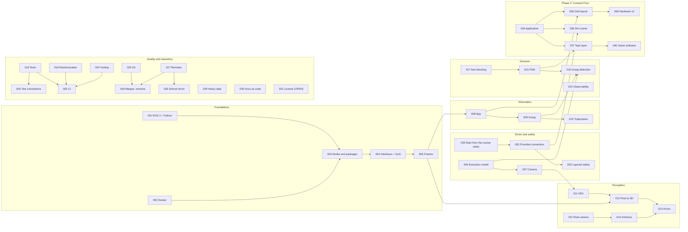

# Decision register (ADR)

Every structural decision has its record: **context, options, decision, consequences, evidence, and when to reconsider it**.

**Statuses**: **IMPOSED** (brief or slides, non-negotiable) · **DECIDED** (team choice backed by a measurement or a review) · **RECOMMENDED** (good practice to confirm on the hardware) · **OPEN** (to settle, often with the teaching staff).

**Rules**: an accepted ADR is not rewritten; if a decision changes, a new ADR "supersedes ADR-xxx" and the old one's status is updated (late facts go into an "Update" section). MES-xx refer to `../11_cross_review_and_measurements.md`. In ADRs written before 2026-10-15, "current code", "merged driver" and "implemented" mean the bootstrap prototype, which is not in the repository (ADR-039).

## Decision map



## Index

| ADR | Decision | Status | Experts | Requirements |
| --- | --- | --- | --- | --- |
| [ADR-001](ADR-001-ros2-jazzy-python.md) | ROS 2 Jazzy and Python (rclpy) | IMPOSED (ROS 2) + DECIDED (Python) | ARC → OPS, KIN | C-01 |
| [ADR-002](ADR-002-docker-topology.md) | Docker topology: control, perception, viz | IMPOSED (2 containers) + DECIDED (additions) | OPS → ARC, VIS | C-02, C-04 |
| [ADR-003](ADR-003-nodes-and-packages.md) | Nodes and packages split | IMPOSED (3 nodes) + DECIDED (shared packages) | ARC → CTRL, KIN, VIS | C-03, C-05, C-08 |
| [ADR-004](ADR-004-interfaces-qos.md) | Interface contract and QoS | PARTLY IMPOSED | ARC → VIS, DEC, CTRL | C-11 to C-14, C-21, C-34, C-35 |
| [ADR-005](ADR-005-frames-units-conventions.md) | Frames, units and conventions | IMPOSED (rad, robot frame) + DECIDED | ARC → KIN, VIS | C-11, C-14, C-21 |
| [ADR-006](ADR-006-driver-execution-model.md) | Driver execution model (loop, threads, rendering) | DECIDED (implemented) | CTRL → ARC, QA | C-11, C-12, C-15 |
| [ADR-007](ADR-007-camera-publishing-real-camera.md) | Camera: publication and real camera | IMPOSED (image ~10 Hz) + DECIDED | VIS → CTRL, OPS | C-12, C-13 |
| [ADR-008](ADR-008-ik-solver.md) | IK solver: ikpy (Pinocchio as an option) | DECIDED (revised after measurement) | KIN → CP, QA | C-31, C-41 |
| [ADR-009](ADR-009-grasp-strategy.md) | Grasp strategy | DECIDED | KIN → DEC, VIS | C-30 |
| [ADR-010](ADR-010-trajectories.md) | Trajectory generation | DECIDED | KIN → CTRL, DEC | C-30, C-51 |
| [ADR-011](ADR-011-hsv-detection.md) | Detection: HSV thresholding | IMPOSED (justified method) + DECIDED | VIS → QA, ARC | C-20, C-24 |
| [ADR-012](ADR-012-pixel-to-3d.md) | Pixel → 3D: ray and table plane | IMPOSED (own assumption) + DECIDED | VIS → KIN | C-22 |
| [ADR-013](ADR-013-extrinsic-calibration.md) | Own extrinsic calibration: spread multi-marker ArUco | IMPOSED (own calibration) + DECIDED | VIS → QA, KIN, CTRL | C-23 |
| [ADR-014](ADR-014-intrinsic-calibration.md) | Intrinsic calibration of the real camera | DECIDED | VIS → CTRL | C-13, C-43 |
| [ADR-015](ADR-015-state-machine.md) | Explicit hand-written state machine | IMPOSED (explicit FSM) + DECIDED | DEC → QA, KIN | C-32, C-34, C-35 |
| [ADR-016](ADR-016-grasp-detection.md) | Grasp detection and verification | DECIDED (revised after measurement) | DEC → CTRL, VIS | C-30 |
| [ADR-017](ADR-017-freshness-non-blocking.md) | Data freshness and non-blocking control | IMPOSED + DECIDED | DEC → ARC, VIS | C-33 |
| [ADR-018](ADR-018-randomization-evaluation.md) | Box randomization and evaluation tools | DECIDED (measures C-42) | OPS → QA, CTRL | C-06, C-42 |
| [ADR-019](ADR-019-tests-ci.md) | Test strategy and continuous integration | DECIDED | QA → OPS, all | C-06, C-41, C-42 |
| [ADR-020](ADR-020-git-workflow.md) | Git workflow | IMPOSED (visible history) + DECIDED | CP → QA | C-07, C-50 |
| [ADR-021](ADR-021-real-camera-placement.md) | Real camera: placement and settings | RECOMMENDED | VIS → CTRL, CP | C-43 |
| [ADR-022](ADR-022-observability.md) | Observability: RViz, debug, recording | IMPOSED (RViz, state) + DECIDED | ARC → QA, DEC, VIS | C-24, C-34, C-52 |
| [ADR-023](ADR-023-layered-safety.md) | Layered safety | IMPOSED (rules) + DECIDED | CTRL/SAFE → CP, DEC | C-15, C-51 |
| [ADR-024](ADR-024-quality-tooling.md) | Quality tooling: ruff, pre-commit, markdownlint, conventional commits | DECIDED | QA → OPS, ARC | C-07, C-50, C-53 |
| [ADR-025](ADR-025-ci-github-actions.md) | CI: GitHub Actions with the project's Docker images | DECIDED | OPS → QA, ARC | C-05, C-06, C-23, C-42 |
| [ADR-026](ADR-026-test-conventions.md) | Test conventions and anti-flakiness rules | DECIDED (complements ADR-019) | QA → CTRL, KIN, VIS, DEC | C-11, C-15, C-41, C-42 |
| [ADR-027](ADR-027-remotes-hosting.md) | Hosting: team repository + course `upstream` remote | DECIDED | CP → OPS | C-07, C-53 |
| [ADR-028](ADR-028-merge-versioning.md) | PR merges, versions and changelog | DECIDED | CP → QA | C-07, C-53 |
| [ADR-029](ADR-029-large-data.md) | Heavy data outside Git (no LFS); versioned calibration | DECIDED | OPS → QA, VIS | C-53 |
| [ADR-030](ADR-030-docs-as-code.md) | Versioned documentation: Markdown, checked Mermaid, ADRs, English | DECIDED | ARC → QA, CP | C-50, C-53 |
| [ADR-031](ADR-031-license.md) | Repository license | OPEN | CP → teaching staff | C-53 |
| [ADR-032](ADR-032-provided-connect-arm.md) | Real-arm connection: keep the provided `_connect_arm` | DECIDED (revised after the upstream pull) | CTRL/SAFE → CP, OPS | C-10, C-51 |
| [ADR-033](ADR-033-school-mirroring.md) | Private repository with CI, mirrored to the school repository | DECIDED | OPS → CP, QA | C-07, C-53 |
| [ADR-034](ADR-034-phase-2-application.md) | Phase-2 application: Connect Four against the robot | DECIDED, validated by the teaching staff (2026-10-09) | CP → all | C-53, C-54 |
| [ADR-035](ADR-035-connect4-grid-layout.md) | Connect Four: small edge-on grid, funnel, magazine, drop poses with locked wrist roll | DECIDED (kinematics measured); grid, funnel and magazine **superseded by ADR-038** | KIN → CTRL, SAFE, VIS | C-41, C-54 |
| [ADR-036](ADR-036-phase-2-sim-scene.md) | Phase-2 sim scene: our scene file, loaded next to the provided `_connect_arm` | DECIDED | CTRL → ARC, VIS, QA | C-05, C-06, C-10 |
| [ADR-037](ADR-037-phase-2-task-layer.md) | Phase 2: a task layer driving the brain through a `PickPlace` action | DECIDED as updated: the action became a `/brain/drop` service (Update 2026-11-07), built and measured (Update 2026-11-13) | ARC → KIN, DEC, VIS | C-05, C-33, C-54 |
| [ADR-038](ADR-038-connect4-hardware-v2.md) | Connect Four hardware: store-bought grid on a riser, depth guide, token handover, wrist camera | DECIDED + RECOMMENDED | KIN → CTRL, SAFE, VIS | C-41, C-51, C-54 |
| [ADR-039](ADR-039-start-from-course-stubs.md) | The repository starts from the course stubs; the bootstrap prototype stays outside | DECIDED | CP → ARC, QA, CTRL | C-07, C-50, C-53 |
| [ADR-040](ADR-040-connect4-game-software.md) | Connect Four in sim: the engine, the turns, the reading of the grid, the bench | DECIDED (built and measured on the sim) | DEC → VIS, KIN, QA, SAFE | C-05, C-06, C-42, C-54 |

## Template for a new ADR

```markdown
# ADR-0XX — Title

| Status | Date | Experts | Related requirements |
| --- | --- | --- | --- |

## Context
## Options considered
| Option | Pros | Cons |
## Decision
## Consequences
## Evidence / validation
## Reconsider if
```
