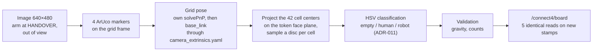
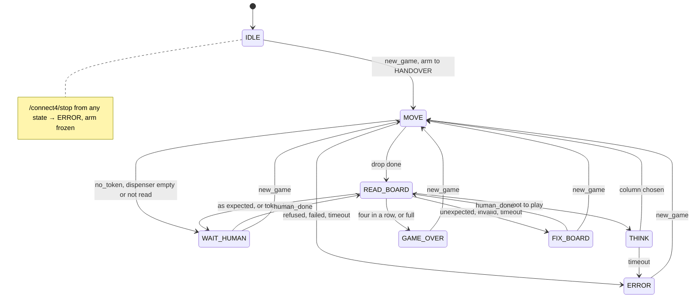
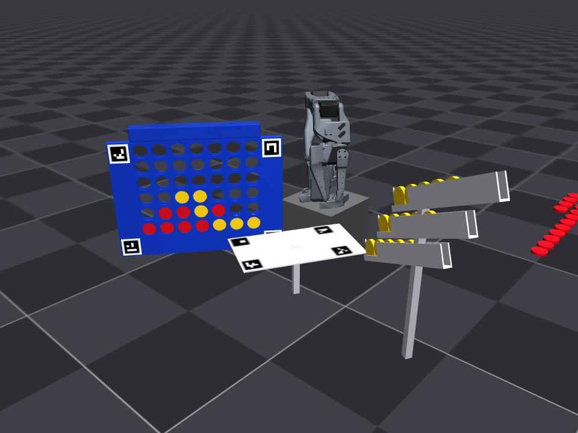
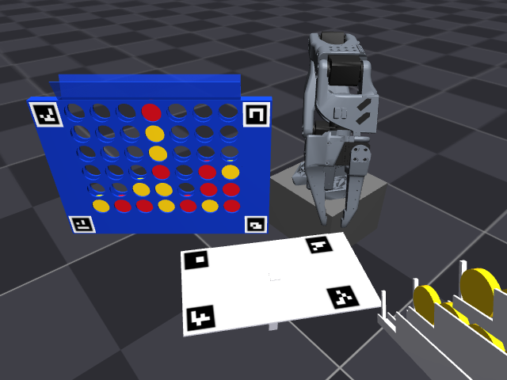
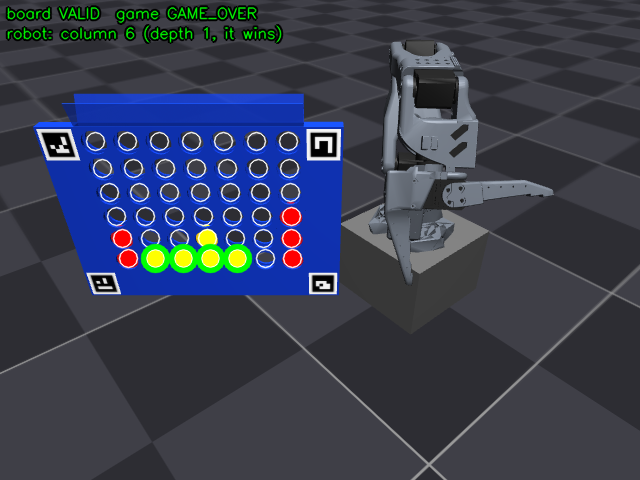

# P2-02 — Design: setup, kinematics, perception, game, software

> Authors: [KIN] Kinematics, [VIS] Vision, [DEC] Decision, [CTRL] Control · Reviewers: [ARC], [SAFE], [QA]
> Requirements: C-05, C-06, C-51, C-54 · Decisions: ADR-035 to ADR-038, ADR-040, ADR-041 · Measurements: MES-27 to MES-32, MES-63 to MES-77

**`v2.0.0` is the sim, `v2.1.0` the real arm** (ADR-034 Update). The numbers of §2, §3, §5 and §7 were measured on 2026-11-07 on prototypes kept in `experiences/connect4/`, the assumed grid model and no real grid; #76 puts them on one layout. §8 keeps what the real arm will need.

## 1. Physical setup (ADR-035, ADR-038)

The grid is placed **edge-on**: its plane contains the vertical axis of `shoulder_pan`, so the arm works in the plane of the grid. Seen from above, the 7 columns lie on a line that starts at the robot.

This table is the real setup. The sim of `v2.0.0` models it, with the values of §7.

| Item | Initial value | Why |
| --- | --- | --- |
| Grid | **Store-bought** classic Connect Four, 7 columns × 6 rows. Pitch, slot gap, token size and slot-entry height are **measured on the purchased grid** (step P2.1); the model used so far: pitch 37 mm, slot entries at 25 cm. The other way, for `v2.1.0`: print the sim's model (#248), which keeps the measured numbers true | Nothing to build, robust, tokens included, recognizable on video |
| Riser | The arm on a rigid block of about 8 cm (10 cm in sim, §7); arm and block clamped to the table | Lowers the grid relative to the arm: all 7 columns reachable, clearance 6.3–10.5 cm [MES-32], against 0.5 cm without it [MES-28] |
| Placement | Plane through the pan axis, columns at r ≈ 0.14 … 0.36 m, azimuth chosen so the webcam sees one face; placement jig | Edge-on is reachable, facing is not [MES-27] |
| Depth guide | Two sloped strips along the whole top edge: a V **across** the grid (entry about 20 mm, down to the slot gap), open along it | Across the grid the slot leaves a millimeter or two per side (to measure) and the flat rim of the token does not self-center: it is the tight direction. A per-column funnel does not fit, the slots are adjacent. Kept unless the camera alone does as well (comparison at step P2.8) |
| Along the grid | No guide. The token is released above the column: a round token whose center is above the column opening rolls or slides off the column wall into it | Expected capture of the order of ±0.7 × the token radius (friction 0.3, simple geometry): **measured in the spike** |
| Tokens | The game's, red and yellow. The robot plays `token.robot_color` of `connect4_grid.yaml`, yellow as installed, and the human the other (#255); this document writes them that way | HSV-distinct from the blue grid |
| Token supply | **A dispenser** (ADR-041, #257): three straight rails stacked in the arm's vertical plane, 7 tokens each, on edge between two walls; a token slides down to a stop, the rail's pick station, open so that the jaws reach both faces. The stations climb like stairs, 40 mm outwards each. The arm takes its token there by itself (`/brain/pick`, §2.3). The **handover** of the first version stays as a setting, `token_source: hand` of the game node: the robot waits at `HANDOVER` with open jaws, the human puts a token between them and says "token given" (§5) | The robot plays without a person in its turn; 21 tokens, no turn in the rails to jam in [MES-75] |
| ArUco markers | 4 printed markers (`DICT_4X4_50`) stuck on the grid frame corners | Grid pose by perception (§3) |
| Wrist camera (`v2.1.0`, if kept, §8) | Probably the WowRobo 2 MP USB module for SO-ARM100/101 (30 fps, 3 m cable) on the printable wrist mount, as the staff indicates (2026-10-16, availability to confirm); otherwise a 32×32 UVC module on the optional SO-ARM100 mount (step P2.8) | Close-up on the token and the slot (§3.1), staff suggestion |

## 2. Kinematics (ADR-035)

### 2.1 The constraint

The token must stay in the plane of the grid, so the **jaw closing axis** (x of `gripper_frame_link`, `04` §1.1) must be **normal to the grid**. The tilt of the approach axis inside the grid plane does not matter: a disc rotated in its own plane is the same disc.

- **Grid facing the robot** (jaws along the radial direction): the approach axis must then be vertical, which the arm only achieves close to the table. Best achievable jaw error: 40–62° at 22–30 cm, 17–23° at 14 cm, 7–8° at 10 cm [MES-27]. **Rejected.**
- **Grid edge-on**: the jaws only have to be normal to the arm plane, which wrist roll at ±90° provides. At exactly ±90° the error is **2.8°**, a constant offset of the URDF wrist (`wrist_roll` origin, rpy 0.0487 rad) [MES-29]. It is a roll zero: at roll **+1.6195 rad**, with the TCP line 8 mm off the pan axis, the error is 0.00 to 0.03° at a constant pan [MES-64].

### 2.2 Computing a pose

The token does not sit on the TCP: it rests on the fixed jaw, its centre 3.15 mm off the TCP along x. The pose documented first (roll ±90°, TCP on the slot plane) dropped **0 token out of 28** [MES-64]. So the target is the **token centre**:

```text
release_pose(kin, target, q_seed):      # target = token centre, base_link
    roll = +1.6195 rad                  # +90° + 2.8°: jaws normal to the grid
    p = target - token offset           # 3.15 mm along the TCP's x; aim 1 mm towards the fixed jaw (+y, grid frame)
    q = ik_pos(p, q_seed, roll)         # gives the pan
    q = ik_point(p, approach tilted 70°, q_seed = q, roll)
    return q, or None (unreachable: report it)
```

- `kinematics.py` does not change: `release_pose` lives in `so101_brain/drop.py`. The multi-start `drop_ik` of [MES-29] (0.26 s per pose) goes: this takes 10 to 36 ms and solves all 7 columns [MES-64].
- `ik_pos` alone is not enough: it flipped the tool on 6 poses of 135 (tilt 114–149°) [MES-64]. The tilt in the grid plane is free in theory, not for the jaws' clearance.

### 2.3 Motion of one move

`/brain/drop` does all of it, the arm at `HANDOVER`, a token between the open jaws. Away from `HANDOVER` it refuses, `not_at_handover`: the path starts there, under the grid's top. The move is judged where the camera sees the grid before anything moves (§2.5).

1. Close, then check the token is held (§5). No token: `no_token`, replied once the jaws are open again, the arm has not moved.
2. → pre-drop: **height first**, then the column, min-jerk (`04` §6).
3. Descent to `release_pose` at 0.3 rad/s, token bottom about 8 mm above the guide. Joint interpolation from the pre-drop: no Cartesian line needed.
4. Open: the token falls through the guide.
5. Lift **straight up through IK waypoints** every 5 mm to the pre-drop, 25 mm above the release, then back to `HANDOVER`, gripper open, in two legs at 1.4 times the motion's speed: the jaws are empty [MES-73]. The service replies. Every pose, the lift's waypoints included, is solved in the service call, before the jaws close: an unreachable target is refused with the arm still, and no IK runs during the move. One joint move from the release to the pre-drop swept the fixed jaw into the guide at column 6, and at 30 mm column 6 is at its reach [MES-63].

A move lasts **11.5 to 13.5 s** on columns 0 to 5 and 17 s on column 6, at its reach, where the descent turns the joints most; 50 tokens of 50 in their column [MES-73]. It was 13 to 15 s and 19 s [MES-69] before the legs back went faster and `HANDOVER`'s pan came from −1.0 to −0.8: the two turns of the pan are still 4.8 s of a move, the lift 2.6 s. The first estimate was 5 to 8 s, from 4.7–5.2 s without the pre-drop [MES-64]: the lift's 5 motions take 0.5 s each, and each leg ends on the measured joints.

| Tolerance of a drop | Along the grid | Across the grid |
| --- | --- | --- |
| Without guide, gaps 8.5 and 9.5 mm [MES-64] | ±12 mm | −2…+0.5 mm, a window of 2.5 to 3 mm |
| With the 30 mm guide [MES-63] | ±16 mm | −10…+6 mm |

The perception gives the slot within 0.8 mm across [MES-65], so without the guide the margin is thin: the guide stays, in sim too. It costs 2 cm of riser (§7).

**The pick, `/brain/pick`** (#259, ADR-041). The robot's token is taken at a station of the dispenser with the pose of the drop: the token stands on edge in the arm's vertical plane, and `release_pose` puts the jaws on its two faces. The move starts at `HANDOVER` with empty jaws, and is refused away from it.

1. → 40 mm above the station's token, the jaws at 40 %, **2.5 mm aside** along the jaws' axis: the fixed jaw that much further from the token than where it holds one.
2. Straight down through IK waypoints every 10 mm, still aside: the jaws pass on either side of the stop.
3. **Seat**: sideways at the station's level, until the fixed jaw is where it holds a token standing in the middle of its slot. A token nearer is pushed there.
4. Close, then check the token is held, as the drop does: the moving jaw brings a token that stood further onto the fixed one. Closed on nothing: the jaws open, the arm comes back up, and the reply is `no_token` at `HANDOVER`.
5. Straight up through waypoints every 10 mm, then back to `HANDOVER` with the token: the drop starts from there, and its own check of the grip passes on the token already held.

**Why aside, then seated.** The token has 1.5 mm of play on each side in its slot, and the camera places a station within 1.5 mm [MES-76]. Aimed at the slot's middle all the way down, the fixed jaw passed 0.8 mm from the token's face: a token 1 mm nearer and the jaw landed on its rim and stopped (`timeout:down_3`), which lost one game of the first ten. On the other side, a token held 1.5 mm off the middle rubbed the rail's high wall on its way up (`timeout:lift_2`). With the way down aside, the seat, and the station's low walls as long as the path of a lifted token (§7), the pick takes the token at every corner of its play and of the camera's error, ±1.5 mm each, at the lowest and the highest station [MES-77].

**A pick cut short** (a stop, a timeout) may leave the arm down in a station. The next `/brain/handover` then rises 40 mm straight up before it turns to `HANDOVER`: in one joint motion from the bottom of a station the moving jaw swept 9 mm into the stop; with the rise the arm stays 2.7 mm or more from the dispenser from any pose of a pick [MES-77].

Every pose is solved in the service call; a waypoint without a pose refuses the pick (`unreachable`), since the way down has no room to spare: the arm passes 2.7 mm from the stop. A pick lasts **8.2 s at the highest station, 10.0 s at the middle one and 12.3 s at the lowest**, where the wrist turns 1.8 rad from `HANDOVER` and back; the game takes the highest station that holds a token first [MES-77].

### 2.4 Real-arm caveats

- **Calibration zero**: LeRobot's joint zeros are not the URDF's. `joint_zero_offsets` holds them, per arm (`driver_real.yaml`) [MES-30], [MES-55]: check them **before** any drop test (`07` §4).
- **Riser**: the table is 8 cm lower in `base_link`; phase-1 demos run without the riser. Arm and riser are clamped, and the arm on the riser goes through the `07` §3 commissioning again.
- **Fallback, taught poses**: the stack stopped (with the driver running, the 50 Hz `send_action` turns the torque back on), move the arm by hand above each column, record the joints, check with FK. Taught by hand, they keep the sag of a held pose. It bypasses model and calibration errors, but it stays a fallback: the plan is computed poses (phase-1 IK). The staff accepts it (2026-10-16) if the PR and the defense explain why and show that the computed poses were tried and fixed first.

### 2.5 Positions from perception: what is judged before a move (ADR-042, #260)

The team's rule of 2026-11-13: where the grid and the dispenser stand is measured by the camera, never given to the arm. The game node aims each move at `/connect4/grid_pose` and `/connect4/dispenser_pose` (§3). The brain subscribes to both, and judges a move it has solved before anything moves:

| Judged | How | Refused as |
| --- | --- | --- |
| Every step has a pose | `drop_steps` and `pick_steps` solve them all in the service call (§2.3) | `unreachable` |
| The slot is edge-on | The angle between the slot's vertical plane, the x-z plane of the measured frame, and the arm's own at the release (`drop.off_plane`): −6° to +1° for a drop, ±4° for a pick. The arm holds a token in its own plane: 1.5° past it on the fixed jaw's side the token fell beside its column, 8° the other way it fell in; at a station the jaws touched the stop from 6° on [MES-79] | `not_edge_on` |
| The way keeps clear of the grid | `so101_brain/clearance.py`: the arm as points every 8 mm on the convex hulls of the URDF's collision meshes, the grid as two boxes in its measured frame (its body, its depth guide: `connect4.grid_boxes`), each step's joint line judged every 0.03 rad. Nearer than 5 mm is refused, with the first step that is. The model says what MuJoCo's own distance says within 1.4 mm on 99 % of 68,000 poses and 3.6 mm at most, and costs 0.2 s per move [MES-78] | `unsafe_path:<step>` |
| The poses are known | The last message of each topic | `no_grid_pose`, `no_dispenser_pose` |

- **Why the way is judged.** Where the layout puts the grid, a game's moves pass 11 mm from it at the nearest: the upper arm above the grid's near end, on the way to column 6. Set down 2 cm nearer, every column still has a pose and the shoulder passes 2 mm from the near post; 5 mm further, the lower arm passes 3.5 mm above the guide's end. The scene draws the posts and the base without contacts, so no game and no test ever showed it [MES-78].
- **The arm waits beside the dispenser it sees.** `/brain/handover` solves the pose at each call (`drop.wait_pose`): the tool at the same place and tilt in the dispenser's measured frame as `HANDOVER` has where the layout puts the dispenser, within 0.003 rad there. A pick and a drop start from the last pose reached. While the camera has seen no dispenser (`token_source: hand`), the arm waits at `connect4.handover_pose`.
- **`check_only`**: `/brain/drop` and `/brain/pick` with `check_only: true` reply the same judgment at once; nothing moves and the arm may be anywhere. While the brain moves the arm the reply is `busy`: a check's IK holds the brain's executor for half a second, and the 50 Hz commands with it. For the same reason the joints' age is counted from the end of the last solve: a `/brain/handover` asked between two checks was refused, `no_joint_states`, the messages that came meanwhile still queued.
- **The game is `ready` once the brain would play there** (`so101_connect4/placement.py`): one `check_only` request per column and per station, one at a time (each holds the brain's executor for its IK), only while neither the arm nor the engine works, a `busy` reply asked again; again once a pose is 5 mm or 2° from where it was judged. It takes about 4 s. `/connect4/state` says why a game cannot start, `not_ready`: `no <topics and services>`, `checking where the grid stands`, or the brain's first refusal as `column 7: unsafe_path:column`, numbered as the console's keys; the console shows it.
- **During a game** the poses keep coming from the camera at each image, and each move is judged on the last ones: a grid pushed to where the brain would not play ends the move in `ERROR:brain_refused:<reason>`, the arm still.
- **Not judged**: the dispenser as an obstacle (the waiting pose and the pick's way are fixed beside it, and measured [MES-77]), the held token (it is above its column by construction), and anything nobody modelled.
- **On the stack**: the grid set down 1 cm nearer and 3° around the arm between two games is found, judged again and played (`test_connect4_game_launch.py`, `tools/so101 robustness g7`); 25 mm nearer, the game says `column 1: unsafe_path:column` and the brain refuses the drop (`g8`).

## 3. Perception: reading the grid



- **One camera, the phase-1 one, and it does not move** [MES-65]: `sim_scene.yaml`, with `camera_extrinsics.yaml` reused, no new calibration. The base stays at the origin (§7): raising it would put the grid 79 mm off in the same file, 0.4 mm with the floor lowered. There is no `board_cam`. The grid is at azimuth −40°, square to the camera.
- **640×480 in game mode**: cells of 28–33 × 21–29 px, the 4 markers of 30 mm found every time; at 320×240 they are unreliable below 60 mm. The image comes at 10 Hz and the 50 Hz tick holds (p99 21.6 ms) [MES-67]; the reader assumes no rate, it counts new image stamps. It subscribes Reliable: a best-effort subscriber gets 1 image in 10 at this size.
- **Grid pose**: `detect_markers` from phase 1, then an own `solvePnP`, since `calibration.py` handles the table plane only. Published as `/connect4/grid_pose`, with the TF of the grid. Accuracy at the slot entries: 0.3 mm along, 0.8 mm across, 0.9 mm in height [MES-65]. It is also the check: a fixed placement alone reads within 8 mm on one axis, and 5 mm + 5 mm + 1° breaks it.
- **Classification**: fraction of pixels inside each color's range within a disc per cell, on the token face plane, not the grid mid-plane. Red: the cube's ranges unchanged; yellow: `hsv_ranges(18, 40, 120, 30)`; threshold 0.35. Which side a color is comes from `layout.colors` (`token.robot_color`), the one place that pairs them. **2100 of 2100 cells** right on 50 boards, shadows on, the arm at `HANDOVER` holding a token; 100 % too at 320×240 and in dim light [MES-65].
- **Column pitch and row pitch differ**: tokens stack at their diameter, 34 mm, not at the column pitch [MES-63].
- **Stability**: `/connect4/board` is published on stable reads only, 5 identical reads counted on new image stamps; its stamp is the first image of the streak. `game_node` does not judge a read by that stamp: a streak often starts before `/brain/drop` replies, so every good read would be refused. It takes the reads received after it entered `READ_BOARD`, and a board unchanged is "not yet" (§5). No FK needed.
- **Validation**: `board.py` checks gravity and counts, an invalid board carries its reason. What the turn expects is in `turns.py` (§5).
- **Why not `perception_node`**: it would take tokens for the cube, and `fsm.py`'s `VERIFY` would retry. In game mode `board_reader_node` runs in its place (§6.1).
- **Markers**: 3 of the 4 are enough for the pose (a hand may hide one); with fewer, the board is published invalid, `markers:<n>`, and no pose.
- **The token dispenser, in the same images** (#258, ADR-041): its own 4 markers (ids 14 to 17, 30 mm), flat and facing up at the corners of its marker plate, before the lowest station on the camera's side of the rails. `board.dispenser_in_camera` gives its pose from 3 of them or 4, published as `/connect4/dispenser_pose` with the TF `connect4_dispenser`; a station is that pose plus the part's own dimensions (`layout.station`). Over 20 placements of the dispenser (±3°, ±10 mm), the stations are within **1.4 mm** of the scene's, under the default light and the dim one. The markers are spread 90 × 165 mm: in a 45 mm block the stations were 7 mm off; and they stay on the marker plate: a shelf beside a higher station hides the stations below it from the camera [MES-76].
- **Which station holds a token**: `board.stations` reads a disc on the face of each station's token, in the robot's color; a queue slides down to its station, so an empty station is an empty rail. Published as `/connect4/stations` on 5 identical reads, as the board; the debug image rings each station, green where a token waits.
- **On the game's scene, through `board.py`**: 2100 cells of 2100 on 50 random states, the arm at `HANDOVER` holding a token; the grid's pose within 0.1 mm along, 0.3 mm across and 0.7 mm in height of the scene's [MES-68].
- **Costs**: a read takes 21 ms; the perception image needs no change [MES-65].

### 3.1 Wrist camera (staff suggestion, step P2.8, `v2.1.0`)

- **Why**: the token and the column walls are in the same image, so the offset between them is a **relative** measurement. Calibration, kinematic and camera-extrinsic errors cancel out; the known token diameter gives the scale in millimeters.
- **Look and correct**: at the end of the descent, one image → offset along the grid and across it → a small Cartesian correction → a second image to confirm → release. One or two corrections, not continuous servoing: ikpy is enough (ADR-008).
- **Token check**: after the handover, the same camera sees whether the token is between the jaws and how far off-center it is along the grid, which the drop pose then compensates.
- **Split**: perception measures the offset, the brain applies the correction (it owns every motion, ADR-037); the offset message is designed in step P2.8.
- **Hardware**: cable along the arm with slack for a ±90° wrist roll; its pose relative to `gripper_frame_link` comes from the mount drawing, checked once per session in a known pose.

## 4. Game engine

- Pure module `so101_connect4/game.py`, no dependency: **bitboards** (two integers, one per player), move generation, win detection by shifts, **negamax with alpha-beta**, center-first move ordering, transposition table, iterative deepening.
- A prototype reaches depth 10 to 12 in 1 s on an empty board, 12 to 17 mid-game, longest move 1.10 s; 100/100 against random from depth 2 [MES-66]. **1 s budget when a person plays; a fixed depth on the benches and in the tests**, so a seed replays the same game (100 games at depth 4: 1 to 2 s; with the 1 s budget: 446 s).
- **Ties go to the centre**: among moves of equal score the most central column is played, and the seed only decides between two columns as central. With `engine.seed` and `engine.max_depth`, a game is replayed move for move as long as no search reaches its budget.
- **Three levels, as depths: easy 1, medium 4, hard 10** (`game.LEVELS`; `engine.max_depth` of the game node, set while it runs). Depth orders this engine's strength only loosely: 2 against 6 ends 15 – 15 over 40 games. These three are in order: 1 loses to 4 (2 – 28), 4 to 10 (7 – 26), 1 to 10 (2 – 32); the leaf evaluation limits the engine, not the depth [MES-70]. At depth 10 the longest move takes 0.64 s, under the 1 s budget (`engine.budget_s`), which only guards the search.
- **Why a move**: the engine's `score` and `depth` go with the robot's move into `last` of `/connect4/state`, with `wins_in` or `loses_in` (plies, `game.ends_in`) once the result is proven.

## 5. Turns (game state machine)

Pure module `so101_connect4/turns.py`; `game_node` calls `step()` at 10 Hz and does what it returns, as `brain_node` does with `fsm.py`.



**One turn, call by call**:

| # | Who | What |
| --- | --- | --- |
| 1 | Console or bench | `/sim/connect4/drop_token`: a red token falls |
| 2 | Console or bench | `/connect4/human_done` |
| 3 | `game_node`, `READ_BOARD` | Waits for a stable board with one more red token. A board unchanged is "not yet", not an error: no settle delay |
| 4 | `game_node`, `THINK` | The engine, outside the tick |
| 5 | `game_node`, `MOVE` | Waits for a read of `/connect4/stations` newer than the `MOVE`, takes the highest station that holds a token: `board.station_target` on the dispenser's pose as the camera sees it, then `/brain/pick`, which replies at `HANDOVER` with the token |
| 6 | `game_node`, `MOVE` | `board.column_target` on the grid's pose, then `/brain/drop`, which replies at `HANDOVER` |
| 7 | `game_node`, `READ_BOARD` | Expects the yellow token: then `WAIT_HUMAN`, or `GAME_OVER` |

With `token_source: hand` there is no step 5: before step 1 the console or the bench calls `/sim/connect4/give_token`, a yellow token between the open jaws.

| Event | Seen by | Then |
| --- | --- | --- |
| Illegal or full column | Client (`legal` of `/connect4/state`); the driver refuses too | Nothing changes |
| Human token never seen; board invalid or never stable | `READ_BOARD`, 5 s | `FIX_BOARD` with the reason |
| Two tokens, wrong color, not at the landing cell | `READ_BOARD` | `FIX_BOARD` |
| New game: tokens left on the grid, or the grid not read | `READ_BOARD`, 5 s: before that, "not yet", the reader may still show the last game right after `reset_board` | `FIX_BOARD`, `board_not_empty` or the reader's reason |
| No token in the jaws | `/brain/drop`, `no_token`, arm still; `/brain/pick`, `no_token`, the arm back at `HANDOVER` | `WAIT_HUMAN`, the robot's turn: `human_done` and it takes a token again (by hand: give one) |
| The dispenser is empty | `/connect4/stations`, no station holds a token | `WAIT_HUMAN:dispenser_empty`, the robot's turn, nothing moved: the person fills it and says `human_done` |
| The dispenser is not read | No `/connect4/stations` newer than the `MOVE` for 5 s | `WAIT_HUMAN:dispenser_not_seen`, the robot's turn, nothing moved |
| Token lost during the move | `READ_BOARD` timeout, a recent read unchanged | `WAIT_HUMAN`, the robot's turn |
| Token in the wrong column | `READ_BOARD` | The camera wins, the game goes on, `missed` counts it |
| Brain refuses, drop fails | `/brain/drop` reply | `ERROR` |
| Timeouts | `READ_BOARD` 5 s, `THINK` 5 s, `MOVE` 90 s, then `/brain/stop` | As above |
| `/connect4/stop`; in `MOVE`, the brain's `STOPPED` or its reply `stopped` | Any state | `ERROR:stopped`, `/brain/stop` called |
| Robot plays first | `/connect4/new_game` with `data: true` | `WAIT_HUMAN`, the robot's turn |

- **The arm only moves in `MOVE`**, never in `WAIT_HUMAN` or `FIX_BOARD` (P2-05): 0 moves outside it over 8 fault campaigns on a fake world [MES-66].
- **Each fault on the whole stack, in one command**: `tools/so101 robustness g1` to `g8`, the course's five questions asked of a game, a stop in the middle of a move, and the grid set down elsewhere between two games then where the arm would hit it (§2.5); eight of eight handled, the arm still where no motion is allowed (`results/robustness_demo.md`, #243, #260).
- **`FIX_BOARD` is a dead end in sim**: no hand can fix a grid, so `new_game` leaves it and the bench counts a failure.
- **No `token_given` and no `/brain/set_gripper` in `v2.0.0`**: `/brain/drop` closes the jaws and judges the grip itself. With `close_pct` 0, the closing effort tells a token from none: 0.36 to 0.79 on a token over the hand's offsets, 0.00 empty. The jaws' position does not: they end within 0.13 % of an empty close [MES-67] (the first prototype, on stiffer contacts, stopped at 2.7 % [MES-64]). `v2.1.0` adds the handover by a person: a self-loop on `WAIT_HUMAN`, with the safety work of §8.
- `new_game` is refused before the first `/end_effector_pose`: "Brain node ready" does not mean the brain has `/joint_states` (AGENTS.md). It also waits for the grid's pose and the brain's services and, with the dispenser, for its pose and a first read of its stations; then for the brain's judgment of every column and station where the camera sees them (§2.5). `/connect4/state` says so, `ready`, and why not, `not_ready`.
- **The station is chosen on a fresh read**: the last `/connect4/stations` may be older than the last pick, and the queue it showed has moved since. A robot's `MOVE` waits for a read that came after it started (0.1 to 0.2 s with the arm at `HANDOVER`).
- **Nothing waits in the node**: the engine searches in a worker process (the tick period stays 100 ms during `THINK`), the brain's services are called asynchronously, and a new search or call replaces the pending one, so the late answer of a cut move is never read. A brain that never replies ends in `ERROR:timeout:MOVE`.

## 6. Software architecture and interfaces (ADR-037)

New package `so101_connect4` (ament_python):

| Element | Runs in | Role |
| --- | --- | --- |
| `game.py` | pure, unit-tested | Engine (§4) |
| `turns.py` | pure, unit-tested | Turns (§5) |
| `placement.py` | pure, unit-tested | Whether the brain would play where the camera sees the grid and the dispenser: the checks to ask, the reason a game cannot start (§2.5) |
| `board.py` | pure, unit-tested | The grid's pose from its markers, cell geometry, classification, validation, `column_target` (the drop's clearance and aim are in `connect4_grid.yaml`, `drop`), the stable-read filter, the debug drawing; no ROS |
| `shapes.py` | pure, unit-tested | What the game's RViz view draws in 3D: the grid, the tokens read, the dispenser's rails and the tokens at its stations, each in the grid's or the dispenser's frame (#280); `board_reader_node` sends them as `/connect4/markers` |
| `client.py` | console, bench, board reader | `/connect4/state` and the services, no rule. A turn is one call: the person's token dropped, then `human_done` (`dropped` says the token went in, so a failed end of turn never drops a second one); before it, the dispenser filled when the state says `dispenser_empty`, or with `token_source: hand` the robot's token given. A new game is asked first and the grid cleared after: the node takes a board not empty yet as "not yet" (§5). `set_depth` is the level: it sets the game node's `engine.max_depth`. `last_move` says a state's `last` in words, "robot: column 4 (depth 10, it wins in 2 moves)": `wins_in` and `loses_in` are plies, said as moves of the winner. The console and the debug image share it |
| `play.py` | control container | The console, `tools/so101 play`: draws the state at each change, with the level, the last move and the robot's reason, the winning four as `*` (`game.four`). Keys 1 to 7, `n`, `r`, `s`, `q`; `e`, `m`, `h` the level; `a` the automatic player, the engine playing the person's turns until a key stops it; `?` a hint, the engine at depth 8 for the person, run in the console's process and never in the node (34 ms [MES-66]). A column key or a hint outside the person's turn, or a full column, changes nothing; on the robot's turn (it starts, `no_token`, `token_lost`, `dispenser_empty`) it says `human_done` by itself, after filling a dispenser found empty; with `token_source: hand` it gives the token first. A turn that failed is played again with the same key, the robot's at any key; before the first state, a key says what the console waits for |
| `so101_bringup/sim_hand.py`, `connect4_play` | control container | The simulated person's hand over `/sim/connect4/*`, given to the client; the console's entry point. Outside `so101_connect4`, which names no sim service (guard) |
| `board_reader_node` | perception container | Camera → `/connect4/board`, `/connect4/grid_pose` and the TF `base_link` → `connect4_grid`, `/connect4/dispenser_pose` and its TF, `/connect4/stations`, the debug image, the 3D shapes for RViz (`/connect4/markers`, `shapes.py`); `board_reader.launch.py`, `config/board_reader.yaml` |
| `game_node` | control container | Around `turns.py` and `placement.py`; calls `/brain/pick`, `/brain/drop`, `/brain/handover` and `/brain/stop`; `game.launch.py`, `config/game.yaml` (the delays of §5, `token_source`, the engine's `max_depth`, `budget_s` and `seed`) |
| `config/connect4_grid.yaml` | both containers | The layout (§7): here because the perception container does not build `so101_bringup` |

Next to it: `so101_brain/drop.py`, pure (§2), and `so101_driver/connect4_sim.py` (§7). The brain keeps every motion, with **`fsm.py` and `grasp_planner.py` unchanged** (ADR-037 Update). The game node never publishes `/joint_command`, and a guard checks it.

**Interfaces.** They are the contract of `01` §3, which is the reference: a change is made there first, with the approval of the owners on both sides.

| Name | Type | Server or producer → consumers | Content |
| --- | --- | --- | --- |
| `/connect4/board` (topic) | `so101_interfaces/msg/Connect4Board` (new) | board_reader → game_node | `header`, stamp = first image of the stable streak; `int8[42] cells` (row-major from the bottom row, 0 empty, 1 human, 2 robot), `bool valid`, `string reason` (`markers:<n>`, `out_of_view`, `gravity:<column>`, `counts:<human>-<robot>`); stable reads only; Reliable, depth 1 |
| `/connect4/grid_pose` (topic) | `geometry_msgs/PoseStamped` | board_reader → game_node, RViz | Grid frame in `base_link`: origin at the center of cell (column 0, row 0) in the mid-plane, x outward along the columns (column 0 nearest the arm), z up, y = z × x; at each image whose markers give a pose, with the TF `base_link` → `connect4_grid`; Reliable, transient_local, depth 1 |
| `/connect4/dispenser_pose` (topic) | `geometry_msgs/PoseStamped` | board_reader → game_node, RViz | The dispenser's frame in `base_link`: origin at the centre of the token waiting at the lowest station, x outwards, z up (§1, §7); latched, with the TF `connect4_dispenser` |
| `/connect4/stations` (topic) | `std_msgs/UInt8MultiArray` | board_reader → game_node | For each rail from the lowest, 1 when a token of the robot's color waits at its station; on 5 identical reads |
| `/connect4/markers` (topic) | `visualization_msgs/MarkerArray` | board_reader → RViz | The 3D view's shapes (`shapes.py`): the grid's volume (`layout.grid_boxes`) and a token in its color at each cell of the last valid board, in the frame `connect4_grid`; the dispenser's rails and a token of the robot's color at each station where one waits, in `connect4_dispenser`. Each shape is locked to its frame with no stamp: RViz draws it at the last measured pose, so the view shows what the robot believes, never the simulation's state. A grid the arm hides keeps its tokens; a token that is gone (a new game) is deleted. Sent when the board or the stations change; Reliable, latched: RViz opened during a game gets it. Display only |
| `/connect4/debug_image` (topic) | `sensor_msgs/Image` | board_reader → RViz | Each cell's disc, filled in its color when read as a token; the cells of the winning four circled (`game.four` on the cells read); a status line: the read's validity or its reason, the game's state from `/connect4/state`; a second line: the last move and the robot's reason (`client.last_move`). Display only: nothing of it reaches `turns.py`. Reliable, depth 1: best effort loses 9 images in 10 at 640×480 [MES-67] |
| `/connect4/state` (topic) | `std_msgs/String`, JSON | game_node → console, bench, debug image | `ready`, `max_depth` (the level), `state`, `reason`, `turn`, `board`, `legal`, `last` (`who`, `column`, `planned`; the robot's: `score`, `depth`, and `wins_in` or `loses_in` when proven), `result`, `moves`, `lost`, `missed`, `first`, `token_source` (`dispenser` or `hand`), `history` (the columns in the order the tokens were seen; with `first`, the board can be rebuilt and a game replayed), `seconds` (of this game, by state: `move`, `read`, `wait`, `think`, each added when the state is left); at each change; Reliable, transient_local, depth 1 |
| `/connect4/new_game` (service) | `std_srvs/SetBool` | game_node | `data: true`, the robot plays first. Refused in `MOVE`, `THINK` and `READ_BOARD`, and while `ready` is false |
| `/connect4/human_done`, `/connect4/stop` (services) | `std_srvs/Trigger` | game_node | End of the human's turn; abort |
| `/brain/drop` (service) | `so101_interfaces/srv/Drop` (new) | brain, game mode only | `geometry_msgs/Point target`, token centre in `base_link` → `bool success`, `string message`. **Replies at the end of the move**, `/brain_state` stays `IDLE`. `message`: `done in <s> s`, or `no_token`, `unreachable`, `not_at_handover`, `not_idle:<state>`, `busy`, `no_joint_states`, `stopped` (`/brain/stop` cuts it), `timeout:<step>`, `no_grid_pose`, `not_edge_on`, `unsafe_path:<step>` (§2.5). `bool check_only` in the request: nothing moves, the reply comes at once |
| `/brain/pick` (service) | `so101_interfaces/srv/Drop` | brain, game mode only | `target`: the centre of the token that waits at a station of the dispenser, `base_link` (`board.station_target`). From `HANDOVER` and back, the token in the closed jaws; **replies at the end**. The messages of `/brain/drop`, and `no_dispenser_pose`; `no_token` comes once the arm is back at `HANDOVER`, the jaws open |
| `/brain/handover` (service) | `std_srvs/Trigger` | brain, game mode only | Opens the gripper, reaches `HANDOVER`, the place beside the dispenser where the camera sees it (§2.5; `connect4.handover_pose` of `brain.yaml` while it has seen none), replies at the end; after a pick cut short, 40 mm straight up first, out of the station; the same refusals |
| `/sim/connect4/drop_token` (service, **sim only**) | `so101_interfaces/srv/DropToken` (new: `column`, `color`) | driver | The simulated human plays (§7) |
| `/sim/connect4/give_token` (service, **sim only**) | `std_srvs/Trigger` | driver | A yellow token between the open jaws (§7) |
| `/sim/connect4/reset_board` (service, **sim only**) | `std_srvs/Trigger` | driver | Every token back to its parking place |
| `/sim/connect4/empty_dispenser`, `/sim/connect4/fill_dispenser` (services, **sim only**) | `std_srvs/Trigger` | driver | The simulated person takes every token out of the rails, or puts back those that are neither in the grid nor between the jaws (§7) |
| `/sim/connect4/move_grid` (service, **sim only**) | `so101_interfaces/srv/MoveGrid` (new) | driver | The simulated person sets the empty grid down elsewhere: `nearer` the arm (m), `around` it (rad), from where the scene starts it (§2.5, §7) |
| `/sim/ground_truth/connect4_board` (topic, **bench only**) | `so101_interfaces/msg/Connect4Board` | driver → `evaluate` | Under `expose_ground_truth`, as the other ground truth (C-06) |

Rules carried over: no backend import in `so101_connect4` (C-05), no ground truth outside `test/` (C-06), QoS rules of ADR-004; `tools/ci/guards.sh` extends them to the package.

### 6.1 Two phases on one branch

Both phases live on `main`, with no long-lived branch: phase 1 stays what the stack does by default, and the game is a mode.

| | Phase 1 (default) | Game (`CONNECT4=true`) |
| --- | --- | --- |
| Scene | `sim_scene.yaml`, 320×240 | The same, plus grid, tokens, the token dispenser, the floor lowered, 640×480 |
| Perception container | `perception_node` | `board_reader_node`, `perception_node` does not run |
| Control container | Driver, brain | Plus `game_node`, `/brain/drop`, `/brain/pick`, `/brain/handover`, `/sim/connect4/*`; no `/sim/randomize`, `/brain/start` refused; the driver ends at `HANDOVER`, not `PARK` (the way to `PARK` crosses the grid [MES-69]) |
| Unchanged | `fsm.py`, `grasp_planner.py`, `perception_node.py`, `_connect_arm` | Same files |
| Proof | E2E on each PR, 50 episodes each night | One game on each PR, 10 each night |

- The switch goes `docker/.env` → compose → `control_entrypoint.sh` → `connect4:=` on `sim.launch.py`, as `USE_SIM` does. `CONNECT4=true tools/so101 up` needs no `.env` edit. `up` applies it, `restart` keeps the old environment [MES-66].
- A leftover `CONNECT4=true` cannot break phase 1: `tools/so101 test` runs with `CONNECT4=false`, `bench` starts its own stack with the default arguments, and `cycle` refuses a stack in game mode and says to `down` then `up`. With the default arguments, tests check the nodes started and that the scene has no grid; the generated scene is byte-identical to the one before the game [MES-67].
- The perception container builds `so101_connect4` too, with `so101_interfaces` (5 packages, about 9 s), and starts the board reader, `board_reader.launch.py`, in game mode. The control container starts the game node, `game.launch.py`, included by `sim.launch.py connect4:=true`, which also sets the brain's `connect4.enabled`.
- The game's images are 0.9 MB each: a **Reliable** subscriber gets the 10 Hz, a best-effort one about 1 Hz (`ros2 topic hz` is one) [MES-67]. The board reader subscribes as the contract says, Reliable, depth 1.
- `CONNECT4=true` with `USE_SIM=false` is refused in `v2.0.0`.
- The tag `v1.3.0` is phase 1 as released: a checkout of it is the fallback.

## 7. Simulation (ADR-036)

**Scene**: `so101_bringup/sim_scene.py` generates it with `mujoco.MjSpec` from a copy of the provided scene, the same generator as the phase-1 camera and markers; the driver loads it through `scene_path`. `sim/` is never touched.



The game's scene, a game under way, the arm at `HANDOVER` (`experiences/connect4/dispenser/render_overview.py`).



The same scene as the phase-1 camera sees it at 640×480: the grid, and of the dispenser its markers and its stations, which is what the reader needs (a reference image of `so101_connect4/test/data`).



`/connect4/debug_image` at the end of a game: the cells as read, the last move with the robot's reason, the winning four circled (`experiences/connect4/game/record_debug.py`).

| Item | Value | Source |
| --- | --- | --- |
| Base | **Stays at the origin**: floor and table lowered, so MuJoCo world = `base_link` holds (the driver's `_publish_ground_truth`), for the ground truth, the FK tests and the extrinsics | [MES-63], [MES-65] |
| Riser | **10 cm**, not 8: at 8 `lower_arm` hits the guide and column 6 is lost; 14/14 at 10 cm | [MES-63] |
| Grid | Model of §1, unless #75 measures one: 7 × 6, column pitch 37 mm, **row pitch 34 mm**, slot gap 9.5 mm, slot entries 25 cm above the table, box geoms | [MES-28], [MES-63] |
| Placement | Azimuth −40°, columns at r = 0.14 … 0.36 m, the slot plane 3.85 mm off the pan axis along −y of the grid frame (the TCP line's side; the fixed jaw is on +y) | [MES-63], [MES-64], [MES-65] |
| Tokens | 42, Ø 34 × 6.5 mm, 4 g, free joints: `token_red_0` to `20`, `token_yellow_0` to `20`. The robot's wait in the dispenser's rails; the person's spares lie on the table out of the arm's reach and of the camera's view: in view, each is a red or yellow blob beside the grid. `token.robot_color` (`yellow` or `red`) says which the robot plays; another value is refused when the file is loaded | [MES-65], [MES-67] |
| Dispenser | `dispenser` in `connect4_grid.yaml`, built by `sim_scene` at azimuth 60°, its lowest station 0.27 m from the pan axis and 2 cm above the base; rails at 25° (the scene's tokens slide: their joint damping stops them rolling), slot 9.5 mm, station walls 7 mm, over the 33 mm of rail a token lifted straight up sweeps before it is above the 30 mm rail walls; a stop 2 mm wide, 0.45 mm off the tokens' plane towards the fixed jaw, half-way between the jaws where they shut (in the plane and 4 mm wide, the moving jaw touched it as it shut [MES-77]); the stations at x = 0, 40, 80 mm and z = 0, 63, 126 mm of its frame (`layout.station`). The robot's 21 tokens start in the rails (`layout.waiting`). The arm stays 2.7 mm or more from it over a whole pick, the jaws shut on nothing included. Its placement in the file builds the scene only | ADR-041, [MES-75], [MES-77] |
| Depth guide | 30 mm high | [MES-63] |
| Frame | Both faces are plates with a Ø 29 mm window per cell; a 45 mm post on each side, from the table to the slot entries. Contacts are hidden boxes (plates, walls, slot floor, guide); the posts are drawn only, the arm stays 17 mm or more from them at the 7 releases | [MES-67] |
| Markers | 4, `DICT_4X4_50`, ids 10 to 13, 30 mm on a 39 mm white plate, at the top and the bottom of each post, on the front face; `so101_connect4/layout.py` gives their corners in the grid frame | [MES-65] |
| `HANDOVER` | `[-0.8, -0.6, 0.6, 1.1, 1.57]` (`connect4.handover_pose`) where the layout puts the dispenser, the same place beside it elsewhere (§2.5): pan ≤ −0.7 hides nothing from the camera, and −0.8 shortens the two turns of the pan; 2100 cells of 2100 read with the arm there | [MES-65], [MES-73] |

**Contact working set** [MES-63], [MES-64]. The provided defaults fail: tokens creep at 70 mm/s, jaws squeeze through a token, and it is lost. `solref` 20 ms: 84 tokens of 84 through the slot bottom. Margin 0.5 mm: NaN.

| Parameter | Value |
| --- | --- |
| Cone, `impratio` | Elliptic, 100 |
| Token `solref`, `solmix` | 4 ms, 1000 |
| Free-joint damping | 0.005 |
| Margin | 0 |
| Sleeping | On, tolerance 0.01: required, the tick p99 reaches 29.7 ms without it |
| Timestep | 2 ms |
| Rendering | `shadowsize` 0 and floor `reflectance` 0: the image at 10 Hz in 640×480, the tick p99 21.5 ms [MES-67] |

The set is the one the drop spike ran (#76); the stiffer `solimp` and the priority of the first drop prototype are not in it: the spike held 100 tokens of 100 without them. It lives in `connect4_grid.yaml`, under `contact`. With it: 378 drops of 378 in the right cell, settled within 0.66 s; a full stack; the token held up to 1.5 rad/s, slip under 4 mm; the driver's tick p99 20.3 ms with 42 tokens, as phase 1 [MES-63]. MuJoCo's sleeping needs the 3.15 of the image; the kit's lock file says 3.10.

**Phase-1 objects**: `connect()` calls `randomize_object()`, which needs `pickup_object_free`. The cube stays in the scene as a ghost set by the generator (`contype` 0, gravity compensated, no visual), the box is moved. Nothing is parked at run time.

**The simulated human** (`so101_driver/connect4_sim.py`, pure, and the services next to `/sim/randomize`):

- `drop_token` teleports a spare token of the color above the column, inside the guide, and lets it fall; it refuses a full column, an unknown column or color, and a color with no spare left.
- `give_token` places a token of the robot's color between the open jaws (30 % or more, else refused), its axis half a thickness off the fixed jaw, with a seeded offset of ±3 mm along the grid and ±5 mm in depth. A second call before the jaws close moves the same token. Its gravity is cancelled through `qfrc_applied` until both jaws touch it: a free token falls 30 mm in 0.1 s, and the jaws need 0.46 s.
- `reset_board` puts every token back in 19 µs plus a `mj_forward`, with no settling: the person's on the table, the robot's in the rails, which refills the dispenser.
- `move_grid` sets the empty grid down elsewhere, `nearer` the arm along its own line and carried `around` the pan axis, both from where the scene starts it; with a token in the grid it refuses, the token would stay behind. It writes the grid's pose in the model, the one thing of the model the simulated person writes: the camera thread draws a copy of `MjData` and never reads it. A mocap body would have kept the rule, and was tried: tokens at rest on a mocap body never fall asleep, they crept at 2 mm/s and three tests of the scene failed [MES-78]. Nothing tells the nodes: the reader measures the new pose (§2.5).
- A spare token of the robot's color (for `give_token`, or a robot's token dropped by a test) is taken at the top of the fullest queue: the stations stay served and a queue keeps no hole.
- `empty_dispenser` lays every token of the rails flat on the table, at its `spare_<token>` site of the scene; `fill_dispenser` puts back in each rail, from its station up, its tokens that are neither in a cell of the grid nor between the jaws. They are the robustness demo's case of a dispenser found empty in a game.
- `tick`, at each control tick, wakes a queue whose station is empty with a force of 1 µN on its tokens: a token that follows the one the arm lifts moves slower than MuJoCo's sleep tolerance, falls asleep 3 mm further and would stay there [MES-75]. A full dispenser at rest sleeps.
- They run in the control executor: `MjData` is written under the driver's `_backend_lock` only, no `mj_step`, and `model` is never written, since the camera reads it unlocked; one exception, `move_grid` below.
- None of them returns information to the pipeline, which reads the grid through the camera (C-06).

## 8. Real arm (`v2.1.0`)

- Build: riser; depth guide; a placement jig with the base outline and the grid position (as `04` §7).
- Camera: a webcam facing the grid (`07` §4, ADR-021).
- Order: phase-1 commissioning on the riser (`07` §3) → joint zeros checked → **the real spike below** → handover tuning → drop bench → games.

**Findings of the expert review of 2026-11-07.** Nothing here was run on a real grid: numbers come from the URDF model and the phase-1 measurements, and most are computed or estimated. They were left out of `v2.0.0`, and they must not be lost.

| Topic | Finding | What to do |
| --- | --- | --- |
| **Roll and slot** | `wrist_roll` stops 0.17 rad short, at rest (`07` §4): the token's envelope is 12.2 mm for a slot of 8.5–10.5 mm (computed) | A trim at rest, `q_cmd += q_goal − q_measured`, 2–3 times, then a release threshold; `reach_tol` 0.10 tolerates 36 mm across |
| **Sag and pan** | −13 to −35 mm at r = 0.36 (estimated); pan: 3.6 mm per 0.01 rad at that radius | Same trim; precision comes from stopping, not from slowness, which only brings stick-slip [MES-62] |
| **Real spike first** | Half a day, 2 people, `07` §7, no riser: a cardboard rail at z = 0.18, 7 columns × 5 returns, 30 closes empty, 30 on a token, 5 min hold, then 10 releases on columns 1, 4, 7 | GO after trim: across ≤ 4 mm, along ≤ 6 mm, σz ≤ 1.5 mm, token ≤ 3°, ≥ 9/10, no Overload, no empty "held". NO-GO: across > 6.75 mm or token > 6° |
| **Blocking: pinch** | No slow close, 50 % torque, 15–20 N on a finger (estimated), and a finger is judged "held" | Brain ramp ≤ 25 %/s, an upper bound that reopens; tested on a dummy with a dynamometer, **never a finger** |
| **Blocking: paths** | `HANDOVER` opposite `PARK`: 82 paths of 96 cross the grid, same side 0 of 104 (URDF model); `HANDOVER` → pre-drop touches in 33 of 168 | Phase-2 `shutdown_pose` on the `HANDOVER` side, a via-pose, clearance ≥ 3 cm with the sag, a sim test at 0 contacts |
| **Blocking: stop** | `/brain/stop` is not latched; a stop or a bus loss then `down` drops the arm; no cut-off but the plug | A latched stop, gripper open while waiting, `tools/so101 stop`, a DC switch in reach, a rule for guests |
| **Blocking: speed** | The `v2.0.0` sim moves at 1.0 rad/s, 1.4 on the legs back with empty jaws, limiter 1.5 | `connect4_real.yaml` loaded last: brain 0.7, limiter 1.0, after measuring; TCP 0.22 m/s at 0.7 |
| **Blocking: tolerances** | `/brain/drop` starts within 0.05 rad of `HANDOVER` (`drop.AT_HANDOVER`), and the real arm stops up to 0.08 to 0.17 rad off its goal (`brain_real.yaml`); the board reader does not undistort the image, exact in sim only | The brain's reach tolerances for that check; `undistorted` with the webcam's `d`, as perception does; `HANDOVER`'s pan is 0.1 rad from the −0.7 that hides a cell [MES-65]: to check with the real arm's stop |
| **Blocking: riser** | 0.7 N·m at reach (URDF) | Riser bolted, 2 clamps, a 20 N test |
| **Grid camera** | No tool calibrates facing the grid (table in view 14 cm, board 19 cm); stickers do not fit a store-bought grid (free corner 16–20 mm, 16 mm found ≤ 5 %) | Grid pose by 3 touches, `calibrate_grid`, refused above 4 mm; holes with `findCirclesGrid`, 240/240 on synthetic images, on a **neutral background**, so the human stays on the camera side |
| **Webcam link** | 26 to 49 % of drops per game over usbip (estimated); the driver does not reopen it | `camera_stale`, arm still, stack restarted, `new_game` resumes from the grid |
| **Two setups** | `perception_node` assumes the table at z = 0: a riser breaks phase 1 by about 7 cm | Film phase 1 before mounting the riser; a plateau under cube and bowl as a reserve |
| **Wrist camera** | 4 M tickets, the hardware unconfirmed, ADR-038 expects no gain | Proposed cut: decide at the start of `v2.1.0` |

## 9. Stretch features (level 3)

| Feature | What it adds | Note |
| --- | --- | --- |
| Difficulty levels | Engine depth as a parameter | Done: `engine.max_depth`, easy 1, medium 4, hard 10 (§4, #244); the console's keys `e`, `m`, `h` set it (#246) |
| Automatic human-move detection | Board stable with exactly one new token | Replaces `/connect4/human_done`. In sim, a few lines of `turns.py`; on the real arm, safety re-review [SAFE]. Cut for `v2.0.0` (2026-11-12) |
| Robot commentary | LLM prompt with the board, text-to-speech | Text only, never in the motor loop. Cut for `v2.0.0` (2026-11-12): the robot's reason for a move, from the engine, is shown instead (#244, #246) |
| Token supply without the human | A dispenser the arm takes its tokens from | Done: three stacked rails with open pick stations, the camera places them and the arm takes its tokens there (ADR-041, #257 to #259; §1, §2.3, §7) |
| Continuous visual servoing | Pinocchio differential IK at the wrist-camera rate, instead of look and correct (§3.1) | ADR-008 "reconsider if" |
