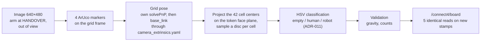
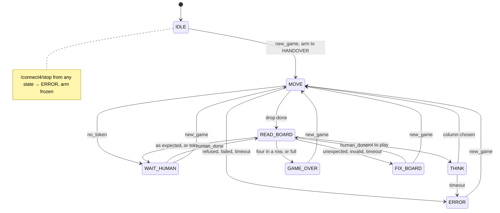

# P2-02 — Design: setup, kinematics, perception, game, software

> Authors: [KIN] Kinematics, [VIS] Vision, [DEC] Decision, [CTRL] Control · Reviewers: [ARC], [SAFE], [QA]
> Requirements: C-05, C-06, C-51, C-54 · Decisions: ADR-035 to ADR-038 · Measurements: MES-27 to MES-32, MES-63 to MES-66

**`v2.0.0` is the sim, `v2.1.0` the real arm** (ADR-034 Update). The numbers of §2, §3, §5 and §7 were measured on 2026-11-07 on prototypes kept in `experiences/connect4/`, the assumed grid model and no real grid; #76 puts them on one layout. §8 keeps what the real arm will need.

## 1. Physical setup (ADR-035, ADR-038)

The grid is placed **edge-on**: its plane contains the vertical axis of `shoulder_pan`, so the arm works in the plane of the grid. Seen from above, the 7 columns lie on a line that starts at the robot.

This table is the real setup. The sim of `v2.0.0` models it, with the values of §7.

| Item | Initial value | Why |
| --- | --- | --- |
| Grid | **Store-bought** classic Connect Four, 7 columns × 6 rows. Pitch, slot gap, token size and slot-entry height are **measured on the purchased grid** (step P2.1); the model used so far: pitch 37 mm, slot entries at 25 cm | Nothing to build, robust, tokens included, recognizable on video |
| Riser | The arm on a rigid block of about 8 cm (10 cm in sim, §7); arm and block clamped to the table | Lowers the grid relative to the arm: all 7 columns reachable, clearance 6.3–10.5 cm [MES-32], against 0.5 cm without it [MES-28] |
| Placement | Plane through the pan axis, columns at r ≈ 0.14 … 0.36 m, azimuth chosen so the webcam sees one face; placement jig | Edge-on is reachable, facing is not [MES-27] |
| Depth guide | Two sloped strips along the whole top edge: a V **across** the grid (entry about 20 mm, down to the slot gap), open along it | Across the grid the slot leaves a millimeter or two per side (to measure) and the flat rim of the token does not self-center: it is the tight direction. A per-column funnel does not fit, the slots are adjacent. Kept unless the camera alone does as well (comparison at step P2.8) |
| Along the grid | No guide. The token is released above the column: a round token whose center is above the column opening rolls or slides off the column wall into it | Expected capture of the order of ±0.7 × the token radius (friction 0.3, simple geometry): **measured in the spike** |
| Tokens | The game's: red for the human, yellow for the robot | HSV-distinct from the blue grid |
| Token supply (v1) | **Handover**: the robot waits in a `HANDOVER` pose with the gripper open; the human puts a yellow token between the jaws and says "token given"; the gripper closes (§5) | Nothing to build. A dispenser or a rack comes later (§9) |
| ArUco markers | 4 printed markers (`DICT_4X4_50`) stuck on the grid frame corners | Grid pose by perception (§3) |
| Wrist camera (`v2.1.0`, if kept, §8) | Probably the WowRobo 2 MP USB module for SO-ARM100/101 (30 fps, 3 m cable) on the printable wrist mount, as the staff indicates (2026-10-16, availability to confirm); otherwise a 32×32 UVC module on the optional SO-ARM100 mount (step P2.8) | Close-up on the token and the slot (§3.1), staff suggestion |

## 2. Kinematics (ADR-035)

### 2.1 The constraint

The token must stay in the plane of the grid, so the **jaw closing axis** (x of `gripper_frame_link`, `04` §1.1) must be **normal to the grid**. The tilt of the approach axis inside the grid plane does not matter: a disc rotated in its own plane is the same disc.

- **Grid facing the robot** (jaws along the radial direction): the approach axis must then be vertical, which the arm only achieves close to the table. Best achievable jaw error: 40–62° at 22–30 cm, 17–23° at 14 cm, 7–8° at 10 cm [MES-27]. **Rejected.**
- **Grid edge-on**: the jaws only have to be normal to the arm plane, which wrist roll at ±90° provides. At exactly ±90° the error is **2.8°**, a constant offset of the URDF wrist (`wrist_roll` origin, rpy 0.0487 rad) [MES-29]. It is a roll zero: at roll **+1.6195 rad**, with the TCP line 8 mm off the pan axis, the error is 0.00 to 0.03° at a constant pan [MES-64].

### 2.2 Computing a pose

The token does not sit on the TCP: it rests on the fixed jaw, its centre 3.15 mm off the TCP along x. The pose documented first (roll ±90°, TCP on the slot plane) dropped **0 token out of 28** [MES-64]. So the target is the **token centre**:

```text
release_pose(kin, target, q_seed):      # target = token centre, base_link
    roll = +1.6195 rad                  # +90° + 2.8°: jaws normal to the grid
    p = target - token offset           # 3.15 mm along the TCP's x; aim 1 mm towards the fixed jaw
    q = ik_pos(p, q_seed, roll)         # gives the pan
    q = ik_point(p, approach tilted 70°, q_seed = q, roll)
    return q, or None (unreachable: report it)
```

- `kinematics.py` does not change: `release_pose` lives in `so101_brain/drop.py`. The multi-start `drop_ik` of [MES-29] (0.26 s per pose) goes: this takes 10 to 36 ms and solves all 7 columns [MES-64].
- `ik_pos` alone is not enough: it flipped the tool on 6 poses of 135 (tilt 114–149°) [MES-64]. The tilt in the grid plane is free in theory, not for the jaws' clearance.

### 2.3 Motion of one move

`/brain/drop` does all of it, the arm at `HANDOVER`, a token between the open jaws:

1. Close, then check the token is held (§5). No token: refused, `no_token`, the arm has not moved.
2. → pre-drop: **height first**, then the column, min-jerk (`04` §6).
3. Descent to `release_pose` at 0.3 rad/s, token bottom about 8 mm above the guide. Joint interpolation from the pre-drop: no Cartesian line needed.
4. Open: the token falls through the guide.
5. Lift, back to `HANDOVER`, gripper open. The service replies.

A move lasts 5 to 8 s: 4.7–5.2 s measured without the pre-drop (close 0.8 s, two legs of 1.7–1.9 s, open 0.5 s) [MES-64], the pre-drop adds the rest (estimated).

| Tolerance of a drop | Along the grid | Across the grid |
| --- | --- | --- |
| Without guide, gaps 8.5 and 9.5 mm [MES-64] | ±12 mm | −2…+0.5 mm, a window of 2.5 to 3 mm |
| With the 30 mm guide [MES-63] | ±16 mm | −10…+6 mm |

The perception gives the slot within 0.8 mm across [MES-65], so without the guide the margin is thin: the guide stays, in sim too. It costs 2 cm of riser (§7).

### 2.4 Real-arm caveats

- **Calibration zero**: LeRobot's joint zeros are not the URDF's. `joint_zero_offsets` holds them, per arm (`driver_real.yaml`) [MES-30], [MES-55]: check them **before** any drop test (`07` §4).
- **Riser**: the table is 8 cm lower in `base_link`; phase-1 demos run without the riser. Arm and riser are clamped, and the arm on the riser goes through the `07` §3 commissioning again.
- **Fallback, taught poses**: the stack stopped (with the driver running, the 50 Hz `send_action` turns the torque back on), move the arm by hand above each column, record the joints, check with FK. Taught by hand, they keep the sag of a held pose. It bypasses model and calibration errors, but it stays a fallback: the plan is computed poses (phase-1 IK). The staff accepts it (2026-10-16) if the PR and the defense explain why and show that the computed poses were tried and fixed first.

## 3. Perception: reading the grid



- **One camera, the phase-1 one, and it does not move** [MES-65]: `sim_scene.yaml`, with `camera_extrinsics.yaml` reused, no new calibration. The base stays at the origin (§7): raising it would put the grid 79 mm off in the same file, 0.4 mm with the floor lowered. There is no `board_cam`. The grid is at azimuth −40°, square to the camera.
- **640×480 in game mode**: cells of 28–33 × 21–29 px, the 4 markers of 30 mm found every time; at 320×240 they are unreliable below 60 mm. The image rate falls to 3 to 5 Hz, the 50 Hz tick holds (p99 20 to 22 ms). Nothing may assume 10 Hz.
- **Grid pose**: `detect_markers` from phase 1, then an own `solvePnP`, since `calibration.py` handles the table plane only. Published as `/connect4/grid_pose`, with the TF of the grid. Accuracy at the slot entries: 0.3 mm along, 0.8 mm across, 0.9 mm in height [MES-65]. It is also the check: a fixed placement alone reads within 8 mm on one axis, and 5 mm + 5 mm + 1° breaks it.
- **Classification**: fraction of pixels inside each color's range within a disc per cell, on the token face plane, not the grid mid-plane. Red: the cube's ranges unchanged; yellow: `hsv_ranges(18, 40, 120, 30)`; threshold 0.35. **2100 of 2100 cells** right on 50 boards, shadows on, the arm at `HANDOVER` holding a token; 100 % too at 320×240 and in dim light [MES-65].
- **Column pitch and row pitch differ**: tokens stack at their diameter, 34 mm, not at the column pitch [MES-63].
- **Stability**: `/connect4/board` is published on stable reads only, 5 identical reads counted on new image stamps; its stamp is the first image of the streak, so `game_node` rejects a read older than the drop. No FK needed.
- **Validation**: `board.py` checks gravity and counts, an invalid board carries its reason. What the turn expects is in `turns.py` (§5).
- **Why not `perception_node`**: it would take tokens for the cube, and `fsm.py`'s `VERIFY` would retry. In game mode `board_reader_node` runs in its place (§6.1).
- **Costs**: a read takes 21 ms; the perception image needs no change [MES-65].

### 3.1 Wrist camera (staff suggestion, step P2.8, `v2.1.0`)

- **Why**: the token and the column walls are in the same image, so the offset between them is a **relative** measurement. Calibration, kinematic and camera-extrinsic errors cancel out; the known token diameter gives the scale in millimeters.
- **Look and correct**: at the end of the descent, one image → offset along the grid and across it → a small Cartesian correction → a second image to confirm → release. One or two corrections, not continuous servoing: ikpy is enough (ADR-008).
- **Token check**: after the handover, the same camera sees whether the token is between the jaws and how far off-center it is along the grid, which the drop pose then compensates.
- **Split**: perception measures the offset, the brain applies the correction (it owns every motion, ADR-037); the offset message is designed in step P2.8.
- **Hardware**: cable along the arm with slack for a ±90° wrist roll; its pose relative to `gripper_frame_link` comes from the mount drawing, checked once per session in a known pose.

## 4. Game engine

- Pure module `so101_connect4/game.py`, no dependency: **bitboards** (two integers, one per player), move generation, win detection by shifts, **negamax with alpha-beta**, center-first move ordering, transposition table, iterative deepening. Difficulty = maximum depth.
- A prototype reaches depth 10 to 12 in 1 s on an empty board, 12 to 17 mid-game, longest move 1.10 s; 100/100 against random from depth 2 [MES-66]. **1 s budget when a person plays; a fixed depth on the benches and in the tests**, so a seed replays the same game (100 games at depth 4: 1 to 2 s; with the 1 s budget: 446 s).
- Seeded tie-break, so tests are reproducible.

## 5. Turns (game state machine)

Pure module `so101_connect4/turns.py`; `game_node` calls `step()` at 10 Hz and does what it returns, as `brain_node` does with `fsm.py`.



**One turn, call by call**:

| # | Who | What |
| --- | --- | --- |
| 1 | Console or bench | `/sim/connect4/drop_token`: a red token falls |
| 2 | Console or bench | `/sim/connect4/give_token`: a yellow token between the open jaws |
| 3 | Console or bench | `/connect4/human_done` |
| 4 | `game_node`, `READ_BOARD` | Waits for a stable board with one more red token. A board unchanged is "not yet", not an error: no settle delay |
| 5 | `game_node`, `THINK` | The engine, outside the tick |
| 6 | `game_node`, `MOVE` | `board.column_target`, then `/brain/drop`, which replies at `HANDOVER` |
| 7 | `game_node`, `READ_BOARD` | Expects the yellow token: then `WAIT_HUMAN`, or `GAME_OVER` |

| Event | Seen by | Then |
| --- | --- | --- |
| Illegal or full column | Client (`legal` of `/connect4/state`); the driver refuses too | Nothing changes |
| Human token never seen; board invalid or never stable | `READ_BOARD`, 5 s | `FIX_BOARD` with the reason |
| Two tokens, wrong color, not at the landing cell | `READ_BOARD` | `FIX_BOARD` |
| No token in the jaws | `/brain/drop`, `no_token`, arm still | `WAIT_HUMAN`, the robot's turn: give a token |
| Token lost during the move | `READ_BOARD` timeout, a recent read unchanged | `WAIT_HUMAN`, the robot's turn |
| Token in the wrong column | `READ_BOARD` | The camera wins, the game goes on, `missed` counts it |
| Brain refuses, drop fails | `/brain/drop` reply | `ERROR` |
| Timeouts | `READ_BOARD` 5 s, `THINK` 5 s, `MOVE` 90 s, then `/brain/stop` | As above |
| `/connect4/stop` | Any state | `ERROR`, `/brain/stop` called |
| Robot plays first | `/connect4/new_game` with `data: true` | `WAIT_HUMAN`, the robot's turn |

- **The arm only moves in `MOVE`**, never in `WAIT_HUMAN` or `FIX_BOARD` (P2-05): 0 moves outside it over 8 fault campaigns on a fake world [MES-66].
- **`FIX_BOARD` is a dead end in sim**: no hand can fix a grid, so `new_game` leaves it and the bench counts a failure.
- **No `token_given` and no `/brain/set_gripper` in `v2.0.0`**: `/brain/drop` closes the jaws and judges the grip itself. A token stops the jaws at 2.7 %, empty jaws reach 0 %, effort 1.0 against 0, with `close_pct` 0 [MES-64]. `v2.1.0` adds the handover by a person: a self-loop on `WAIT_HUMAN`, with the safety work of §8.
- `new_game` is refused before the first `/end_effector_pose`: "Brain node ready" does not mean the brain has `/joint_states` (AGENTS.md).

## 6. Software architecture and interfaces (ADR-037)

New package `so101_connect4` (ament_python):

| Element | Runs in | Role |
| --- | --- | --- |
| `game.py` | pure, unit-tested | Engine (§4) |
| `turns.py` | pure, unit-tested | Turns (§5) |
| `board.py` | pure, unit-tested | Cell geometry, classification, validation, `column_target`; no ROS |
| `client.py` | console, bench | `/connect4/state` and the services, no rule |
| `play.py` | control container | The console, `tools/so101 play` |
| `board_reader_node` | perception container | Camera → `/connect4/board`, `/connect4/grid_pose`, debug image |
| `game_node` | control container | Around `turns.py`; calls `/brain/drop` and `/brain/handover` |
| `config/connect4_grid.yaml` | both containers | The layout (§7): here because the perception container does not build `so101_bringup` |

Next to it: `so101_brain/drop.py`, pure (§2), and `so101_driver/connect4_sim.py` (§7). The brain keeps every motion, with **`fsm.py` and `grasp_planner.py` unchanged** (ADR-037 Update). The game node never publishes `/joint_command`, and a guard checks it.

**Interfaces.** They become contract in `01` §3, with the approval of the owners on both sides, in the PR that implements each one.

| Name | Type | Server or producer → consumers | Content |
| --- | --- | --- | --- |
| `/connect4/board` (topic) | `so101_interfaces/msg/Connect4Board` (new) | board_reader → game_node | `header`, stamp = first image of the stable streak; `int8[42] cells` (row-major from the bottom row, 0 empty, 1 human, 2 robot), `bool valid`, `string reason`; stable reads only; Reliable, depth 1 |
| `/connect4/grid_pose` (topic) | `geometry_msgs/PoseStamped` | board_reader → game_node, RViz | Grid frame in `base_link`: origin at the center of cell (column 0, row 0) in the mid-plane, x outward along the columns (column 0 nearest the arm), z up, y = z × x; Reliable, transient_local, depth 1 |
| `/connect4/debug_image` (topic) | `sensor_msgs/Image` | board_reader → RViz | Grid outline, classified cells, chosen column; Best effort |
| `/connect4/state` (topic) | `std_msgs/String`, JSON | game_node → console, bench, debug image | `state`, `reason`, `turn`, `board`, `legal`, `last`, `result`, `missed`; Reliable, transient_local, depth 1 |
| `/connect4/new_game` (service) | `std_srvs/SetBool` | game_node | `data: true`, the robot plays first. Refused during a move |
| `/connect4/human_done`, `/connect4/stop` (services) | `std_srvs/Trigger` | game_node | End of the human's turn; abort |
| `/brain/drop` (service) | `so101_interfaces/srv/Drop` (new) | brain, game mode only | `geometry_msgs/Point target`, token centre in `base_link` → `bool success`, `string message`. **Replies at the end of the move**, `/brain_state` stays `IDLE`. Refused: not IDLE, a task running, stale joints, `no_token`, `unreachable`. `/brain/stop` cuts it |
| `/brain/handover` (service) | `std_srvs/Trigger` | brain, game mode only | Opens the gripper, reaches `HANDOVER`, replies at the end |
| `/sim/connect4/drop_token` (service, **sim only**) | `so101_interfaces/srv/DropToken` (new: `column`, `color`) | driver | The simulated human plays (§7) |
| `/sim/connect4/give_token` (service, **sim only**) | `std_srvs/Trigger` | driver | A yellow token between the open jaws (§7) |
| `/sim/connect4/reset_board` (service, **sim only**) | `std_srvs/Trigger` | driver | Every token back to its parking place |
| `/sim/ground_truth/connect4_board` (topic, **bench only**) | `so101_interfaces/msg/Connect4Board` | driver → `evaluate` | Under `expose_ground_truth`, as the other ground truth (C-06) |

Rules carried over: no backend import in `so101_connect4` (C-05), no ground truth outside `test/` (C-06), QoS rules of ADR-004; `tools/ci/guards.sh` extends them to the package.

### 6.1 Two phases on one branch

Both phases live on `main`, with no long-lived branch: phase 1 stays what the stack does by default, and the game is a mode.

| | Phase 1 (default) | Game (`CONNECT4=true`) |
| --- | --- | --- |
| Scene | `sim_scene.yaml`, 320×240 | The same, plus grid, tokens, the floor lowered, 640×480 |
| Perception container | `perception_node` | `board_reader_node`, `perception_node` does not run |
| Control container | Driver, brain | Plus `game_node`, `/brain/drop`, `/brain/handover`, `/sim/connect4/*`; no `/sim/randomize` |
| Unchanged | `fsm.py`, `grasp_planner.py`, `perception_node.py`, `_connect_arm` | Same files |
| Proof | E2E on each PR, 50 episodes each night | One game on each PR, 10 each night |

- The switch goes `docker/.env` → compose → `control_entrypoint.sh` → `connect4:=` on `sim.launch.py`, as `USE_SIM` does. `CONNECT4=true tools/so101 up` needs no `.env` edit. `up` applies it, `restart` keeps the old environment [MES-66].
- `tools/so101 test`, `cycle` and `bench` force `CONNECT4=false`, so a leftover value cannot break phase 1. With the default arguments, a test compares the nodes and the scene with today's.
- `CONNECT4=true` with `USE_SIM=false` is refused in `v2.0.0`.
- The tag `v1.3.0` is phase 1 as released: a checkout of it is the fallback.

## 7. Simulation (ADR-036)

**Scene**: `so101_bringup/sim_scene.py` generates it with `mujoco.MjSpec` from a copy of the provided scene, the same generator as the phase-1 camera and markers; the driver loads it through `scene_path`. `sim/` is never touched.

| Item | Value | Source |
| --- | --- | --- |
| Base | **Stays at the origin**: floor and table lowered, so MuJoCo world = `base_link` holds (`driver_node.py:425`), for the ground truth, the FK tests and the extrinsics | [MES-63], [MES-65] |
| Riser | **10 cm**, not 8: at 8 `lower_arm` hits the guide and column 6 is lost; 14/14 at 10 cm | [MES-63] |
| Grid | Model of §1, unless #75 measures one: 7 × 6, column pitch 37 mm, **row pitch 34 mm**, slot gap 9.5 mm, slot entries 25 cm above the table, box geoms | [MES-28], [MES-63] |
| Placement | Azimuth −40°, columns at r = 0.14 … 0.36 m, grid plane 3.85 mm off the pan axis on the fixed-jaw side | [MES-64], [MES-65] |
| Tokens | 42, Ø 34 × 6.5 mm, free joints, spares parked near the origin: far ones streak the shadows | [MES-65] |
| Depth guide | 30 mm high | [MES-63] |
| Markers | 4, `DICT_4X4_50`, 30 mm, on the grid frame | [MES-65] |
| `HANDOVER` | Candidate `[-1.0, -0.6, 0.6, 1.1, 1.57]`: pan ≤ −0.7 hides nothing from the camera | [MES-65] |

**Contact working set** [MES-63], [MES-64]. The provided defaults fail: tokens creep at 70 mm/s, jaws squeeze through a token, and it is lost. `solref` 20 ms: 84 tokens of 84 through the slot bottom. Margin 0.5 mm: NaN.

| Parameter | Value |
| --- | --- |
| Cone, `impratio` | Elliptic, 100 |
| Token `solref`, `solmix` | 4 ms, 1000 |
| Token `solimp` with the jaws | 0.99 0.999 0.0005 0.5 2, priority 1 |
| Free-joint damping | 0.005 |
| Margin | 0 |
| Sleeping | On, tolerance 0.01: required, the tick p99 reaches 29.7 ms without it |
| Timestep | 2 ms |
| Rendering | `shadowsize` 0 to 1024 and floor `reflectance` 0: chosen in #79 for image ≥ 3 Hz, tick p99 ≤ 25 ms |

With it: 378 drops of 378 in the right cell, settled within 0.66 s; a full stack; the token held up to 1.5 rad/s, slip under 4 mm; the driver's tick p99 20.3 ms with 42 tokens, as phase 1 [MES-63]. MuJoCo's sleeping needs the 3.15 of the image; the kit's lock file says 3.10.

**Phase-1 objects**: `connect()` calls `randomize_object()`, which needs `pickup_object_free`. The cube stays in the scene as a ghost set by the generator (`contype` 0, gravity compensated, no visual), the box is moved. Nothing is parked at run time.

**The simulated human** (`so101_driver/connect4_sim.py`, pure, and the services next to `/sim/randomize`):

- `drop_token` teleports a token above the column and lets it fall; it refuses a full column.
- `give_token` places a yellow token between the open jaws, its axis half a thickness off the fixed jaw, with a seeded offset of ±3 mm along the grid and ±5 mm in depth. Its gravity is cancelled through `qfrc_applied` until both jaws touch it: a free token falls 30 mm in 0.1 s, and the jaws need 0.46 s.
- `reset_board` puts every token back in 19 µs plus a `mj_forward`, with no settling.
- They run in the control executor: `MjData` is written under `_backend_lock` only (`driver_node.py:184`), no `mj_step`, and `model` is never written, since the camera reads it unlocked.
- None of them returns information to the pipeline, which reads the grid through the camera (C-06).

## 8. Real arm (`v2.1.0`)

- Build: riser; depth guide; a placement jig with the base outline and the grid position (as `04` §7).
- Camera: a webcam facing the grid (`07` §4, ADR-021).
- Order: phase-1 commissioning on the riser (`07` §3) → joint zeros checked → **the real spike below** → handover tuning → drop bench → games.

**Findings of the expert review of 2026-11-07.** Nothing here was run on a real grid: numbers come from the URDF model and the phase-1 measurements, and most are computed or estimated. They were left out of `v2.0.0`, and they must not be lost.

| Topic | Finding | What to do |
| --- | --- | --- |
| **Roll and slot** | `wrist_roll` stops 0.17 rad short, at rest (`07` §4): the token's envelope is 12.2 mm for a slot of 8.5–10.5 mm (computed) | A trim at rest, `q_cmd += q_goal − q_measured`, 2–3 times, then a release threshold; `reach_tol` 0.10 tolerates 36 mm across |
| **Sag and pan** | −13 to −35 mm at r = 0.36 (estimated); pan: 3.6 mm per 0.01 rad at that radius | Same trim; precision comes from stopping, not from slowness, which only brings stick-slip [MES-62] |
| **Real spike first** | Half a day, 2 people, `07` §7, no riser: a cardboard rail at z = 0.18, 7 columns × 5 returns, 30 closes empty, 30 on a token, 5 min hold, then 10 releases on columns 1, 4, 7 | GO after trim: across ≤ 4 mm, along ≤ 6 mm, σz ≤ 1.5 mm, token ≤ 3°, ≥ 9/10, no Overload, no empty "held". NO-GO: across > 6.75 mm or token > 6° |
| **Blocking: pinch** | No slow close, 50 % torque, 15–20 N on a finger (estimated), and a finger is judged "held" | Brain ramp ≤ 25 %/s, an upper bound that reopens; tested on a dummy with a dynamometer, **never a finger** |
| **Blocking: paths** | `HANDOVER` opposite `PARK`: 82 paths of 96 cross the grid, same side 0 of 104 (URDF model); `HANDOVER` → pre-drop touches in 33 of 168 | Phase-2 `shutdown_pose` on the `HANDOVER` side, a via-pose, clearance ≥ 3 cm with the sag, a sim test at 0 contacts |
| **Blocking: stop** | `/brain/stop` is not latched; a stop or a bus loss then `down` drops the arm; no cut-off but the plug | A latched stop, gripper open while waiting, `tools/so101 stop`, a DC switch in reach, a rule for guests |
| **Blocking: speed** | The `v2.0.0` sim moves at 1.0 rad/s, limiter 1.5 | `connect4_real.yaml` loaded last: brain 0.7, limiter 1.0, after measuring; TCP 0.22 m/s at 0.7 |
| **Blocking: riser** | 0.7 N·m at reach (URDF) | Riser bolted, 2 clamps, a 20 N test |
| **Grid camera** | No tool calibrates facing the grid (table in view 14 cm, board 19 cm); stickers do not fit a store-bought grid (free corner 16–20 mm, 16 mm found ≤ 5 %) | Grid pose by 3 touches, `calibrate_grid`, refused above 4 mm; holes with `findCirclesGrid`, 240/240 on synthetic images, on a **neutral background**, so the human stays on the camera side |
| **Webcam link** | 26 to 49 % of drops per game over usbip (estimated); the driver does not reopen it | `camera_stale`, arm still, stack restarted, `new_game` resumes from the grid |
| **Two setups** | `perception_node` assumes the table at z = 0: a riser breaks phase 1 by about 7 cm | Film phase 1 before mounting the riser; a plateau under cube and bowl as a reserve |
| **Wrist camera** | 4 M tickets, the hardware unconfirmed, ADR-038 expects no gain | Proposed cut: decide at the start of `v2.1.0` |

## 9. Stretch features (level 3)

| Feature | What it adds | Note |
| --- | --- | --- |
| Difficulty levels | Engine depth as a parameter | Trivial |
| Automatic human-move detection | Board stable with exactly one new token | Replaces `/connect4/human_done`. In sim, a few lines of `turns.py`; on the real arm, safety re-review [SAFE] |
| Robot commentary | LLM prompt with the board, text-to-speech | Text only, never in the motor loop |
| Token supply without the human | A rack (tokens on edge in the arm plane, like Scrabble tiles on their stand: same jaw orientation as the drop), or a vertical dispenser (tokens stacked flat, the bottom one taken from the side with the wrist roll at 0, then turned into the grid plane by rolling to ±90°) | A pick service next to `/brain/drop`; reach of a horizontal side grasp to check with the kinematics script |
| Continuous visual servoing | Pinocchio differential IK at the wrist-camera rate, instead of look and correct (§3.1) | ADR-008 "reconsider if" |
