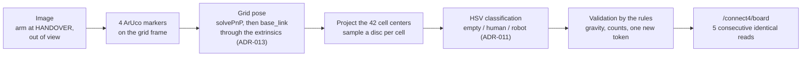
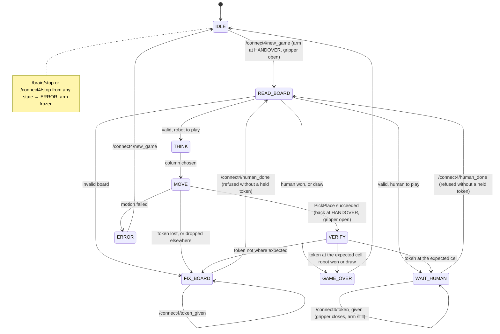

# P2-02 — Design: setup, kinematics, perception, game, software

> Authors: [KIN] Kinematics, [VIS] Vision, [DEC] Decision, [CTRL] Control · Reviewers: [ARC], [SAFE], [QA]
> Requirements: C-05, C-06, C-51, C-54 · Decisions: ADR-035 to ADR-038 · Measurements: MES-27 to MES-32

## 1. Physical setup (ADR-035, ADR-038)

The grid is placed **edge-on**: its plane contains the vertical axis of `shoulder_pan`, so the arm works in the plane of the grid. Seen from above, the 7 columns lie on a line that starts at the robot.

| Item | Initial value | Why |
| --- | --- | --- |
| Grid | **Store-bought** classic Connect Four, 7 columns × 6 rows. Pitch, slot gap, token size and slot-entry height are **measured on the purchased grid** (step P2.1); the model used so far: pitch 37 mm, slot entries at 25 cm | Nothing to build, robust, tokens included, recognizable on video |
| Riser | The arm on a rigid block of about 8 cm; arm and block clamped to the table | Lowers the grid relative to the arm: all 7 columns reachable, clearance 6.3–10.5 cm [MES-32], against 0.5 cm without it [MES-28] |
| Placement | Plane through the pan axis, columns at r ≈ 0.14 … 0.36 m, azimuth chosen so the webcam sees one face; placement jig | Edge-on is reachable, facing is not [MES-27] |
| Depth guide | Two sloped strips along the whole top edge: a V **across** the grid (entry about 20 mm, down to the slot gap), open along it | Across the grid the slot leaves a millimeter or two per side (to measure) and the flat rim of the token does not self-center: it is the tight direction. A per-column funnel does not fit, the slots are adjacent. Kept unless the camera alone does as well (comparison at step P2.8) |
| Along the grid | No guide. The token is released above the column: a round token whose center is above the column opening rolls or slides off the column wall into it | Expected capture of the order of ±0.7 × the token radius (friction 0.3, simple geometry): **measured in the spike** |
| Tokens | The game's: red for the human, yellow for the robot | HSV-distinct from the blue grid |
| Token supply (v1) | **Handover**: the robot waits in a `HANDOVER` pose with the gripper open; the human puts a yellow token between the jaws and says "token given"; the gripper closes (§5) | Nothing to build. A dispenser or a rack comes later (§9) |
| ArUco markers | 4 printed markers (`DICT_4X4_50`) stuck on the grid frame corners | Grid pose by perception (§3) |
| Wrist camera | Probably the WowRobo 2 MP USB module for SO-ARM100/101 (30 fps, 3 m cable) on the printable wrist mount, as the staff indicates (2026-10-16, availability to confirm); otherwise a 32×32 UVC module on the optional SO-ARM100 mount (step P2.8) | Close-up on the token and the slot (§3.1), staff suggestion |

## 2. Kinematics (ADR-035)

### 2.1 The constraint

The token must stay in the plane of the grid, so the **jaw closing axis** (x of `gripper_frame_link`, `04` §1.1) must be **normal to the grid**. The tilt of the approach axis inside the grid plane does not matter: a disc rotated in its own plane is the same disc.

- **Grid facing the robot** (jaws along the radial direction): the approach axis must then be vertical, which the arm only achieves close to the table. Best achievable jaw error: 40–62° at 22–30 cm, 17–23° at 14 cm, 7–8° at 10 cm [MES-27]. **Rejected.**
- **Grid edge-on**: the jaws only have to be normal to the arm plane, which wrist roll at ±90° provides. Residual error: **2.8°**, a constant offset of the URDF wrist (`wrist_roll` origin, rpy 0.0487 rad) [MES-29]; 1–3° over r = 14–36 cm, z = 6–34 cm [MES-27].

### 2.2 Computing a pose

```text
drop_ik(p, n):                          # p = TCP target, n = grid normal
    for roll in (+90°, −90°):
        for seed in multi-start seeds (04 §3.1, pan = −azimuth seen from the pan axis):
            q = position IK on the 4 other joints, wrist_roll locked at roll
            keep q if FK error < 1 mm
    return the kept q with the smallest jaw error, or None (unreachable: report it)
```

- Measured on 120 targets: `drop_ik` solves **every reachable target** (81 % of the map, the rest being out of reach); ikpy `orientation_mode="X"` (roll free) only 11 % with up to 15 seeds [MES-29].
- Time: median 0.26 s, max 1.2 s per pose (every seed is tried). A move needs 2 poses (pre-drop, drop; `HANDOVER` is fixed): about 0.5 s in the brain's worker thread (ADR-017), fine for a turn-based game. **No Pinocchio needed** [MES-21] (reproduced on 2026-10-09).

### 2.3 Motion of one move

1. Token held at `HANDOVER` (checked by the gripper position, §5).
2. → pre-drop: token bottom about 3 cm above the depth guide of the column, jaws normal to the grid, min-jerk (`04` §6).
3. Straight descent (3 to 5 Cartesian waypoints) until the token bottom is about 5 mm above the guide entry: the jaws straddle the token across the grid, so they cannot enter the guide. With the wrist camera: look and correct (§3.1). Open the gripper: the token falls through the guide.
4. Lift back → `HANDOVER`, gripper open. The grid can only be read when the arm is out of `board_cam`'s view: check in the scene (step P2.3) that the `HANDOVER` pose does not hide the grid.

### 2.4 Real-arm caveats

- **Calibration zero**: LeRobot's zero is the middle of the recorded range. For this arm it is 22.9° away from the held calibration pose on `shoulder_lift` [MES-30]. If the URDF zero is that held pose, the real TCP is off by centimeters: check it **before** any drop test (`07` §4).
- **Riser**: the table is 8 cm lower in `base_link`; phase-1 demos run without the riser. Arm and riser are clamped, and the arm on the riser goes through the `07` §3 commissioning again.
- **Fallback, taught poses**: torque off (uncomment the provided `disable_torque()` lines for that session only), move the arm by hand above each column, record `/joint_states`, check with FK. It bypasses model and calibration errors, but it stays a fallback: the plan is computed poses (phase-1 IK). The staff accepts it (2026-10-16) if the PR and the defense explain why and show that the computed poses were tried and fixed first.

## 3. Perception: reading the grid



- **Grid pose**: `solvePnP` on the 16 marker corners with the known frame layout, as the phase-1 calibration tool (ADR-013). Published as `/connect4/grid_pose`; it also gives the drop poses, so the grid may be moved slightly between games.
- **Classification**: fraction of pixels inside each color's HSV range within a disc of radius 0.3 × cell; thresholds tuned on recorded images, manual camera settings (ADR-011, `07` §4).
- **Validation, cheap and strong**: no token above an empty cell; token counts consistent with whose turn it is; exactly one new human token after the human's turn; the robot's token at the expected cell after its move. An invalid board leads to `FIX_BOARD` (§5), never to a move.
- **Resolution**: aim for ≥ 10 px per cell. The phase-1 camera gives 7.7 × 6.3 px at 320×240 (15 × 12 px at 640×480); a camera facing the grid at 45 cm gives 13 px at 320×240 [MES-31]. These numbers are for the 24 mm pitch of the first design: a store-bought grid (about 37 mm) gives about 1.5 times more. Sim: dedicated `board_cam` (ADR-036). Real: a webcam facing the grid ("1 camera + whatever you add", [BOOT2 p15]).

### 3.1 Wrist camera (staff suggestion, step P2.8)

- **Why**: the token and the column walls are in the same image, so the offset between them is a **relative** measurement. Calibration, kinematic and camera-extrinsic errors cancel out; the known token diameter gives the scale in millimeters.
- **Look and correct**: at the end of the descent, one image → offset along the grid and across it → a small Cartesian correction → a second image to confirm → release. One or two corrections, not continuous servoing: ikpy is enough (ADR-008).
- **Token check**: after the handover, the same camera sees whether the token is between the jaws and how far off-center it is along the grid, which the drop pose then compensates.
- **Split**: perception measures the offset, the brain applies the correction (it owns every motion, ADR-037); the offset message is designed in step P2.8.
- **Hardware**: cable along the arm with slack for a ±90° wrist roll; its pose relative to `gripper_frame_link` comes from the mount drawing, checked once per session in a known pose.

## 4. Game engine

- Pure module `so101_connect4/game.py`, no dependency: **bitboards** (two integers, one per player), move generation, win detection by shifts, **negamax with alpha-beta**, center-first move ordering, transposition table, iterative deepening within a time budget (1 s). Difficulty = maximum depth.
- Deterministic tie-break (seeded) so tests are reproducible.
- Python speed (depth reached in 1 s) is measured during the spike; if too slow, cap the depth: a depth-6 player already beats casual players.

## 5. Turns and safety (game state machine)



- **The arm only moves in `MOVE`** (and back to `HANDOVER`), never in `WAIT_HUMAN` or `FIX_BOARD` (P2-05); only the gripper closes there, on "token given".
- **Handover**: `/connect4/token_given` is pressed by the person holding the token. The gripper then closes slowly to a squeeze target just below the token thickness (measured once: the squeeze, and so the force, stays small); the arm does not move. The gripper position after closing tells whether a token is held (phase-1 grasp detection, `09` step 4.4).
- `/connect4/human_done` is the human saying "my hands are out of the workspace" (level 2). Detecting it automatically is a stretch feature and must be re-reviewed by [SAFE].
- The phase-1 safety layers stay as they are (ADR-023): limiter and clamp in the driver, reduced real-arm speed, `/brain/stop`.

## 6. Software architecture and interfaces (ADR-037)

New package `so101_connect4` (ament_python):

| Element | Runs in | Role |
| --- | --- | --- |
| `game.py` | pure, unit-tested | Engine (§4) |
| `board.py` | pure, unit-tested | Cell geometry, classification and validation on an image, no ROS |
| `board_reader_node` | perception container | Camera → `/connect4/board`, `/connect4/grid_pose`, debug image |
| `game_node` | control container | Game state machine (§5); builds `PickPlace` goals from the grid pose and the column |
| `scene_connect4.xml` + assets | driver (sim) | Phase-2 scene (ADR-036) |

The brain keeps every motion: it serves a new **`PickPlace` action**, and phase 1's `/brain/start` becomes a client of the same code path (ADR-037). The game node never publishes `/joint_command`.

**Proposed interfaces.** They become contract only once approved by the owners on both sides (`01` §3), in the PR that implements them.

| Name | Type | Server or producer → consumers | Content |
| --- | --- | --- | --- |
| `/connect4/board` (topic) | `so101_interfaces/msg/Connect4Board` (new) | board_reader → game_node | `header`, `int8[42] cells` (row-major from the bottom row, 0 empty, 1 human, 2 robot), `bool valid`, `string reason`; 5 Hz while the arm is out of view; Reliable, depth 1 |
| `/connect4/grid_pose` (topic) | `geometry_msgs/PoseStamped` | board_reader → game_node, RViz | Grid frame in `base_link`: origin at the center of the bottom-left cell, x along the columns, y = grid normal towards the camera, z up; Reliable, transient_local, depth 1 |
| `/connect4/debug_image` (topic) | `sensor_msgs/Image` | board_reader → RViz | Grid outline, classified cells, status; Best effort |
| `/connect4/state` (topic) | `std_msgs/String` | game_node → human, tests | State, whose turn, last move, result; Reliable, transient_local, depth 1 |
| `/connect4/new_game`, `/connect4/token_given`, `/connect4/human_done`, `/connect4/stop` (services) | `std_srvs/Trigger` | game_node | Start; close the gripper on the handed token (arm still); end of the human's turn, refused without a held token; abort |
| `/brain/pick_place` (action) | `so101_interfaces/action/PickPlace` (new) | brain | Goal: pick mode (`POSE`, or `IN_GRIPPER` for a token already held), pick pose, place pose, orientation constraint (free, point down, jaw axis normal to a vector), release height, end pose (`PARK` or `HANDOVER`). Feedback: phase. Result: success, message (token lost, unreachable…) |
| `/brain/set_gripper` (service) | `std_srvs/SetBool` | brain | `true` closes to the squeeze target, `false` opens; gripper only, refused while a motion runs. `success` = a token is held |
| `/sim/connect4/drop_token` (service, **sim only**) | `so101_interfaces/srv/DropToken` (new: `column`, `color`) | driver | The simulated human plays (§7) |
| `/sim/connect4/give_token` (service, **sim only**) | `std_srvs/Trigger` | driver | The simulated human hands a yellow token: placed between the open jaws with a random offset (§7) |
| `/wrist_cam/image_raw`, `/wrist_cam/camera_info` (topics) | `sensor_msgs/Image`, `CameraInfo` | driver → perception, RViz | Wrist camera (§3.1), same rules as `/external_cam/*` (`01` §3), frame `wrist_cam_optical_frame`; only when the driver parameter `wrist_cam` is true |

Rules carried over: no backend import in `so101_connect4` (C-05, extend `tools/ci/guards.sh` to the package); no ground truth outside `test/` (C-06); QoS rules of ADR-004.

## 7. Simulation (ADR-036)

- **Scene**: generated with `mujoco.MjSpec` from a copy of the provided `scene_tek5.xml` (never modified, ADR-036 update): robot base raised by the riser height, a riser box, the wrist camera on the `gripper` body, then the measured grid (box geoms), the depth guide, 21 + 21 tokens (cylinders with free joints), the ArUco markers (textures, as in `exp_perception_calib.py`) and `board_cam` facing the grid.
- **Loading**: the mechanism planned for the phase-1 calibration scene (`05` §5): MuJoCo resolves `include` paths relative to the main file, so the provided asset folder is copied (or linked) into a temporary folder next to our scene. Then, **next to the provided `_connect_arm`, which stays untouched** (ADR-032): `disconnect()`, set `scene_path` and `camera_name`, `connect()`. `SO101Sim.connect()` reloads the model from `scene_path` [CODE].
- **The phase-1 cube**: `connect()` calls `randomize_object()`, which needs `pickup_object_free`. The cube stays in the scene and is moved out of the play area right after loading (sim-only driver code).
- **The simulated human**: `/sim/connect4/drop_token` teleports a red token above a column and lets it fall; `/sim/connect4/give_token` places a yellow token between the open jaws, off-center by up to ±3 mm along the grid and ±5 mm in depth, as a human hand would. Both act on the scene and give no information to the pipeline, which still reads the grid through the camera (C-06).
- **Physics**: thin tokens in narrow slots are a classic source of contact jitter in MuJoCo; `margin`, `solref` and the token mass are tuned during the spike, which also counts jammed tokens.

## 8. Real arm

- Build: riser; depth guide; ArUco stickers on the grid; a placement jig with the base outline and the grid position (as `04` §7).
- Camera: webcam facing the grid at about 45 cm, manual exposure and white balance (`07` §4, ADR-021); its extrinsics with the phase-1 ArUco tool (ADR-013).
- Order: phase-1 commissioning on the riser (`07` §3) → calibration-zero check [MES-30] → handover tuning (`HANDOVER` pose, squeeze target) → drop bench at low speed → games.

## 9. Stretch features (level 3)

| Feature | What it adds | Note |
| --- | --- | --- |
| Difficulty levels | Engine depth as a parameter | Trivial |
| Automatic human-move detection | Board stable with exactly one new token and no motion in the grid area for 1 s | Replaces `/connect4/human_done`; safety re-review [SAFE] |
| Robot commentary | LLM prompt with the board, text-to-speech | Text only, never in the motor loop |
| Token supply without the human | A rack (tokens on edge in the arm plane, like Scrabble tiles on their stand: same jaw orientation as the drop), or a vertical dispenser (tokens stacked flat, the bottom one taken from the side with the wrist roll at 0, then turned into the grid plane by rolling to ±90°) | `PickPlace` pick mode `POSE`; reach of a horizontal side grasp to check with the kinematics script |
| Continuous visual servoing | Pinocchio differential IK at the wrist-camera rate, instead of look and correct (§3.1) | ADR-008 "reconsider if" |
