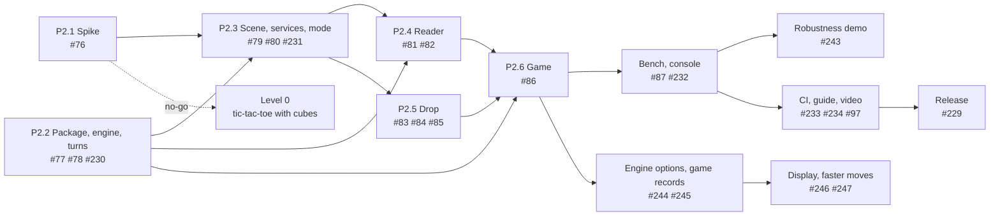

# P2-04 — Phase-2 roadmap (Connect Four)

> Author: [CP] Project lead · Reviewers: all experts
> Same rules as the phase-1 roadmap [`../09_roadmap_step_by_step.md`](../09_roadmap_step_by_step.md), which this document details for its stage 7: every step ends with **evidence** ("Done when"), the riskiest part first. **Unlike `09`, this plan has dates** (§3): the hand-in is 2026-11-20 23:42. Lanes as in `09` §1.2: **A** driver, infra and hardware · **B** kinematics and brain · **C** perception.
> Tickets: `P2.<step><letter>`, under the stage-7 epic (`../15` §12) · Decisions: ADR-034 to ADR-038 · Risks and tests: [`P2-03`](P2-03_plan_risks_tests.md) · Targets `P2-xx`: [`P2-01`](P2-01_scope_and_demo.md) §4

## 1. Overview

`v2.0.0` ends at P2.6. The rest is `v2.1.0`, after the hand-in.

| Step | Lane | Tickets | Outcome | Level (`P2-01` §2) |
| --- | --- | --- | --- | --- |
| **P2.0** Pitch ✅ | CP | #73, #74 | Validated by the teaching staff; scope set to the sim | — |
| **P2.1** Drop spike ✅ | B | #76 | One layout, go / no-go on dropping | Go: 1; no-go: 0 |
| **P2.2** Game engine ✅ | B | #77, #78, #230 | Package, `game.py`, `turns.py` tested | — |
| **P2.3** Scene and loading ✅ | A | #79, #80, #231 | Game scene, sim services, `CONNECT4` mode | — |
| **P2.4** Board reader ✅ | C | #81, #82 | Grid read from the camera | — |
| **P2.5** Token in the gripper and `/brain/drop` ✅ | B | #83, #84, #85 | One move through the brain, `fsm.py` untouched | — |
| **P2.6** Sim integration | Shared | #86, #87, #232, #233, #234, #243 to #247 | Full games in sim, a console, the CI, the robustness demo; the engine's levels and reasons, the games' records | **1** |
| **P2.7** Real arm (`v2.1.0`) | Shared, A leads | #88 to #91, #248 | Full games on the real arm, filmed; the grid printed from the sim's model | **2** |
| **P2.8** Wrist camera (`v2.1.0`) | A, C, B | #92 to #95 | Look and correct, if kept (`P2-02` §8) | 2, more reliable |
| **P2.9** Stretch | Anyone | none | One or two bonus features, only if ahead | **3** |

### 1.1 Dependencies

**Critical path**: #76 → #79 → #80 → #84 → #86 → #87 → #229. The real grid is `v2.1.0`, printed from the model (#248) or bought and measured (#75): the sim runs on the model of `P2-02` §7, and every dimension is a parameter of `connect4_grid.yaml`.

### 1.2 Who does what

| Lane | Tickets | Note |
| --- | --- | --- |
| A — Driver, infra | #79, #80, #231, #233 | Scene, sim services, mode, CI |
| B — Kinematics and brain | #76, #77, #78, #83, #84, #85, #230, #244, #247 | Spike, engine, turns, `/brain/drop`; the engine's options, faster moves |
| C — Perception | #81, #82 | Grid reading |
| Shared | #86, #87, #232, #234, #243, #245, #246, #97, #98, #229 | Everyone plays a game and can explain each block before the defense (C-50) |

---

### Step P2.0 — Pitch validated ✅ (7.1a, 7.1b)

- **Done**: validated by the teaching staff on 2026-10-09 (ADR-034); questions of `P2-03` §4 answered on 2026-10-16; scope set to the sim on 2026-11-07, after an expert review that measured it [MES-63 to MES-66].

### Step P2.1 — Drop spike ✅ (#76)

- **Goal**: know that the arm can drop a token, on one layout, before building around it. The expert review proved each part on a prototype: #76 puts them together.
- **Tasks**: `experiences/connect4/scene/exp_connect4_scene.py` on the layout of `P2-02` §7 with the pose of `experiences/connect4/drop/`; 100 drops, 100 with a TCP offset of ±5 mm, capture sweep, full stacks read with the method of `experiences/connect4/reading/`.
- **Done when**: results recorded; **go** if ≥ 95 % without TCP offset and ≥ 80 % with ±5 mm. No-go: change the sim geometry (slot gap, guide), it is a parameter; still no-go: **level 0** with the same software.

### Step P2.2 — Game engine ✅ (#77, #78, #230)

- **Tasks**: the `so101_connect4` package with the guards extended to it; `game.py` and `turns.py`, ported from `experiences/connect4/game/` with their tests.
- **Done when**: P2-04 met in CI (legal moves only, 100/100 against random, < 2 s per move); every transition of `P2-02` §5 tested; the arm moves in `MOVE` only.

### Step P2.3 — Scene and loading ✅ (#79, #80, #231)

- **Tasks**
  - [x] Scene generated with `MjSpec` from a copy of the provided one: floor and table lowered, the base at the origin, grid, depth guide, 42 tokens, ArUco markers, the working set (`P2-02` §7).
  - [x] Sim services `/sim/connect4/drop_token`, `give_token`, `reset_board`, the true board under `expose_ground_truth`.
  - [x] `CONNECT4` from `docker/.env` to the launch files (`P2-02` §6.1).
- **Done when**: tick p99 ≤ 25 ms and image ≥ 3 Hz with 42 tokens; a `drop_token` lands in the right cell and a `give_token` then a close holds the token; with the mode off, the generated scene is identical and the E2E job is green.
- **Done**: tick p99 21.5 ms and the image at 10 Hz in 640×480 while 42 tokens fall, 42 of 42 in their cell; a given token held while the arm moves [MES-67].

### Step P2.4 — Board reader ✅ (#81, #82)

- **Tasks**: `board.py` and `board_reader_node` (`P2-02` §3): grid pose from the ArUco markers, 42 cells classified, stable reads only; debug view in RViz.
- **Done when**: P2-01 met in sim (50 states, 100 % of the cells); grid pose within 5 mm of the scene (test only).
- **Done**: 2100 cells of 2100 on 50 states, the grid's pose within 0.7 mm of the scene's [MES-68].

### Step P2.5 — Token in the gripper and `/brain/drop` ✅ (#83, #84, #85)

- **Tasks**
  - [x] `release_pose` in `so101_brain/drop.py`: roll +1.6195 rad, tilt 70°, target = token centre.
  - [x] `/brain/drop` (reply at the end of the move), `/brain/handover`, the held-token check; `fsm.py` and `grasp_planner.py` unchanged.
  - [x] Interface contract updated in `01` §3 with both owners' approval.
- **Done when**: 50 sim drops ≥ 95 % (P2-02), token held ≥ 49/50 (P2-03); 10 tries without a token refused, the arm never moves; the phase-1 nightly unchanged.
- **Done**: 50 tokens of 50 in their column, held 50 of 50, 10 tries of 10 refused; a move lasts 13 to 19 s [MES-69].

### Step P2.6 — Sim integration (#86, #87, #232, #233, #234, #243): level 1

- **Tasks**: `game_node`, the console `tools/so101 play`, the game bench, phase 2 in the CI, the player guide and the results file; the robustness demo of the game, its fault cases in one command each, as phase 1's (#243). From the review of 2026-11-12: the engine's levels, seed and reasons (#244), the moves and the timings of each game (#245), their display in the console and the debug image (#246), faster empty legs (#247).
- **Done when**: P2-06 (≥ 8/10 full games), P2-07 (a member who did not write the game plays from a fresh clone), P2-08 (a game on each PR, the games in the nightly report).
- **Done so far** (2026-11-13): the game node, the engine's three levels, the console and the game bench (#86, #244, #232, #87), and the game in the CI, its ticket open until the job is a required check (#233). First full game on the stack; 10 games of 10 against a random person, 2 of 2 against the engine [MES-71]. Still to do: #245, #243, #246, #247, #234.

### Step P2.7 — Real arm (`v2.1.0`, #88 to #91, #248): level 2

The grid printed from `connect4_grid.yaml`, one column first (#248), or bought and measured (#75). Riser, jig, depth guide, commissioning again on the riser (`07` §3), handover tuning, grid webcam, real benches, then games against people. **Read `P2-02` §8 first**: five findings block any session next to a person, and the first task is a real spike on 7 poses.

### Step P2.8 — Wrist camera (`v2.1.0`, #92 to #95)

Look and correct before the release, compared with the guide on the real arm. The sim arm has no gear backlash, so a sim result says nothing here: only the real comparison decides. The 2026-11-07 review proposes to cut it (`P2-02` §8).

### Step P2.9 — Stretch (optional): level 3

One or two features of `P2-02` §9, only once P2.6 is green and ahead of §3. Difficulty levels are a parameter of the game node, `engine.max_depth` (#244).

## 2. Delivery

Phase 2 ends in `09` stage 8: the sim video, the team on camera, the slides (the pitch, the edge-on geometry [MES-27], the bench numbers, and why the sim), tag `v2.0.0`. `v2.1.0` brings the real arm.

## 3. Calendar to the hand-in

The team works on Thursdays and Fridays, the weekend as a reserve. Monday to Wednesday hold no gate: only reviews, CI and nightlies.

| Date | Gate | Tickets |
| --- | --- | --- |
| Thu 12 ✅ | Scope docs, the spike (a go), the engine, the turns and the drop pose merged | #74, #76, #77, #78, #83, #230 |
| Thu 12 ✅ | Scene, sim services, mode, the board reader | #79, #80, #231, #81, #82 |
| Thu 12 ✅ | `/brain/drop`, handover | #84, #85 |
| **Sun 15** | **First full game on the stack**; console, game bench, a game on each PR; then, in this order and only if the game runs: the engine's options, the games' records, the robustness demo, the display, faster moves. No new code after this day: SonarQube reads a merge one day late | #86, #232, #87, #233, #244, #245, #243, #246, #247 |
| Mon 16 – Wed 18 | No work day. Reviews; the nightly runs the games on what is merged | |
| Thu 19 | Guide, results, videos, the team on camera, rehearsal. **16:00: the last PR**, with `[2.0.0]` and the docs, opened once the gate is read; the nightly dispatched at its merge | #234, #97, #98, #229 |
| Fri 20 | 12:00: latest tag. The tag on the school copy checked. **23:42: hand-in** | #229 |

A feature not merged on Sunday 15 has one work day left, Thursday 19, shared with the release: it is cut first (§4). The release chain is the last PR's review, a nightly on its commit (about 20 min plus the games), then `tools/release.sh`. Tickets grouped in PRs by this table, one commit per ticket.

## 4. Cut-offs

| Date | If | Then |
| --- | --- | --- |
| 2026-11-14 | Drops below 95 % because of the pose | Targets from `connect4_grid.yaml`, markers kept as a check |
| 2026-11-15 | No full game on the stack | Cut the polish of the console and the engine human of the bench; the game comes first on Thursday 19 |
| 2026-11-15 | Bench not stable | 3 games in the report instead of 10, said in the results |
| 2026-11-15 | No full game on the stack | The robustness demo (#243) keeps three cases as tests (empty jaws, dim lighting, a stop mid-move), without the command |
| 2026-11-15 | A ticket of the review not merged | Cut in this order, moved to `v2.1.0`: faster moves (#247), the display (#246), the robustness demo's command (#243), the games' records (#245), the engine's options (#244) |
| 2026-11-19 12:00 | A ticket not merged | Moved to `v2.1.0`: `release.sh` refuses an open ticket |

No grid was measured by 2026-11-12: #75 is in `v2.1.0`, the sim stays on the model. Closed by measurements: the spike is a go (#76); in the merged scene the contacts hold, the tokens stack and the closed jaws keep a token through the driver's own tick [MES-67], so neither the weld nor the rest poses are needed.
