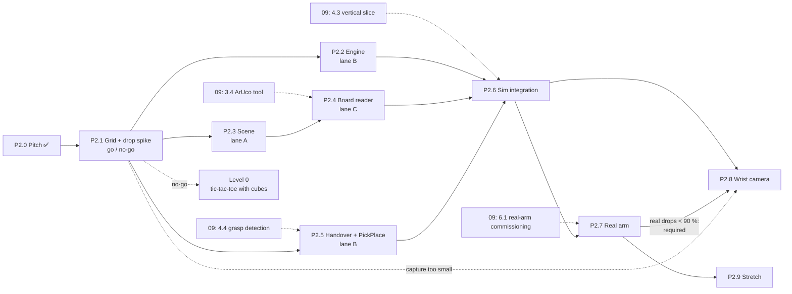

# P2-04 — Phase-2 roadmap (Connect Four)

> Author: [CP] Project lead · Reviewers: all experts
> Same rules as the phase-1 roadmap [`../09_roadmap_step_by_step.md`](../09_roadmap_step_by_step.md), which this document details for its stage 7: **no dates**, the logical order of work, every step ends with **evidence** ("Done when"), the riskiest part first, sim before the real arm. Lanes as in `09` §1.2: **A** driver, infra and hardware · **B** kinematics and brain · **C** perception.
> Tickets: `P2.<step><letter>` (P2.1a, P2.1b…), one PR each, under the stage-7 epic (`../15` §12) · Decisions: ADR-034 to ADR-038 · Risks and tests: [`P2-03`](P2-03_plan_risks_tests.md) · Targets `P2-xx`: [`P2-01`](P2-01_scope_and_demo.md) §4

## 1. Overview

| Step | Lane | Outcome | Level reached (`P2-01` §2) |
| --- | --- | --- | --- |
| **P2.0** Pitch ✅ | CP | Validated by the teaching staff | — |
| **P2.1** Grid in hand + drop spike | Shared, B leads | Purchased grid measured; go / no-go on dropping | Go: 1 is possible; no-go: 0 |
| **P2.2** Game engine | B | `game.py` tested | — |
| **P2.3** Scene and loading | A | Connect Four scene in sim, sim services | — |
| **P2.4** Board reader | C | Grid read from the camera | — |
| **P2.5** Token in the gripper + `PickPlace` | B | Handover and drop through the brain | — |
| **P2.6** Sim integration | Shared | Full games in sim | **1** |
| **P2.7** Real arm | Shared, A leads | Full games on the real arm, filmed | **2** |
| **P2.8** Wrist camera (staff suggestion) | A hardware, C perception, B correction | Look and correct before the release | 2, more reliable |
| **P2.9** Stretch | Anyone | One or two bonus features | **3** |

### 1.1 Dependencies

**Critical path**: P2.1 → P2.5 → P2.6 → P2.7. P2.1 can start **now** (it uses ikpy and MuJoCo directly, no phase-1 node); P2.6 needs the phase-1 vertical slice (`09` 4.3); P2.7 needs the real-arm commissioning (`09` 6.1). Phase 2 must not slow phase 1 down (P2-R-04): before 4.3, only P2.1 and P2.2.

### 1.2 Who does what

| Lane | Steps | Note |
| --- | --- | --- |
| A — Driver, infra, hardware | P2.3, P2.7 (lead), P2.8 hardware | Riser, depth guide, jig, cameras |
| B — Kinematics and brain | P2.1 (lead), P2.2, P2.5, P2.7 handover tuning, P2.8 correction | `drop_ik`, handover, action |
| C — Perception | P2.4, P2.7 grid webcam, P2.8 measurement | Grid reading, wrist-camera offset |
| Shared | P2.6, P2.7, P2.9 | Everyone plays at least one real game before the defense (C-50) |

---

### Step P2.0 — Pitch validated ✅ (ticket 7.1a)

- **Done**: validated by the teaching staff on 2026-10-09 (ADR-034). Questions of `P2-03` §4 still open.

### Step P2.1 — Grid in hand and drop spike (tickets P2.1a, P2.1b)

- **Goal**: know before building anything whether the arm can drop a token into the real grid.
- **Tasks**
  - [ ] Buy a classic Connect Four (7 × 6). Measure with a caliper: column pitch, slot gap, token diameter and thickness, slot-entry height above the table, shape of the column wall tops, footprint of the feet. Photos in the ticket.
  - [ ] Put the measurements in `experiences/exp_connect4_kinematics.py` (MES-28 / MES-32 block): riser height, grid start radius, clearance with the link thickness counted.
  - [ ] Spike script `experiences/exp_connect4_drop.py`: minimal scene generated with `MjSpec` (one column of the measured grid, depth guide, riser, ADR-036 update), token placed between the jaws with a random handover offset (±3 mm along the grid, ±5 mm in depth), `drop_ik` pose, release above the guide.
  - [ ] 100 drops without offset, 100 with a random TCP offset of ±5 mm; an offset sweep along the grid gives the capture; jammed tokens counted.
- **Done when**: grid dimensions and spike results recorded as MES. **Go** if ≥ 95 % without offset and ≥ 80 % with ±5 mm. Capture too small: wrist camera (P2.8) in sim before going further. Still no-go: **level 0** with the same software.
- **Pitfalls**: thin tokens in narrow slots jitter in MuJoCo: tune `margin`, `solref` and the token mass before concluding (P2-R-05).

### Step P2.2 — Game engine (lane B)

- **Tasks**: the `so101_connect4` package with the guards extended to it; `game.py` (`P2-02` §4): bitboards, win detection, negamax with alpha-beta, move ordering, iterative deepening within 1 s; its unit tests; time per depth, 4 to 8.
- **Done when**: P2-04 met in CI (legal moves only, 100/100 against random, < 2 s per move).

### Step P2.3 — Scene and loading (lane A)

- **Tasks**
  - [ ] Scene generated with `MjSpec` from a copy of the provided one: base raised by the riser height, riser box, wrist camera on `gripper` (rendered only when `wrist_cam` is true), measured grid, depth guide, 21 + 21 tokens, ArUco markers, `board_cam` (ADR-036 and its update).
  - [ ] Loading next to the provided `_connect_arm` (ADR-036); phase-1 cube moved out of the play area.
  - [ ] Sim services `/sim/connect4/drop_token` and `/sim/connect4/give_token` (`P2-02` §6).
- **Done when**: driver tests still green; a launch file starts the Connect Four scene; a `drop_token` lands in the right cell and a `give_token` puts a token between the open jaws (integration tests, ground truth allowed in tests); the `HANDOVER` pose does not hide the grid from `board_cam`.

### Step P2.4 — Board reader (lane C)

- **Tasks**: `board.py` and `board_reader_node` (`P2-02` §3): grid pose from the ArUco markers, 42 cells classified, validation by the rules; synthetic and sim test sets.
- **Done when**: P2-01 met in sim (50 states, 100 % of the cells).

### Step P2.5 — Token in the gripper and `PickPlace` action (lane B)

- **Tasks**
  - [ ] `PickPlace` action in the brain on top of the phase-1 motions (ADR-037), pick mode `IN_GRIPPER` first (`POSE` kept for a rack or dispenser, P2.9); jaw-axis constraint with `drop_ik`; phase-1 `/brain/start` moved onto the same code path.
  - [ ] `/brain/set_gripper`: squeeze target just below the token thickness, held-token check by the gripper position (phase-1 grasp detection, `09` 4.4).
  - [ ] `HANDOVER` pose: reachable, out of `board_cam`'s view, comfortable for a hand.
  - [ ] Interface contract updated in `01` §3 with both owners' approval.
- **Done when**: phase-1 bench unchanged (no regression); 50 sim moves (`give_token` → `set_gripper` → `PickPlace`) at ≥ 95 % (P2-02); 10 trials without a token: always refused, the arm never moves.

### Step P2.6 — Sim integration (shared): level 1

- **Tasks**: `game_node` (state machine of `P2-02` §5, handover included), launch file, game bench (a scripted random human through `drop_token`, `give_token`, `token_given`, `human_done`), README section "Play against the sim robot".
- **Done when**: P2-06 sim part (≥ 8/10 full games) and P2-07 (a newcomer plays from a fresh clone) met; sim video recorded.

### Step P2.7 — Real arm (shared, lane A leads): level 2

- **Tasks**
  - [ ] Riser (rigid, about 8 cm; arm and riser clamped), placement jig (grid at the measured radius and azimuth, yaw within ±3°), depth guide on the grid, ArUco stickers.
  - [ ] Phase-1 commissioning again on the riser (`07` §3), calibration-zero check [MES-30].
  - [ ] Handover tuning: `HANDOVER` pose, squeeze target (the token holds through the move; a finger pulls out easily), closing speed. [SAFE] review before the first handover by someone outside the team.
  - [ ] Webcam facing the grid and its extrinsics (ArUco tool, ADR-013).
  - [ ] Real benches at low speed: 30 drops, 30 handovers, 20 board photos; then games against people.
- **Done when**: P2-01 to P2-03 real targets measured (met or explained); ≥ 3 full games filmed with the team (C-53). Drop bench < 90 %: P2.8 becomes required.

### Step P2.8 — Wrist camera (staff suggestion)

- **Tasks**
  - [ ] Hardware: 32×32 UVC module on the optional SO-ARM100 mount ("Wrist Cam Mount 32x32 UVC Module"), cable with slack for a ±90° wrist roll; the driver publishes `/wrist_cam/*` (sim: the camera of P2.3).
  - [ ] Perception: token present between the jaws and its offset along the grid; at the end of the descent, offset between the token and the column walls in millimeters (the token diameter gives the scale); offset message designed here.
  - [ ] Brain: look and correct (`P2-02` §3.1), one or two corrections, then release.
  - [ ] **Guide vs camera comparison**, real arm, 30 drops each, same columns and speed: guide only, camera only (guide removed), guide + camera. Result per configuration: success rate and causes of the misses.
- **Done when**: sim drop bench with ±10 mm TCP offset at ≥ 95 % with look and correct, measured against the same bench without it; the real comparison recorded as a MES. Configuration kept: the simplest one that reaches ≥ 90 %. If the camera alone does, the depth guide is removed (ADR-038 "reconsider if").
- **Pitfalls**: the sim arm has no gear backlash, so a sim camera-only result says nothing about the real arm. Only the real comparison decides.

### Step P2.9 — Stretch (optional): level 3

- **Tasks**: one or two features of `P2-02` §9, only after P2.7: difficulty levels; automatic detection of the human's move; robot commentary; a token rack or dispenser instead of the handover; continuous visual servoing.
- **Done when**: shown in a short clip; no regression on the benches.

## 2. Delivery

Phase 2 ends in `09` stage 8: phase-2 demo video with the team, phase-2 slides (the three-line pitch, the edge-on geometry [MES-27], the numbers of the benches), tag `v2.0.0`.
