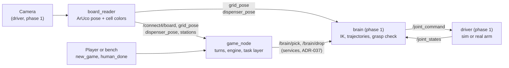

# Phase 2 — Connect Four against the robot

> Authors: [CP] Project lead, [KIN] Kinematics · Reviewers: all experts
> Requirements: C-54 · Decisions: ADR-034 to ADR-038, ADR-040 to ADR-042 · Measurements: MES-21, MES-27 to MES-32, MES-63 to MES-79 · Roadmap: [P2-04](P2-04_roadmap.md)

**Status: VALIDATED** by the teaching staff on 2026-10-09 (roadmap step 7.1, ADR-034). **`v2.0.0`, the hand-in of 2026-11-20 23:42, is the game in simulation; the real arm is `v2.1.0`** (ADR-034 Update). The design was measured on prototypes on 2026-11-07 ([`../experiences/connect4/`](../experiences/connect4/README.md)) and the drop spike on one layout is a go (#76). Implemented: the `so101_connect4` package with the engine, the turns and the grid layout, the drop pose `release_pose`, the game's sim scene with the simulated player's services, the `CONNECT4` mode (`CONNECT4=true tools/so101 up`), the board reader (`board.py`, `board_reader_node`), one move of the game through the brain (`/brain/drop`, `/brain/pick`, `/brain/handover`), the game node with the engine's three levels, the console (`tools/so101 play`) and the game bench (`tools/so101 bench --game`), with a game on each PR and ten each night, each game's columns and timings in its record, and the robustness demo of the game (`tools/so101 robustness g1` to `g6`). The player guide is the repository's README ("Play against the sim robot"), the results are in `results/phase2_2026-11-13.md`. The token dispenser of ADR-041 is in the scene and read by the camera (`/connect4/dispenser_pose`, `/connect4/stations`), and the robot takes its tokens there by itself (`/brain/pick`, `token_source: dispenser`; the handover stays as `token_source: hand`). Not yet: a game replayed from a fresh clone by a member who did not write it, target P2-07 ([`P2-04`](P2-04_roadmap.md) §3 gives the dates).

## 1. The pitch (check-in format [BOOT2 p16])

| | |
| --- | --- |
| **The idea** | A human plays Connect Four against the arm: the robot reads the grid with its camera, picks its move and drops its token into the right column. |
| **The tech** | Grid perception (ArUco pose + per-cell color classification), a game engine (negamax with alpha-beta pruning), a task layer that turns a move into a drop, precise drops into a vertical grid, turn-taking. |
| **The risk** | Dropping a token into a slot barely thicker than it. In sim, the thin contacts of the token are the hard part: the provided defaults lose it [MES-63]. Answer: a grid placed edge-on to the robot [MES-27], a depth guide across the slots, a round token that self-centers between the column walls, a measured contact set, and a spike with a go/no-go before anything else (`P2-04` step P2.1). On the real arm, the static error and the sag come on top (`P2-02` §8). |

## 2. Why this idea fits the workshop constraints ([BOOT2 p15])

| Constraint | How Connect Four meets it |
| --- | --- |
| 1 arm, 5 DoF + gripper | Every drop pose is reachable with a jaw-axis error of 1 to 3° if the grid is **edge-on** to the robot; a grid facing the robot is out of reach of a 5-DoF arm above 10 cm [MES-27] |
| Low payload | Game tokens, a few grams |
| Small workspace, a tabletop | A store-bought grid, the arm on a riser (10 cm in sim, `P2-02` §7): 7 columns between 14 and 36 cm from the pan axis, 6.3 cm of clearance or more [MES-32] |
| 1 camera + whatever you add | The phase-1 camera, unmoved, in sim [MES-65]; a webcam facing the grid on the real setup (`v2.1.0`) |
| Your code: ROS 2, sim first | Same ROS 2 stack, a `CONNECT4` mode next to phase 1; the sim in `v2.0.0`, the real arm in `v2.1.0` |
| Safety: near humans, slow | The arm only moves on the robot's turn, after an explicit "done" from the human. A person next to the arm is `v2.1.0`, with its findings (`P2-02` §8) |
| Feasible in a few weeks | The hard parts (driver, IK, perception, state machine, CI) come from phase 1; the game engine is a classic, well-bounded algorithm |
| Demonstrable on video | Understood in 3 seconds: a person playing a board game against a robot arm |
| A real robotics skill | Constrained IK on a 5-DoF arm, perception of a structured scene, task planning, human-robot interaction |

## 3. What phase 1 provides (C-54: "use the work made in phase 1")

| Phase-1 block | Reused for |
| --- | --- |
| Driver (`use_sim`, limiter, clamp, camera) | Loads the Connect Four scene and serves the simulated human (ADR-036) |
| Kinematics (`04`, ikpy, FK check, collision check) | Drop poses with the jaw axis normal to the grid (ADR-035) |
| Motion and grasp check (`06`) | Behind the `/brain/drop` service, `fsm.py` unchanged |
| HSV detection (ADR-011) | Classifying each cell: empty, human, robot |
| ArUco calibration (ADR-013) | `camera_extrinsics.yaml` reused as it is; marker detection for the grid pose (markers on the grid frame) |
| Safety layers (ADR-023) | Unchanged, plus "the arm only moves on its turn" |
| Tests, CI, guards, evaluation bench (`08`, `14`) | Same rules; a game on each PR, N games each night (`P2-03` §3.1) |

## 4. Documents of this folder

| Document | Content |
| --- | --- |
| [P2-01_scope_and_demo.md](P2-01_scope_and_demo.md) | Levels (minimum, target, stretch), demo scenario, measurable targets `P2-xx`, out of scope |
| [P2-02_design.md](P2-02_design.md) | Physical setup, kinematics, perception, game engine, turn-taking, software architecture and interfaces, the two phases on one branch, simulation, the real arm's findings |
| [P2-03_plan_risks_tests.md](P2-03_plan_risks_tests.md) | Risk register `P2-R-xx`, test and measurement plan, CI, questions for the staff |
| [P2-04_roadmap.md](P2-04_roadmap.md) | **Roadmap**: steps P2.0 to P2.9 with "Done when", lanes, the calendar to the hand-in and its cut-offs |

**Relation with the phase-1 documents**: this folder only describes what phase 2 **adds**. Shared registers stay in the parent folder: decisions in [`../adr/`](../adr/README.md) (ADR-034 to 038, 040 to 042), measurements in [`../11_cross_review_and_measurements.md`](../11_cross_review_and_measurements.md) (MES-27 to 32, MES-63 to 79, RC-39 to 44), terms in [`../12_glossary_references.md`](../12_glossary_references.md), scripts in [`../experiences/`](../experiences/README.md). Phase-2 identifiers carry a `P2-` prefix so they never collide with phase-1 ones (`P2-02` §3 is this folder, `02` §3 is the phase-1 environment document).

## 5. Key measurements

| Question | Answer | Source |
| --- | --- | --- |
| Can the arm hold a token in the plane of a grid **facing** it? | No: best jaw-axis error 40–62° at 22–30 cm high, 17–23° at 14 cm | [MES-27] |
| And in a grid placed **edge-on** (its plane contains the pan axis)? | Yes: 1–3° over r = 14–36 cm, z = 6–34 cm (4–8° only close to the base, high up) | [MES-27] |
| Does the arm clear the top of the grid? | Store-bought grid (slots at 25 cm): 0.5 cm above the far column with the arm on the table; **6.3 cm or more with the arm on an 8 cm riser** | [MES-28], [MES-32] |
| Best way to compute a drop pose? | Roll +1.6195 rad, tilt 70°, target = the token centre: jaw error under 0.03°, 10–36 ms, all 7 columns. The first pose, TCP on the slot plane, dropped 0 of 28 | [MES-64] |
| Is ikpy enough, or is Pinocchio needed? | ikpy, fine for a turn-based game | [MES-21], [MES-64] |
| Can the camera read the grid? | The phase-1 camera, unmoved, at 640×480: 2100 of 2100 cells on 50 boards, grid pose within 0.8 mm across | [MES-65] |
| Does the reader hold on the game's scene? | Yes: 2100 of 2100 cells on 50 game states, the grid's pose within 0.7 mm of the scene's | [MES-68] |
| Does the brain play a move on the sim? | Yes: 50 tokens of 50 in their column through `/brain/drop`, held 50 of 50, empty jaws refused 10 of 10; a move lasts 11.5 to 17 s, 13 to 19 s before the legs back went faster | [MES-69], [MES-73] |
| Does a deeper search play better? | Only loosely: three depths are in order, easy 1, medium 4, hard 10 (hard beats medium 26 – 7, medium beats easy 28 – 2) | [MES-70] |
| Does a whole game run on the stack? | Yes: 10 games of 10 against a random person, 2 of 2 against the engine; no token lost in 80 drops, the arm still during each person's turn | [MES-71] |
| Where does a game's time go? | The arm: a robot's turn is 21 s of move (a pick 8 to 12 s, a drop 11.5 to 17 s), 0.2 s of search and 0.4 s of reading | [MES-72], [MES-73], [MES-77] |
| Can the arm take its tokens by itself? | Yes: 50 of 50 taken at the dispenser and dropped, 20 games of 20 with the poses the camera measures | [MES-75] to [MES-77] |
| What if the grid is set down elsewhere? | The brain judges each move where the camera sees it: played 1 cm nearer or carried around the arm, refused 2 cm nearer (the shoulder 2 mm from a post) or turned 1.5° out of the arm's plane | [MES-78], [MES-79] |
| Do tokens behave in sim? | With a measured contact set: 378 drops of 378, full stacks, held up to 1.5 rad/s, the tick unchanged. With the provided defaults: lost | [MES-63] |
| Does the running driver hold the scene? | Yes: tick p99 21.5 ms and the image at 10 Hz in 640×480 while 42 tokens fall, 42 of 42 in their cell | [MES-67] |
| Is the engine strong enough? | Depth 10 to 12 in 1 s in pure Python, 100/100 against random | [MES-66] |
