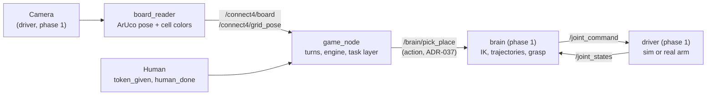

# Phase 2 — Connect Four against the robot

> Authors: [CP] Project lead, [KIN] Kinematics · Reviewers: all experts
> Requirements: C-54 · Decisions: ADR-034 to ADR-038 · Measurements: MES-21, MES-27 to MES-32 · Roadmap: [P2-04](P2-04_roadmap.md)

**Status: VALIDATED** by the teaching staff on 2026-10-09 (roadmap step 7.1, ADR-034). Nothing is implemented yet; the next step is buying and measuring a store-bought grid, then the drop spike ([`P2-04`](P2-04_roadmap.md) step P2.1). Every number below comes from a reproducible kinematics or geometry measurement.

## 1. The pitch (check-in format [BOOT2 p16])

| | |
| --- | --- |
| **The idea** | A human plays Connect Four against the arm: the robot reads the grid with its camera, picks its move and drops its token into the right column. |
| **The tech** | Grid perception (ArUco pose + per-cell color classification), a game engine (negamax with alpha-beta pruning), a task layer that turns a move into a pick & place, precise drops into a vertical grid, human turn-taking. |
| **The risk** | Dropping a token into a slot barely thicker than it, with an arm whose real accuracy target is 1 cm. Answer: a grid placed edge-on to the robot [MES-27], a depth guide across the slots, a round token that self-centers between the column walls, a wrist camera for the last millimeters (staff suggestion), and a sim spike with a go/no-go before anything else (`P2-04` step P2.1). |

## 2. Why this idea fits the workshop constraints ([BOOT2 p15])

| Constraint | How Connect Four meets it |
| --- | --- |
| 1 arm, 5 DoF + gripper | Every drop pose is reachable with a jaw-axis error of 1 to 3° if the grid is **edge-on** to the robot; a grid facing the robot is out of reach of a 5-DoF arm above 10 cm [MES-27] |
| Low payload | Game tokens, a few grams |
| Small workspace, a tabletop | A store-bought grid, the arm on an 8 cm riser: 7 columns between 14 and 36 cm from the pan axis, 6.3 cm of clearance or more [MES-32] |
| 1 camera + whatever you add | The phase-1 camera (sim); one webcam facing the grid on the real setup; a wrist camera (staff suggestion) |
| Your code: ROS 2, sim first | Same ROS 2 stack, sim scene first, real arm last |
| Safety: near humans, slow | The arm only moves on the robot's turn, after an explicit "done" from the human; at the handover the arm stays still and the gripper closes slowly with a small squeeze; phase-1 speed limits |
| Feasible in a few weeks | The hard parts (driver, IK, perception, state machine, CI) come from phase 1; the game engine is a classic, well-bounded algorithm |
| Demonstrable on video | Understood in 3 seconds: a person playing a board game against a robot arm |
| A real robotics skill | Constrained IK on a 5-DoF arm, perception of a structured scene, task planning, human-robot interaction |

## 3. What phase 1 provides (C-54: "use the work made in phase 1")

| Phase-1 block | Reused for |
| --- | --- |
| Driver (`use_sim`, limiter, clamp, camera) | Unchanged; loads the Connect Four scene in sim (ADR-036) |
| Kinematics (`04`, ikpy, multi-start, FK check) | Drop and pick poses with the jaw axis normal to the grid (ADR-035) |
| Grasp strategy and state machine (`06`) | Behind the `PickPlace` action: approach, descent, grasp, transport, release, verify |
| HSV detection (ADR-011) | Classifying each cell: empty, human, robot |
| ArUco calibration (ADR-013) | Camera extrinsics **and** the grid pose (markers on the grid frame) |
| Safety layers (ADR-023), real-arm commissioning (`07`) | Unchanged, plus "the arm only moves on its turn" |
| Tests, CI, guards, evaluation bench (`08`, `14`) | Same rules; the bench plays N games instead of N pick & place cycles |

## 4. Documents of this folder

| Document | Content |
| --- | --- |
| [P2-01_scope_and_demo.md](P2-01_scope_and_demo.md) | Levels (minimum, target, stretch), demo scenario, measurable targets `P2-xx`, out of scope |
| [P2-02_design.md](P2-02_design.md) | Physical setup, kinematics, perception, game engine, turn-taking, software architecture and interfaces, simulation, real arm |
| [P2-03_plan_risks_tests.md](P2-03_plan_risks_tests.md) | Risk register `P2-R-xx`, test and measurement plan, questions for the staff |
| [P2-04_roadmap.md](P2-04_roadmap.md) | **Roadmap**, no dates: steps P2.0 to P2.9 with "Done when", dependencies on the phase-1 roadmap (`../09`), lanes |

**Relation with the phase-1 documents**: this folder only describes what phase 2 **adds**. Shared registers stay in the parent folder: decisions in [`../adr/`](../adr/README.md) (ADR-034 to 038), measurements in [`../11_cross_review_and_measurements.md`](../11_cross_review_and_measurements.md) (MES-27 to 32, RC-39 to 44), terms in [`../12_glossary_references.md`](../12_glossary_references.md), scripts in [`../experiences/`](../experiences/README.md). Phase-2 identifiers carry a `P2-` prefix so they never collide with phase-1 ones (`P2-02` §3 is this folder, `02` §3 is the phase-1 environment document).

## 5. Key measurements

| Question | Answer | Source |
| --- | --- | --- |
| Can the arm hold a token in the plane of a grid **facing** it? | No: best jaw-axis error 40–62° at 22–30 cm high, 17–23° at 14 cm | [MES-27] |
| And in a grid placed **edge-on** (its plane contains the pan axis)? | Yes: 1–3° over r = 14–36 cm, z = 6–34 cm (4–8° only close to the base, high up) | [MES-27] |
| Does the arm clear the top of the grid? | Store-bought grid (slots at 25 cm): 0.5 cm above the far column with the arm on the table; **6.3 cm or more with the arm on an 8 cm riser** | [MES-28], [MES-32] |
| Best way to compute a drop pose? | Wrist roll locked at ±90°, position IK on the other 4 joints: every reachable target (81 % of the map); ikpy `orientation_mode="X"`: 11 % | [MES-29] |
| Is ikpy enough, or is Pinocchio needed? | ikpy: 0.26 s median per drop pose, 2 poses per move, fine for a turn-based game; the wrist camera does one or two corrections, not continuous servoing | [MES-21], [MES-29] |
| Can the camera read the grid? | Phase-1 camera: 7.7 × 6.3 px per cell at 320×240; a camera facing the grid at 45 cm: 13 px (24 mm pitch; a store-bought grid gives about 1.5 times more) | [MES-31] |
