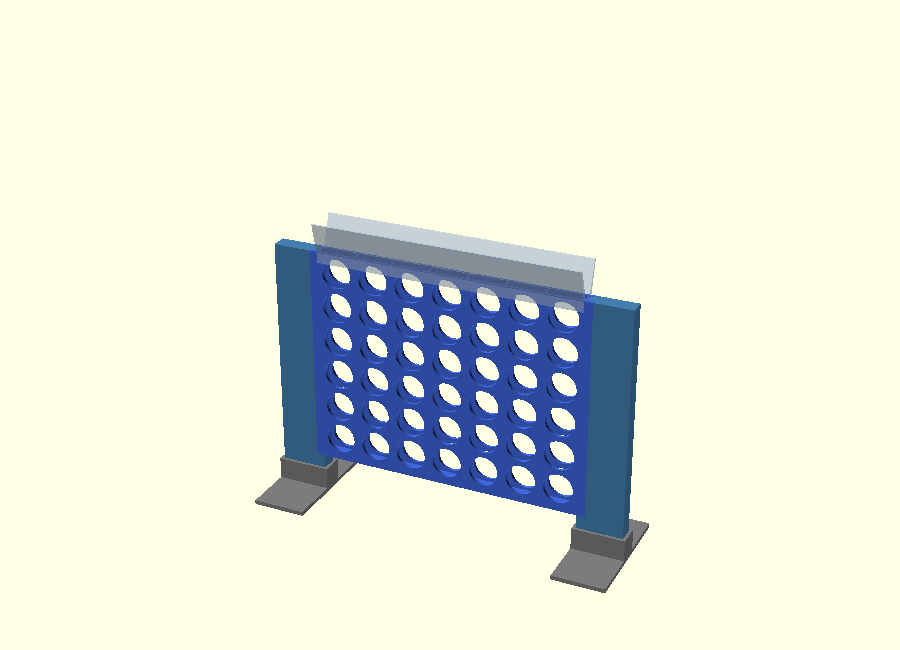
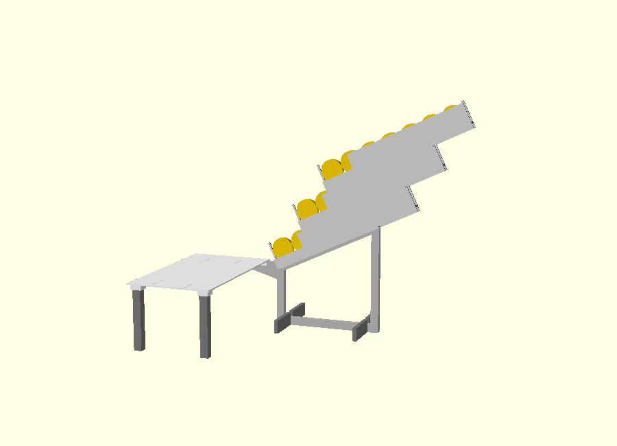

# The Connect Four parts to print

OpenSCAD sources of the game's parts, **with the simulation's dimensions**: every number is the one of
[`connect4_grid.yaml`](../../ros2_ws/src/so101_connect4/config/connect4_grid.yaml), the file the scene, the
board reader and the brain read. A printed grid, its tokens and its dispenser are then the ones the tests and
the benches of `v2.0.0` ran on (ADR-038, ADR-041, `docs/project/phase2/P2-02` §1 and §7).

**Status: compiled, never printed.** Each part compiles to an STL with OpenSCAD 2021.01 and has the size below.
Nothing was printed, assembled or tried with the arm: that is #248, one column of the grid first.

 

## Files

| File | What |
| --- | --- |
| `dimensions.scad` | The YAML's values in mm and degrees, one name per YAML path. `tools/ci/check_scad_dimensions.py` (pre-commit) fails when one differs: change the YAML first, then this file |
| `token.scad` | A token |
| `grid.scad` | The grid: two plates with their windows, the walls and the floor, the two posts that carry the markers, their feet, the depth guide |
| `dispenser.scad` | The dispenser of ADR-041: three rails that stack, their stand and its feet, the marker plate and its legs |

Open a file in OpenSCAD to see the assembly. To export a part, set `part` (Customizer, or the command line), render (F6) and export the STL:

```bash
openscad -o grid_back_0-3.stl -D 'part="back"' -D first=0 -D last=3 hardware/connect4/grid.scad
```

## Parts

Sizes are the part as it lies on the bed.

| Part | `part` | Count | Size (mm) | On the bed |
| --- | --- | --- | --- | --- |
| Token | `token.scad` | 21 red, 21 yellow | Ø 34 × 6.5 | Flat |
| Grid, back plate with the walls and the floor | `back` | 1 | 275 × 212 × 12.5 | The plate down, the walls up |
| Grid, front plate | `front` | 1 | 275 × 212 × 3 | Flat |
| Grid, post | `post`, then with `far=true` | 2 | 45 × 250 × 15.5 | On its back, the markers' outlines up |
| Grid, foot | `foot` | 2 | 52 × 120 × 25 | Flange down |
| Grid, depth guide strip | `guide` | 2 | 259 × 40 × 12 | On its skirt |
| Dispenser, rail | `rail` | 3 | 245 × 13.5 × 44 | On its two skirts: the floor bridges 9.5 mm |
| Dispenser, stand | `stand` | 1 | 223 × 170 × 11 | Flat, its nub up |
| Dispenser, stand foot | `stand_foot` | 2 | 6 × 120 × 20 | On edge, as it stands |
| Dispenser, marker plate | `marker_plate` | 1 | 129 × 226 × 10 | Its top face down |
| Dispenser, plate leg | `leg` | 2 | 98 × 12 × 12 | Lying |

- **A bed under 275 mm**: print each grid plate and each guide strip in two pieces with `first` and `last`
  (the columns kept, 0 to 6), for instance 0–3 then 4–6. The cut is in the middle of a wall; the two pieces are
  glued on the tongues of the posts and on each other. The marker plate needs 226 mm, the posts 250 mm.
- **One column first** (#248): `-D 'part="back"' -D first=0 -D last=0`, the same for `front`. A channel is
  34.8 mm for a 34 mm token: a token must fall through it 10 times of 10 before the rest is printed.
- **A token weighs 4 g in the simulation**; solid PLA gives about 7 g: print at about 50 % infill and weigh one.

## Assembly

1. **Grid.** Glue the front plate on the walls of the back plate. Each post has a tongue that goes between the
   two plates, 8 mm deep: glue it. The plates stand on the posts' steps, their floor 38 mm above the table.
   Glue a guide strip on the top edge of each plate, its skirt on the plate's outer face. Each post's bottom
   goes through a foot.
2. **Markers** (paper, ids and size in the YAML): the grid's four go on the outlines engraved on the front
   face of the posts, the dispenser's four on the outlines of its marker plate.
3. **Dispenser.** The stand's two feet cross it in its notches. The lowest rail sits astride the stand, the
   notch of one of its skirts on the stand's nub. Each next rail stands on the walls of the one below, its
   notches on the nubs at that rail's end: it is then 40 mm further out and 62.8 mm higher. Glue them. The
   marker plate lies on the stand's arm, between its two ribs, and on its two legs.
4. The lowest station's token is then 120 mm above the table: 20 mm above the arm's base on its 100 mm riser
   (`placement.riser`, `dispenser.placement.station_z`).

## Not in these files

- **The riser** under the arm, 100 mm: its footprint is the arm's base, to measure on the arm (#248).
- **Jaw pads** (#90), the **placement jig** and the clamps (#88), the **wrist camera's mount** (the staff's
  STL, ADR-038).
- The markers themselves: printed on paper at 100 %.

## To check before a long print

- **The near foot against the riser**: the first post stands 77 to 122 mm from the shoulder_pan axis and its
  foot is 120 mm across the grid (`foot_length`).
- **The stop's fin** at each station is the simulation's, 2 mm wide and 3 mm long: fragile. `stop_brace`
  makes it longer towards the arm; that shape was never tried with the gripper.
- **The dispenser's balance**: its rails reach about 130 mm behind the stand. Clamp or tape the stand,
  as the arm and its riser are.
- **Clearances**: `clearance` (0.3 mm) between parts that slide into each other, for a printer's accuracy.
- A printed part measured differently from the YAML: the YAML changes, and the simulation's tests run again
  (#248).
